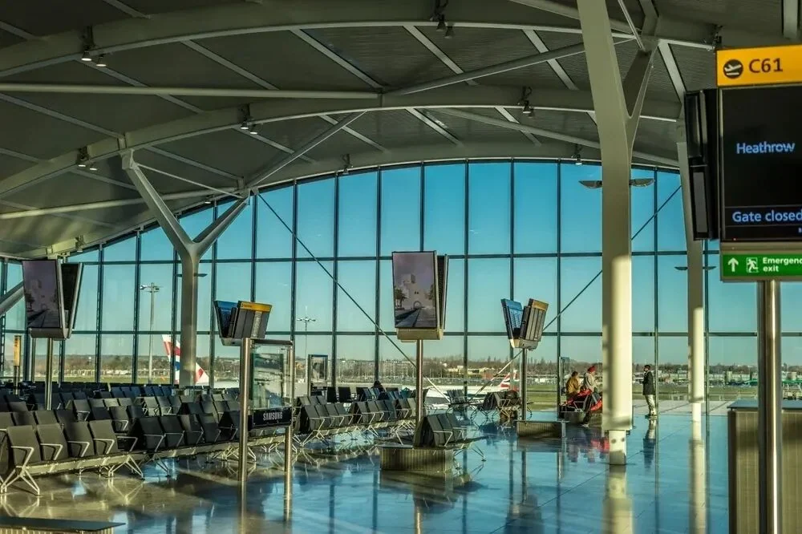

Skytrax世界空港アワード2026が発表され、ロンドン・ヒースロー（LHR）は再び世界ランキングで英国最高位の空港となりました。世界16位で前年から6位上昇、欧州では8位です。さらに「世界最高の空港ショッピング」部門賞も受賞しました。

トップ100に入った英国の空港は、ロンドン・ガトウィック（LGW）の30位だけです。こちらも6位上昇しました。ロンドンの2空港がそろって6位ずつ順位を上げたことが、今年の英国の成績のすべてです。この記事では、ヒースローの2つの結果、2026年のトップ10、そして空港を選ぶときにこのランキングが実際どれほど役立つかを考えます。

## 1. ヒースロー：世界16位、英国1位、欧州8位

まず数字から見ましょう。世界16位で6位上昇、欧州の空港では8位、英国では最高位です。混雑と乗り継ぎの悪さを旅行者から日常的に批判される老舗ハブにとって、華々しい結果ではありませんが、正しい方向への動きではあります。

Skytraxの賞は1999年から毎年実施され、100か国以上、575以上の空港で乗客アンケートをもとにしています。旅行者は旅を項目ごとに評価します。空港へのアクセスのしやすさ、チェックイン施設、ショップやレストランの選択肢、スタッフの親切さ、手荷物の扱いなどです。建築賞ではなく、到着から出発までの一連の流れを項目ごとに採点したものです。

ヒースローの改善を、特定の新しい建物に帰するのは難しいでしょう。4つのターミナルはすべて何年も稼働しており、ターミナル5は2008年に開業したものです。より有望な説明は運営の安定性です。保安検査の列、手荷物ベルト、案内表示は毎年採点され、数週間の悪い時期を避けられた空港は、ある程度スコアを取り戻す傾向があります。

## 2. ショッピング部門：345店舗とブランド一覧

今年ヒースローが部門賞を獲得した決め手は、実際には小売です。4つのターミナル全体で345以上の小売店・飲食店があり、ユニオンジャックのお土産や旅先で読む文庫本から、旅の終わりに会う人への直前の贈り物までそろっています。

高級路線ではBurberry、Bulgari、Harrods、Fortnum & Mason、Prada。日常使いではBoots、JD Sports、Accessorize、WHSmithに加え、昨夏に登場したMarks & Spencerがあります。子ども連れの家族が余分に20分費やしがちなHamleysのおもちゃ店もあります。

この一覧は、トロフィー以上に多くを語っています。ヒースローの小売構成は市場の両端で機能しています。免税品と高級品は旅客一人あたりの支出を押し上げ、BootsやWHSmithは旅行者が実際に立ち寄る店です。ほとんどの乗客にとって「ショッピング体験」とは後者ですが、空港にとって小売収入の上限を決めるのは前者です。

## 3. フレイザー・ブラウン：最も制約の厳しい空港の一つで小売を展開

ヒースローの小売部門ディレクター、フレイザー・ブラウン氏は、2つの賞を乗客による直接投票という事実に結びつけました。「Skytraxの『世界最高の空港ショッピング』賞を受賞し、世界最高の空港の一つに選ばれたことは、ヒースローのすべてのスタッフにとって大きな誇りです」と同氏は述べています。「これらの賞は乗客が直接投票するもので、その評価は私たちが日々目にしていることの証です。世界で最も運営上の制約が厳しい空港環境の一つの中で、私たちのチームは世界水準の小売体験を提供しています」

この発言で注目すべき点は2つあります。1つは「乗客による直接投票」で、これはSkytraxの仕組みを反映しており、ショッピング賞と総合ランキングが連動して動く理由でもあります。もう1つは「運営上の制約」です。ヒースローには滑走路が2本しかなく、スロットも極めて厳しく組まれているため、日中に自由に建設することはできず、既存のターミナルの中に小売を収める必要があります。

旅行者にとってこれは、ヒースローのショッピングの優位が一度の改装で消える可能性は低い一方、コンコースが突然広くなることも期待できないという意味です。滑走路付きの新しいショッピングセンターではなく、固定された枠の中で限界近くまで追い込まれた商業運営なのです。

## 4. 2026年のトップ10

トップ10を見ると、英国の位置づけがより明確になります。以下の順位は、主催者が2026年として公表したものです。

| 順位 | 空港 |
| --- | --- |
| 1 | シンガポール・チャンギ |
| 2 | ソウル・仁川 |
| 3 | 東京羽田 |
| 4 | 香港国際 |
| 5 | 東京成田 |
| 6 | パリ＝シャルル・ド・ゴール |
| 7 | ローマ・フィウミチーノ |
| 8 | イスタンブール |
| 9 | ミュンヘン |
| 10 | バンクーバー |

トップ10以下にも注目すべき順位があります。ヘルシンキ＝ヴァンターが11位、ドバイが13位、ウィーンが15位、アムステルダム・スキポールが17位、チューリッヒが19位。続いてメルボルンが21位で、今年のオーストラリア・太平洋地域最優秀空港です。台湾・桃園が24位、関西が25位。トップ100で英国を代表するのはヒースローとガトウィックだけです。

目立つ名前が1つ欠けています。昨年2位だったドーハのハマド国際空港が、今年のトップ30のどこにも現れません。オーストラリアのメディア報道によると、カタール周辺の中東空域が現在の紛争で閉鎖されたため、直前に辞退したといいます。上位の顔ぶれがいつもと違うのはそのためです。

## 5. ガトウィック30位：英国の2枠目

ガトウィックは今年30位で、こちらも6位上昇しました。ヒースローとは役割が異なります。ヒースローがロンドンの長距離路線の大半を担うのに対し、ガトウィックは短距離のレジャー路線と格安航空会社に依存しています。南北ターミナル間の移動と、ロンドン中心部へのガトウィック・エクスプレスが、乗客が最もよく口にする2つのポイントです。

ロンドン南部に住む旅行者にとって、ガトウィックはしばしばより実用的な選択です。ターミナルが小さく、歩く距離が短く、駅も到着口から数分です。6位上昇は、こうした小規模空港の便利さが乗客アンケートで実際に評価されていることを示しています。

## 6. ランキングの読み方

第一に、部門賞は総合順位よりも役に立ちます。今年はショッピングがヒースロー、食事と入国審査がチャンギ、保安が香港国際、地域賞がメルボルンというように、それぞれが抽象的な「品質」ではなく具体的なニーズに対応しています。

第二に、順位の変動は母集団の大きさと合わせて読むべきです。6位は大きく聞こえますが、トップ30内の差は通常わずかで、1回の調査サイクルで数順位動くこともあります。信頼できるシグナルは、何年も同じ帯にとどまる空港です。

第三に、ランキングを基準に旅を計画しないことです。個々の旅では、時刻表、ターミナル、入国審査の列、地上交通のほうが、リスト上の順位よりはるかに重要です。「世界16位」だからという理由で乗り継ぎにヒースローを選んでも、滑走路2本の空港で混雑時間帯に荷物を待つことになれば、ほとんど助けにはなりません。

## 関連リンク

- **このサイト内**：[ロンドン・ヒースロー（LHR）](/airport/LHR)、[ロンドン・ガトウィック（LGW）](/airport/LGW)、[イギリス（GB）](/country/GB)
- **Wikipedia**：[ヒースロー空港](https://en.wikipedia.org/wiki/Heathrow_Airport)、[ガトウィック空港](https://en.wikipedia.org/wiki/Gatwick_Airport)
- **百度百科**：[ヒースロー空港](https://baike.baidu.com/item/%E5%B8%8C%E6%80%9D%E7%BD%97%E6%9C%BA%E5%9C%BA)、[ガトウィック空港](https://baike.baidu.com/item/%E7%9B%96%E7%89%B9%E5%A8%81%E5%85%8B%E6%9C%BA%E5%9C%BA)

画像出典：UK Campus。賞の名称、順位、評価基準はSkytraxの発表によるものです。現在の店舗、ターミナル、交通の状況はヒースローとガトウィックの公式サイトで確認してください。
