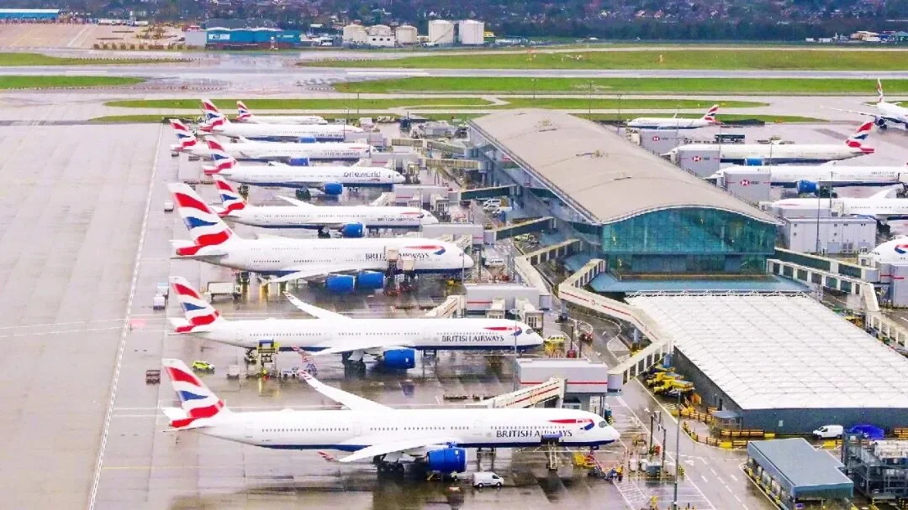

Opublikowano wyniki Skytrax World Airport Awards 2026, a londyńskie Heathrow (LHR) ponownie jest najwyżej sklasyfikowanym brytyjskim lotniskiem na światowej liście: 16. na świecie, o sześć miejsc wyżej niż rok temu, i ósme w Europie. Zdobyło też nagrodę w kategorii World's Best Airport Shopping.

Jedynym innym brytyjskim lotniskiem w pierwszej setce jest londyńskie Gatwick (LGW) na 30. miejscu, również o sześć miejsc wyżej. Dwa londyńskie lotniska i dwa awanse o sześć pozycji to cały tegoroczny dorobek Wielkiej Brytanii. W tym artykule przyglądamy się dwóm wynikom Heathrow, publikujemy pierwszą dziesiątkę 2026 roku i zastanawiamy się, ile ten ranking jest naprawdę wart, gdy wybierasz lotnisko.

## 1. Heathrow: 16. na świecie, pierwsze w Wielkiej Brytanii, ósme w Europie

Zacznijmy od liczby. Szesnaste miejsce na świecie, awans o sześć pozycji; ósme wśród europejskich lotnisk; najlepsza brytyjska lokata. Jak na ustabilizowany węzeł, który podróżni regularnie krytykują za tłok i przeciętne połączenia, to nie jest spektakularny wynik, ale ruch we właściwym kierunku.

Nagrody Skytrax przyznawane są corocznie od 1999 roku i opierają się na ankietach wśród pasażerów na ponad 575 lotniskach w ponad 100 krajach. Podróżni oceniają podróż etapami: jak łatwo dotrzeć na lotnisko, infrastrukturę odprawy, wybór sklepów i restauracji, życzliwość personelu i sprawność obsługi bagażu. To nie konkurs architektoniczny; to cały łańcuch od przyjazdu do odlotu, oceniany punkt po punkcie.

Poprawę Heathrow trudno przypisać jednemu nowemu budynkowi. Wszystkie cztery terminale działają od lat, a Terminal 5 otwarto już w 2008 roku. Bardziej prawdopodobne wyjaśnienie to stabilność operacyjna: kolejki do kontroli bezpieczeństwa, taśmy bagażowe i oznakowanie są oceniane co roku, a lotnisko, które unika kilku złych tygodni, zwykle odzyskuje część punktów.

## 2. Najlepsze pod względem zakupów: 345 punktów i lista marek

To, co w tym roku naprawdę przyniosło Heathrow nagrodę w kategorii, to handel detaliczny. Na czterech terminalach lotnisko ma ponad 345 punktów sprzedaży detalicznej, gastronomii i napojów — od pamiątek z Union Jackiem i książki w miękkiej oprawie na basen po prezent na ostatnią chwilę dla kogoś na drugim końcu podróży.

W segmencie luksusowym są Burberry, Bulgari, Harrods, Fortnum & Mason i Prada; na co dzień — Boots, JD Sports, Accessorize i WHSmith, a od zeszłego lata także Marks & Spencer. Jest też sklep z zabawkami Hamleys, w którym rodziny podróżujące z dziećmi zwykle tracą dodatkowe dwadzieścia minut.

Ta lista mówi więcej niż sama statuetka. Mieszanka handlowa Heathrow działa na obu końcach rynku: duty-free i luksus podnoszą wydatki na pasażera, a Boots i WHSmith to sklepy, do których podróżni faktycznie wchodzą. Dla większości pasażerów „doświadczenie zakupowe” oznacza tę drugą grupę; dla lotniska pierwsza grupa wyznacza pułap przychodów z handlu.

## 3. Fraser Brown: handel detaliczny na jednym z najbardziej ograniczonych lotnisk

Dyrektor ds. handlu detalicznego Heathrow, Fraser Brown, odniósł obie nagrody do faktu, że pasażerowie głosują bezpośrednio. „Zdobycie nagrody Skytrax w kategorii World's Best Airport Shopping i znalezienie się w gronie najlepszych lotnisk świata to powód do ogromnej dumy dla wszystkich w Heathrow” — powiedział. „O tych nagrodach decydują bezpośrednio pasażerowie, a to wyróżnienie potwierdza to, co widzimy codziennie: nasze zespoły zapewniają światowej klasy doświadczenia zakupowe w jednym z najbardziej ograniczonych operacyjnie środowisk lotniskowych na świecie”.

W tej wypowiedzi warto zwrócić uwagę na dwie rzeczy. Pierwsza to „bezpośrednio przez pasażerów”, co odzwierciedla sposób działania Skytrax i wyjaśnia, dlaczego nagroda za zakupy i ogólny ranking zwykle idą w parze. Druga to „ograniczone operacyjnie”: Heathrow ma tylko dwa pasy startowe i brutalnie napięty harmonogram slotów, więc nie może budować według woli w ciągu dnia i musi upchać handel w istniejących terminalach.

Dla podróżnych oznacza to, że przewaga Heathrow w zakupach raczej nie zniknie po jednym remoncie, ale nie licz też, że hale nagle się poszerzą. To komercyjna operacja doprowadzona blisko granic możliwości w stałych ramach, a nie nowe centrum handlowe z doczepionym pasem startowym.

## 4. Pierwsza dziesiątka 2026 roku

Zestawienie pierwszej dziesiątki jaśniej pokazuje pozycję Wielkiej Brytanii. Poniższe miejsca są zgodne z publikacją organizatora za 2026 rok.

| Miejsce | Lotnisko |
| --- | --- |
| 1 | Singapur Changi |
| 2 | Seul Incheon |
| 3 | Tokio Haneda |
| 4 | Hongkong |
| 5 | Tokio Narita |
| 6 | Paryż Charles de Gaulle |
| 7 | Rzym Fiumicino |
| 8 | Stambuł |
| 9 | Monachium |
| 10 | Vancouver |

Poniżej pierwszej dziesiątki kilka miejsc wartych uwagi: Helsinki-Vantaa jest 11., Dubaj 13., Wiedeń 15., Amsterdam Schiphol 17., a Zurych 19.; dalej Melbourne na 21. — tegoroczne Best Airport in Australia-Pacific — Tajwan Taoyuan na 24. i Kansai na 25. W pierwszej setce Wielką Brytanię reprezentują tylko Heathrow i Gatwick.

Brakuje jednego znaczącego nazwiska: Hamad International w Dosze, ubiegłoroczny wicelider, nie pojawia się nigdzie w tegorocznej trzydziestce. Według doniesień australijskich mediów wycofało się w ostatniej chwili, ponieważ przestrzeń powietrzna na Bliskim Wschodzie wokół Kataru została zamknięta z powodu trwającego konfliktu — co wyjaśnia nietypowy kształt górnej części tabeli.

## 5. Gatwick na 30. miejscu: drugi brytyjski przedstawiciel w rankingu

Gatwick zajął w tym roku 30. miejsce, również awansując o sześć. Jego rola różni się od roli Heathrow: Heathrow obsługuje większość londyńskiego ruchu długodystansowego, a Gatwick opiera się na krótkodystansowych trasach wypoczynkowych i tanich liniach. Przesiadka między terminalami North i South oraz Gatwick Express do centrum Londynu to dwie rzeczy najczęściej wymieniane przez pasażerów.

Dla podróżnych mieszkających na południe od Londynu Gatwick jest często praktyczniejszym wyborem: terminal jest mniejszy, spacer krótszy, a stacja kolejowa kilka minut od przylotów. Awans o sześć miejsc sugeruje, że ta wygoda małego lotniska naprawdę liczy się w ankietach pasażerów.

## 6. Jak czytać ranking

Po pierwsze, nagrody kategorii są bardziej użyteczne niż ogólne miejsce. W tym roku zakupy wskazują na Heathrow, gastronomia i kontrola paszportowa na Changi, bezpieczeństwo na Hongkong, a tytuł regionalny na Melbourne; każda z nich odpowiada konkretnej potrzebie, a nie abstrakcyjnemu wyobrażeniu o jakości.

Po drugie, czytaj przesunięcia w kontekście wielkości stawki. Sześć miejsc brzmi dużo, ale różnice w pierwszej trzydziestce są zwykle niewielkie, a jeden cykl ankiet może przesunąć lotnisko o kilka pozycji. Trwałym sygnałem jest lotnisko, które przez lata pozostaje w tym samym przedziale.

Po trzecie, nie planuj podróży wokół rankingu. W każdej konkretnej podróży rozkłady, terminale, kolejki do kontroli paszportowej i transport naziemny znaczą znacznie więcej niż pozycja na liście. Wybór Heathrow na przesiadkę, bo jest „16. na świecie”, niewiele pomoże, jeśli w szczycie czekasz na bagaż na lotnisku z dwoma pasami startowymi.

## Powiązane linki

- **Na tej stronie**: [London Heathrow (LHR)](/airport/LHR), [London Gatwick (LGW)](/airport/LGW), [United Kingdom (GB)](/country/GB)
- **Wikipedia**: [Heathrow Airport](https://en.wikipedia.org/wiki/Heathrow_Airport), [Gatwick Airport](https://en.wikipedia.org/wiki/Gatwick_Airport)
- **Baidu Baike**: [Heathrow Airport](https://baike.baidu.com/item/%E5%B8%8C%E6%80%9D%E7%BD%97%E6%9C%BA%E5%9C%BA), [Gatwick Airport](https://baike.baidu.com/item/%E7%9B%96%E7%89%B9%E5%A8%81%E5%85%8B%E6%9C%BA%E5%9C%BA)

Źródło zdjęcia: UK Campus. Nazwy nagród, miejsca w rankingu i kryteria są zgodne z publikacją Skytrax; aktualne sklepy, terminale i rozwiązania transportowe sprawdź na stronach Heathrow i Gatwick.
