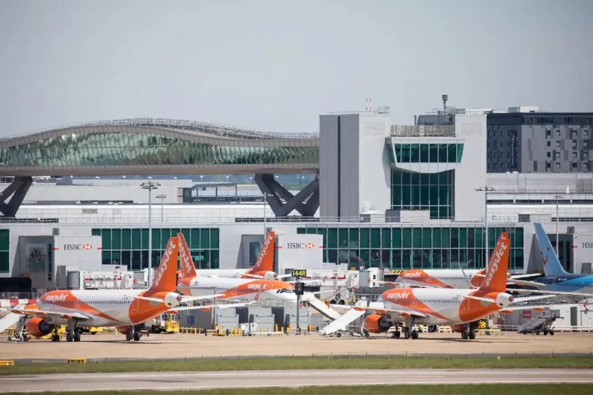

Au fost publicate Skytrax World Airport Awards 2026, iar aeroportul Heathrow din Londra (LHR) este din nou cel mai bine clasat aeroport britanic din lista mondială: locul 16 în lume, cu șase locuri mai sus față de anul trecut, și locul opt în Europa. A primit și premiul de categorie pentru World's Best Airport Shopping.

Singurul alt aeroport britanic din top 100 este Gatwick din Londra (LGW), pe locul 30, și el cu șase locuri mai sus. Două aeroporturi londoneze și două urcări de câte șase locuri formează întreaga prezență a Regatului Unit în acest an. Acest articol analizează cele două rezultate ale Heathrow, publică topul zece din 2026 și arată cât valorează de fapt clasamentul atunci când alegi un aeroport.

## 1. Heathrow: locul 16 mondial, primul în Regatul Unit, al optulea în Europa

Începe cu cifra. Locul șaisprezece în lume, cu șase locuri mai sus; al optulea între aeroporturile europene; cea mai bună poziție din Regatul Unit. Pentru un hub consacrat pe care călătorii îl critică în mod obișnuit pentru aglomerație și legături mediocre, nu este un rezultat spectaculos, dar este o mișcare în direcția bună.

Premiile Skytrax se acordă anual din 1999 și se bazează pe sondaje făcute printre pasagerii din peste 575 de aeroporturi din mai mult de 100 de țări. Călătorii notează călătoria pe componente: cât de ușor este de ajuns la aeroport, facilitățile de check-in, oferta de magazine și restaurante, cât de amabil este personalul și cât de bine sunt gestionate bagajele. Nu este un premiu de arhitectură; este întregul lanț de la sosire la plecare, punctat bucată cu bucată.

Îmbunătățirea Heathrow este greu de atribuit unei singure clădiri noi. Toate cele patru terminale funcționează de ani buni, iar Terminalul 5 s-a deschis încă din 2008. Explicația mai plauzibilă este stabilitatea operațională: cozile la securitate, benzile de bagaje și indicatoarele sunt notate în fiecare an, iar un aeroport care evită câteva săptămâni proaste tinde să recupereze o parte din punctaj.

## 2. Cel mai bun pentru cumpărături: 345 de magazine și o listă de branduri

Ceea ce i-a adus de fapt Heathrow premiul de categorie în acest an este retailul. În cele patru terminale, aeroportul are peste 345 de spații comerciale de retail, alimentație și băuturi, de la suveniruri cu Union Jack și o carte de buzunar pentru piscină până la un cadou de ultim moment pentru cineva de la celălalt capăt al călătoriei.

La capitolul de lux există Burberry, Bulgari, Harrods, Fortnum & Mason și Prada; pentru nevoile de zi cu zi există Boots, JD Sports, Accessorize și WHSmith, plus Marks & Spencer, care a sosit vara trecută. Există și un magazin de jucării Hamleys, unde familiile care călătoresc cu copii tind să piardă douăzeci de minute în plus.

Această listă spune mai mult decât trofeul. Mixul de retail al Heathrow funcționează la ambele capete ale pieței: partea duty-free și de lux ridică cheltuiala pe pasager, în timp ce Boots și WHSmith sunt magazinele în care călătorii chiar intră. Pentru majoritatea pasagerilor, al doilea grup este ceea ce înseamnă „experiență de cumpărături”; pentru aeroport, primul grup stabilește plafonul veniturilor din retail.

## 3. Fraser Brown: retailul într-unul dintre cele mai constrânse aeroporturi

Directorul de retail al Heathrow, Fraser Brown, a pus cele două premii în contextul faptului că pasagerii votează direct. „Câștigarea premiului Skytrax pentru World's Best Airport Shopping și desemnarea ca unul dintre cele mai bune aeroporturi din lume este o sursă de mare mândrie pentru toți cei de la Heathrow”, a spus el. „Aceste premii sunt votate direct de pasageri, iar această recunoaștere este dovada a ceea ce vedem în fiecare zi: echipele noastre oferă o experiență de retail de nivel mondial într-unul dintre cele mai constrânse medii operaționale de aeroport din lume.”

Două lucruri din această declarație merită reținute. Primul este „votate direct de pasageri”, care reflectă modul în care funcționează Skytrax și explică de ce premiul pentru cumpărături și clasamentul general tind să evolueze împreună. Al doilea este „constrâns operațional”: Heathrow are doar două piste și un program de sloturi extrem de strâns, așa că nu poate construi după voie în timpul zilei și trebuie să-și încadreze retailul în terminale care există deja.

Pentru călători, asta înseamnă că avantajul Heathrow la cumpărături nu va dispărea probabil într-o singură renovare, dar nici nu trebuie să te aștepți ca holurile să se lărgească dintr-odată. Este o operațiune comercială împinsă aproape de limite în interiorul unui cadru fix, nu un centru comercial nou cu o pistă atașată.

## 4. Topul zece din 2026

Listarea primelor zece poziții face mai clară poziția Regatului Unit. Locurile de mai jos sunt cele publicate de organizator pentru 2026.

| Loc | Aeroport |
| --- | --- |
| 1 | Singapore Changi |
| 2 | Seoul Incheon |
| 3 | Tokyo Haneda |
| 4 | Hong Kong International |
| 5 | Tokyo Narita |
| 6 | Paris Charles de Gaulle |
| 7 | Rome Fiumicino |
| 8 | Istanbul |
| 9 | Munich |
| 10 | Vancouver |

Sub topul zece, câteva poziții merită menționate: Helsinki-Vantaa este pe 11, Dubai pe 13, Viena pe 15, Amsterdam Schiphol pe 17 și Zurich pe 19, urmate de Melbourne pe 21 — Best Airport in Australia-Pacific al acestui an — cu Taiwan Taoyuan pe 24 și Kansai pe 25. Doar Heathrow și Gatwick reprezintă Regatul Unit în top 100.

Lipsește un nume important: Hamad International din Doha, al doilea anul trecut, nu apare nicăieri în top 30 al acestui an. Potrivit relatărilor din presa australiană, s-a retras în ultimul moment pentru că spațiul aerian din Orientul Mijlociu din jurul Qatarului a fost închis din cauza conflictului actual — ceea ce explică forma neobișnuită a părții de sus a clasamentului.

## 5. Gatwick pe locul 30: al doilea bilet al Regatului Unit

Gatwick s-a clasat pe locul 30 în acest an, și el cu șase locuri mai sus. Rolul său diferă de cel al Heathrow: Heathrow preia cea mai mare parte a traficului de lung curier al Londrei, în timp ce Gatwick se bazează pe rute de agrement de scurt curier și pe companii low-cost. Transferul între terminalele sale Nord și Sud și Gatwick Express spre centrul Londrei sunt cele două lucruri pe care pasagerii le menționează cel mai des.

Pentru călătorii care locuiesc la sud de Londra, Gatwick este adesea alegerea mai practică: terminalul este mai mic, drumul pe jos este mai scurt, iar stația este la câteva minute de sosiri. O urcare de șase locuri sugerează că această comoditate de aeroport mic valorează puncte reale în sondajele pasagerilor.

## 6. Cum să citești clasamentul

În primul rând, premiile de categorie sunt mai utile decât locul general. Cumpărăturile indică Heathrow în acest an, restaurantele și controlul de frontieră indică Changi, securitatea indică Hong Kong International, iar titlul regional indică Melbourne; fiecare corespunde unei nevoi concrete, nu unei idei abstracte de calitate.

În al doilea rând, citește mișcările în raport cu mărimea clasamentului. Șase locuri sună mult, dar diferențele din interiorul topului 30 sunt de obicei mici, iar un singur ciclu de sondaj poate muta un aeroport cu câteva poziții. Semnalul durabil este un aeroport care rămâne în aceeași zonă ani la rând.

În al treilea rând, nu-ți planifica o călătorie în funcție de clasament. Pentru orice călătorie individuală, orarele, terminalele, cozile la controlul de frontieră și transportul terestru contează mult mai mult decât o poziție într-o listă. Să alegi Heathrow pentru o escală pentru că este „pe locul 16 în lume” nu te va ajuta prea mult dacă aștepți un bagaj la o oră de vârf într-un aeroport cu două piste.

## Linkuri utile

- **Pe acest site**: [London Heathrow (LHR)](/airport/LHR), [London Gatwick (LGW)](/airport/LGW), [Regatul Unit (GB)](/country/GB)
- **Wikipedia**: [Aeroportul Heathrow](https://en.wikipedia.org/wiki/Heathrow_Airport), [Aeroportul Gatwick](https://en.wikipedia.org/wiki/Gatwick_Airport)
- **Baidu Baike**: [Aeroportul Heathrow](https://baike.baidu.com/item/%E5%B8%8C%E6%80%9D%E7%BD%97%E6%9C%BA%E5%9C%BA), [Aeroportul Gatwick](https://baike.baidu.com/item/%E7%9B%96%E7%89%B9%E5%A8%81%E5%85%8B%E6%9C%BA%E5%9C%BA)

Sursa imaginii: UK Campus. Denumirile premiilor, clasamentele și criteriile sunt cele publicate de Skytrax; verifică site-urile Heathrow și Gatwick pentru magazinele, terminalele și aranjamentele de transport actuale.
