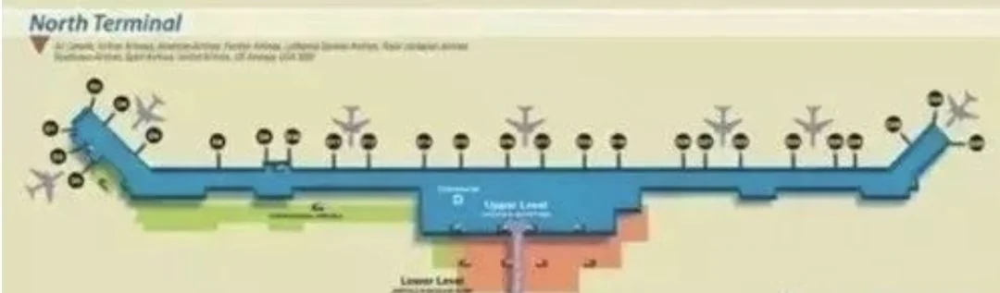

যুক্তরাষ্ট্রে আন্তর্জাতিক থেকে আন্তর্জাতিকে ট্রানজিট বলে কিছু নেই: আপনার চূড়ান্ত গন্তব্য যাই হোক, দেশে ঢোকা প্রত্যেককে **যে বিমানবন্দরে প্রথম নামেন** সেখানেই ইমিগ্রেশন পার হতে হয়, চেক করা ব্যাগ সংগ্রহ করতে হয়, কাস্টমস পার হতে হয়, ব্যাগ আবার চেক-ইন করতে হয় এবং পরের ফ্লাইটে ওঠার আগে আবার দেশীয় নিরাপত্তা তল্লাশি পার হতে হয়। যুক্তরাষ্ট্রে প্রথম ভ্রমণে—পর্যটন, কাজ বা পড়াশোনার জন্য—যাত্রার এই অংশেই সবচেয়ে বেশি ভুল হয়।

অনেক বিমানবন্দর আন্তর্জাতিক আগমন গ্রহণ করে: লস অ্যাঞ্জেলেস, সান ফ্রান্সিসকো, সিয়াটল, নিউ ইয়র্ক, শিকাগো, আটলান্টা, ওয়াশিংটন, ডেট্রয়েট এবং আরও। এই গাইড দুই ভাগে—**সাধারণ প্রক্রিয়া** এবং **প্রথম প্রবেশবিন্দু হিসেবে সবচেয়ে বেশি ব্যবহৃত সাতটি বিমানবন্দর**: লস অ্যাঞ্জেলেস (LAX), সান ফ্রান্সিসকো (SFO), আটলান্টা (ATL), শিকাগো ও’হেয়ার (ORD), নিউ ইয়র্ক নিউয়ার্ক (EWR), সিয়াটল (SEA) ও ডেট্রয়েট (DTW)—এবং প্রতিটিতে কোন শাটল বা ট্রেন নেবেন ও কোন করিডর অনুসরণ করবেন তা বলে দেয়।

## 1. যুক্তরাষ্ট্রে পৌঁছানোর পর সংযোগ প্রক্রিয়া

আপনি যেখানেই নামুন, যুক্তরাষ্ট্রের সংযোগ একই পাঁচ ধাপে হয়: **ইমিগ্রেশন → লাগেজ সংগ্রহ → কাস্টমস → ব্যাগ আবার চেক-ইন → টার্মিনাল বদল ও আবার নিরাপত্তা পার হওয়া।**

### 1. ইমিগ্রেশন

ভিড় অনুসরণ করুন, অথবা ইমিগ্রেশন ও আগমন সাইন ধরে ইমিগ্রেশন হলে যান। ভিসা বা ESTA থাকা যাত্রীরা দর্শনার্থী লেনে সারিতে দাঁড়ান এবং ভ্রমণ সম্পর্কে কয়েকটি সহজ প্রশ্নের উত্তর দেন; কাউকে সেকেন্ডারি ইন্সপেকশনে পাঠানো হলে আলাদা ডেস্কে দেখা হয়। **ইমিগ্রেশনের অপেক্ষাকক্ষে ছবি তোলা নিষিদ্ধ, ফোন ও অন্যান্য ইলেকট্রনিক ডিভাইস ব্যবহারও নিষিদ্ধ**—সারিতে যোগ দেওয়ার আগে সেগুলো সরিয়ে রাখুন।

### 2. লাগেজ সংগ্রহ

ইমিগ্রেশনের পরে কনভেয়ার বেল্ট থেকে আপনার চেক করা লাগেজ নিন। মনে রাখবেন, **পরবর্তী ফ্লাইট দেশীয় হলেও ব্যাগ স্বয়ংক্রিয়ভাবে স্থানান্তরিত হয় না**—বেল্ট থেকে নিজেই নামিয়ে কাস্টমসের ভেতর দিয়ে বাইরে আনতে হবে।

### 3. কাস্টমস

বিমানে পূরণ করা ঘোষণাপত্র (নীল ফর্ম; বাড়তি কপি আগমন হলে পাওয়া যায়) জমা দিয়ে কাস্টমস পার হন। ঘোষণা করার কিছু থাকলে সততার সঙ্গে ফর্ম পূরণ করে লাল চ্যানেল ব্যবহার করুন; না থাকলে সবুজ চ্যানেল দিয়ে হেঁটে যান। এই দরজা পেরোলেই আপনি আনুষ্ঠানিকভাবে যুক্তরাষ্ট্রে।

### 4. ব্যাগ আবার চেক-ইন

কাস্টমসের পরে সোজা বিমানবন্দর থেকে বেরিয়ে যাবেন না—আগে **সংযোগকারী ফ্লাইট বা ট্রানজিট কাউন্টার** খুঁজে আপনার ব্যাগ জমা দিন। আন্তর্জাতিক আগমন হলে সাধারণত প্রধান এয়ারলাইন্সগুলোর ট্রানজিট কাউন্টার থাকে: যেমন শিকাগো ও’হেয়ারের টার্মিনাল 5-এ United ও American-এর প্রত্যেকের নিজস্ব কাউন্টার আছে। আপনি যে টার্মিনালে নেমেছেন সেখানে আপনার এয়ারলাইনের ট্রানজিট ডেস্ক না থাকলে ব্যাগ নিয়ে পরের ফ্লাইট যে টার্মিনাল থেকে ছাড়বে সেখানে গিয়ে চেক-ইন করতে হবে।

### 5. টার্মিনাল বদল ও আবার নিরাপত্তা পার হওয়া

তারপর বোর্ডিং পাস অনুযায়ী সঠিক টার্মিনাল ও কনকোর্সে যান। যুক্তরাষ্ট্রের বিমানবন্দর বড়, আর টার্মিনালগুলো সাধারণত অভ্যন্তরীণ ট্রেন বা শাটল বাসে যুক্ত; **দেশীয় প্রস্থান এলাকায় ঢোকার আগে আপনাকে আবার নিরাপত্তা তল্লাশি পার হতে হবে**, ঠিক যাত্রার শুরুতে যেমন করেছিলেন। সাতটি বিমানবন্দরের অভ্যন্তরীণ সংযোগের বিকল্প নিচে, প্রতিটির বিস্তারিত পরের অংশে।

| বিমানবন্দর | টার্মিনালের মধ্যে কীভাবে যাবেন | এক লাইনের সতর্কতা |
| --- | --- | --- |
| LAX লস অ্যাঞ্জেলেস | বিনামূল্যের আন্তঃটার্মিনাল শাটল বাস, কিছু হাঁটার পথ | নয়টি আলাদা টার্মিনাল; এক থেকে অন্যটিতে হাঁটা ধীরগতির |
| SFO সান ফ্রান্সিসকো | AirTrain (লাল ও নীল লাইন) | আন্তর্জাতিক আগমন ইন্টারন্যাশনাল টার্মিনালে |
| ATL আটলান্টা | ভূগর্ভস্থ Plane Train | শহরের মেট্রো MARTA-র সঙ্গে গুলিয়ে ফেলবেন না |
| ORD শিকাগো | ATS বিমানবন্দর ট্রেন | আন্তর্জাতিক আগমন টার্মিনাল 5-এ; ATS নিন |
| EWR নিউয়ার্ক | AirTrain (তিনটি স্টপ: A, B, C) | আন্তর্জাতিক আগমন মূলত টার্মিনাল B-তে |
| SEA সিয়াটল | মূলত হেঁটে, মূল টার্মিনালের ভেতরে | গেট নম্বরের অক্ষরটিই কনকোর্স |
| DTW ডেট্রয়েট | টার্মিনালের ভেতরের ট্রাম, আন্তঃটার্মিনাল শাটল | Delta ম্যাকনামারায়; অন্য এয়ারলাইন উত্তর টার্মিনালে |

### 6. কত সংযোগ-সময় দেবেন

মূল উপাদানে বড় বিমানবন্দরগুলোর বিষয়ে স্পষ্ট বলা হয়েছে: সময় যত বেশি তত ভালো।

| বিমানবন্দর | কত সময় দিন | কেন |
| --- | --- | --- |
| ORD শিকাগো | 2 ঘণ্টা বা বেশি | আন্তর্জাতিক আগমন টার্মিনাল 5-এ; ATS নিয়ে আবার নিরাপত্তা পার হতে হয় |
| DTW ডেট্রয়েট | 2 ঘণ্টা বা বেশি | 90 মিনিট খুবই কম, আর টার্মিনাল শাটল আরেকটি অংশ যোগ করে |
| LAX লস অ্যাঞ্জেলেস | টার্মিনালের মধ্যে হাঁটলে অন্তত 40 মিনিট | নয়টি আলাদা টার্মিনাল ও একমুখী শাটল লুপ |
| অন্য বিমানবন্দর | 1.5–2 ঘণ্টা | ইমিগ্রেশন, লাগেজ, কাস্টমস ও নিরাপত্তায় সারি |

পিক সিজনে, সরকারি ছুটির আশপাশে ও সন্ধ্যার আগমনে আরামের জন্য আরও 30–60 মিনিট যোগ করুন।

## 2. সাতটি বিমানবন্দর

### 1. লস অ্যাঞ্জেলেস আন্তর্জাতিক বিমানবন্দর (LAX)

লস অ্যাঞ্জেলেসে **নয়টি টার্মিনাল** (টার্মিনাল 1–8 এবং টম ব্র্যাডলি ইন্টারন্যাশনাল টার্মিনাল, TBIT, যাকে টার্মিনাল B-ও বলা হয়) এবং **প্রতিটি আলাদা ভবন**, কেবল রাস্তা, শাটল বাস ও কয়েকটি হাঁটার পথে যুক্ত। TBIT বর্তমানে প্রধান আন্তর্জাতিক আগমনস্থল, এবং প্রধান চীনা এয়ারলাইন্সগুলোর বেশিরভাগ ফ্লাইট সেখানেই নামে।

LAX-এ টার্মিনাল বদলানোর সময় দুটি বিষয় গুরুত্বপূর্ণ:

- **কেবল আন্তঃটার্মিনাল শাটল বাস নিন** (মূল উপাদানে শাটল বাস A বলা হয়েছে)। আরও কয়েকটি বাস পার্কিং, গাড়ি ভাড়া কেন্দ্র ও মেট্রো স্টেশনে যায়—ভুল বাসে উঠলে আপনি বিমানবন্দর ছেড়ে বেরিয়ে যাবেন।
- **শাটল একমুখী লুপে চলে**, তাই পুরো একটি চক্করে অনেক সময় লাগতে পারে; আর TBIT থেকে স্টপ দেখতে হলে টার্মিনালের দুই প্রান্তের যেকোনো একটিতে হেঁটে যেতে হবে, কারণ মাঝের সাইনগুলো দুর্বল। পাশাপাশি কিছু টার্মিনালের মধ্যে হাঁটার পথ আছে, কিন্তু TBIT থেকে United-এর এলাকায় হাঁটতে **অন্তত 40 মিনিট** লাগে—সংযোগের সময় কম থাকলে চেষ্টা করবেন না।

ব্যাগ সম্পর্কে: প্রতিটি টার্মিনালের নিজস্ব ইমিগ্রেশন হল আছে, এবং প্রক্রিয়া অন্য বিমানবন্দরের মতোই—ইমিগ্রেশন, লাগেজ সংগ্রহ, কাস্টমস। কাস্টমসের পরে মনে রাখবেন, **আপনি যে টার্মিনালে নেমেছেন সেখানে প্রতিটি এয়ারলাইনের ট্রানজিট কাউন্টার থাকে না**; পরের ফ্লাইট যে টার্মিনাল থেকে ছাড়বে সেখানে ব্যাগ ঠেলে নিয়ে যেতে হতে পারে।

### 2. সান ফ্রান্সিসকো আন্তর্জাতিক বিমানবন্দর (SFO)

সান ফ্রান্সিসকো ইন্টারন্যাশনাল United-এর একটি প্রধান হাব এবং Alaska Airlines-এর অন্যতম প্রধান কেন্দ্র, তাই বিশেষ করে United-এর যাত্রীরা প্রায়ই এখানে সংযোগ নেন। বিমানবন্দরটিতে **চারটি টার্মিনাল**: টার্মিনাল 1, 2 ও 3 দেশীয় ফ্লাইট পরিচালনা করে, এবং **সব আন্তর্জাতিক ফ্লাইট ইন্টারন্যাশনাল টার্মিনালে আসে**, যা A ও G নামের দুটি বোর্ডিং এলাকায় বিভক্ত।

ইমিগ্রেশন ও লাগেজ সংগ্রহের পরে হেঁটে এগিয়ে যান: ঘোষণা করার পণ্য থাকলে ফর্ম পূরণ করেন, বাকিরা সোজা কাস্টমস পার হন। সংযোগ থাকলে সাইন মন দিয়ে পড়ুন—**আগমন লবি ও সংযোগকারী ফ্লাইটের প্রস্থান হলের বিপরীত প্রান্তে**, তাই ভুল মোড় নিলে অনেক ঘুরে হাঁটতে হবে।

সাইন অনুসরণ করলে আপনার এয়ারলাইনের সংযোগী লাগেজ ডেস্কে পৌঁছাবেন; ব্যাগ জমা দেওয়ার পর বিমানবন্দরের **AirTrain** যাত্রীদের টার্মিনালের মধ্যে নিয়ে যায়।

AirTrain-এ দুটি লাইন: **লাল লাইন** টার্মিনাল, টার্মিনাল পার্কিং ও BART স্টেশনে থামে, আর **নীল লাইন** গাড়ি ভাড়া কেন্দ্র যোগ করে। দেশীয়ভাবে যাত্রা করার মতোই পরের টার্মিনালে ঢোকার আগে আপনাকে আবার নিরাপত্তা পার হতে হবে। মূল উপাদানে আরও বলা আছে, SFO-তে লাগেজ কার্ট বিনামূল্যে।

### 3. হার্টসফিল্ড–জ্যাকসন আটলান্টা আন্তর্জাতিক বিমানবন্দর (ATL)

আটলান্টা **Delta-র সবচেয়ে বড় হাব**, এবং সাংহাই থেকে Delta-র ফ্লাইট প্রায়ই এখানে সংযোগ নেয়। বিমানবন্দরে **একটি দেশীয় টার্মিনাল** (উত্তর ও দক্ষিণ দিকসহ) এবং **একটি আন্তর্জাতিক টার্মিনাল** (কনকোর্স F) আছে; যাত্রীদের আসলে **সাতটি কনকোর্স: T, A, B, C, D, E ও F** নিয়েই কাজ করতে হয়, প্রতিটি ফ্লাইট মোটামুটি নির্দিষ্ট টার্মিনাল ও গেট ব্যবহার করে।

কনকোর্সগুলো **ভূগর্ভস্থ Plane Train**-এ যুক্ত, যা খুব ঘন ঘন চলে—T থেকে শেষ প্রান্ত F পর্যন্ত প্রায় বারো মিনিট লাগে। মূল উপাদানে এই বিমানবন্দর ট্রেনকে “সাবওয়ে” বলা হয়েছে, যা **শহরের মেট্রো MARTA**-র সঙ্গে গুলিয়ে ফেলা সহজ: MARTA-র স্টেশন **দেশীয় টার্মিনাল** দিকে এবং সেখান থেকেই আটলান্টার কেন্দ্রে যাওয়া যায়। সংযোগের জন্য এটি লাগবে না। ইমিগ্রেশনের পরে Plane Train-এর সাইন অনুসরণ করুন, তাহলে পরের ফ্লাইটের দিকেই এগোবেন।

মূল উপাদানের স্মারক নোট:

- আটলান্টায় **লাগেজ কার্ট অর্থদায়ী**, ক্রেডিট কার্ডে পরিশোধ করতে হয়।
- **বিমানবন্দরের Wi-Fi অর্থদায়ী**, তাই নেমেই অনলাইনে থাকার ভরসা করবেন না।
- দিবালোক সঞ্চয় সময়ে আটলান্টা চীনের চেয়ে 12 ঘণ্টা পিছিয়ে; শীতকালে 13 ঘণ্টা। বিমানে উঠেই ঘড়ি স্থানীয় সময়ে মিলিয়ে নিন, যাতে নামার সময় ও সংযোগ আরামদায়ক কি না বুঝতে পারেন।
- সাংহাই থেকে আটলান্টা প্রায় 14 ঘণ্টার উড়ান।

### 4. শিকাগো ও’হেয়ার আন্তর্জাতিক বিমানবন্দর (ORD)

শিকাগো ও’হেয়ার উত্তর আমেরিকার ব্যস্ততম বিমানবন্দরগুলোর একটি এবং যুক্তরাষ্ট্রের শহরগুলোতে যাওয়া যাত্রীদের প্রবেশদ্বার। এতে **186টি গেট** আছে **চারটি টার্মিনাল (1, 2, 3 ও 5) ও নয়টি কনকোর্সে (B, C, E, F, G, H, K, L ও M)**, এবং **সব আন্তর্জাতিক ফ্লাইট টার্মিনাল 5-এ আসে**।

নামার পরে ঘোষণাপত্র নিয়ে ভিড় অনুসরণ করে কাস্টমসে যান—এখানে “ভিড় অনুসরণ করুন” ভালো কাজ করে। **ইমিগ্রেশনের অপেক্ষাকক্ষে ছবি তোলা এবং ফোন ও অন্যান্য ইলেকট্রনিক ডিভাইস ব্যবহার কঠোরভাবে নিষিদ্ধ**, তাই সারিতে থাকা অবস্থায় সেগুলো সরিয়ে রাখুন। কাস্টমস পার হয়ে ব্যাগ হাতে পাওয়ার পরে **সোজা বিমানবন্দর থেকে বের হবেন না**: দুই পাশের লিফটে উঠে বিমানবন্দর ট্রেনে যান।

অভ্যন্তরীণ ট্রেনটি **ATS (Airport Transit System)**, আর এর স্টপগুলো এই ক্রমে: তিনটি দেশীয় টার্মিনাল → আন্তর্জাতিক টার্মিনাল → পার্কিং → CTA মেট্রো স্টেশন → বাস স্টেশন। **ওঠার আগে দেখে নিন আপনার পরের ফ্লাইট কোন টার্মিনাল থেকে ছাড়বে**, আর হারিয়ে গেলে যেকোনো গ্রাউন্ড স্টাফকে ট্রান্সফার শাটল কোথায় জিজ্ঞেস করুন। মোটামুটি বলতে গেলে, টার্মিনাল 1-এ United-এর প্রাধান্য, টার্মিনাল 3-এ American-এর, আর টার্মিনাল 2 কয়েকটি দেশীয় এয়ারলাইন মিলে ব্যবহার করে।

ATS আপনাকে সঠিক দেশীয় টার্মিনালে নামালে **আবার যুক্তরাষ্ট্রের দেশীয় নিরাপত্তা তল্লাশি পার হতে হবে**; নিরাপত্তার পরে পরের ফ্লাইটের গেট খুঁজে সেখানে অপেক্ষা করুন। মূল উপাদানে আরও আছে, শিকাগোর বিমানবন্দর Wi-Fi অর্থদায়ী ও সস্তা নয়, তাই অফলাইনে থাকার প্রস্তুতি রাখুন, এবং সংযোগের জন্য **অন্তত দুই ঘণ্টা** সময় দিন।

### 5. নিউ ইয়র্ক নিউয়ার্ক লিবার্টি আন্তর্জাতিক বিমানবন্দর (EWR)

নিউয়ার্ক ম্যানহাটন থেকে প্রায় 16 মাইল দূরে এবং নিউ ইয়র্ক মহানগর এলাকার তিনটি বিমানবন্দরের একটি—অন্য দুটি জন এফ. কেনেডি (JFK) ও লা গার্ডিয়া (LGA), যার মধ্যে LGA ম্যানহাটনের সবচেয়ে কাছে এবং শহরে বেড়াতে গেলে সাধারণত এটিই বাছা হয়। নিউয়ার্ক দেশের ব্যস্ততম বিমানবন্দরগুলোর একটি এবং **United-এর হাব** (মূল উপাদানের “Continental Airlines” 2012 সালে United-এ মিশে গেছে), যা টার্মিনাল C এবং টার্মিনাল A-র একটি অংশ ব্যবহার করে।

নিউয়ার্কে **তিনটি টার্মিনাল—A, B ও C—এবং টার্মিনাল B প্রধান আন্তর্জাতিক টার্মিনাল**, যদিও চীন থেকে ফ্লাইট টার্মিনাল C-তেও আসতে পারে। নামার পরে ভিড় বা ইমিগ্রেশন সাইন অনুসরণ করে আনুষ্ঠানিকতা সারুন; টার্মিনাল C-এর ইমিগ্রেশন পয়েন্ট নিচে দেখানো হয়েছে।

তারপর ব্যাগ সংগ্রহ করুন—মনে রাখবেন, **EWR-এ লাগেজ কার্টের দাম $5**, তাই নোট বা কয়েন হাতে রাখুন। ব্যাগ নিয়ে কাস্টমস পার হন; ঘোষণা করার কিছু না থাকলে বেরিয়ে ট্রানজিট কাউন্টার খুঁজে ব্যাগ আবার জমা দিন।

ব্যাগ আবার চেক-ইন করে পরের ফ্লাইট যে টার্মিনাল থেকে ছাড়বে সেদিকে যান। বিমানবন্দরের **AirTrain** টার্মিনাল A, B ও C-এর মধ্যে চলে—**অফ-পিক সময়ে মোটামুটি প্রতি 15 মিনিটে এবং পিক সময়ে প্রতি 3 মিনিটে**—এবং P2, P3 ও P4 পার্কিং ও NJ Transit ও Amtrak রেল স্টেশনের সঙ্গে যুক্ত, যেখান থেকে সরাসরি নিউ ইয়র্ক পেন স্টেশনে পৌঁছানো যায়।

### 6. সিয়াটল–টাকোমা আন্তর্জাতিক বিমানবন্দর (SEA)

সিয়াটলে সংযোগ তুলনামূলক সহজ: সহযাত্রীদের অনুসরণ করে বিমান থেকে ইমিগ্রেশন হলে যান, ইমিগ্রেশন পার হন, ব্যাগ নিন (লাগেজ ক্লেইম), কাস্টমস পার হন, ব্যাগ আবার চেক-ইন করুন এবং আরেকবার নিরাপত্তা পার হন। ইংরেজি পড়তে জানলে, বা শুধু ভিড় অনুসরণ করলেও ভুল হওয়ার আশঙ্কা কম।

চেক-ইন ডেস্ক সব **মূল টার্মিনালে**, আর বিমানগুলো বিভিন্ন কনকোর্সে ভিরে। সিয়াটলে **চারটি কনকোর্স—A, B, C ও D**—হালকা সবুজ, কমলা, গাঢ় সবুজ ও গৈরিক রঙে চিহ্নিত। চীনে বোর্ডিং পাস পাওয়ার সঙ্গে সঙ্গেই আপনার পরের ফ্লাইট কোথা থেকে ছাড়বে বুঝতে পারবেন, কারণ **সিয়াটলের গেট নম্বর একটি অক্ষর ও দুটি সংখ্যা, আর অক্ষরটিই কনকোর্স**: C মানে কনকোর্স C, D মানে কনকোর্স D।

### 7. ডেট্রয়েট মেট্রোপলিটন ওয়েন কাউন্টি বিমানবন্দর (DTW)

ডেট্রয়েট **Delta-র হাব** এবং দেশের সবচেয়ে আধুনিক বিমানবন্দরগুলোর একটি। এতে **দুটি টার্মিনাল**: ম্যাকনামারা টার্মিনাল ও উত্তর টার্মিনাল। **Delta ও তার SkyTeam অংশীদাররা ম্যাকনামারা ব্যবহার করে**, আর অন্য এয়ারলাইনগুলো উত্তর টার্মিনাল।

ম্যাকনামারায় আন্তর্জাতিক আগমন **সবুজ লেভেলে** (নিচের তলা) আসে: কাস্টমস পার হন, একই তলায় ব্যাগ নিন, এবং দরকার হলে সেখানেই আবার চেক-ইন করুন। তারপর উপরে **নীল লেভেল 2**-এ যান—Delta-র বেশিরভাগ ফ্লাইট **কনকোর্স A** থেকে ছাড়ে, আর কনকোর্স B বা C-তে যেতে বিখ্যাত লাইট টানেল দিয়ে হাঁটতে পারেন বা টার্মিনালের ভেতরের এক্সপ্রেস ট্রাম নিতে পারেন।

**উত্তর টার্মিনালের** জন্য আন্তঃটার্মিনাল শাটল নিন—টার্মিনাল–ওয়েস্টিন–টার্মিনাল পরিষেবা, **প্রতি 10 মিনিটে**, ম্যাকনামারা থেকে উত্তর টার্মিনাল প্রায় 7 মিনিট, পথে ওয়েস্টিন হোটেলে থামে। উত্তর টার্মিনাল নিজে সহজ, তবে **ঢোকার আগে আবার নিরাপত্তা পার হতে হবে**।

এত আধুনিক হলেও ডেট্রয়েটে উদার সংযোগ-সময় দরকার: **দুই ঘণ্টা বা বেশি দিন—90 মিনিট খুবই কম**—তাই টিকিট বুক করার সময় এটি মনে রাখুন।

## 3. সহজে চোখ এড়ানো খুঁটিনাটি

- **লাগেজ কার্ট:** মূল উপাদানে বলা আছে SFO-তে বিনামূল্যে, ATL-এ অর্থদায়ী (কার্ডে) এবং EWR-এ $5—কিছু ছোট নোট ও কাজ করা ক্রেডিট কার্ড সঙ্গে রাখলে খরচ নেই।
- **বিমানবন্দর Wi-Fi:** ATL ও ORD-এ অর্থদায়ী, তাই নামার সঙ্গে সঙ্গে অনলাইনে নাও থাকতে পারেন; জরুরি যোগাযোগের তথ্য অফলাইনে পড়ার মতো জায়গায় রাখুন।
- **সময়ের পার্থক্য:** দিবালোক সঞ্চয় সময়ে আটলান্টা চীনের চেয়ে 12 ঘণ্টা পিছিয়ে, শীতে 13 ঘণ্টা। বিমানে থাকতেই ঘড়ি স্থানীয় সময়ে মিলিয়ে নিন, তাহলে আগমন ও সংযোগের সময় বোঝা অনেক সহজ হবে।
- **ফোন ও ক্যামেরা:** ইমিগ্রেশন ও কাস্টমসের অপেক্ষাকক্ষে ফোন ও অন্যান্য ইলেকট্রনিক ডিভাইস ব্যবহার নিষিদ্ধ—আর ছবি তুলবেন না।
- **ব্যাগ নিজেকেই বহন করবেন:** সংযোগ টিকিট থাকুক বা না থাকুক, যুক্তরাষ্ট্রে ঢোকার পর আপনি ব্যাগ সংগ্রহ করেন, কাস্টমস দিয়ে নিয়ে যান এবং আবার চেক-ইন করেন; ব্যাগ কখনও স্বয়ংক্রিয়ভাবে পরের ফ্লাইটে আপনার পিছু পিছু যায় না।

এখানে দেওয়া বিমানবন্দরের চিত্র মূল উপাদান থেকে; বিমানবন্দর ও এয়ারলাইন্স নিয়ত বদলায়—উৎসের Continental Airlines United-এ, US Airways American-এ এবং Northwest Delta-তে মিশে গেছে। আপনি যে দিন যাত্রা করবেন, সেই দিনের তথ্য বিমানবন্দর ও আপনার এয়ারলাইনের কাছে যাচাই করে নিন।

## সম্পর্কিত লিংক

- **এই সাইটে**: [লস অ্যাঞ্জেলেস LAX](/airport/LAX), [সান ফ্রান্সিসকো SFO](/airport/SFO), [আটলান্টা ATL](/airport/ATL), [শিকাগো ও’হেয়ার ORD](/airport/ORD), [নিউয়ার্ক EWR](/airport/EWR), [সিয়াটল SEA](/airport/SEA), [যুক্তরাষ্ট্র (US)](/country/US)
- **উইকিপিডিয়া**: [লস অ্যাঞ্জেলেস LAX](https://en.wikipedia.org/wiki/Los_Angeles_International_Airport), [সান ফ্রান্সিসকো SFO](https://en.wikipedia.org/wiki/San_Francisco_International_Airport), [আটলান্টা ATL](https://en.wikipedia.org/wiki/Hartsfield%E2%80%93Jackson_Atlanta_International_Airport), [শিকাগো ও’হেয়ার ORD](https://en.wikipedia.org/wiki/O'Hare_International_Airport), [নিউয়ার্ক EWR](https://en.wikipedia.org/wiki/Newark_Liberty_International_Airport), [সিয়াটল SEA](https://en.wikipedia.org/wiki/Seattle%E2%80%93Tacoma_International_Airport), [ডেট্রয়েট DTW](https://en.wikipedia.org/wiki/Detroit_Metropolitan_Wayne_County_Airport)
- **বাইদু বাইকে**: [লস অ্যাঞ্জেলেস LAX](https://baike.baidu.com/item/%E6%B4%9B%E6%9D%89%E7%9F%B6%E5%9B%BD%E9%99%85%E6%9C%BA%E5%9C%BA), [সান ফ্রান্সিসকো SFO](https://baike.baidu.com/item/%E6%97%A7%E9%87%91%E5%B1%B1%E5%9B%BD%E9%99%85%E6%9C%BA%E5%9C%BA), [আটলান্টা ATL](https://baike.baidu.com/item/%E5%93%88%E8%8C%A8%E8%8F%B2%E5%B0%94%E5%BE%B7-%E6%9D%B0%E5%85%8B%E9%80%8A%E4%BA%9A%E7%89%B9%E5%85%B0%E5%A4%A7%E5%9B%BD%E9%99%85%E6%9C%BA%E5%9C%BA), [শিকাগো ও’হেয়ার ORD](https://baike.baidu.com/item/%E5%A5%A5%E9%BB%91%E5%B0%94%E5%9B%BD%E9%99%85%E6%9C%BA%E5%9C%BA), [নিউয়ার্ক EWR](https://baike.baidu.com/item/%E7%BA%BD%E7%93%A6%E5%85%8B%E8%87%AA%E7%94%B1%E5%9B%BD%E9%99%85%E6%9C%BA%E5%9C%BA), [সিয়াটল SEA](https://baike.baidu.com/item/%E8%A5%BF%E9%9B%85%E5%9B%BE-%E5%A1%94%E7%A7%91%E9%A9%AC%E5%9B%BD%E9%99%85%E6%9C%BA%E5%9C%BA), [ডেট্রয়েট DTW](https://baike.baidu.com/item/%E5%BA%95%E7%89%B9%E5%BE%8B%E9%83%BD%E4%BC%9A%E9%9F%A6%E6%81%A9%E5%8E%BF%E6%9C%BA%E5%9C%BA)
