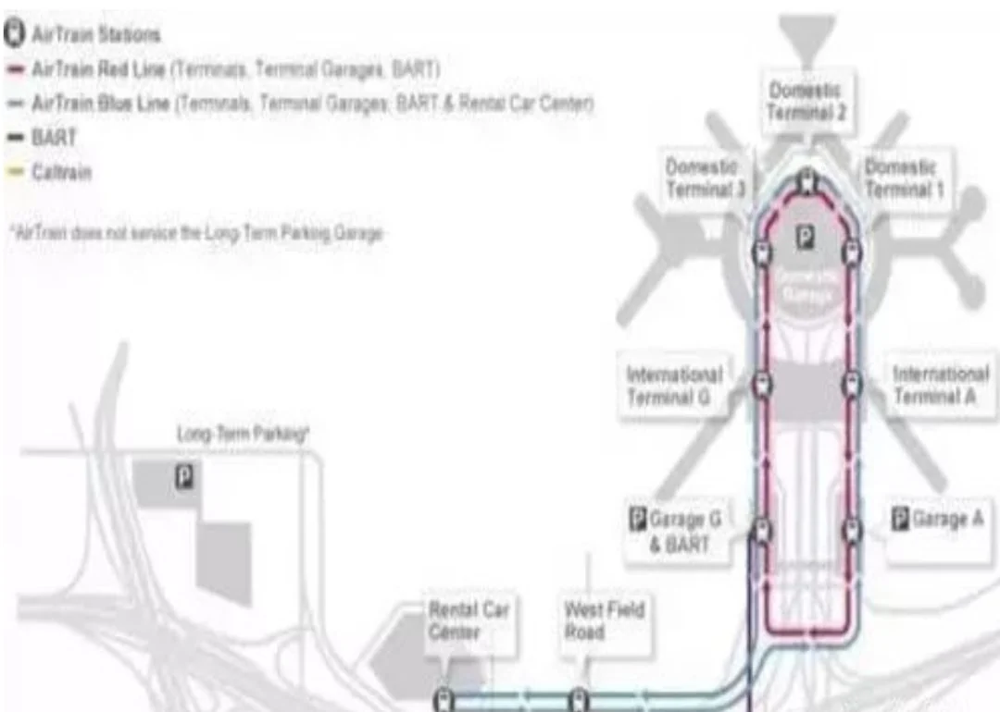
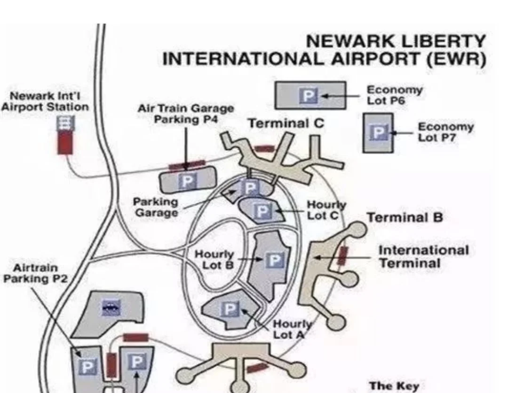
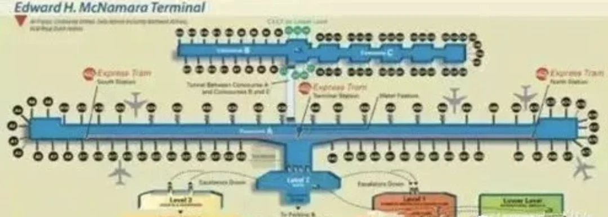

Ve Spojených státech neexistuje něco jako mezinárodní přestup bez vstupu do země: ať je vaše konečná destinace jakákoli, každý, kdo do země vstupuje, prochází pasovou kontrolou na **prvním letišti, kde přistane**, vyzvedne si odbavená zavazadla, projde celní kontrolou, zavazadla znovu odbaví a před nástupem do dalšího letadla absolvuje ještě vnitrostátní bezpečnostní kontrolu. Při první cestě do USA – ať už za turistikou, prací nebo studiem – se nejčastěji pokazí právě tato část cesty.

Mezinárodní přílety přijímá mnoho letišť: Los Angeles, San Francisco, Seattle, New York, Chicago, Atlanta, Washington, Detroit a další. Tento průvodce má dvě části – **obecný postup** a **sedm letišť nejčastěji používaných jako první vstupní bod do země**: Los Angeles (LAX), San Francisco (SFO), Atlanta (ATL), Chicago O'Hare (ORD), New York Newark (EWR), Seattle (SEA) a Detroit (DTW) – a u každého uvádí, kterým kyvadlovým autobusem nebo vlakem jet a kterým koridorem se vydat.

## 1. Přestupní proces po příletu do USA

Ať přistanete kdekoli, přestup v USA má vždy stejných pět kroků: **pasová kontrola → výdej zavazadel → celnice → opětovné odbavení zavazadel → změna terminálu a nová bezpečnostní kontrola.**

### 1. Pasová kontrola

Jděte s davem nebo podle značek Immigration a Arrival do haly pasové kontroly. Cestující s vízem nebo ESTA stojí ve frontě pro návštěvníky a odpovídají na několik jednoduchých otázek o své cestě; koho pošlou na podrobnější kontrolu, toho vyřídí u samostatné přepážky. **V čekací hale pasové kontroly je fotografování zakázáno, stejně jako používání telefonů a jiných elektronických zařízení** – schovejte je, než se postavíte do fronty.

### 2. Výdej zavazadel

Po pasové kontrole si vyzvedněte odbavená zavazadla z pásu. Pozor, **zavazadla se nepřekládají automaticky, ani když je navazující let vnitrostátní** – musíte je sami sundat z pásu a odnést přes celnici.

### 3. Celnice

Odevzdejte celní prohlášení, které jste vyplnili v letadle (modrý formulář; náhradní výtisky jsou k dispozici v příletové hale), a projděte celní kontrolou. Pokud máte co deklarovat, vyplňte formulář poctivě a použijte červený koridor; pokud ne, projděte zeleným koridorem. Jakmile projdete těmito dveřmi, jste oficiálně ve Spojených státech.

### 4. Opětovné odbavení zavazadel

Nevycházejte po celnici rovnou z letiště – nejdřív najděte **přepážku pro navazující lety nebo tranzit** a zavazadla znovu odevzdejte. V halách mezinárodních příletů bývají tranzitní přepážky hlavních aerolinek: například v terminálu 5 na chicagském O'Hare mají United a American každá svou. Pokud vaše aerolinka v terminálu, kde jste přistáli, tranzitní přepážku nemá, musíte zavazadla odvézt do terminálu, odkud odlétá váš další let, a odbavit je tam.

### 5. Změna terminálu a nová bezpečnostní kontrola

Pak se podle palubní vstupenky vydejte do správného terminálu a haly. Americká letiště jsou velká a terminály obvykle spojuje vnitřní vlak nebo kyvadlový autobus; **před vstupem do vnitrostátní odletové části musíte znovu projít bezpečnostní kontrolou**, přesně jako na začátku cesty. Možnosti vnitřního přestupu na sedmi letištích najdete níže, podrobnosti k jednotlivým letištím v následující kapitole.

| Letiště | Jak se pohybovat mezi terminály | Upozornění v jedné větě |
| --- | --- | --- |
| LAX Los Angeles | Bezplatný kyvadlový autobus mezi terminály, některé pěší spojky | Devět samostatných terminálů; pěšky je to mezi nimi pomalé |
| SFO San Francisco | AirTrain (červená a modrá linka) | Mezinárodní přílety jsou v mezinárodním terminálu |
| ATL Atlanta | Podzemní vlak Plane Train | Nezaměňujte ho s MARTA, metrem města |
| ORD Chicago | Letištní vlak ATS | Mezinárodní přílety jsou v terminálu 5; jeďte ATS |
| EWR Newark | AirTrain (tři zastávky: A, B, C) | Mezinárodní přílety jsou hlavně v terminálu B |
| SEA Seattle | Většinou pěšky, uvnitř hlavního terminálu | Písmeno v čísle gatu označuje halu |
| DTW Detroit | Tramvaj uvnitř terminálu, kyvadlová doprava mezi terminály | Delta je v McNamara; ostatní aerolinky v severním terminálu |

### 6. Kolik času na přestup si nechat

Původní materiál je u velkých letišť jednoznačný: více času je vždy lepší.

| Letiště | Nechat si | Proč |
| --- | --- | --- |
| ORD Chicago | 2 hodiny nebo více | Mezinárodní přílety jsou v terminálu 5; jedete ATS a znovu procházíte bezpečnostní kontrolou |
| DTW Detroit | 2 hodiny nebo více | 90 minut je velmi těsné a kyvadlová doprava mezi terminály přidá další úsek |
| LAX Los Angeles | Alespoň 40 minut, pokud jdete pěšky mezi terminály | Devět samostatných terminálů a kyvadlová doprava v jednom směru |
| Ostatní letiště | 1,5–2 hodiny | Fronty u pasové kontroly, na výdeji zavazadel, u celnice a u bezpečnostní kontroly |

V hlavní sezóně, kolem státních svátků a u večerních příletů si pro klid přidejte dalších 30–60 minut.

## 2. Sedm letišť

### 1. LAX – mezinárodní letiště Los Angeles

Los Angeles má **devět terminálů** (terminály 1–8 a mezinárodní terminál Toma Bradleyho, TBIT, označovaný také jako terminál B) a **každý z nich je samostatná budova**, kterou spojují jen silnice, kyvadlové autobusy a několik pěších spojek. TBIT je v současnosti hlavním místem mezinárodních příletů a přistává tam většina letů velkých čínských dopravců.

Při změně terminálu na LAX jsou důležité dvě věci:

- **Jeďte pouze kyvadlovým autobusem mezi terminály** (v původním materiálu označeným jako Shuttle Bus A). Několik dalších autobusů jezdí na parkoviště, do centra půjčoven aut a ke stanici metra – nastupte do špatného a odjedete z letiště.
- **Autobus jezdí v jednosměrném okruhu**, takže celé kolo může trvat dlouho; a z TBIT musíte dojít na jeden nebo druhý konec terminálu, abyste zastávku vůbec našli, protože značení mezi nimi je slabé. Mezi některými sousedními terminály vedou pěší spojky, ale cesta z TBIT do části United trvá **nejméně 40 minut** – pokud máte těsný přestup, nepouštějte se do toho.

K zavazadlům: každý terminál má vlastní halu pasové kontroly a postup je stejný jako na jiných letištích – pasová kontrola, výdej zavazadel, celnice. Po celnici pozor, **ne každá aerolinka má tranzitní přepážku v terminálu, kam jste přiletěli**; možná budete muset zavazadla dokutálet do terminálu, odkud odlétá váš další let.

### 2. SFO – mezinárodní letiště San Francisco

Mezinárodní letiště San Francisco je významným uzlovým letištěm United a pro Alaska Airlines jedním z hlavních center, takže právě cestující United zde často přestupují. Letiště má **čtyři terminály**: terminály 1, 2 a 3 obsluhují vnitrostátní lety a **všechny mezinárodní lety přilétají do mezinárodního terminálu**, který se dělí na dvě nástupní části A a G.

Po pasové kontrole a výdeji zavazadel pokračujte: cestující se zbožím k deklaraci vyplní formulář, ostatní projdou celnicí rovnou. Pokud přestupujete, čtěte pozorně značky – **příletová hala a východ k navazujícím letům jsou na opačných koncích haly**, takže špatné odbočení vás bude stát dlouhou obcházku.

Sledujte značky a dojdete k přepážce pro navazující zavazadla své aerolinky; jakmile máte zavazadla odevzdaná, přepraví vás mezi terminály letištní **AirTrain**.

AirTrain má dvě linky: **červená** zastavuje u terminálů, terminálových garáží a stanice BART a **modrá** navíc u centra půjčoven aut. Před vstupem do dalšího terminálu stále musíte projít bezpečnostní kontrolou, stejně jako při vnitrostátním odletu. Původní materiál také uvádí, že vozíky na zavazadla jsou na SFO zdarma.

### 3. ATL – mezinárodní letiště Hartsfield–Jackson v Atlantě

Atlanta je **největším uzlovým letištěm Delty** a lety Delty ze Šanghaje zde velmi často přestupují. Letiště má **jeden vnitrostátní terminál** (se severní a jižní částí) a **jeden mezinárodní terminál** (hala F); cestující ale v praxi řeší **sedm hal: T, A, B, C, D, E a F**, přičemž každý let má víceméně stálý terminál a gat.

Haly propojuje **podzemní vlak Plane Train**, který jezdí velmi často – z T na vzdálený konec F to trvá asi dvanáct minut. Původní materiál tento letištní vlak nazývá „metrem", což se snadno zamění s **MARTA, metrem města**: stanice MARTA je na straně **vnitrostátního terminálu** a vede do centra Atlanty. K přestupu ji nepotřebujete. Po pasové kontrole se držte značek Plane Train a míříte k dalšímu letu.

Připomínky z původního materiálu:

- **Vozíky na zavazadla v Atlantě jsou zpoplatněné**, platí se kartou.
- **Letištní Wi-Fi je zpoplatněná**, takže nepočítejte s tím, že budete online hned po přistání.
- V letním čase je Atlanta o 12 hodin pozadu za Čínou, v zimním o 13. Přestavte si hodinky na místní čas už v letadle, abyste mohli odhadnout, kdy přistanete a zda je váš přestup pohodlný.
- Ze Šanghaje do Atlanty se letí asi 14 hodin.

### 4. ORD – mezinárodní letiště Chicago O'Hare

Chicago O'Hare je jedno z nejrušnějších letišť v Severní Americe a brána pro cestující mířící do měst po celých USA. Má **186 gatů** ve **čtyřech terminálech (1, 2, 3 a 5) a devíti halách (B, C, E, F, G, H, K, L a M)** a **všechny mezinárodní lety přistávají u terminálu 5**.

Po přistání si vezměte celní prohlášení a jděte s davem k celnici – „jít s davem" tady funguje dobře. **Fotografování a používání telefonů a dalších elektronických zařízení je v čekací hale pasové kontroly přísně zakázáno**, takže je při čekání ve frontě schovejte. Jakmile projdete celnicí a máte zavazadla, **nevycházejte rovnou z letiště**: vyjeďte výtahy po obou stranách nahoru k letištnímu vlaku.

Vnitřní vlak je **ATS (Airport Transit System)** a jeho zastávky jdou v tomto pořadí: tři vnitrostátní terminály → mezinárodní terminál → parkoviště → stanice metra CTA → autobusové nádraží. **Než nastoupíte, zjistěte, ze kterého terminálu odlétá váš další let**, a pokud se ztratíte, zeptejte se kteréhokoli pracovníka pozemního personálu, kde je přestupní autobus. Obecně platí, že terminálu 1 dominuje United, terminálu 3 American a terminál 2 sdílí několik vnitrostátních dopravců.

Když vás ATS vysadí u správného vnitrostátního terminálu, **musíte znovu projít americkou vnitrostátní bezpečnostní kontrolou**; za ní najděte gat svého dalšího letu a počkejte tam. Původní materiál dodává, že letištní Wi-Fi v Chicagu je zpoplatněná a není levná, takže buďte připraveni být offline, a že na přestup máte počítat **alespoň se dvěma hodinami**.

### 5. EWR – mezinárodní letiště Newark Liberty u New Yorku

Newark je asi 16 mil od Manhattanu a jedno ze tří letišť obsluhujících newyorskou metropolitní oblast – dalšími jsou John F. Kennedy (JFK) a LaGuardia (LGA), přičemž LGA je k Manhattanu nejblíž a bývá obvyklou volbou pro výlet do města. Newark patří k nejrušnějším letištím v zemi a je **uzlovým letištěm United** („Continental Airlines" z původního materiálu se v roce 2012 sloučily s United), která využívá terminál C a část terminálu A.

Newark má **tři terminály – A, B a C – a hlavním mezinárodním terminálem je B**, i když lety z Číny mohou přistát také v terminálu C. Po přistání jděte s davem nebo podle značek Immigration a vyřiďte formality; místo pasové kontroly v terminálu C je na obrázku níže.

Pak si vyzvedněte zavazadla – pozor, **vozíky na zavazadla na EWR stojí 5 dolarů**, takže mějte připravené bankovky nebo mince. Projděte se zavazadly celnicí; pokud nemáte co deklarovat, vyjděte a najděte tranzitní přepážku, kde zavazadla znovu odevzdáte.

Když máte zavazadla znovu odbavená, vydejte se do terminálu, odkud odlétá váš další let. Letištní **AirTrain** jezdí mezi terminály A, B a C – **zhruba každých 15 minut mimo špičku a každé 3 minuty ve špičce** – a spojuje také garáže P2, P3 a P4 a vlakové nádraží NJ Transit a Amtrak, odkud se dostanete přímo na newyorské Penn Station.

### 6. SEA – mezinárodní letiště Seattle–Tacoma

Přestup v Seattlu je poměrně jednoduchý: vyjděte s ostatními cestujícími z letadla do haly pasové kontroly, projděte pasovou kontrolou, vyzvedněte si zavazadla (výdej zavazadel), projděte celnicí, zavazadla znovu odbavte a naposledy absolvujte bezpečnostní kontrolu. Pokud umíte anglicky, nebo prostě jen jdete s davem, těžko se ztratíte.

Odbavovací přepážky jsou všechny v **hlavním terminálu**, zatímco letadla přistávají u různých hal. Seattle má **čtyři haly – A, B, C a D** – barevně odlišené světle zelenou, oranžovou, tmavě zelenou a okrovou. Kde váš další let odlétá, zjistíte hned, jak v Číně dostanete palubní vstupenku, protože **čísla gatů v Seattlu mají jedno písmeno a dvě číslice a písmeno je hala**: C znamená hala C, D znamená hala D.

### 7. DTW – letiště Detroit Metropolitan Wayne County

Detroit je **uzlovým letištěm Delty** a jedním z nejmodernějších letišť v zemi. Má **dva terminály**: McNamara Terminal a North Terminal. **Delta a její partneři ze SkyTeamu používají McNamara**, ostatní aerolinky North Terminal.

Mezinárodní přílety v McNamara jsou v **zelené úrovni** (spodní podlaží): projděte celnicí, vyzvedněte zavazadla ve stejné úrovni a případně je tam znovu odevzdejte. Pak vyjeďte nahoru do **modré úrovně 2** – většina letů Delty odlétá z **haly A** a do hal B nebo C se dostanete procházkou slavným Světelným tunelem nebo tramvají Express Tram uvnitř terminálu.

Do **North Terminal** se dostanete kyvadlovou dopravou mezi terminály – spoj Terminal–Westin–Terminal, **každých 10 minut**, z McNamara do North Terminal asi 7 minut, cestou zastavuje u hotelu Westin. North Terminal sám je jednoduchý, ale **před vstupem do něj znovu procházíte bezpečnostní kontrolou**.

I když je Detroit moderní, i tak potřebujete na přestup dost času: **počítejte se dvěma hodinami nebo více – 90 minut je velmi těsné** – mějte to na paměti při rezervaci.

## 3. Detaily, které snadno uniknou

- **Vozíky na zavazadla:** původní materiál uvádí, že na SFO jsou zdarma, v ATL zpoplatněné (kartou) a na EWR za 5 dolarů – nosit u sebe pár bankovek a funkční kreditní kartu nic nestojí.
- **Letištní Wi-Fi:** v ATL a ORD je zpoplatněná, takže po přistání možná nebudete hned online; důležité kontakty si uložte tam, kde si je přečtete i bez připojení.
- **Časové rozdíly:** Atlanta je v letním čase o 12 hodin pozadu za Čínou a v zimním o 13. Přestavte si hodinky na místní čas už v letadle a časy přistání i přestupu mnohem snáz odhadnete.
- **Telefony a fotoaparáty:** v čekacích prostorách pasové a celní kontroly je používání telefonů a dalších elektronických zařízení zakázáno – a nefoťte.
- **Zavazadla si nosíte sami:** ať máte jednu vstupenku na celou cestu, nebo ne, po vstupu do USA si zavazadla vyzvednete, provedete je celnicí a znovu odbavíte; nikdy vás automaticky nenásledují k dalšímu letu.

Letištní schémata zde pocházejí z původního materiálu a letiště i aerolinky se neustále mění – Continental Airlines ze zdroje se sloučily s United, US Airways s American a Northwest s Delta. Pro den své cesty se informujte přímo na letišti a u své aerolinky.

## Související odkazy

- **Na tomto webu**: [Los Angeles LAX](/airport/LAX), [San Francisco SFO](/airport/SFO), [Atlanta ATL](/airport/ATL), [Chicago O'Hare ORD](/airport/ORD), [Newark EWR](/airport/EWR), [Seattle SEA](/airport/SEA), [Spojené státy (US)](/country/US)
- **Wikipedie**: [Los Angeles LAX](https://en.wikipedia.org/wiki/Los_Angeles_International_Airport), [San Francisco SFO](https://en.wikipedia.org/wiki/San_Francisco_International_Airport), [Atlanta ATL](https://en.wikipedia.org/wiki/Hartsfield%E2%80%93Jackson_Atlanta_International_Airport), [Chicago O'Hare ORD](https://en.wikipedia.org/wiki/O'Hare_International_Airport), [Newark EWR](https://en.wikipedia.org/wiki/Newark_Liberty_International_Airport), [Seattle SEA](https://en.wikipedia.org/wiki/Seattle%E2%80%93Tacoma_International_Airport), [Detroit DTW](https://en.wikipedia.org/wiki/Detroit_Metropolitan_Wayne_County_Airport)
- **Baidu Baike**: [Los Angeles LAX](https://baike.baidu.com/item/%E6%B4%9B%E6%9D%89%E7%9F%B6%E5%9B%BD%E9%99%85%E6%9C%BA%E5%9C%BA), [San Francisco SFO](https://baike.baidu.com/item/%E6%97%A7%E9%87%91%E5%B1%B1%E5%9B%BD%E9%99%85%E6%9C%BA%E5%9C%BA), [Atlanta ATL](https://baike.baidu.com/item/%E5%93%88%E8%8C%A8%E8%8F%B2%E5%B0%94%E5%BE%B7-%E6%9D%B0%E5%85%8B%E9%80%8A%E4%BA%9A%E7%89%B9%E5%85%B0%E5%A4%A7%E5%9B%BD%E9%99%85%E6%9C%BA%E5%9C%BA), [Chicago O'Hare ORD](https://baike.baidu.com/item/%E5%A5%A5%E9%BB%91%E5%B0%94%E5%9B%BD%E9%99%85%E6%9C%BA%E5%9C%BA), [Newark EWR](https://baike.baidu.com/item/%E7%BA%BD%E7%93%A6%E5%85%8B%E8%87%AA%E7%94%B1%E5%9B%BD%E9%99%85%E6%9C%BA%E5%9C%BA), [Seattle SEA](https://baike.baidu.com/item/%E8%A5%BF%E9%9B%85%E5%9B%BE-%E5%A1%94%E7%A7%91%E9%A9%AC%E5%9B%BD%E9%99%85%E6%9C%BA%E5%9C%BA), [Detroit DTW](https://baike.baidu.com/item/%E5%BA%95%E7%89%B9%E5%BE%8B%E9%83%BD%E4%BC%9A%E9%9F%A6%E6%81%A9%E5%8E%BF%E6%9C%BA%E5%9C%BA)
