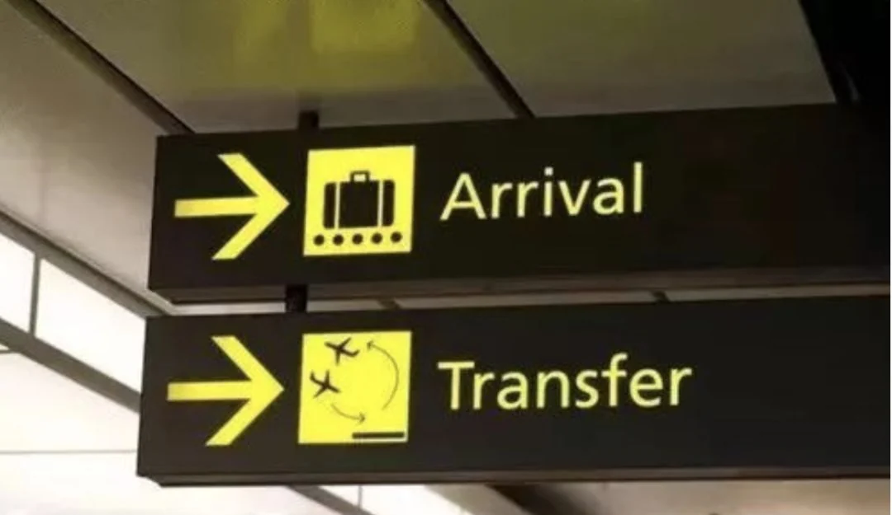
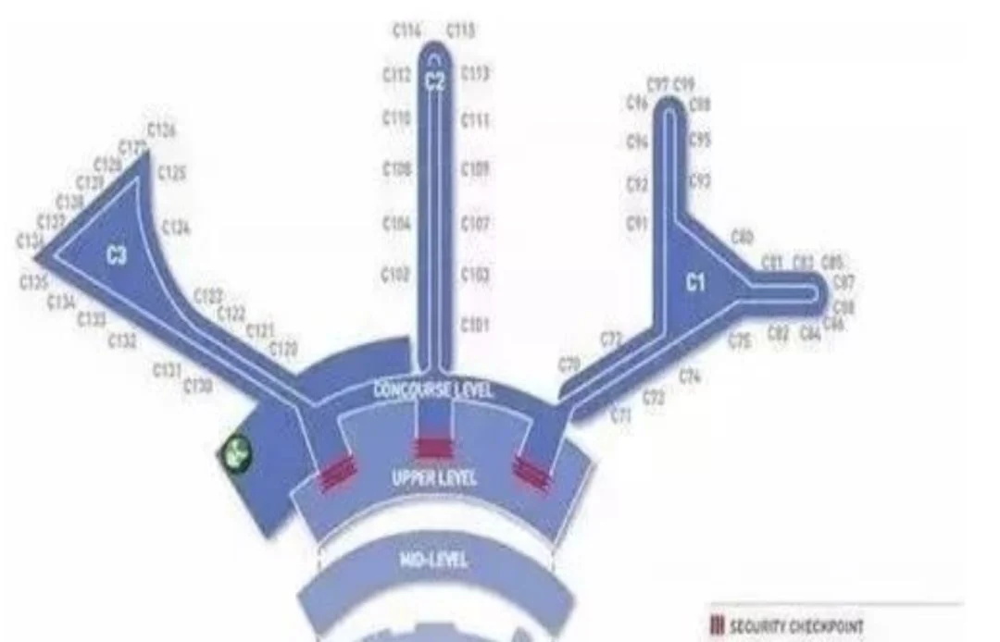

Tidak ada yang namanya transit internasional ke internasional di Amerika Serikat: apa pun tujuan akhir Anda, setiap orang yang masuk negara harus melewati imigrasi di **bandara pertama tempat mereka mendarat**, mengambil bagasi tercatat, melewati bea cukai, memeriksa ulang bagasi, dan melewati keamanan domestik lagi sebelum menaiki penerbangan berikutnya. Untuk perjalanan pertama ke AS — untuk wisata, kerja, atau studi — bagian perjalanan inilah yang paling sering menjadi masalah.

Banyak bandara menerima kedatangan internasional: Los Angeles, San Francisco, Seattle, New York, Chicago, Atlanta, Washington, Detroit, dan lainnya. Panduan ini terdiri dari dua bagian — **proses umum** dan **tujuh bandara yang paling sering menjadi titik masuk pertama**: Los Angeles (LAX), San Francisco (SFO), Atlanta (ATL), Chicago O'Hare (ORD), New York Newark (EWR), Seattle (SEA), dan Detroit (DTW) — serta menjelaskan shuttle atau kereta mana yang harus diambil dan koridor mana yang harus diikuti di masing-masing bandara.

## 1. Proses transit setelah tiba di AS

Di mana pun Anda mendarat, koneksi di AS melewati lima langkah yang sama: **imigrasi → pengambilan bagasi → bea cukai → periksa ulang bagasi Anda → ganti terminal dan lewati keamanan lagi.**

### 1. Imigrasi

Ikuti kerumunan, atau tanda Imigrasi dan Kedatangan, menuju aula imigrasi. Pelancong dengan visa atau ESTA mengantre di jalur pengunjung dan menjawab beberapa pertanyaan sederhana tentang perjalanan mereka; siapa pun yang dirujuk ke pemeriksaan sekunder akan dilayani di meja terpisah. **Fotografi dilarang di area tunggu imigrasi, begitu pula penggunaan ponsel dan perangkat elektronik lain** — simpan semuanya sebelum Anda bergabung dalam antrean.

### 2. Pengambilan bagasi

Setelah imigrasi, ambil bagasi tercatat Anda dari carousel. Perhatikan bahwa **bagasi tidak dipindahkan secara otomatis, bahkan ketika penerbangan lanjutan Anda adalah penerbangan domestik** — Anda harus mengambilnya sendiri dari sabuk dan membawanya keluar melewati bea cukai.

### 3. Bea cukai

Serahkan formulir deklarasi yang Anda isi di pesawat (formulir biru; salinan cadangan tersedia di aula kedatangan) dan lewati bea cukai. Jika Anda membawa sesuatu yang harus dideklarasikan, isi formulir dengan jujur dan gunakan jalur merah; jika tidak, lewati jalur hijau. Begitu melewati pintu ini, Anda resmi berada di Amerika Serikat.

### 4. Memeriksa ulang bagasi Anda

Jangan langsung berjalan keluar bandara setelah bea cukai — pertama-tama cari **konter penerbangan sambung atau transit** dan serahkan kembali bagasi Anda. Aula kedatangan internasional biasanya memiliki konter transit untuk maskapai utama: di Terminal 5 Chicago O'Hare, misalnya, United dan American masing-masing memiliki konter sendiri. Jika maskapai Anda tidak memiliki meja transit di terminal tempat Anda mendarat, Anda harus membawa bagasi ke terminal keberangkatan penerbangan berikutnya dan menyerahkannya di sana.

### 5. Berganti terminal dan melewati keamanan lagi

Lalu ikuti boarding pass Anda ke terminal dan concourse yang benar. Bandara AS besar, dan terminal biasanya dihubungkan oleh kereta internal atau bus shuttle; **Anda harus melewati keamanan sekali lagi sebelum memasuki area keberangkatan domestik**, persis seperti yang Anda lakukan di awal perjalanan. Pilihan transfer internal di ketujuh bandara ada di bawah, dengan detail masing-masing bandara di bagian berikutnya.

| Bandara | Cara berpindah antar terminal | Peringatan singkat |
| --- | --- | --- |
| LAX Los Angeles | Bus shuttle antar terminal gratis, beberapa jalur pejalan kaki | Sembilan terminal terpisah; berjalan di antaranya lambat |
| SFO San Francisco | AirTrain (jalur merah dan biru) | Kedatangan internasional berada di Terminal Internasional |
| ATL Atlanta | Plane Train bawah tanah | Jangan tertukar dengan MARTA, metro kota |
| ORD Chicago | Kereta bandara ATS | Kedatangan internasional di Terminal 5; naik ATS |
| EWR Newark | AirTrain (tiga halte: A, B, C) | Kedatangan internasional terutama di Terminal B |
| SEA Seattle | Sebagian besar berjalan kaki, di dalam terminal utama | Huruf pada nomor gerbang Anda adalah concourse |
| DTW Detroit | Tram di dalam terminal, shuttle antar terminal | Delta berada di McNamara; maskapai lain di Terminal Utara |

### 6. Berapa banyak waktu koneksi yang perlu disediakan

Materi asli menjelaskan secara tegas tentang bandara besar: lebih banyak waktu selalu lebih baik.

| Bandara | Sediakan | Alasan |
| --- | --- | --- |
| ORD Chicago | 2 jam atau lebih | Kedatangan internasional di Terminal 5; Anda naik ATS dan melewati keamanan lagi |
| DTW Detroit | 2 jam atau lebih | 90 menit sangat ketat, dan shuttle terminal menambah satu etape |
| LAX Los Angeles | Setidaknya 40 menit jika berjalan antar terminal | Sembilan terminal terpisah dan jalur shuttle satu arah |
| Bandara lain | 1,5–2 jam | Antrean di imigrasi, pengambilan bagasi, bea cukai, dan keamanan |

Pada musim puncak, sekitar hari libur nasional, dan pada kedatangan malam, tambahkan 30–60 menit lagi agar lebih nyaman.

## 2. Tujuh bandara

### 1. LAX Bandara Internasional Los Angeles

Los Angeles memiliki **sembilan terminal** (Terminal 1–8 ditambah Terminal Internasional Tom Bradley, TBIT, yang juga disebut Terminal B) dan **masing-masing adalah bangunan terpisah**, hanya dihubungkan oleh jalan, bus shuttle, dan beberapa jalur pejalan kaki. TBIT saat ini menjadi titik kedatangan internasional utama, dan sebagian besar penerbangan maskapai besar Tiongkok mendarat di sana.

Dua hal penting saat berganti terminal di LAX:

- **Hanya naik bus shuttle antar terminal** (disebut Shuttle Bus A dalam materi asli). Beberapa bus lain menuju parkir mobil, pusat persewaan mobil, dan stasiun metro — jika salah naik, Anda keluar dari bandara.
- **Shuttle berjalan dalam lingkaran satu arah**, sehingga satu putaran penuh bisa memakan waktu lama; dan dari TBIT Anda harus berjalan ke salah satu ujung terminal untuk melihat haltenya, karena tanda di antaranya minim. Ada jalur pejalan kaki antara beberapa terminal yang berdekatan, tetapi berjalan dari TBIT ke area United memakan waktu **setidaknya 40 menit** — jangan mencobanya jika koneksi Anda ketat.

Tentang bagasi: setiap terminal memiliki aula imigrasi sendiri, dan prosesnya sama seperti di bandara lain — imigrasi, pengambilan bagasi, bea cukai. Setelah bea cukai, perhatikan bahwa **tidak setiap maskapai memiliki konter transit di terminal tempat Anda tiba**; Anda mungkin harus mendorong bagasi ke terminal keberangkatan penerbangan berikutnya.

### 2. SFO Bandara Internasional San Francisco

Bandara Internasional San Francisco adalah hub utama United dan kota fokus Alaska Airlines, sehingga penumpang United khususnya sering transit di sini. Bandara ini memiliki **empat terminal**: Terminal 1, 2, dan 3 menangani penerbangan domestik, dan **semua penerbangan internasional tiba di Terminal Internasional**, yang dibagi menjadi dua area boarding, A dan G.

Setelah imigrasi dan pengambilan bagasi, lanjutkan berjalan: penumpang dengan barang yang harus dideklarasikan mengisi formulir, sisanya langsung melewati bea cukai. Jika Anda transit, baca tanda dengan cermat — **Aula Kedatangan dan Pintu Keluar Penerbangan Sambung berada di ujung berlawanan dari aula**, jadi salah belok membuat Anda berjalan jauh memutar.

Ikuti tanda dan Anda akan mencapai meja bagasi sambung maskapai Anda; setelah bagasi diserahkan, **AirTrain** bandara mengangkut penumpang antar terminal.

AirTrain memiliki dua jalur: **jalur merah** berhenti di terminal, garasi terminal, dan stasiun BART, dan **jalur biru** menambahkan pusat persewaan mobil. Anda tetap perlu melewati keamanan sebelum memasuki terminal berikutnya, seperti saat berangkat domestik. Materi asli juga mencatat bahwa troli bagasi di SFO gratis.

### 3. ATL Bandara Internasional Hartsfield–Jackson Atlanta

Atlanta adalah **hub terbesar Delta**, dan penerbangan Delta dari Shanghai sangat sering transit di sini. Bandara ini memiliki **satu terminal domestik** (dengan sisi Utara dan Selatan) dan **satu terminal internasional** (Concourse F); yang sebenarnya dihadapi penumpang adalah **tujuh concourse: T, A, B, C, D, E, dan F**, dengan setiap penerbangan menggunakan terminal dan gerbang yang cukup tetap.

Concourse dihubungkan oleh **Plane Train bawah tanah**, yang beroperasi sangat sering — dari T ke ujung terjauh di F memakan waktu sekitar selusin menit. Materi asli menyebut kereta bandara ini “subway”, yang mudah tertukar dengan **MARTA, metro kota**: stasiun MARTA berada di sisi **terminal domestik** dan merupakan cara Anda masuk ke pusat kota Atlanta. Anda tidak membutuhkannya untuk transit. Setelah imigrasi, ikuti tanda Plane Train dan Anda sedang menuju penerbangan berikutnya.

Pengingat dari materi asli:

- **Troli bagasi Atlanta dikenakan biaya**, dibayar dengan kartu kredit.
- **Wi-Fi bandara dikenakan biaya**, jadi jangan mengandalkan koneksi online begitu Anda mendarat.
- Pada waktu musim panas, Atlanta 12 jam di belakang Tiongkok; pada waktu musim dingin 13 jam. Setel jam Anda ke waktu setempat begitu berada di pesawat, sehingga Anda dapat memperkirakan kapan mendarat dan apakah koneksi Anda nyaman.
- Shanghai ke Atlanta sekitar 14 jam di udara.

### 4. ORD Bandara Internasional Chicago O'Hare

Chicago O'Hare adalah salah satu bandara tersibuk di Amerika Utara dan gerbang bagi pelancong yang melanjutkan ke kota-kota di seluruh AS. Bandara ini memiliki **186 gerbang** di **empat terminal (1, 2, 3, dan 5) dan sembilan concourse (B, C, E, F, G, H, K, L, dan M)**, dan **semua penerbangan internasional merapat di Terminal 5**.

Setelah mendarat, bawa formulir deklarasi Anda dan ikuti kerumunan menuju bea cukai — “ikuti kerumunan” berfungsi baik di sini. **Fotografi dan penggunaan ponsel serta perangkat elektronik lain dilarang keras di area tunggu imigrasi**, jadi simpan semuanya saat mengantre. Setelah melewati bea cukai dan membawa bagasi, **jangan langsung berjalan keluar bandara**: naik lift di kedua sisi ke kereta bandara.

Kereta internalnya adalah **ATS (Airport Transit System)**, dan haltenya berurutan: tiga terminal domestik → terminal internasional → parkir mobil → stasiun metro CTA → stasiun bus. **Periksa terminal keberangkatan penerbangan berikutnya sebelum naik**, dan jika tersesat, tanyakan kepada staf darat mana pun di mana shuttle transfer berada. Secara umum, Terminal 1 didominasi United, Terminal 3 oleh American, dan Terminal 2 digunakan bersama beberapa maskapai domestik.

Saat ATS menurunkan Anda di terminal domestik yang benar, **Anda harus melewati keamanan domestik AS lagi**; setelah pemeriksaan keamanan, temukan gerbang penerbangan berikutnya dan tunggu di sana. Materi asli menambahkan bahwa Wi-Fi bandara Chicago dikenakan biaya dan tidak murah, jadi bersiaplah offline, dan Anda sebaiknya menyediakan **setidaknya dua jam** untuk transit.

### 5. EWR Bandara Internasional Newark Liberty New York

Newark berjarak sekitar 16 mil dari Manhattan dan merupakan salah satu dari tiga bandara yang melayani wilayah metropolitan New York — dua lainnya adalah John F. Kennedy (JFK) dan LaGuardia (LGA), dengan LGA paling dekat ke Manhattan dan biasanya menjadi pilihan untuk perjalanan wisata ke kota. Newark termasuk bandara tersibuk di negara itu dan **hub bagi United** (“Continental Airlines” dalam materi asli bergabung ke United pada 2012), yang menggunakan Terminal C dan sebagian Terminal A.

Newark memiliki **tiga terminal — A, B, dan C — dan Terminal B adalah terminal internasional utama**, meskipun penerbangan dari Tiongkok juga dapat tiba di Terminal C. Setelah mendarat, ikuti kerumunan atau tanda Imigrasi untuk menyelesaikan formalitas; titik imigrasi Terminal C ditunjukkan di bawah.

Lalu ambil bagasi Anda — perhatikan bahwa **troli bagasi di EWR berbiaya $5**, jadi siapkan uang kertas atau koin. Bawa bagasi melewati bea cukai; jika tidak ada yang perlu dideklarasikan, keluar dan cari konter transit, lalu serahkan kembali bagasi.

Setelah bagasi diperiksa ulang, menuju terminal keberangkatan penerbangan berikutnya. **AirTrain** bandara berjalan antara Terminal A, B, dan C — **kira-kira setiap 15 menit di luar jam sibuk dan setiap 3 menit pada jam sibuk** — dan juga menghubungkan garasi P2, P3, dan P4 serta stasiun kereta NJ Transit dan Amtrak, dari mana Anda dapat mencapai New York Penn Station secara langsung.

### 6. SEA Bandara Internasional Seattle–Tacoma

Transit di Seattle relatif sederhana: ikuti sesama penumpang turun dari pesawat menuju aula imigrasi, lewati imigrasi, ambil bagasi (pengambilan bagasi), lewati bea cukai, periksa ulang bagasi, dan lewati keamanan sekali lagi. Jika Anda bisa membaca bahasa Inggris, atau sekadar mengikuti kerumunan, sulit untuk salah.

Konter check-in semuanya berada di **terminal utama**, sedangkan pesawat merapat di concourse berbeda. Seattle memiliki **empat concourse — A, B, C, dan D** — dengan kode warna hijau muda, oranye, hijau tua, dan kuning kecokelatan. Anda dapat mengetahui dari mana penerbangan berikutnya berangkat begitu menerima boarding pass di Tiongkok, karena **nomor gerbang Seattle terdiri dari satu huruf ditambah dua digit, dan huruf itu adalah concourse**: C berarti concourse C, D berarti concourse D.

### 7. DTW Bandara Metropolitan Wayne County Detroit

Detroit adalah **hub bagi Delta** dan salah satu bandara paling modern di negara itu. Bandara ini memiliki **dua terminal**: Terminal McNamara dan Terminal Utara. **Delta dan mitra SkyTeam-nya menggunakan McNamara**, sedangkan maskapai lain menggunakan Terminal Utara.

Kedatangan internasional di McNamara masuk melalui **level hijau** (level bawah): lewati bea cukai, ambil bagasi di level yang sama, dan periksa ulang di sana jika perlu. Lalu naik ke **Level 2 biru** — sebagian besar penerbangan Delta berangkat dari **Concourse A**, dan untuk mencapai Concourse B atau C Anda dapat berjalan melalui Light Tunnel yang terkenal atau naik Express Tram di dalam terminal.

Untuk **Terminal Utara**, naik shuttle antar terminal — layanan Terminal–Westin–Terminal, **setiap 10 menit**, sekitar 7 menit dari McNamara ke Terminal Utara dengan pemberhentian di hotel Westin dalam perjalanan. Terminal Utara sendiri sederhana, tetapi **Anda melewati keamanan lagi sebelum memasukinya**.

Meski modern, Detroit tetap membutuhkan waktu koneksi yang lapang: **sediakan dua jam atau lebih — 90 menit sangat ketat** — jadi pertimbangkan itu saat memesan.

## 3. Detail yang mudah terlewat

- **Troli bagasi:** materi asli mencatat troli gratis di SFO, dikenakan biaya di ATL (dengan kartu), dan $5 di EWR — membawa beberapa uang kertas kecil dan kartu kredit yang berfungsi tidak merugikan.
- **Wi-Fi bandara:** dikenakan biaya di ATL dan ORD, jadi Anda mungkin tidak online begitu mendarat; simpan detail kontak penting di tempat yang dapat Anda baca secara offline.
- **Perbedaan waktu:** Atlanta 12 jam di belakang Tiongkok pada waktu musim panas dan 13 jam pada musim dingin. Setel jam Anda ke waktu setempat selama di pesawat dan waktu kedatangan serta koneksi menjadi jauh lebih mudah diperkirakan.
- **Ponsel dan kamera:** penggunaan ponsel dan perangkat elektronik lain dilarang di area tunggu imigrasi dan bea cukai — dan jangan mengambil foto.
- **Anda membawa bagasi sendiri:** dengan tiket terusan atau tidak, begitu masuk AS Anda mengambil bagasi, membawanya melewati bea cukai, dan menyerahkannya lagi; bagasi tidak pernah mengikuti Anda secara otomatis ke penerbangan berikutnya.

Diagram bandara di sini berasal dari materi asli, dan bandara serta maskapai terus berubah — Continental Airlines dalam sumber bergabung ke United, US Airways ke American, dan Northwest ke Delta. Periksa dengan bandara dan maskapai Anda untuk hari keberangkatan.

## Tautan terkait

- **Di situs ini**: [Los Angeles LAX](/airport/LAX), [San Francisco SFO](/airport/SFO), [Atlanta ATL](/airport/ATL), [Chicago O'Hare ORD](/airport/ORD), [Newark EWR](/airport/EWR), [Seattle SEA](/airport/SEA), [Amerika Serikat (US)](/country/US)
- **Wikipedia**: [Los Angeles LAX](https://en.wikipedia.org/wiki/Los_Angeles_International_Airport), [San Francisco SFO](https://en.wikipedia.org/wiki/San_Francisco_International_Airport), [Atlanta ATL](https://en.wikipedia.org/wiki/Hartsfield%E2%80%93Jackson_Atlanta_International_Airport), [Chicago O'Hare ORD](https://en.wikipedia.org/wiki/O'Hare_International_Airport), [Newark EWR](https://en.wikipedia.org/wiki/Newark_Liberty_International_Airport), [Seattle SEA](https://en.wikipedia.org/wiki/Seattle%E2%80%93Tacoma_International_Airport), [Detroit DTW](https://en.wikipedia.org/wiki/Detroit_Metropolitan_Wayne_County_Airport)
- **Baidu Baike**: [Los Angeles LAX](https://baike.baidu.com/item/%E6%B4%9B%E6%9D%89%E7%9F%B6%E5%9B%BD%E9%99%85%E6%9C%BA%E5%9C%BA), [San Francisco SFO](https://baike.baidu.com/item/%E6%97%A7%E9%87%91%E5%B1%B1%E5%9B%BD%E9%99%85%E6%9C%BA%E5%9C%BA), [Atlanta ATL](https://baike.baidu.com/item/%E5%93%88%E8%8C%A8%E8%8F%B2%E5%B0%94%E5%BE%B7-%E6%9D%B0%E5%85%8B%E9%80%8A%E4%BA%9A%E7%89%B9%E5%85%B0%E5%A4%A7%E5%9B%BD%E9%99%85%E6%9C%BA%E5%9C%BA), [Chicago O'Hare ORD](https://baike.baidu.com/item/%E5%A5%A5%E9%BB%91%E5%B0%94%E5%9B%BD%E9%99%85%E6%9C%BA%E5%9C%BA), [Newark EWR](https://baike.baidu.com/item/%E7%BA%BD%E7%93%A6%E5%85%8B%E8%87%AA%E7%94%B1%E5%9B%BD%E9%99%85%E6%9C%BA%E5%9C%BA), [Seattle SEA](https://baike.baidu.com/item/%E8%A5%BF%E9%9B%85%E5%9B%BE-%E5%A1%94%E7%A7%91%E9%A9%AC%E5%9B%BD%E9%99%85%E6%9C%BA%E5%9C%BA), [Detroit DTW](https://baike.baidu.com/item/%E5%BA%95%E7%89%B9%E5%BE%8B%E9%83%BD%E4%BC%9A%E9%9F%A6%E6%81%A9%E5%8E%BF%E6%9C%BA%E5%9C%BA)
