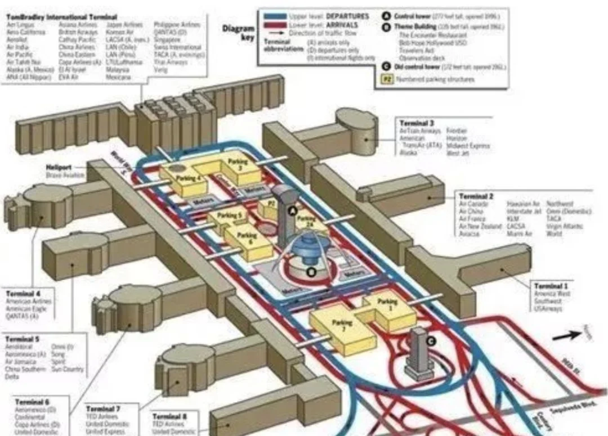
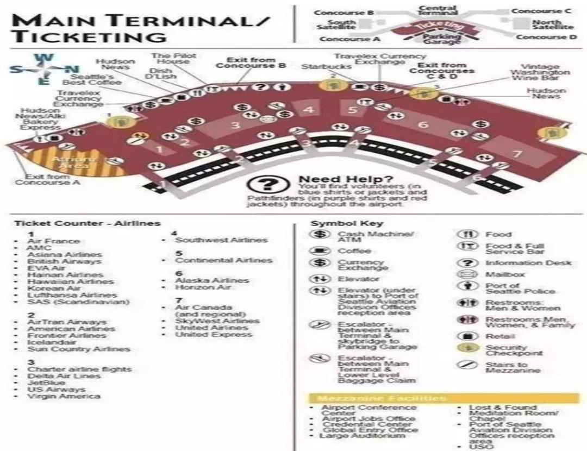

アメリカには国際線から国際線への「通過乗り継ぎ」という仕組みがありません。最終目的地がどこであれ、入国する人は全員、**最初に着陸した空港**で入国審査を受け、預けた手荷物を受け取り、税関を通り、荷物を再預け入れして、次の便に搭乗する前に国内線の保安検査を再度受けます。初めてのアメリカ旅行、観光でも仕事でも留学でも、旅のこの部分が最もよくつまずくところです。

国際線を受け入れる空港は数多くあります。ロサンゼルス、サンフランシスコ、シアトル、ニューヨーク、シカゴ、アトランタ、ワシントン、デトロイトなどです。このガイドは2部構成です。**一般的な手順**と、**最初の入国地として最もよく使われる7空港**、すなわちロサンゼルス（LAX）、サンフランシスコ（SFO）、アトランタ（ATL）、シカゴ・オヘア（ORD）、ニューヨーク・ニューアーク（EWR）、シアトル（SEA）、デトロイト（DTW）を取り上げ、それぞれでどのシャトルや列車に乗り、どの通路を進むかを説明します。

## 1. アメリカ到着後の乗り継ぎ手順

どこに着陸しても、アメリカでの乗り継ぎは同じ5つのステップを踏みます。**入国審査 → 手荷物受取 → 税関 → 手荷物の再預け入れ → ターミナル移動と保安検査のやり直し**です。

### 1. 入国審査

人波に従うか、Immigration and Arrivalの表示に従って入国審査場へ向かいます。ビザやESTAを持つ旅行者は訪問者レーンに並び、旅についての簡単な質問に答えます。二次審査に回された人は別の窓口で対応します。**入国審査の待合エリアでは写真撮影が禁止され、携帯電話などの電子機器の使用も禁止されています**。列に並ぶ前にしまってください。

### 2. 手荷物受取

入国審査の後、ターンテーブルで預けた荷物を受け取ります。**後続便が国内線であっても、荷物は自動的に積み替えられません**。自分でベルトから降ろし、税関を通って持ち出す必要があります。

### 3. 税関

機内で記入した申告書（青い用紙。予備は到着ホールにあります）を提出し、税関を通ります。申告するものがあれば正直に記入して赤い通路へ、なければ緑の通路を進みます。この扉を抜ければ、正式にアメリカに入国したことになります。

### 4. 手荷物の再預け入れ

税関の後、そのまま空港の外へ出ないでください。まず**乗り継ぎ便またはトランジットのカウンター**を探し、荷物を預け直します。国際線の到着ホールには通常、主要航空会社の乗り継ぎカウンターがあります。たとえばシカゴ・オヘアのターミナル5では、UnitedとAmericanがそれぞれ専用カウンターを持っています。着陸したターミナルに航空会社の乗り継ぎ窓口がない場合は、次の便が出るターミナルまで荷物を運び、そこで預け入れる必要があります。

### 5. ターミナル移動と保安検査のやり直し

次に搭乗券に従って正しいターミナルとコンコースへ向かいます。アメリカの空港は広く、ターミナル間は通常、空港内列車かシャトルバスで結ばれています。**国内線出発エリアに入る前には、旅の最初と同じように保安検査をもう一度受けなければなりません**。7空港の空港内移動手段は以下にまとめ、各空港の詳細は次のセクションで説明します。

| 空港 | ターミナル間の移動方法 | 一言注意 |
| --- | --- | --- |
| LAX ロサンゼルス | 無料のターミナル間シャトルバス、一部は徒歩通路 | ターミナルが9つに分かれており、徒歩移動は遅い |
| SFO サンフランシスコ | AirTrain（赤線と青線） | 国際線の到着は国際線ターミナル |
| ATL アトランタ | 地下のPlane Train | 市内地下鉄のMARTAと混同しないこと |
| ORD シカゴ | ATS空港内列車 | 国際線の到着はターミナル5。ATSに乗る |
| EWR ニューアーク | AirTrain（A、B、Cの3駅） | 国際線の到着は主にターミナルB |
| SEA シアトル | 主にメインターミナル内の徒歩 | 搭乗口番号のアルファベットがコンコース |
| DTW デトロイト | ターミナル内トラム、ターミナル間シャトル | デルタはマクナマラ、他の航空会社はノースターミナル |

### 6. 乗り継ぎ時間の目安

元の資料は主要空港について明確です。時間は多ければ多いほどよい、というものです。

| 空港 | 確保する時間 | 理由 |
| --- | --- | --- |
| ORD シカゴ | 2時間以上 | 国際線の到着はターミナル5。ATSに乗り、保安検査をやり直す |
| DTW デトロイト | 2時間以上 | 90分は非常に厳しく、ターミナル間シャトルでさらに移動が増える |
| LAX ロサンゼルス | ターミナル間を徒歩で移動するなら最低40分 | ターミナルが9つに分かれ、シャトルは一方通行の循環 |
| その他の空港 | 1.5〜2時間 | 入国審査、手荷物受取、税関、保安検査の列 |

繁忙期、祝日前後、夜の到着では、余裕を見てさらに30〜60分を加えてください。

## 2. 7つの空港

### 1. LAX ロサンゼルス国際空港

ロサンゼルスには**9つのターミナル**（ターミナル1〜8と、トム・ブラッドリー国際線ターミナル、TBIT、別名ターミナルB）があり、**それぞれが別の建物**で、道路、シャトルバス、一部の徒歩通路だけで結ばれています。現在、国際線の主な到着地点はTBITで、中国の主要航空会社の便の多くもここに着きます。

LAXでターミナルを移動する際に重要な点は2つです。

- **ターミナル間シャトルバスだけに乗る**（元の資料ではShuttle Bus A）。駐車場、レンタカーセンター、地下鉄駅へ向かうバスも複数あるため、間違ったバスに乗ると空港の外に出てしまいます。
- **シャトルは一方通行の循環**なので、一周に長い時間がかかることがあります。またTBITでは、途中の案内表示が貧弱なため、停車位置を見るにはターミナルの端まで歩く必要があります。隣接するターミナル間には徒歩通路もありますが、TBITからUnitedのエリアまで歩くと**最低40分**かかります。乗り継ぎが厳しい場合は徒歩を考えないでください。

手荷物について。各ターミナルにはそれぞれ入国審査場があり、手順は他の空港と同じです。入国審査、手荷物受取、税関です。税関の後、**すべての航空会社が到着したターミナルに乗り継ぎカウンターを持っているわけではない**ことに注意してください。次の便が出発するターミナルまで自分で荷物を運ばなければならない場合があります。

### 2. SFO サンフランシスコ国際空港

サンフランシスコ国際空港はUnitedの主要ハブであり、アラスカ航空のフォーカスシティでもあるため、特にUnitedの乗客がここで乗り継ぐことがよくあります。空港には**4つのターミナル**があります。ターミナル1、2、3が国内線を扱い、**国際線はすべて国際線ターミナルに到着**します。同ターミナルはAとGの2つの搭乗エリアに分かれています。

入国審査と手荷物受取の後、そのまま進みます。申告する物品がある乗客は用紙に記入し、それ以外の人は税関をそのまま通過します。乗り継ぎの場合、案内表示をよく読んでください。**到着ロビーと乗り継ぎ便出口はホールの反対側の端**にあるため、曲がる方向を間違えると遠回りになります。

案内に従って進めば、航空会社の乗り継ぎ手荷物カウンターに着きます。荷物を預けたら、空港の**AirTrain**がターミナル間を結びます。

AirTrainには2つの路線があります。**赤線**はターミナル、ターミナル駐車場、BART駅に停車し、**青線**はさらにレンタカーセンターまで運行します。次のターミナルに入る前には、国内線出発時と同じく保安検査を受ける必要があります。元の資料には、SFOの手荷物カートが無料であるとも書かれています。

### 3. ATL ハーツフィールド＝ジャクソン・アトランタ国際空港

アトランタは**デルタ航空最大のハブ**で、上海発のデルタ便はここで乗り継ぐことが非常に多い空港です。空港には**国内線ターミナルが1つ**（北側と南側）と**国際線ターミナル**（コンコースF）があり、乗客が実際に接するのは**T、A、B、C、D、E、Fの7つのコンコース**です。各便はほぼ決まったターミナルとゲートを使います。

コンコース間は**地下のPlane Train**で結ばれ、非常に頻繁に運行しています。Tから一番奥のFまで約十数分です。元の資料はこの空港内列車を「地下鉄」と呼んでいますが、**市内地下鉄のMARTA**と混同しやすいので注意してください。MARTAの駅は**国内線ターミナル**側にあり、アトランタ中心部へ出るためのものです。乗り継ぎには必要ありません。入国審査の後はPlane Trainの表示に従えば、次の便へ向かえます。

元の資料の注意点は次のとおりです。

- アトランタの**手荷物カートは有料**で、クレジットカードで支払います。
- **空港のWi-Fiは有料**なので、着陸後すぐにオンラインになれるとは考えないでください。
- 夏時間のアトランタは中国より12時間遅れ、冬時間は13時間遅れです。機内で腕時計を現地時間に合わせておけば、到着時刻や乗り継ぎに余裕があるかを判断しやすくなります。
- 上海からアトランタまでは飛行時間が約14時間です。

### 4. ORD シカゴ・オヘア国際空港

シカゴ・オヘアは北米で最も忙しい空港の一つで、アメリカ各地へ向かう旅行者の玄関口です。**4つのターミナル（1、2、3、5）と9つのコンコース（B、C、E、F、G、H、K、L、M）**に**186のゲート**があり、**国際線はすべてターミナル5に到着**します。

着陸後、申告書を持って人波に従い税関へ向かいます。ここでは「人波に従う」がよく機能します。**入国審査の待合エリアでは写真撮影と携帯電話などの電子機器の使用が厳しく禁止されている**ため、列に並ぶ間にしまってください。税関を抜けて荷物を受け取ったら、**そのまま空港の外へ出ないでください**。両側のエレベーターで空港内列車の階へ上がります。

空港内列車は**ATS（Airport Transit System）**で、停車順は次のとおりです。国内線ターミナル3つ → 国際線ターミナル → 駐車場 → CTA地下鉄駅 → バスターミナル。**乗る前に、次の便がどのターミナルから出るか確認してください**。迷った場合は、地上スタッフに乗り継ぎシャトルの場所を尋ねましょう。概して、ターミナル1はUnited、ターミナル3はAmericanが中心で、ターミナル2は複数の国内線航空会社が共用しています。

ATSで正しい国内線ターミナルに着いたら、**アメリカの国内線保安検査をもう一度受けなければなりません**。保安検査を抜けたら、次の便のゲートを探して待ちます。元の資料によると、シカゴの空港Wi-Fiは有料で安くないため、オフラインになる心構えが必要です。また、乗り継ぎには**最低2時間**を見てください。

### 5. EWR ニューヨーク・ニューアーク・リバティ国際空港

ニューアークはマンハッタンから約16マイルの距離にあり、ニューヨーク都市圏を担う3空港の一つです。ほかはジョン・F・ケネディ（JFK）とラガーディア（LGA）で、LGAがマンハッタンに最も近く、市内観光の際によく選ばれます。ニューアークは全米でも特に忙しい空港で、**Unitedのハブ**です（元の資料の「コンチネンタル航空」は2012年にUnitedへ統合）。UnitedはターミナルCとターミナルAの一部を使用しています。

ニューアークには**A、B、Cの3つのターミナルがあり、ターミナルBが主な国際線ターミナル**ですが、中国からの便がターミナルCに到着することもあります。着陸後は人波かImmigrationの表示に従って手続きを済ませます。ターミナルCの入国審査場は下の図のとおりです。

次に荷物を受け取ります。**EWRの手荷物カートは5ドル**なので、紙幣か硬貨を用意しておいてください。荷物を持って税関を通ります。申告するものがなければ、そのまま出て乗り継ぎカウンターを探し、荷物を預け直します。

荷物を預け直したら、次の便が出るターミナルへ向かいます。空港の**AirTrain**はターミナルA、B、Cの間を**オフピーク時は約15分間隔、ピーク時は約3分間隔**で運行し、P2、P3、P4駐車場とNJ Transit・Amtrakの鉄道駅も結んでいます。鉄道駅からはニューヨーク・ペン駅へ直通できます。

### 6. SEA シアトル＝タコマ国際空港

シアトルでの乗り継ぎは比較的簡単です。他の乗客に従って機内から入国審査場へ向かい、入国審査を受け、荷物を受け取り（手荷物受取）、税関を通り、荷物を再預け入れして、もう一度保安検査を受けます。英語が読める人、あるいは単に人波に従える人なら、まず迷いません。

チェックインカウンターはすべて**メインターミナル**にあり、航空機は異なるコンコースに駐機します。シアトルには**A、B、C、Dの4つのコンコース**があり、淡い緑、オレンジ、濃い緑、黄土色で色分けされています。中国で搭乗券を受け取った時点で次の便の出発場所がわかります。**シアトルのゲート番号はアルファベット1文字と数字2桁で、アルファベットがコンコースを表す**からです。CならコンコースC、DならコンコースDです。

### 7. DTW デトロイト・メトロポリタン・ウェイン郡空港

デトロイトは**デルタ航空のハブ**で、全米でも特に近代的な空港の一つです。**マクナマラ・ターミナルとノース・ターミナルの2つ**があります。**デルタとスカイチーム加盟航空会社はマクナマラ**を使い、その他の航空会社はノース・ターミナルを使います。

マクナマラの国際線到着は**グリーン階**（下層階）に来ます。税関を通り、同じ階で荷物を受け取り、必要ならそこで再預け入れします。その後、上の**ブルーのレベル2**へ上がります。デルタ便の多くは**コンコースA**から出発し、コンコースBやCへは有名なライトトンネルを通るか、ターミナル内のエクスプレストラムで移動します。

**ノース・ターミナル**へはターミナル間シャトルに乗ります。Terminal–Westin–Terminalサービスで**10分間隔**、マクナマラからノース・ターミナルまで約7分、途中でWestinホテルに停車します。ノース・ターミナル自体はシンプルですが、**入る前に保安検査をやり直します**。

近代的ではありますが、デトロイトでも乗り継ぎには余裕が必要です。**2時間以上を見てください。90分は非常に厳しい**ので、予約時に考慮してください。

## 3. 見落としやすい詳細

- **手荷物カート：** 元の資料によると、SFOでは無料、ATLでは有料（カード払い）、EWRでは5ドルです。小額紙幣と使えるクレジットカードを持っておけば問題ありません。
- **空港のWi-Fi：** ATLとORDでは有料なので、着陸した瞬間にオンラインになれるとは限りません。重要な連絡先はオフラインでも読める場所に控えておいてください。
- **時差：** アトランタは夏時間で中国より12時間、冬時間で13時間遅れています。機内で腕時計を現地時間に合わせておけば、到着時刻と乗り継ぎ時間の見当がつけやすくなります。
- **携帯電話とカメラ：** 入国審査場と税関の待合エリアでは、携帯電話などの電子機器の使用が禁止されています。写真も撮らないでください。
- **荷物は自分で運ぶ：** スルーチケットであっても、アメリカに入国したら自分で荷物を受け取り、税関を通り、再び預け入れます。次の便へ自動的に積み替えられることはありません。

ここに掲載した空港図は元の資料によるもので、空港と航空会社は常に変わります。資料にあったコンチネンタル航空はUnitedに、USエアウェイズはAmericanに、ノースウェストはデルタに統合されました。旅行当日の状況は空港と航空会社に確認してください。

## 関連リンク

- **このサイト内**：[ロサンゼルス LAX](/airport/LAX)、[サンフランシスコ SFO](/airport/SFO)、[アトランタ ATL](/airport/ATL)、[シカゴ・オヘア ORD](/airport/ORD)、[ニューアーク EWR](/airport/EWR)、[シアトル SEA](/airport/SEA)、[アメリカ（US）](/country/US)
- **Wikipedia**：[ロサンゼルス LAX](https://en.wikipedia.org/wiki/Los_Angeles_International_Airport)、[サンフランシスコ SFO](https://en.wikipedia.org/wiki/San_Francisco_International_Airport)、[アトランタ ATL](https://en.wikipedia.org/wiki/Hartsfield%E2%80%93Jackson_Atlanta_International_Airport)、[シカゴ・オヘア ORD](https://en.wikipedia.org/wiki/O'Hare_International_Airport)、[ニューアーク EWR](https://en.wikipedia.org/wiki/Newark_Liberty_International_Airport)、[シアトル SEA](https://en.wikipedia.org/wiki/Seattle%E2%80%93Tacoma_International_Airport)、[デトロイト DTW](https://en.wikipedia.org/wiki/Detroit_Metropolitan_Wayne_County_Airport)
- **百度百科**：[ロサンゼルス LAX](https://baike.baidu.com/item/%E6%B4%9B%E6%9D%89%E7%9F%B6%E5%9B%BD%E9%99%85%E6%9C%BA%E5%9C%BA)、[サンフランシスコ SFO](https://baike.baidu.com/item/%E6%97%A7%E9%87%91%E5%B1%B1%E5%9B%BD%E9%99%85%E6%9C%BA%E5%9C%BA)、[アトランタ ATL](https://baike.baidu.com/item/%E5%93%88%E8%8C%A8%E8%8F%B2%E5%B0%94%E5%BE%B7-%E6%9D%B0%E5%85%8B%E9%80%8A%E4%BA%9A%E7%89%B9%E5%85%B0%E5%A4%A7%E5%9B%BD%E9%99%85%E6%9C%BA%E5%9C%BA)、[シカゴ・オヘア ORD](https://baike.baidu.com/item/%E5%A5%A5%E9%BB%91%E5%B0%94%E5%9B%BD%E9%99%85%E6%9C%BA%E5%9C%BA)、[ニューアーク EWR](https://baike.baidu.com/item/%E7%BA%BD%E7%93%A6%E5%85%8B%E8%87%AA%E7%94%B1%E5%9B%BD%E9%99%85%E6%9C%BA%E5%9C%BA)、[シアトル SEA](https://baike.baidu.com/item/%E8%A5%BF%E9%9B%85%E5%9B%BE-%E5%A1%94%E7%A7%91%E9%A9%AC%E5%9B%BD%E9%99%85%E6%9C%BA%E5%9C%BA)、[デトロイト DTW](https://baike.baidu.com/item/%E5%BA%95%E7%89%B9%E5%BE%8B%E9%83%BD%E4%BC%9A%E9%9F%A6%E6%81%A9%E5%8E%BF%E6%9C%BA%E5%9C%BA)
