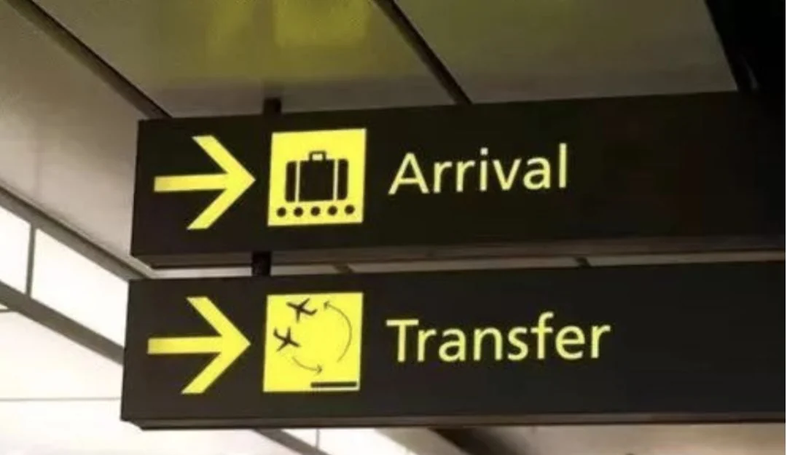

미국에는 국제선에서 국제선으로 바로 갈아타는 환승이 없습니다. 최종 목적지가 어디든, 미국에 들어오는 사람은 모두 **처음 도착한 공항**에서 입국 심사를 받고, 위탁 수하물을 찾아 세관을 통과하고, 짐을 다시 부친 뒤 국내선 보안 검색을 다시 통과해야 다음 항공편을 탈 수 있습니다. 관광, 업무, 유학 등 처음 미국을 찾는 여행에서 문제가 가장 자주 생기는 구간이 바로 이 부분입니다.

국제선 도착을 받는 공항은 많습니다. 로스앤젤레스, 샌프란시스코, 시애틀, 뉴욕, 시카고, 애틀랜타, 워싱턴, 디트로이트 등입니다. 이 글은 두 부분으로 나뉩니다. **일반적인 절차**와, **첫 입국 공항으로 가장 자주 쓰이는 일곱 곳** — 로스앤젤레스(LAX), 샌프란시스코(SFO), 애틀랜타(ATL), 시카고 오헤어(ORD), 뉴욕 뉴어크(EWR), 시애틀(SEA), 디트로이트(DTW) — 입니다. 공항마다 어떤 셔틀을 타고 어떤 통로를 따라가야 하는지도 정리했습니다.

## 1. 미국 도착 후 환승 절차

어디에 내리든 미국에서의 환승은 같은 다섯 단계를 거칩니다. **입국 심사 → 수하물 찾기 → 세관 → 수하물 재위탁 → 터미널 이동 및 보안 검색 재통과.**

### 1. 입국 심사

사람들의 흐름을 따라가거나, 입국 심사(Immigration)와 도착(Arrival) 표지판을 따라 입국 심사장으로 갑니다. 비자나 ESTA가 있는 여행자는 방문객 통로에 줄을 서서 여행에 관한 간단한 질문 몇 개에 답하고, 2차 심사로 안내된 사람은 별도 창구에서 심사를 받습니다. **입국 심사 대기 구역에서는 사진 촬영이 금지되며, 휴대전화와 전자기기 사용도 금지됩니다.** 줄을 서기 전에 모두 넣어 두십시오.

### 2. 수하물 찾기

입국 심사를 마치면 컨베이어 벨트에서 위탁 수하물을 찾습니다. 주의할 점은 **후속 항공편이 국내선이라도 수하물이 자동으로 옮겨지지 않는다**는 것입니다. 직접 벨트에서 내려 세관을 지나 밖으로 가지고 나가야 합니다.

### 3. 세관

비행기에서 작성한 신고서(파란색 양식이며, 여분은 도착 홀에 있습니다)를 제출하고 세관을 통과합니다. 신고할 물품이 있으면 양식을 사실대로 작성해 적색 통로를, 없으면 녹색 통로로 나가십시오. 이 문을 지나면 공식적으로 미국에 들어온 것입니다.

### 4. 수하물 재위탁

세관을 통과한 뒤 바로 공항 밖으로 나가지 마십시오. 먼저 **환승 항공편 접수처 또는 환승 카운터**를 찾아 수하물을 다시 맡기십시오. 국제선 도착 홀에는 보통 주요 항공사의 환승 카운터가 있습니다. 예를 들어 시카고 오헤어 5터미널에는 United와 American의 카운터가 각각 있습니다. 도착한 터미널에 해당 항공사의 환승 데스크가 없다면, 다음 항공편이 출발하는 터미널로 짐을 직접 가져가 그곳에서 부쳐야 합니다.

### 5. 터미널 이동과 보안 검색 재통과

그다음 탑승권에 적힌 터미널과 콘코스로 이동합니다. 미국 공항은 크고 터미널은 보통 내부 열차나 셔틀버스로 연결되며, **국내선 출발 구역에 들어가려면 여정을 시작할 때와 똑같이 보안 검색을 한 번 더 통과해야 합니다**. 일곱 공항의 내부 이동 수단은 아래에 정리했고, 공항별 세부 내용은 다음 장에 이어집니다.

| 공항 | 터미널 간 이동 방법 | 한 줄 주의 |
| --- | --- | --- |
| LAX 로스앤젤레스 | 무료 터미널 간 셔틀버스, 일부 보행 통로 | 터미널이 아홉 개로 분리되어 있어 걸어서 이동하면 느립니다 |
| SFO 샌프란시스코 | AirTrain (적색·청색 노선) | 국제선 도착은 국제선 터미널에 있습니다 |
| ATL 애틀랜타 | 지하의 Plane Train | 시내 지하철인 MARTA와 혼동하지 마십시오 |
| ORD 시카고 | ATS 공항 열차 | 국제선 도착은 5터미널이며 ATS를 탑니다 |
| EWR 뉴어크 | AirTrain (A, B, C 세 정류장) | 국제선 도착은 주로 B터미널입니다 |
| SEA 시애틀 | 대부분 도보, 메인 터미널 내부 | 게이트 번호의 알파벳이 곧 콘코스입니다 |
| DTW 디트로이트 | 터미널 내 트램, 터미널 간 셔틀 | Delta는 맥나마라, 다른 항공사는 노스 터미널입니다 |

### 6. 환승 시간은 얼마나 두어야 하나

원문 자료는 대형 공항에 대해 분명하게 말합니다. 시간은 많을수록 좋습니다.

| 공항 | 확보할 시간 | 이유 |
| --- | --- | --- |
| ORD 시카고 | 2시간 이상 | 국제선 도착이 5터미널이고, ATS를 타고 보안 검색을 다시 받습니다 |
| DTW 디트로이트 | 2시간 이상 | 90분은 매우 빠듯하고, 터미널 셔틀이 한 구간을 더합니다 |
| LAX 로스앤젤레스 | 터미널 사이를 걸을 경우 최소 40분 | 터미널 아홉 개와 한 방향 순환 셔틀 |
| 그 밖의 공항 | 1.5~2시간 | 입국 심사, 수하물 찾기, 세관, 보안 검색의 줄 |

성수기, 공휴일 전후, 저녁 도착편에는 여유를 위해 30~60분을 더 잡으십시오.

## 2. 일곱 개 공항

### 1. LAX 로스앤젤레스 국제공항

로스앤젤레스에는 **터미널이 아홉 개**(1~8터미널과 톰 브래들리 국제선 터미널 TBIT, 즉 B터미널) 있고 **각각이 별개의 건물**이라 도로와 셔틀버스, 몇 개의 보행 통로로만 이어집니다. 현재 국제선 도착의 주 통로는 TBIT이고, 중국 주요 항공사의 항공편 대부분이 이곳에 내립니다.

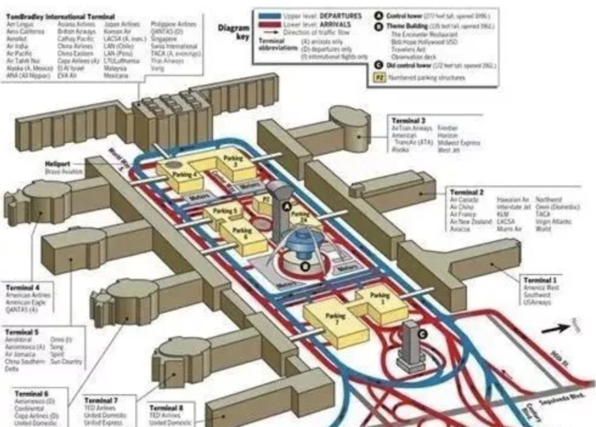

LAX에서 터미널을 옮길 때 중요한 것은 두 가지입니다.

- **터미널 간 셔틀버스만 타십시오** (원문 자료에서는 Shuttle Bus A라고 부릅니다). 주차장, 렌터카 센터, 지하철역으로 가는 버스도 여러 대 있으니, 잘못 타면 공항을 벗어나게 됩니다.
- **셔틀은 한 방향으로 순환**하므로 한 바퀴 도는 데 오래 걸릴 수 있고, TBIT에서는 정류장이 보이는 터미널 끝까지 걸어가야 합니다. 중간의 안내 표지판이 부실하기 때문입니다. 이웃한 터미널 사이에는 보행 통로가 있지만, TBIT에서 United 구역까지는 **최소 40분**이 걸립니다. 환승 시간이 빠듯하면 시도하지 마십시오.

수하물에 관해서는 모든 터미널에 자체 입국 심사장이 있고 절차는 다른 공항과 같습니다. 입국 심사, 수하물 찾기, 세관 순서입니다. 세관을 지난 뒤에는 **도착한 터미널에 환승 카운터가 없는 항공사도 있다**는 점을 기억하십시오. 다음 항공편이 출발하는 터미널까지 짐을 직접 끌고 가야 할 수 있습니다.

### 2. SFO 샌프란시스코 국제공항

샌프란시스코 국제공항은 United의 주요 허브이자 Alaska Airlines의 포커스 시티여서, 특히 United 승객이 이곳에서 환승하는 경우가 많습니다. **터미널은 네 개**입니다. 1, 2, 3터미널이 국내선을 처리하고, **국제선은 모두 국제선 터미널로 도착**하며 이 터미널은 A와 G 두 탑승 구역으로 나뉩니다.

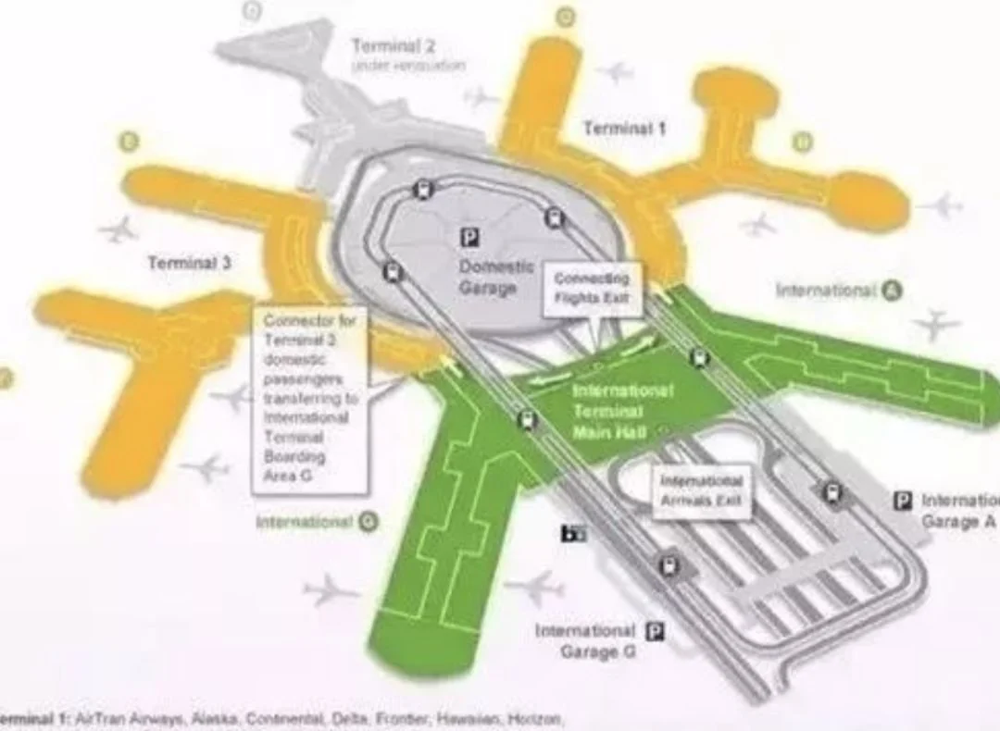

입국 심사와 수하물 찾기를 마치고 계속 이동합니다. 신고할 물품이 있는 승객은 양식을 작성하고, 나머지는 세관을 그대로 통과합니다. 환승이라면 표지판을 잘 읽으십시오. **도착 로비와 환승 출구(Connecting Flights Exit)가 홀의 반대쪽 끝에 있어서**, 잘못 들면 홀을 크게 한 바퀴 돌아야 합니다.

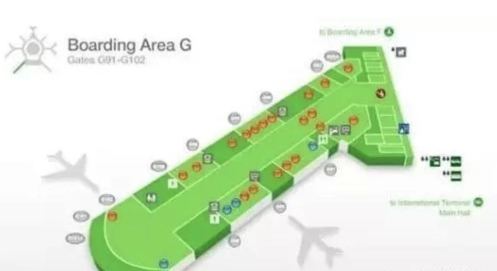

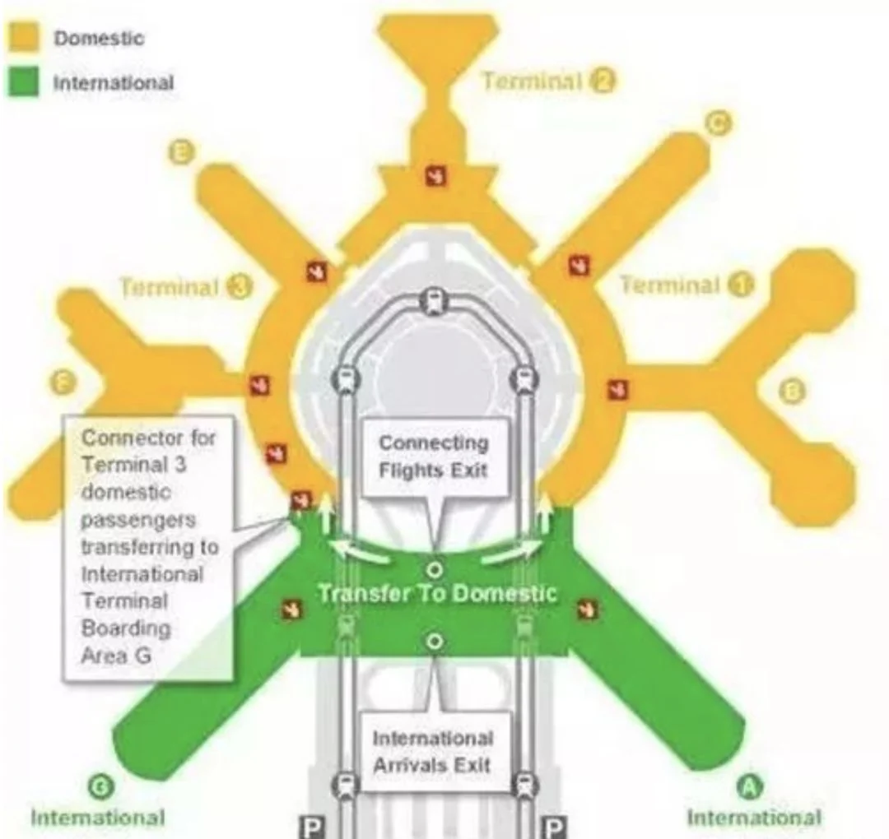

표지판을 따라가면 이용 항공사의 환승 수하물 데스크에 닿습니다. 짐을 맡기면 공항의 **AirTrain**이 터미널 사이를 이어 줍니다.

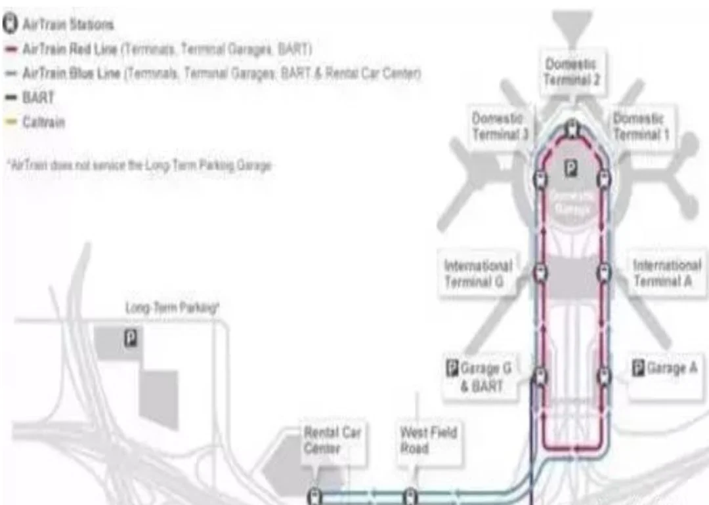

AirTrain은 두 개 노선입니다. **적색 노선**은 터미널, 터미널 주차장, BART 역에 서고, **청색 노선**은 여기에 렌터카 센터가 더해집니다. 다음 터미널에 들어가기 전에는 국내선 출발 때와 마찬가지로 보안 검색을 다시 통과해야 합니다. 원문 자료는 SFO의 수하물 카트가 무료라는 점도 전합니다.

### 3. ATL 하츠필드–잭슨 애틀랜타 국제공항

애틀랜타는 **Delta의 최대 허브**이고, 상하이에서 오는 Delta 항공편이 이곳에서 환승하는 경우가 매우 많습니다. 공항에는 **국내선 터미널 하나**(노스와 사우스 두 구역)와 **국제선 터미널 하나**(F 콘코스)가 있는데, 승객이 실제로 상대하는 것은 **일곱 개 콘코스 T, A, B, C, D, E, F**이고 항공편마다 터미널과 게이트가 비교적 고정되어 있습니다.

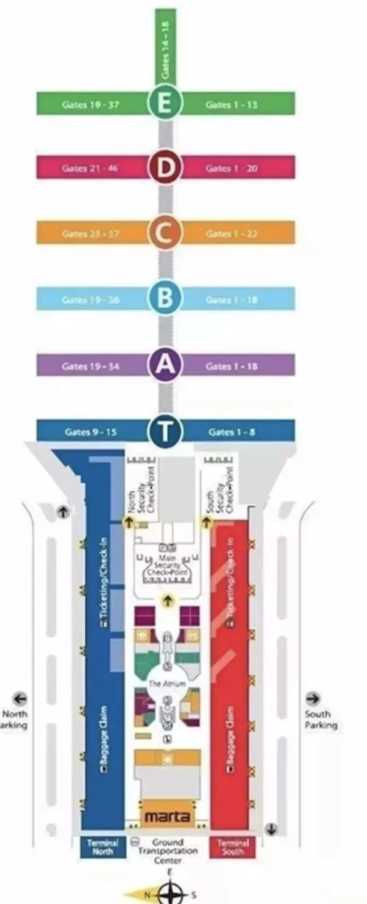

콘코스는 **지하의 Plane Train**으로 이어지고 배차가 매우 잦습니다. T에서 맨 끝 F까지 약 십여 분입니다. 원문 자료는 이 공항 열차를 "지하철"이라고 부르는데, 시내 지하철인 **MARTA와 혼동하기 쉽습니다**. MARTA 역은 **국내선 터미널** 쪽에 있고 애틀랜타 도심으로 나가는 수단입니다. 환승에는 필요하지 않습니다. 입국 심사를 마치고 Plane Train 표지판을 따라가면 다음 항공편으로 향하는 것입니다.

원문 자료의 당부 사항입니다.

- 애틀랜타의 **수하물 카트는 유료**이고 신용카드로 결제합니다.
- **공항 와이파이도 유료**이므로, 도착하자마자 인터넷이 될 것이라 기대하지 마십시오.
- 서머타임 기간에 애틀랜타는 중국보다 12시간, 겨울에는 13시간 느립니다. 기내에서 시계를 현지 시간으로 맞춰 두면 언제 도착하는지, 환승이 여유 있는지 판단하기 쉽습니다.
- 상하이에서 애틀랜타까지 비행 시간은 약 14시간입니다.

### 4. ORD 시카고 오헤어 국제공항

시카고 오헤어는 북미에서 가장 붐비는 공항 중 하나이자 미국 각지로 이동하는 여행자의 관문입니다. **터미널 네 개(1, 2, 3, 5)와 콘코스 아홉 개(B, C, E, F, G, H, K, L, M)**에 걸쳐 **게이트 186개**가 있고, **국제선은 모두 5터미널에 도착**합니다.

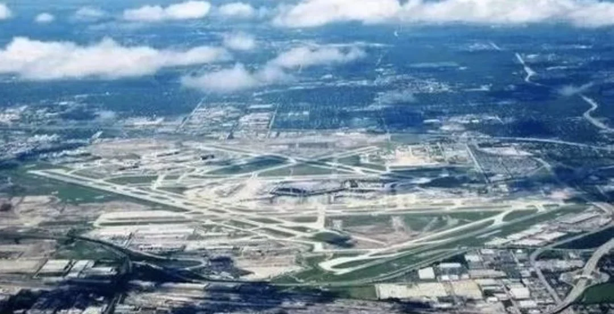

도착하면 신고서를 들고 사람들을 따라 세관으로 가십시오. 이곳에서는 "사람들을 따라가기"가 잘 통합니다. **입국 심사 대기 구역에서는 사진 촬영과 휴대전화 등 전자기기 사용이 엄격히 금지**되므로 줄을 서는 동안 넣어 두십시오. 세관을 통과해 짐을 찾았다면 **공항 밖으로 바로 나가지 마십시오**. 양쪽의 엘리베이터를 타고 위층 공항 열차로 올라가십시오.

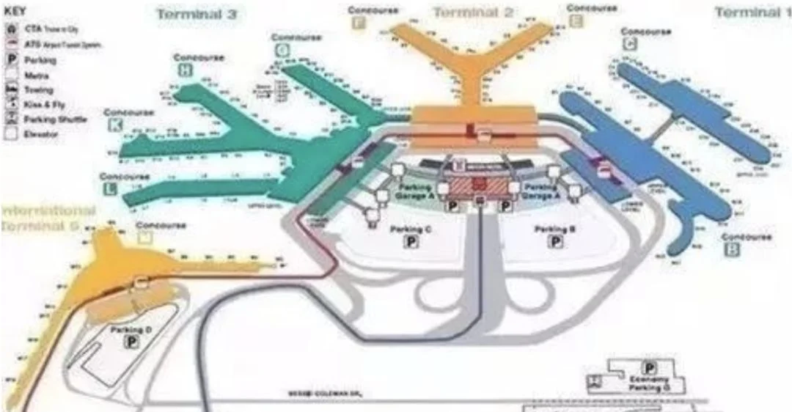

내부 열차는 **ATS(Airport Transit System)**이고 정차 순서는 다음과 같습니다. 국내선 터미널 세 곳 → 국제선 터미널 → 주차장 → CTA 지하철역 → 버스 정류장. **타기 전에 다음 항공편이 어느 터미널에서 출발하는지 확인**하고, 길을 잃으면 지상 직원에게 환승 셔틀 위치를 물으십시오. 대체로 1터미널은 United, 3터미널은 American이 주로 쓰고, 2터미널은 여러 국내 항공사가 함께 씁니다.

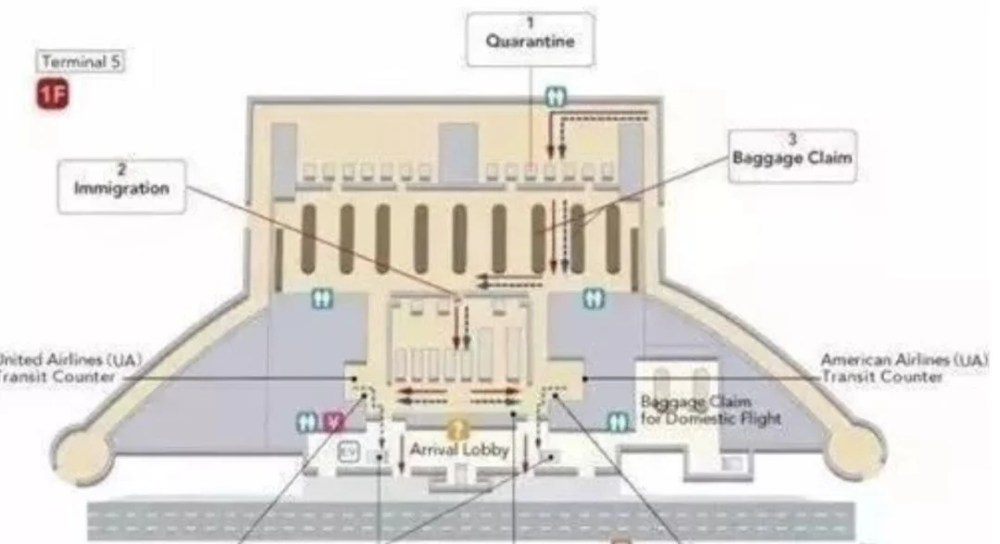

ATS가 맞는 국내선 터미널에 내려 주면 **미국 국내선 보안 검색을 다시 통과해야 합니다**. 보안 검색을 지나 다음 항공편 게이트를 찾아 그곳에서 기다리십시오. 원문 자료는 시카고 공항 와이파이가 유료이고 저렴하지도 않으니 오프라인일 각오를 하라고 덧붙이며, 환승에는 **최소 두 시간**을 잡으라고 합니다.

### 5. EWR 뉴욕 뉴어크 리버티 국제공항

뉴어크는 맨해튼에서 약 16마일 떨어져 있고 뉴욕 대도시권을 담당하는 세 공항 중 하나입니다. 나머지는 존 F. 케네디(JFK)와 라과디아(LGA)이며, 맨해튼에서 가장 가까운 곳은 LGA로 시내 관광을 갈 때 흔히 선택합니다. 뉴어크는 미국에서 가장 붐비는 공항 중 하나이며 **United의 허브**입니다(원문 자료의 "콘티넨털 항공"은 2012년 United에 합병되었습니다). United는 C터미널과 A터미널 일부를 씁니다.

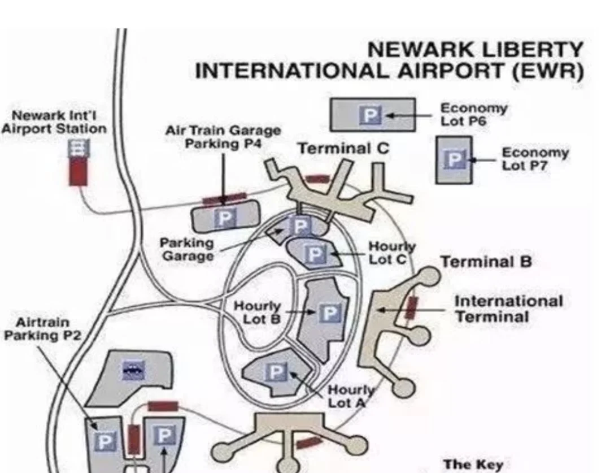

뉴어크에는 **터미널이 세 개(A, B, C)이고 B터미널이 주 국제선 터미널**이지만, 중국발 항공편이 C터미널에 도착하는 경우도 있습니다. 도착하면 사람들을 따라가거나 입국 심사(Immigration) 표지판을 따라 절차를 마치십시오. C터미널의 입국 심사 지점은 아래 그림과 같습니다.

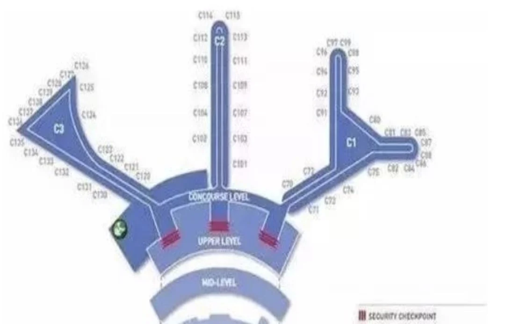

이어서 수하물을 찾습니다. **EWR의 수하물 카트는 $5**이므로 지폐나 동전을 준비하십시오. 짐을 끌고 세관을 통과하고, 신고할 것이 없으면 나가서 환승 카운터를 찾아 짐을 다시 맡기십시오.

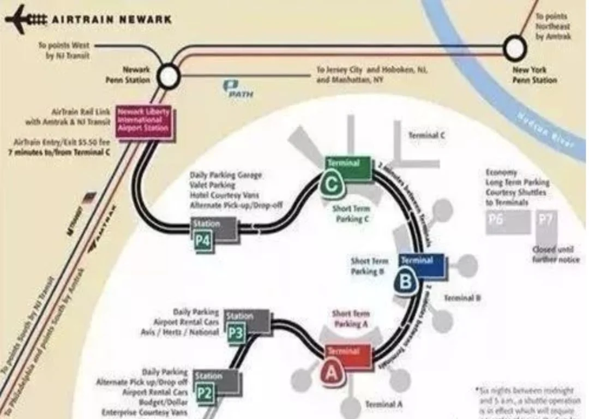

짐을 다시 부쳤으면 다음 항공편이 출발하는 터미널로 향합니다. 공항 **AirTrain**은 A, B, C터미널 사이를 운행하며 **비첨두 시간에는 약 15분, 첨두 시간에는 약 3분 간격**이고, P2·P3·P4 주차장과 NJ Transit·Amtrak 철도역도 잇습니다. 이 역에서 뉴욕 펜역으로 바로 갈 수 있습니다.

### 6. SEA 시애틀–터코마 국제공항

시애틀에서의 환승은 비교적 단순합니다. 동승한 승객들을 따라 입국 심사장으로 가서 입국 심사를 마치고, 수하물을 찾고, 세관을 통과하고, 짐을 다시 부친 뒤 보안 검색을 한 번 더 통과하면 됩니다. 영어를 읽을 수 있거나 그저 사람들을 따라가기만 해도 길을 잘못 들기 어렵습니다.

체크인 카운터는 모두 **메인 터미널**에 있고 항공기는 콘코스별로 도착합니다. 시애틀에는 **콘코스가 네 개(A, B, C, D)** 있고 연한 녹색, 주황, 진한 녹색, 황토색으로 구분됩니다. 중국에서 탑승권을 받을 때부터 다음 항공편이 어디서 출발하는지 알 수 있습니다. **시애틀의 게이트 번호는 알파벳 하나와 숫자 두 자리이고, 그 알파벳이 곧 콘코스**이기 때문입니다. C는 C 콘코스, D는 D 콘코스를 뜻합니다.

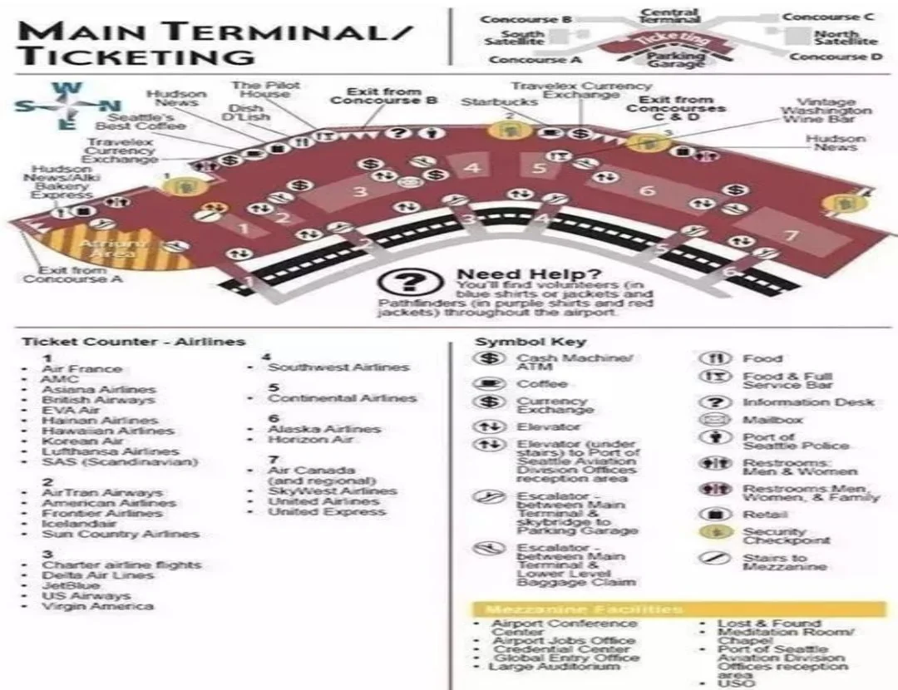

### 7. DTW 디트로이트 메트로폴리탄 웨인 카운티 공항

디트로이트는 **Delta의 허브**이자 미국에서 가장 현대적인 공항 중 하나입니다. **터미널은 두 개**로 맥나마라 터미널과 노스 터미널입니다. **Delta와 SkyTeam 파트너는 맥나마라**를 쓰고, 다른 항공사는 노스 터미널을 씁니다.

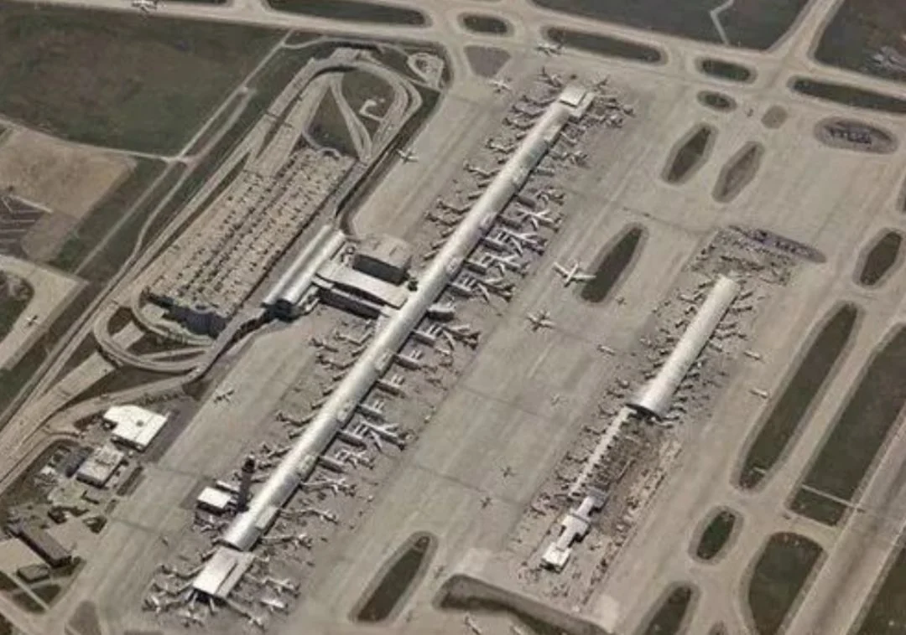

맥나마라의 국제선 도착은 **녹색 층**(아래층)으로 들어옵니다. 세관을 통과하고 같은 층에서 수하물을 찾은 뒤 필요하면 그 자리에서 다시 부치십시오. 그다음 위층 **청색 2층**으로 올라갑니다. Delta 항공편 대부분은 **A 콘코스**에서 출발하고, B나 C 콘코스로 가려면 유명한 라이트 터널(Light Tunnel)을 걸어 지나거나 터미널 내 익스프레스 트램을 타면 됩니다.

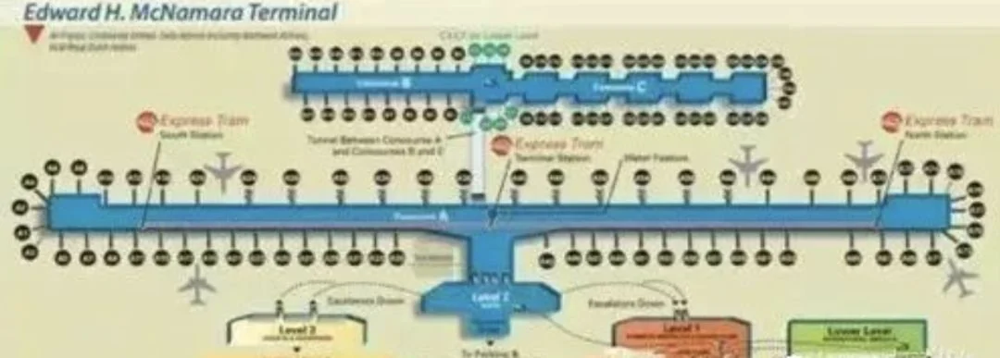

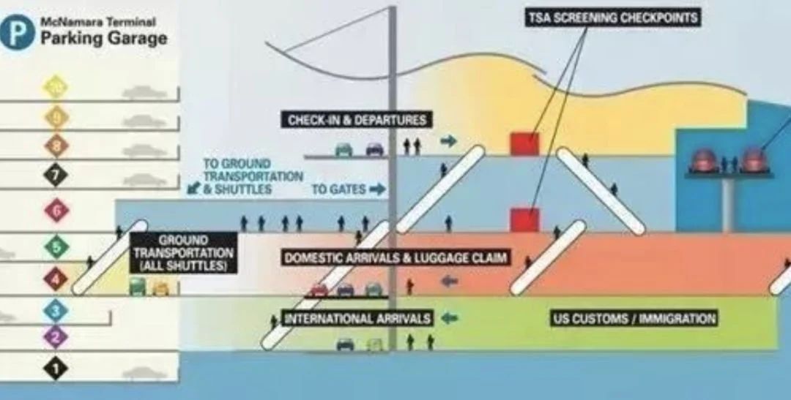

**노스 터미널**로 가려면 터미널 간 셔틀을 이용하십시오. Terminal–Westin–Terminal 노선으로 **10분 간격**이며, 맥나마라에서 노스 터미널까지 약 7분이고 중간에 웨스틴 호텔에 섭니다. 노스 터미널 자체는 단순하지만, **들어가기 전에 보안 검색을 다시 통과합니다**.

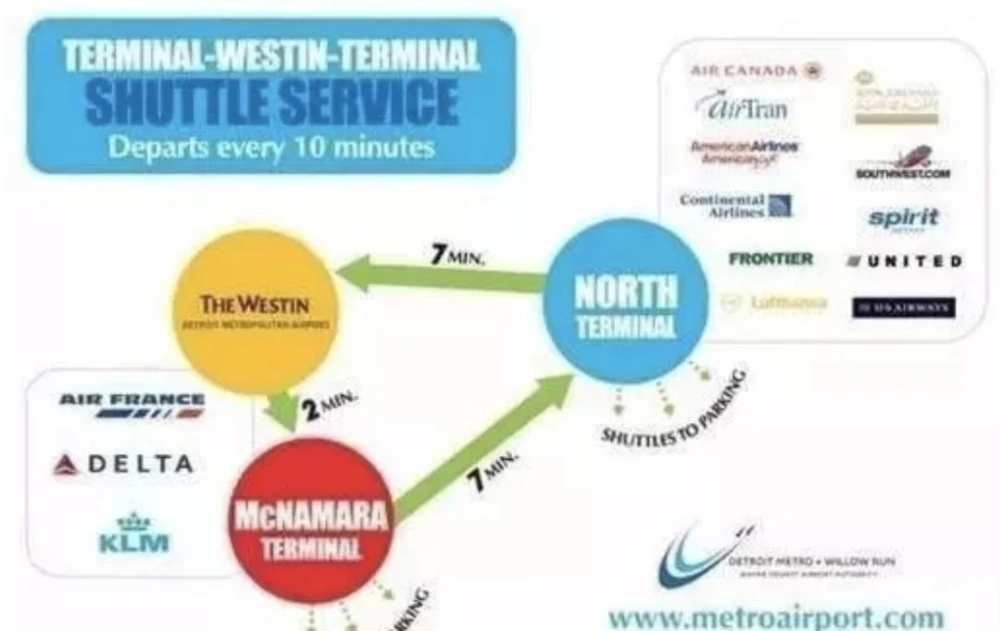

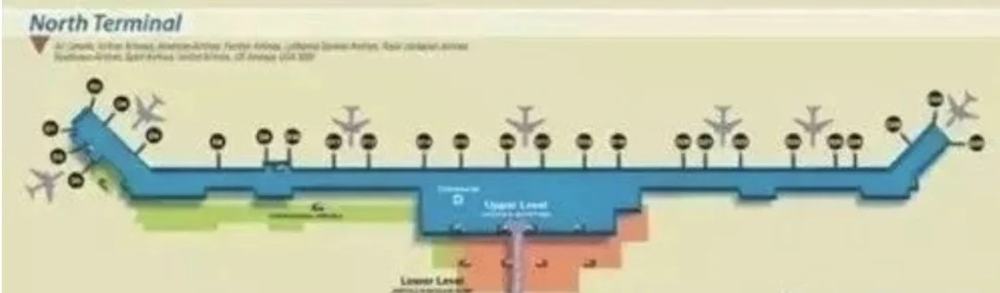

이렇게 현대적이어도 디트로이트는 넉넉한 환승 시간이 필요합니다. **두 시간 이상을 잡고, 90분은 매우 빠듯합니다.** 예약할 때 이 점을 염두에 두십시오.

## 3. 놓치기 쉬운 세부 사항

- **수하물 카트:** 원문 자료에 따르면 SFO에서는 무료, ATL에서는 유료(카드 결제), EWR에서는 $5입니다. 작은 지폐와 쓸 수 있는 신용카드를 준비해 두면 손해 볼 것이 없습니다.
- **공항 와이파이:** ATL과 ORD에서는 유료이므로 도착하자마자 인터넷이 될 것이라 기대하기 어렵습니다. 꼭 필요한 연락처는 오프라인으로 볼 수 있는 곳에 저장해 두십시오.
- **시차:** 애틀랜타는 서머타임 기간에 중국보다 12시간, 겨울에는 13시간 느립니다. 기내에서 시계를 현지 시간으로 맞춰 두면 도착 시각과 환승 여유를 훨씬 쉽게 가늠할 수 있습니다.
- **휴대전화와 카메라:** 입국 심사와 세관 대기 구역에서는 휴대전화 등 전자기기 사용이 금지되며, 사진도 찍어서는 안 됩니다.
- **짐은 직접 옮깁니다:** 연결 항공권이든 아니든 미국에 들어오면 짐을 찾아 세관을 지나 다시 부쳐야 합니다. 짐이 다음 항공편으로 저절로 따라가지 않습니다.

여기 실린 공항 도면은 원문 자료에서 가져온 것이고, 공항과 항공사는 계속 바뀝니다. 원문의 콘티넨털 항공은 United에, US Airways는 American에, 노스웨스트는 Delta에 합병되었습니다. 여행 당일의 상황은 공항과 항공사에서 확인하십시오.

## 관련 링크

- **이 사이트**: [로스앤젤레스 LAX](/airport/LAX), [샌프란시스코 SFO](/airport/SFO), [애틀랜타 ATL](/airport/ATL), [시카고 오헤어 ORD](/airport/ORD), [뉴어크 EWR](/airport/EWR), [시애틀 SEA](/airport/SEA), [미국 (US)](/country/US)
- **위키백과**: [로스앤젤레스 LAX](https://en.wikipedia.org/wiki/Los_Angeles_International_Airport), [샌프란시스코 SFO](https://en.wikipedia.org/wiki/San_Francisco_International_Airport), [애틀랜타 ATL](https://en.wikipedia.org/wiki/Hartsfield%E2%80%93Jackson_Atlanta_International_Airport), [시카고 오헤어 ORD](https://en.wikipedia.org/wiki/O'Hare_International_Airport), [뉴어크 EWR](https://en.wikipedia.org/wiki/Newark_Liberty_International_Airport), [시애틀 SEA](https://en.wikipedia.org/wiki/Seattle%E2%80%93Tacoma_International_Airport), [디트로이트 DTW](https://en.wikipedia.org/wiki/Detroit_Metropolitan_Wayne_County_Airport)
- **바이두 백과**: [로스앤젤레스 LAX](https://baike.baidu.com/item/%E6%B4%9B%E6%9D%89%E7%9F%B6%E5%9B%BD%E9%99%85%E6%9C%BA%E5%9C%BA), [샌프란시스코 SFO](https://baike.baidu.com/item/%E6%97%A7%E9%87%91%E5%B1%B1%E5%9B%BD%E9%99%85%E6%9C%BA%E5%9C%BA), [애틀랜타 ATL](https://baike.baidu.com/item/%E5%93%88%E8%8C%A8%E8%8F%B2%E5%B0%94%E5%BE%B7-%E6%9D%B0%E5%85%8B%E9%80%8A%E4%BA%9A%E7%89%B9%E5%85%B0%E5%A4%A7%E5%9B%BD%E9%99%85%E6%9C%BA%E5%9C%BA), [시카고 오헤어 ORD](https://baike.baidu.com/item/%E5%A5%A5%E9%BB%91%E5%B0%94%E5%9B%BD%E9%99%85%E6%9C%BA%E5%9C%BA), [뉴어크 EWR](https://baike.baidu.com/item/%E7%BA%BD%E7%93%A6%E5%85%8B%E8%87%AA%E7%94%B1%E5%9B%BD%E9%99%85%E6%9C%BA%E5%9C%BA), [시애틀 SEA](https://baike.baidu.com/item/%E8%A5%BF%E9%9B%85%E5%9B%BE-%E5%A1%94%E7%A7%91%E9%A9%AC%E5%9B%BD%E9%99%85%E6%9C%BA%E5%9C%BA), [디트로이트 DTW](https://baike.baidu.com/item/%E5%BA%95%E7%89%B9%E5%BE%8B%E9%83%BD%E4%BC%9A%E9%9F%A6%E6%81%A9%E5%8E%BF%E6%9C%BA%E5%9C%BA)
