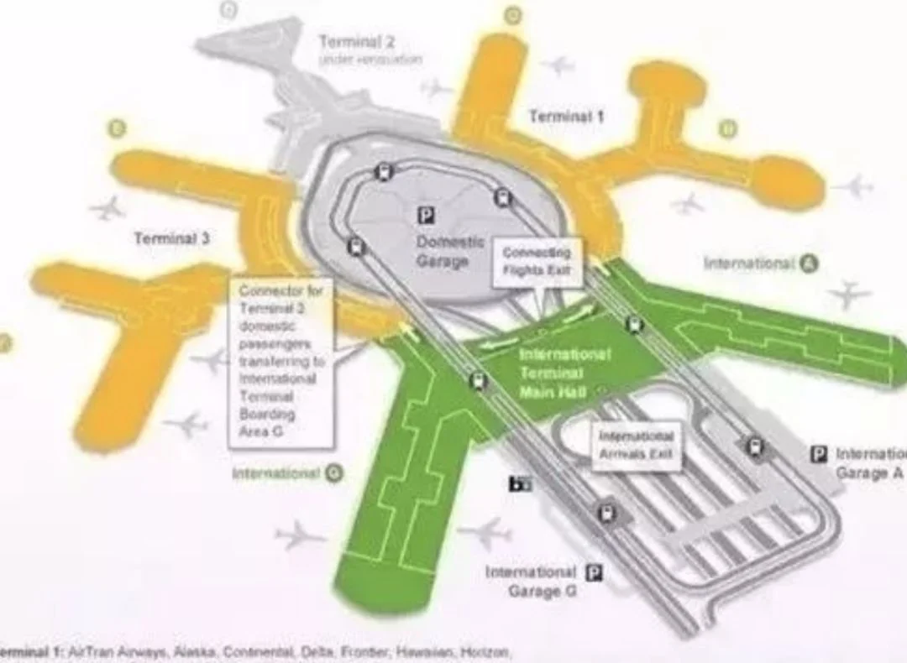
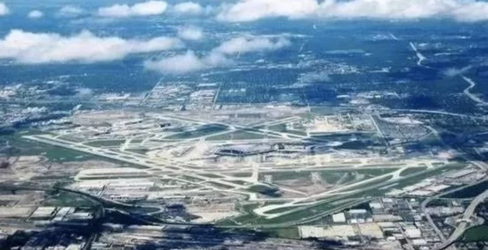
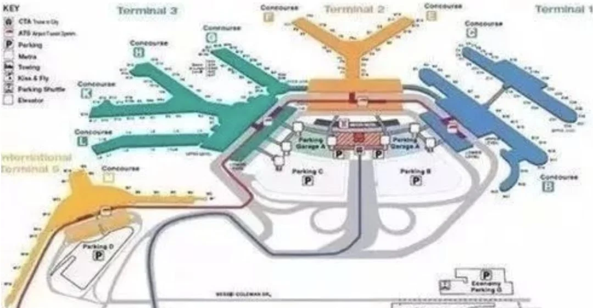
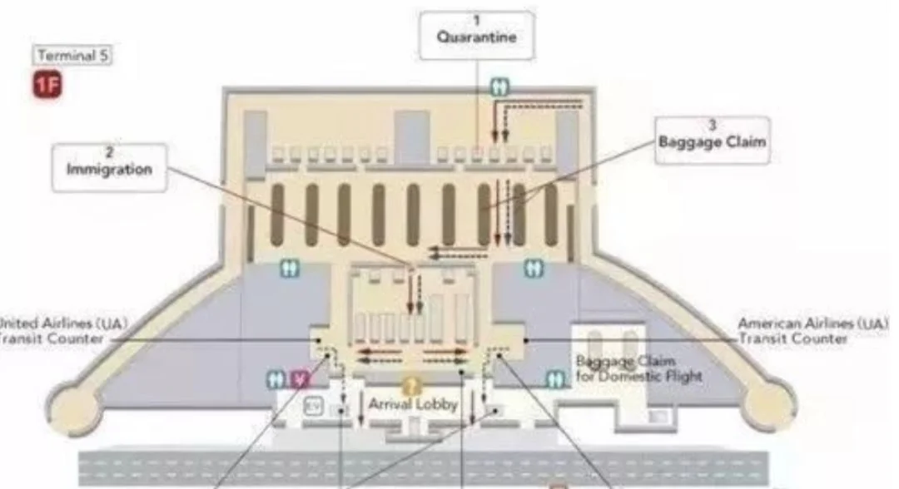

Een internationale overstap zonder binnenkomst bestaat in de Verenigde Staten niet: ongeacht je eindbestemming moet iedereen die het land binnenkomt door de immigratie op de **eerste luchthaven waar hij landt**, de ingecheckte bagage ophalen, door de douane gaan, de bagage opnieuw inchecken en opnieuw door de binnenlandse beveiliging voordat hij aan boord gaat van de volgende vlucht. Bij een eerste reis naar de VS — voor toerisme, werk of studie — gaat het juist in dit deel van de reis het vaakst mis.

Veel luchthavens ontvangen internationale aankomsten: Los Angeles, San Francisco, Seattle, New York, Chicago, Atlanta, Washington, Detroit en meer. Deze gids bestaat uit twee delen — **het algemene proces** en **de zeven luchthavens die het vaakst als eerste binnenkomstpunt worden gebruikt**: Los Angeles (LAX), San Francisco (SFO), Atlanta (ATL), Chicago O'Hare (ORD), New York Newark (EWR), Seattle (SEA) en Detroit (DTW) — en legt uit welke shuttle of trein je moet nemen en welke gang je op elk van hen moet volgen.

## 1. Het overstapproces na aankomst in de VS

Waar je ook landt, een overstap in de VS doorloopt dezelfde vijf stappen: **immigratie → bagage ophalen → douane → bagage opnieuw inchecken → van terminal wisselen en weer door de beveiliging.**

### 1. Immigratie

Volg de menigte, of de borden Immigration en Arrival, naar de immigratiehal. Reizigers met een visum of ESTA staan in de rij voor bezoekers en beantwoorden een paar eenvoudige vragen over hun reis; wie naar de secundaire controle wordt verwezen, komt aan een aparte balie. **Fotograferen is verboden in de wachtruimte van de immigratie, net als het gebruik van telefoons en andere elektronische apparaten** — berg ze op voordat je in de rij gaat staan.

### 2. Bagage ophalen

Haal na de immigratie je ingecheckte bagage van de bagageband. Let op: **bagage wordt niet automatisch overgedragen, ook niet als je volgende vlucht een binnenlandse is** — je moet de tassen zelf van de band halen en door de douane naar buiten dragen.

### 3. Douane

Geef het aangifteformulier dat je in het vliegtuig hebt ingevuld af (het blauwe formulier; extra exemplaren liggen in de aankomsthal) en ga door de douane. Heb je iets aan te geven, vul het formulier dan naar waarheid in en neem de rode doorgang; zo niet, loop dan door de groene doorgang. Zodra je door deze deur bent, ben je officieel in de Verenigde Staten.

### 4. Je bagage opnieuw inchecken

Loop na de douane niet meteen de luchthaven uit — zoek eerst de **balie voor aansluitende vluchten of transit** en geef je bagage daar weer af. De internationale aankomsthallen hebben meestal transitbalies voor de grote maatschappijen: op Terminal 5 van Chicago O'Hare hebben United en American bijvoorbeeld elk hun eigen balie. Heeft je maatschappij geen transitbalie in de terminal waar je bent geland, dan moet je de bagage naar de terminal brengen vanwaar je volgende vlucht vertrekt en ze daar inchecken.

### 5. Van terminal wisselen en weer door de beveiliging

Volg daarna je boardingpass naar de juiste terminal en concourse. Amerikaanse luchthavens zijn groot, en terminals zijn meestal verbonden door een interne trein of shuttlebus; **je moet nog één keer door de beveiliging voordat je het binnenlandse vertrekgebied binnengaat**, precies zoals bij het begin van je reis. De mogelijkheden voor interne overstappen op de zeven luchthavens staan hieronder, met de details per luchthaven in de volgende sectie.

| Luchthaven | Hoe je tussen terminals komt | Waarschuwing in één regel |
| --- | --- | --- |
| LAX Los Angeles | Gratis shuttlebus tussen de terminals, enkele looppaden | Negen aparte terminals; lopen ertussen duurt lang |
| SFO San Francisco | AirTrain (rode en blauwe lijn) | Internationale aankomsten zijn in de International Terminal |
| ATL Atlanta | De ondergrondse Plane Train | Verwar hem niet met MARTA, de metro van de stad |
| ORD Chicago | De ATS-luchthaventrein | Internationale aankomsten zijn op Terminal 5; neem de ATS |
| EWR Newark | AirTrain (drie haltes: A, B, C) | Internationale aankomsten zijn vooral op Terminal B |
| SEA Seattle | Meestal te voet, binnen de hoofdterminal | De letter in je gatenummer is de concourse |
| DTW Detroit | Tram binnen de terminal, shuttle tussen terminals | Delta zit in McNamara; andere maatschappijen in de North Terminal |

### 6. Hoeveel overstaptijd je moet rekenen

Het oorspronkelijke materiaal is duidelijk over de grote luchthavens: meer tijd is altijd beter.

| Luchthaven | Reken op | Waarom |
| --- | --- | --- |
| ORD Chicago | 2 uur of meer | Internationale aankomsten zijn op Terminal 5; je neemt de ATS en gaat opnieuw door de beveiliging |
| DTW Detroit | 2 uur of meer | 90 minuten is erg krap, en de terminalshuttle voegt een extra traject toe |
| LAX Los Angeles | Minstens 40 minuten als je tussen terminals loopt | Negen aparte terminals en een shuttle die maar één kant op rijdt |
| Overige luchthavens | 1,5–2 uur | Wachtrijen bij immigratie, bagageband, douane en beveiliging |

In het hoogseizoen, rond feestdagen en bij aankomsten in de avond kun je voor de zekerheid nog 30–60 minuten extra rekenen.

## 2. De zeven luchthavens

### 1. LAX Los Angeles International Airport

Los Angeles heeft **negen terminals** (Terminals 1–8 plus de Tom Bradley International Terminal, TBIT, ook Terminal B genoemd) en **elk daarvan is een apart gebouw**, alleen verbonden door wegen, shuttlebusjes en een paar looppaden. TBIT is momenteel het belangrijkste punt voor internationale aankomsten, en de meeste vluchten van de grote Chinese maatschappijen landen daar.

Twee dingen zijn belangrijk als je op LAX van terminal wisselt:

- **Neem alleen de shuttlebus tussen de terminals** (in het oorspronkelijke materiaal Shuttle Bus A genoemd). Er rijden verschillende andere bussen naar parkeerterreinen, het autoverhuurcentrum en het metrostation — stap je in de verkeerde, dan verlaat je de luchthaven.
- **De shuttle rijdt in één richting rond**, dus een volledige ronde kan lang duren; en vanaf TBIT moet je naar een van beide uiteinden van de terminal lopen om de halte überhaupt te zien, omdat de borden daartussen slecht zijn. Tussen sommige naburige terminals zijn looppaden, maar van TBIT naar het United-gebied lopen kost **minstens 40 minuten** — waag het niet als je overstap krap is.

Over bagage: elke terminal heeft zijn eigen immigratiehal, en het proces is hetzelfde als op andere luchthavens — immigratie, bagage ophalen, douane. Let na de douane op dat **niet elke maatschappij een transitbalie heeft in de terminal waar je bent aangekomen**; mogelijk moet je je bagage naar de terminal rijden vanwaar je volgende vlucht vertrekt.

### 2. SFO San Francisco International Airport

San Francisco International is een grote hub voor United en een focusstad voor Alaska Airlines, dus vooral United-passagiers stappen hier vaak over. De luchthaven heeft **vier terminals**: Terminals 1, 2 en 3 verwerken binnenlandse vluchten, en **alle internationale vluchten komen aan in de International Terminal**, die is verdeeld in twee boardinggebieden, A en G.

Loop na de immigratie en het ophalen van je bagage verder: passagiers met goederen die ze moeten aangeven vullen een formulier in, alle anderen lopen zo door de douane. Stap je over, lees dan de borden goed — **de Arrival Lobby en de Connecting Flights Exit liggen aan tegenovergestelde uiteinden van de hal**, dus een verkeerde afslag kost je een lange omweg.

Volg de borden en je komt bij de bagagebalie voor overstappers van je maatschappij; zodra de tassen zijn afgegeven, brengt de **AirTrain** van de luchthaven passagiers tussen de terminals.

De AirTrain heeft twee lijnen: de **rode lijn** stopt bij de terminals, de terminalgarages en het BART-station, en de **blauwe lijn** voegt het autoverhuurcentrum toe. Je moet nog steeds door de beveiliging voordat je de volgende terminal binnengaat, net als bij een binnenlandse vertrek. Het oorspronkelijke materiaal vermeldt ook dat bagagekarretjes op SFO gratis zijn.

### 3. ATL Hartsfield–Jackson Atlanta International Airport

Atlanta is **de grootste hub van Delta**, en Delta-vluchten uit Shanghai stappen hier heel vaak over. De luchthaven heeft **één binnenlandse terminal** (met een noord- en een zuidkant) en **een internationale terminal** (Concourse F); waar passagiers echt mee te maken hebben, zijn de **zeven concourses: T, A, B, C, D, E en F**, waarbij elke vlucht een tamelijk vaste terminal en gate gebruikt.

De concourses zijn verbonden door de **ondergrondse Plane Train**, die heel frequent rijdt — van T naar het verste punt F duurt ongeveer een tiental minuten. Het oorspronkelijke materiaal noemt deze luchthaventrein een "metro", wat makkelijk te verwarren is met **MARTA, de metro van de stad**: het station van MARTA ligt aan de kant van de **binnenlandse terminal** en daarmee kom je in het centrum van Atlanta. Voor een overstap heb je hem niet nodig. Volg na de immigratie de borden Plane Train en je bent op weg naar je volgende vlucht.

De waarschuwingen uit het oorspronkelijke materiaal:

- De **bagagekarretjes in Atlanta zijn betaald**, te betalen met creditcard.
- **De wifi op de luchthaven is betaald**, dus reken er niet op dat je meteen na aankomst online bent.
- In de zomertijd loopt Atlanta 12 uur achter op China; in de wintertijd 13 uur. Zet je horloge op de lokale tijd zodra je aan boord bent, zodat je kunt inschatten wanneer je landt en of je overstap ruim genoeg is.
- Van Shanghai naar Atlanta is het ongeveer 14 uur vliegen.

### 4. ORD Chicago O'Hare International Airport

Chicago O'Hare is een van de drukste luchthavens van Noord-Amerika en een poort voor reizigers die doorreizen naar steden in de hele VS. De luchthaven heeft **186 gates** verdeeld over **vier terminals (1, 2, 3 en 5) en negen concourses (B, C, E, F, G, H, K, L en M)**, en **alle internationale vluchten komen aan op Terminal 5**.

Neem na de landing je aangifteformulier mee en volg de menigte naar de douane — "volg de menigte" werkt hier goed. **Fotograferen en het gebruik van telefoons en andere elektronische apparaten zijn streng verboden in de wachtruimte van de immigratie**, dus berg ze op terwijl je in de rij staat. Ben je door de douane en heb je je bagage, **loop dan niet meteen de luchthaven uit**: neem de liften aan weerszijden naar boven naar de luchthaventrein.

De interne trein is de **ATS (Airport Transit System)**, en de haltes volgen elkaar in deze volgorde op: de drie binnenlandse terminals → de internationale terminal → parkeerterreinen → het CTA-metrostation → het busstation. **Controleer voordat je instapt vanaf welke terminal je volgende vlucht vertrekt**, en vraag als je verdwaalt aan een medewerker van de grondafhandeling waar de overstapshuttle is. Grofweg wordt Terminal 1 gedomineerd door United, Terminal 3 door American, en wordt Terminal 2 gedeeld door verschillende binnenlandse maatschappijen.

Zet de ATS je bij de juiste binnenlandse terminal af, dan **moet je opnieuw door de Amerikaanse binnenlandse beveiliging**; zoek na de beveiliging de gate voor je volgende vlucht en wacht daar. Het oorspronkelijke materiaal voegt eraan toe dat de wifi op de luchthaven van Chicago betaald en niet goedkoop is, dus wees voorbereid op offline zijn, en dat je **minstens twee uur** moet rekenen voor de overstap.

### 5. EWR New York Newark Liberty International Airport

Newark ligt ongeveer 16 mijl van Manhattan en is een van de drie luchthavens die de agglomeratie New York bedienen — de andere zijn John F. Kennedy (JFK) en LaGuardia (LGA), waarbij LGA het dichtst bij Manhattan ligt en meestal de keuze is voor een sightseeingtrip naar de stad. Newark is een van de drukste luchthavens van het land en een **hub voor United** (de "Continental Airlines" uit het oorspronkelijke materiaal fuseerde in 2012 met United), die Terminal C en een deel van Terminal A gebruikt.

Newark heeft **drie terminals — A, B en C — en Terminal B is de belangrijkste internationale terminal**, hoewel vluchten uit China ook op Terminal C kunnen aankomen. Volg na de landing de menigte of de borden Immigration om de formaliteiten te vervullen; het immigratiepunt van Terminal C staat hieronder afgebeeld.

Haal daarna je bagage op — let op: **bagagekarretjes op EWR kosten $5**, dus zorg dat je briefgeld of munten bij de hand hebt. Neem de tassen mee door de douane; heb je niets aan te geven, loop dan naar buiten, zoek de transitbalie en geef de tassen daar weer af.

Heb je de bagage weer ingecheckt, ga dan naar de terminal vanwaar je volgende vlucht vertrekt. De **AirTrain** van de luchthaven rijdt tussen Terminals A, B en C — **ongeveer elke 15 minuten buiten de piek en elke 3 minuten op piekmomenten** — en verbindt ook de garages P2, P3 en P4 en het NJ Transit- en Amtrak-station, vanwaar je rechtstreeks New York Penn Station bereikt.

### 6. SEA Seattle–Tacoma International Airport

Overstappen in Seattle is relatief eenvoudig: volg je medepassagiers van het vliegtuig naar de immigratiehal, ga door de immigratie, haal je bagage op, ga door de douane, check de tassen opnieuw in en ga nog een keer door de beveiliging. Als je Engels kunt lezen, of gewoon de menigte volgt, kun je bijna niet fout gaan.

De incheckbalies staan allemaal in de **hoofdterminal**, terwijl vliegtuigen aan verschillende concourses aanleggen. Seattle heeft **vier concourses — A, B, C en D** — met de kleurcodes lichtgroen, oranje, donkergroen en oker. Je kunt al in China zien vanwaar je volgende vlucht vertrekt zodra je je boardingpass krijgt, want **de gatenummers in Seattle bestaan uit één letter plus twee cijfers, en de letter is de concourse**: C betekent concourse C, D betekent concourse D.

### 7. DTW Detroit Metropolitan Wayne County Airport

Detroit is een **hub voor Delta** en een van de modernste luchthavens van het land. De luchthaven heeft **twee terminals**: de McNamara Terminal en de North Terminal. **Delta en zijn SkyTeam-partners gebruiken McNamara**, terwijl andere maatschappijen de North Terminal gebruiken.

Internationale aankomsten op McNamara komen binnen op het **groene niveau** (de onderste laag): ga door de douane, haal je bagage op dezelfde verdieping op en check die daar opnieuw in als dat nodig is. Ga daarna naar boven naar **niveau 2, het blauwe niveau** — de meeste Delta-vluchten vertrekken vanaf **Concourse A**, en om bij Concourse B of C te komen kun je door de beroemde Light Tunnel lopen of de Express Tram binnen de terminal nemen.

Voor de **North Terminal** neem je de shuttle tussen de terminals — de dienst Terminal–Westin–Terminal, **elke 10 minuten**, ongeveer 7 minuten van McNamara naar de North Terminal met onderweg een stop bij het Westin-hotel. De North Terminal zelf is overzichtelijk, maar **je gaat opnieuw door de beveiliging voordat je er binnenkomt**.

Hoe modern ook, Detroit vraagt nog steeds om een ruime overstap: **reken op twee uur of meer — 90 minuten is erg krap** — dus houd daar rekening mee als je boekt.

## 3. Details die je makkelijk mist

- **Bagagekarretjes:** volgens het oorspronkelijke materiaal zijn ze gratis op SFO, betaald op ATL (met kaart) en $5 op EWR — een paar kleine briefjes en een werkende creditcard op zak hebben kost niets.
- **Wifi op de luchthaven:** dat is betaald op ATL en ORD, dus je bent misschien niet online zodra je landt; bewaar belangrijke contactgegevens ergens waar je ze offline kunt lezen.
- **Tijdverschillen:** Atlanta loopt in de zomertijd 12 uur achter op China en in de winter 13 uur. Zet je horloge tijdens de vlucht op de lokale tijd, dan zijn aankomst- en overstaptijden veel makkelijker in te schatten.
- **Telefoons en camera's:** het gebruik van telefoons en andere elektronische apparaten is verboden in de wachtruimtes van de immigratie en de douane — en maak geen foto's.
- **Je draagt je eigen bagage:** met of zonder doorgaand ticket, zodra je de VS binnenkomt haal je je tassen op, neem je ze mee door de douane en check je ze opnieuw in; ze reizen nooit automatisch met je mee naar de volgende vlucht.

De luchthavendiagrammen hier komen uit het oorspronkelijke materiaal, en luchthavens en maatschappijen veranderen voortdurend — Continental Airlines uit de bron fuseerde met United, US Airways met American en Northwest met Delta. Informeer bij de luchthaven en je maatschappij naar de situatie op de dag dat je reist.

## Gerelateerde links

- **Op deze site**: [Los Angeles LAX](/airport/LAX), [San Francisco SFO](/airport/SFO), [Atlanta ATL](/airport/ATL), [Chicago O'Hare ORD](/airport/ORD), [Newark EWR](/airport/EWR), [Seattle SEA](/airport/SEA), [United States (US)](/country/US)
- **Wikipedia**: [Los Angeles LAX](https://en.wikipedia.org/wiki/Los_Angeles_International_Airport), [San Francisco SFO](https://en.wikipedia.org/wiki/San_Francisco_International_Airport), [Atlanta ATL](https://en.wikipedia.org/wiki/Hartsfield%E2%80%93Jackson_Atlanta_International_Airport), [Chicago O'Hare ORD](https://en.wikipedia.org/wiki/O'Hare_International_Airport), [Newark EWR](https://en.wikipedia.org/wiki/Newark_Liberty_International_Airport), [Seattle SEA](https://en.wikipedia.org/wiki/Seattle%E2%80%93Tacoma_International_Airport), [Detroit DTW](https://en.wikipedia.org/wiki/Detroit_Metropolitan_Wayne_County_Airport)
- **Baidu Baike**: [Los Angeles LAX](https://baike.baidu.com/item/%E6%B4%9B%E6%9D%89%E7%9F%B6%E5%9B%BD%E9%99%85%E6%9C%BA%E5%9C%BA), [San Francisco SFO](https://baike.baidu.com/item/%E6%97%A7%E9%87%91%E5%B1%B1%E5%9B%BD%E9%99%85%E6%9C%BA%E5%9C%BA), [Atlanta ATL](https://baike.baidu.com/item/%E5%93%88%E8%8C%A8%E8%8F%B2%E5%B0%94%E5%BE%B7-%E6%9D%B0%E5%85%8B%E9%80%8A%E4%BA%9A%E7%89%B9%E5%85%B0%E5%A4%A7%E5%9B%BD%E9%99%85%E6%9C%BA%E5%9C%BA), [Chicago O'Hare ORD](https://baike.baidu.com/item/%E5%A5%A5%E9%BB%91%E5%B0%94%E5%9B%BD%E9%99%85%E6%9C%BA%E5%9C%BA), [Newark EWR](https://baike.baidu.com/item/%E7%BA%BD%E7%93%A6%E5%85%8B%E8%87%AA%E7%94%B1%E5%9B%BD%E9%99%85%E6%9C%BA%E5%9C%BA), [Seattle SEA](https://baike.baidu.com/item/%E8%A5%BF%E9%9B%85%E5%9B%BE-%E5%A1%94%E7%A7%91%E9%A9%AC%E5%9B%BD%E9%99%85%E6%9C%BA%E5%9C%BA), [Detroit DTW](https://baike.baidu.com/item/%E5%BA%95%E7%89%B9%E5%BE%8B%E9%83%BD%E4%BC%9A%E9%9F%A6%E6%81%A9%E5%8E%BF%E6%9C%BA%E5%9C%BA)
