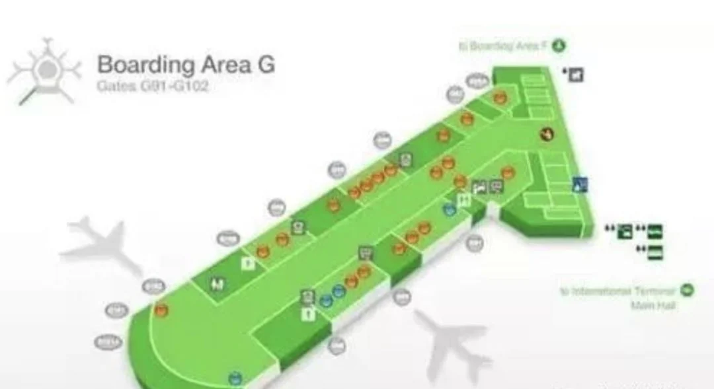
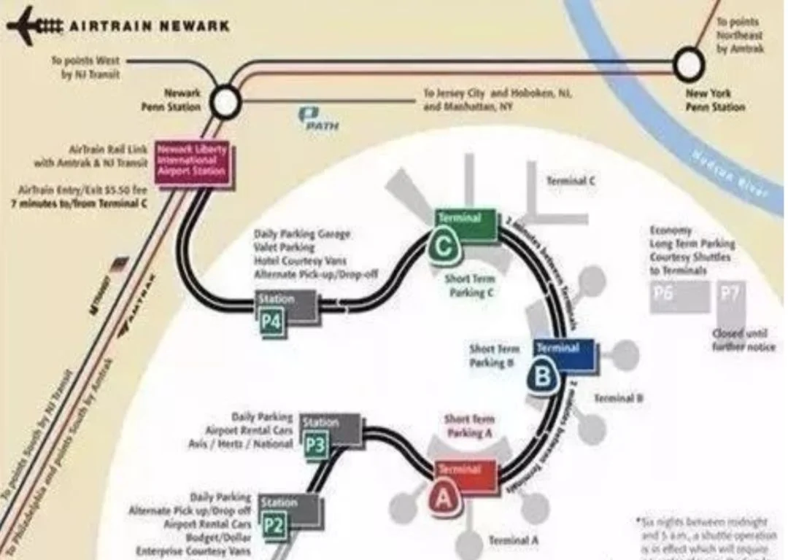
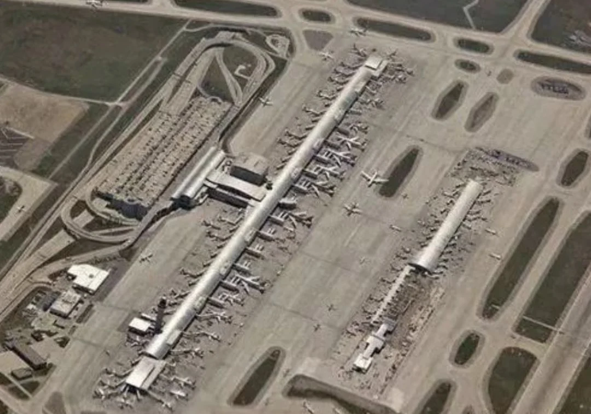

Não existe trânsito internacional para internacional nos Estados Unidos: seja qual for o destino final, todo mundo que entra no país passa pela imigração no **primeiro aeroporto onde pousa**, retira a bagagem despachada, passa pela alfândega, reenvia as malas e passa de novo pela segurança doméstica antes de embarcar no próximo voo. Em uma primeira viagem aos Estados Unidos — a turismo, trabalho ou estudo —, é nesta parte do trajeto que as coisas mais costumam dar errado.

Muitos aeroportos recebem chegadas internacionais: Los Angeles, São Francisco, Seattle, Nova York, Chicago, Atlanta, Washington, Detroit e outros. Este guia tem duas partes — **o processo geral** e **os sete aeroportos mais usados como primeira porta de entrada**: Los Angeles (LAX), São Francisco (SFO), Atlanta (ATL), Chicago O'Hare (ORD), Nova York Newark (EWR), Seattle (SEA) e Detroit (DTW) — e indica qual shuttle ou trem pegar e qual corredor seguir em cada um.

## 1. O processo de conexão depois de chegar aos Estados Unidos

Onde quer que você pouse, uma conexão nos Estados Unidos passa pelas mesmas cinco etapas: **imigração → retirada de bagagem → alfândega → reenvio das malas → troca de terminal e nova passagem pela segurança.**

### 1. Imigração

Siga a multidão, ou as placas de Imigração e Chegadas, até o salão de imigração. Viajantes com visto ou ESTA entram nas filas de visitantes e respondem a algumas perguntas simples sobre a viagem; quem é encaminhado para a inspeção secundária é atendido em um guichê separado. **É proibido fotografar na área de espera da imigração, assim como usar celulares e outros dispositivos eletrônicos** — guarde-os antes de entrar na fila.

### 2. Retirada de bagagem

Depois da imigração, retire a bagagem despachada na esteira. Atenção: **as malas não são transferidas automaticamente, mesmo quando o voo seguinte é doméstico** — você precisa tirá-las da esteira e levá-las pela alfândega.

### 3. Alfândega

Entregue o formulário de declaração que você preencheu no avião (o formulário azul; há cópias extras no saguão de chegadas) e passe pela alfândega. Se tiver algo a declarar, preencha o formulário com honestidade e use o canal vermelho; se não tiver, siga pelo canal verde. Ao passar por essa porta, você está formalmente nos Estados Unidos.

### 4. Reenvio das malas

Não saia direto do aeroporto depois da alfândega — primeiro encontre o **balcão de voos de conexão ou de trânsito** e entregue as malas. Os saguões de chegadas internacionais normalmente têm balcões de trânsito para as principais companhias: no Terminal 5 do Chicago O'Hare, por exemplo, United e American têm cada uma o seu. Se sua companhia não tiver balcão de trânsito no terminal em que você pousou, é preciso levar as malas até o terminal de onde sai o próximo voo e despachá-las lá.

### 5. Troca de terminal e nova passagem pela segurança

Depois, siga o cartão de embarque até o terminal e a área corretos. Os aeroportos americanos são grandes, e os terminais costumam ser ligados por um trem interno ou ônibus shuttle; **você precisa passar pela segurança mais uma vez antes de entrar na área de embarque doméstico**, exatamente como fez no início da viagem. As opções de transferência interna nos sete aeroportos estão abaixo, com os detalhes de cada um na próxima seção.

| Aeroporto | Como você se desloca entre os terminais | Aviso em uma linha |
| --- | --- | --- |
| LAX Los Angeles | Ônibus shuttle gratuito entre terminais, algumas passarelas | Nove terminais separados; caminhar entre eles é lento |
| SFO São Francisco | AirTrain (linhas vermelha e azul) | As chegadas internacionais ficam no Terminal Internacional |
| ATL Atlanta | O Plane Train subterrâneo | Não o confunda com o MARTA, o metrô da cidade |
| ORD Chicago | O trem interno ATS | As chegadas internacionais ficam no Terminal 5; pegue o ATS |
| EWR Newark | AirTrain (três paradas: A, B, C) | As chegadas internacionais ficam principalmente no Terminal B |
| SEA Seattle | Principalmente a pé, dentro do terminal principal | A letra do número do portão é a área |
| DTW Detroit | Tram interno no terminal, shuttle entre terminais | A Delta fica no McNamara; as outras companhias, no Terminal Norte |

### 6. Quanto tempo de conexão reservar

O material original é explícito sobre os grandes aeroportos: mais tempo é sempre melhor.

| Aeroporto | Tempo | Motivo |
| --- | --- | --- |
| ORD Chicago | 2 horas ou mais | As chegadas internacionais ficam no Terminal 5; você pega o ATS e passa pela segurança de novo |
| DTW Detroit | 2 horas ou mais | 90 minutos é muito apertado, e o shuttle entre terminais acrescenta um trecho |
| LAX Los Angeles | Pelo menos 40 minutos se você caminhar entre os terminais | Nove terminais separados e um circuito de shuttle em um só sentido |
| Outros aeroportos | 1,5–2 horas | Filas na imigração, na retirada de bagagem, na alfândega e na segurança |

Na alta temporada, em feriados e em chegadas noturnas, acrescente mais 30–60 minutos para ficar tranquilo.

## 2. Os sete aeroportos

### 1. LAX Aeroporto Internacional de Los Angeles

Los Angeles tem **nove terminais** (Terminais 1–8 mais o Terminal Internacional Tom Bradley, TBIT, também chamado de Terminal B) e **cada um é um edifício separado**, ligado apenas por estradas, ônibus shuttle e algumas passarelas. O TBIT é atualmente o principal ponto de chegadas internacionais, e a maioria dos voos das grandes companhias chinesas pousa lá.

Duas coisas importam ao trocar de terminal no LAX:

- **Pegue apenas o ônibus shuttle entre terminais** (chamado Shuttle Bus A no material original). Vários outros ônibus vão para estacionamentos, o centro de aluguel de carros e a estação de metrô — embarque no errado e você sai do aeroporto.
- **O shuttle faz um circuito em um só sentido**, então uma volta completa pode demorar bastante; e, a partir do TBIT, você precisa caminhar até uma das pontas do terminal para sequer ver a parada, porque a sinalização no meio do caminho é ruim. Há passarelas entre alguns terminais vizinhos, mas caminhar do TBIT até a área da United leva **pelo menos 40 minutos** — não tente se sua conexão for apertada.

Sobre a bagagem: cada terminal tem seu próprio salão de imigração, e o processo é o mesmo dos outros aeroportos — imigração, retirada de bagagem, alfândega. Depois da alfândega, atenção: **não é toda companhia que tem balcão de trânsito no terminal em que você chegou**; pode ser preciso empurrar as malas até o terminal de onde parte o próximo voo.

### 2. SFO Aeroporto Internacional de São Francisco

O São Francisco International é um grande hub da United e uma cidade-foco da Alaska Airlines, então passageiros da United em especial costumam fazer conexão aqui. O aeroporto tem **quatro terminais**: os Terminais 1, 2 e 3 atendem voos domésticos, e **todos os voos internacionais chegam ao Terminal Internacional**, dividido em duas áreas de embarque, A e G.

Depois da imigração e da retirada de bagagem, siga em frente: passageiros com mercadorias a declarar preenchem um formulário, e todos os outros passam direto pela alfândega. Se você está em conexão, leia as placas com atenção — **o Saguão de Chegadas e a Saída para Voos de Conexão ficam em extremos opostos do salão**, então a curva errada custa uma longa caminhada de volta.

Siga as placas e você chegará ao balcão de bagagem de conexão da sua companhia; uma vez entregues as malas, o **AirTrain** do aeroporto leva os passageiros entre os terminais.

O AirTrain tem duas linhas: a **linha vermelha** para nos terminais, nas garagens dos terminais e na estação do BART, e a **linha azul** acrescenta o centro de aluguel de carros. Você ainda precisa passar pela segurança antes de entrar no próximo terminal, como faria em um embarque doméstico. O material original também observa que os carrinhos de bagagem no SFO são gratuitos.

### 3. ATL Aeroporto Internacional Hartsfield-Jackson de Atlanta

Atlanta é o **maior hub da Delta**, e os voos da Delta vindos de Xangai muitas vezes fazem conexão aqui. O aeroporto tem **um terminal doméstico** (com lados Norte e Sul) e **um terminal internacional** (Área F); o que os passageiros de fato enfrentam são as **sete áreas: T, A, B, C, D, E e F**, com cada voo usando um terminal e um portão bastante fixos.

As áreas são ligadas pelo **Plane Train subterrâneo**, que circula com muita frequência — de T até a ponta oposta, em F, leva cerca de uma dúzia de minutos. O material original chama esse trem interno de “metrô”, o que é fácil de confundir com o **MARTA, o metrô da cidade**: a estação do MARTA fica do lado do **terminal doméstico** e é por ela que se chega ao centro de Atlanta. Você não precisa dela para conectar. Depois da imigração, siga as placas do Plane Train e você estará a caminho do próximo voo.

Os lembretes do material original:

- Os **carrinhos de bagagem de Atlanta são pagos**, com pagamento por cartão de crédito.
- **O Wi-Fi do aeroporto é pago**, então não conte com estar online assim que pousar.
- No horário de verão, Atlanta fica 12 horas atrás da China; no horário de inverno, 13. Ajuste o relógio para o horário local assim que estiver a bordo, para poder avaliar quando você pousa e se sua conexão é confortável.
- De Xangai a Atlanta são cerca de 14 horas de voo.

### 4. ORD Aeroporto Internacional O'Hare de Chicago

O Chicago O'Hare é um dos aeroportos mais movimentados da América do Norte e uma porta de entrada para viajantes que seguem para cidades dos Estados Unidos. Tem **186 portões** distribuídos por **quatro terminais (1, 2, 3 e 5) e nove áreas (B, C, E, F, G, H, K, L e M)**, e **todos os voos internacionais atracam no Terminal 5**.

Depois do pouso, pegue seu formulário de declaração e siga a multidão até a alfândega — “seguir a multidão” funciona bem aqui. **É terminantemente proibido fotografar e usar celulares e outros dispositivos eletrônicos na área de espera da imigração**, então guarde-os enquanto estiver na fila. Depois de passar pela alfândega e pegar as malas, **não saia direto do aeroporto**: pegue os elevadores dos dois lados e suba até o trem interno.

O trem interno é o **ATS (Airport Transit System)**, e suas paradas seguem esta ordem: os três terminais domésticos → o terminal internacional → os estacionamentos → a estação de metrô da CTA → a estação de ônibus. **Confira de qual terminal sai seu próximo voo antes de embarcar** e, se se perder, pergunte a qualquer funcionário de solo onde está o shuttle de transferência. De modo geral, o Terminal 1 é dominado pela United, o Terminal 3 pela American, e o Terminal 2 é compartilhado por várias companhias domésticas.

Quando o ATS deixar você no terminal doméstico correto, **você precisa passar de novo pela segurança doméstica americana**; depois da segurança, encontre o portão do próximo voo e espere lá. O material original acrescenta que o Wi-Fi do aeroporto de Chicago é pago e não é barato, então esteja preparado para ficar offline, e que você deve reservar **pelo menos duas horas** para a conexão.

### 5. EWR Aeroporto Internacional Newark-Liberty de Nova York

Newark fica a cerca de 16 milhas de Manhattan e é um dos três aeroportos que atendem a região metropolitana de Nova York — os outros são John F. Kennedy (JFK) e LaGuardia (LGA), sendo o LGA o mais próximo de Manhattan e a escolha habitual para um passeio turístico à cidade. Newark está entre os aeroportos mais movimentados do país e é um **hub da United** (a “Continental Airlines” do material original fundiu-se com a United em 2012), que usa o Terminal C e parte do Terminal A.

Newark tem **três terminais — A, B e C —, e o Terminal B é o principal terminal internacional**, embora voos vindos da China também possam chegar ao Terminal C. Depois do pouso, siga a multidão ou as placas de Imigração para cumprir as formalidades; o ponto de imigração do Terminal C aparece abaixo.

Depois retire as malas — atenção: **os carrinhos de bagagem no EWR custam US$ 5**, então tenha notas ou moedas à mão. Leve as malas pela alfândega; se não tiver nada a declarar, saia e encontre o balcão de trânsito, e entregue as malas de volta.

Com as malas reenviadas, dirija-se ao terminal de onde sai o próximo voo. O **AirTrain** do aeroporto circula entre os Terminais A, B e C — **aproximadamente a cada 15 minutos fora do pico e a cada 3 minutos nos horários de pico** — e também liga as garagens P2, P3 e P4 e a estação ferroviária da NJ Transit e da Amtrak, de onde se chega diretamente à Penn Station de Nova York.

### 6. SEA Aeroporto Internacional de Seattle-Tacoma

Fazer conexão em Seattle é relativamente simples: siga os outros passageiros saindo da aeronave até o salão de imigração, passe pela imigração, retire as malas (retirada de bagagem), passe pela alfândega, reenvie as malas e passe pela segurança mais uma vez. Se você sabe ler inglês, ou simplesmente segue a multidão, é difícil errar.

Os balcões de check-in ficam todos no **terminal principal**, enquanto as aeronaves atracam em áreas diferentes. Seattle tem **quatro áreas — A, B, C e D** — codificadas por cores: verde-claro, laranja, verde-escuro e ocre. Você pode saber de onde sai o próximo voo assim que receber o cartão de embarque na China, porque **os números de portão de Seattle são uma letra mais dois dígitos, e a letra é a área**: C significa área C, D significa área D.

### 7. DTW Aeroporto Metropolitano Wayne County de Detroit

Detroit é um **hub da Delta** e um dos aeroportos mais modernos do país. Tem **dois terminais**: o Terminal McNamara e o Terminal Norte. **A Delta e suas parceiras SkyTeam usam o McNamara**, enquanto as outras companhias usam o Terminal Norte.

As chegadas internacionais no McNamara acontecem no **nível verde** (o nível inferior): passe pela alfândega, retire as malas no mesmo nível e reenvie-as ali, se necessário. Depois suba para o **Nível 2 azul** — a maioria dos voos da Delta sai da **Área A**, e para chegar às áreas B ou C você pode atravessar o famoso Túnel de Luz ou pegar o Express Tram interno do terminal.

Para o **Terminal Norte**, pegue o shuttle entre terminais — o serviço Terminal–Westin–Terminal, **a cada 10 minutos**, cerca de 7 minutos do McNamara até o Terminal Norte, com uma parada no hotel Westin no caminho. O Terminal Norte em si é simples, mas **você passa pela segurança de novo antes de entrar nele**.

Por mais moderno que seja, Detroit ainda exige uma conexão generosa: **reserve duas horas ou mais — 90 minutos é muito apertado** —, então leve isso em conta na hora de comprar.

## 3. Detalhes fáceis de passar despercebidos

- **Carrinhos de bagagem:** o material original observa que são gratuitos no SFO, pagos em ATL (por cartão) e US$ 5 no EWR — carregar algumas notas pequenas e um cartão de crédito que funcione não custa nada.
- **Wi-Fi do aeroporto:** é pago em ATL e ORD, então você pode não estar online no momento em que pousar; mantenha contatos essenciais em algum lugar que você possa ler offline.
- **Fusos horários:** Atlanta fica 12 horas atrás da China no horário de verão e 13 no inverno. Ajuste o relógio para o horário local durante o voo e os horários de chegada e de conexão ficam muito mais fáceis de avaliar.
- **Celulares e câmeras:** o uso de celulares e outros dispositivos eletrônicos é proibido nas áreas de espera da imigração e da alfândega — e não tire fotos.
- **Você carrega suas próprias malas:** com bilhete único ou não, ao entrar nos Estados Unidos você retira as malas, leva-as pela alfândega e as despacha de novo; elas nunca seguem automaticamente para o próximo voo.

Os diagramas de aeroporto aqui vêm do material original, e aeroportos e companhias mudam o tempo todo — a Continental Airlines da fonte fundiu-se com a United, a US Airways com a American e a Northwest com a Delta. Confirme com o aeroporto e sua companhia para o dia em que você viaja.

## Links relacionados

- **Neste site**: [Los Angeles LAX](/airport/LAX), [São Francisco SFO](/airport/SFO), [Atlanta ATL](/airport/ATL), [Chicago O'Hare ORD](/airport/ORD), [Newark EWR](/airport/EWR), [Seattle SEA](/airport/SEA), [Estados Unidos (US)](/country/US)
- **Wikipédia**: [Los Angeles LAX](https://en.wikipedia.org/wiki/Los_Angeles_International_Airport), [São Francisco SFO](https://en.wikipedia.org/wiki/San_Francisco_International_Airport), [Atlanta ATL](https://en.wikipedia.org/wiki/Hartsfield%E2%80%93Jackson_Atlanta_International_Airport), [Chicago O'Hare ORD](https://en.wikipedia.org/wiki/O'Hare_International_Airport), [Newark EWR](https://en.wikipedia.org/wiki/Newark_Liberty_International_Airport), [Seattle SEA](https://en.wikipedia.org/wiki/Seattle%E2%80%93Tacoma_International_Airport), [Detroit DTW](https://en.wikipedia.org/wiki/Detroit_Metropolitan_Wayne_County_Airport)
- **Baidu Baike**: [Los Angeles LAX](https://baike.baidu.com/item/%E6%B4%9B%E6%9D%89%E7%9F%B6%E5%9B%BD%E9%99%85%E6%9C%BA%E5%9C%BA), [São Francisco SFO](https://baike.baidu.com/item/%E6%97%A7%E9%87%91%E5%B1%B1%E5%9B%BD%E9%99%85%E6%9C%BA%E5%9C%BA), [Atlanta ATL](https://baike.baidu.com/item/%E5%93%88%E8%8C%A8%E8%8F%B2%E5%B0%94%E5%BE%B7-%E6%9D%B0%E5%85%8B%E9%80%8A%E4%BA%9A%E7%89%B9%E5%85%B0%E5%A4%A7%E5%9B%BD%E9%99%85%E6%9C%BA%E5%9C%BA), [Chicago O'Hare ORD](https://baike.baidu.com/item/%E5%A5%A5%E9%BB%91%E5%B0%94%E5%9B%BD%E9%99%85%E6%9C%BA%E5%9C%BA), [Newark EWR](https://baike.baidu.com/item/%E7%BA%BD%E7%93%A6%E5%85%8B%E8%87%AA%E7%94%B1%E5%9B%BD%E9%99%85%E6%9C%BA%E5%9C%BA), [Seattle SEA](https://baike.baidu.com/item/%E8%A5%BF%E9%9B%85%E5%9B%BE-%E5%A1%94%E7%A7%91%E9%A9%AC%E5%9B%BD%E9%99%85%E6%9C%BA%E5%9C%BA), [Detroit DTW](https://baike.baidu.com/item/%E5%BA%95%E7%89%B9%E5%BE%8B%E9%83%BD%E4%BC%9A%E9%9F%A6%E6%81%A9%E5%8E%BF%E6%9C%BA%E5%9C%BA)
