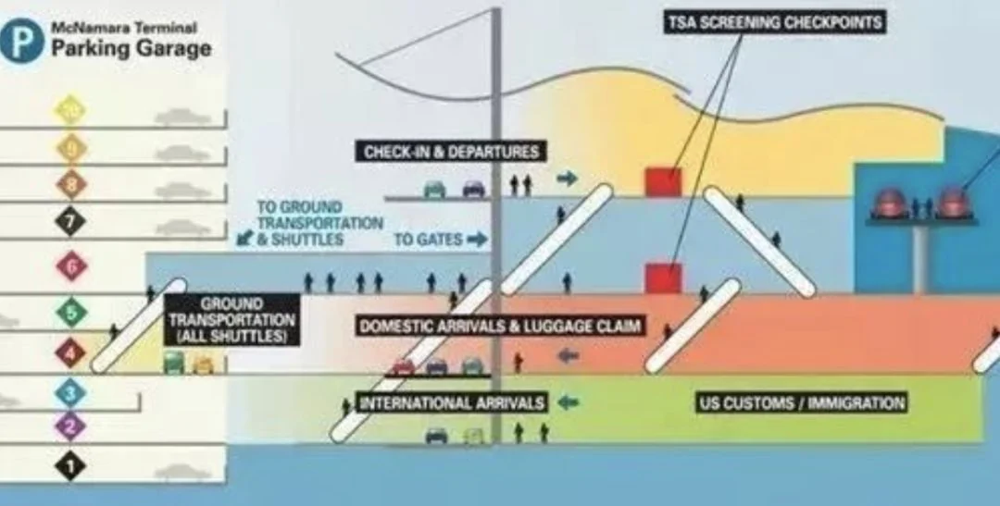

В США не существует международного транзита из страны в страну: куда бы вы ни летели в итоге, каждый, кто въезжает в страну, проходит иммиграцию в **первом аэропорту прилёта**, забирает сданный багаж, проходит таможню, снова сдаёт багаж и заново проходит внутренний досмотр, прежде чем сесть на следующий рейс. Для первой поездки в США — туристической, рабочей или учебной — именно эта часть пути чаще всего идёт не так.

Многие аэропорты принимают международные рейсы: Лос-Анджелес, Сан-Франциско, Сиэтл, Нью-Йорк, Чикаго, Атланта, Вашингтон, Детройт и другие. Этот гид состоит из двух частей — **общий процесс** и **семь аэропортов, чаще всего используемых как первый пункт въезда**: Лос-Анджелес (LAX), Сан-Франциско (SFO), Атланта (ATL), Чикаго О'Хара (ORD), Ньюарк (EWR), Сиэтл (SEA) и Детройт (DTW) — и рассказывает, какой шаттл или поезд выбрать и по какому коридору идти в каждом из них.

## 1. Процесс пересадки после прилёта в США

Где бы вы ни приземлились, пересадка в США проходит через одни и те же пять шагов: **иммиграция → выдача багажа → таможня → повторная сдача багажа → смена терминала и повторный досмотр.**

### 1. Иммиграция

Идите за толпой или указателями Immigration and Arrival в зал иммиграции. Путешественники с визой или ESTA стоят в очереди для посетителей и отвечают на несколько простых вопросов о поездке; тех, кого направляют на вторичную проверку, принимают у отдельной стойки. **В зале ожидания иммиграции фотографировать запрещено, как и пользоваться телефонами и другими электронными устройствами** — уберите их до того, как встанете в очередь.

### 2. Выдача багажа

После иммиграции заберите сданный багаж с ленты. Учтите, что **багаж не перегружается автоматически, даже если следующий рейс внутренний** — его нужно снять с ленты самому и вынести через таможню.

### 3. Таможня

Отдайте декларацию, заполненную в самолёте (синий бланк; запасные есть в зале прибытия), и пройдите таможню. Если есть что декларировать, честно заполните форму и идите в красный коридор; если нет — через зелёный. Как только вы прошли эту дверь, вы официально находитесь в США.

### 4. Повторная сдача багажа

Не выходите из аэропорта сразу после таможни — сначала найдите **стойку пересадки или транзита** и сдайте багаж обратно. В залах международного прибытия обычно есть транзитные стойки основных авиакомпаний: например, в терминале 5 чикагского О'Хара у United и American есть свои. Если у вашей авиакомпании нет транзитной стойки в терминале прилёта, багаж придётся отвезти в терминал следующего рейса и сдать там.

### 5. Смена терминала и повторный досмотр

Затем по посадочному талону найдите нужный терминал и галерею. Американские аэропорты большие, и терминалы обычно связаны внутренним поездом или шаттлом; **перед входом в зону внутренних вылетов нужно ещё раз пройти досмотр**, как в начале путешествия. Варианты внутренних пересадок в семи аэропортах приведены ниже, а подробности по каждому — в следующем разделе.

| Аэропорт | Как перемещаться между терминалами | Предупреждение в одну строку |
| --- | --- | --- |
| LAX Лос-Анджелес | Бесплатный шаттл между терминалами, несколько пешеходных переходов | Девять отдельных терминалов; между ними медленно ходить пешком |
| SFO Сан-Франциско | AirTrain (красная и синяя линии) | Международные рейсы прибывают в международный терминал |
| ATL Атланта | Подземный Plane Train | Не путайте его с MARTA, городским метро |
| ORD Чикаго | Внутренний поезд ATS | Международные рейсы прибывают в терминал 5; садитесь на ATS |
| EWR Ньюарк | AirTrain (три остановки: A, B, C) | Международные рейсы прибывают в основном в терминал B |
| SEA Сиэтл | В основном пешком, внутри главного терминала | Буква в номере выхода — это галерея |
| DTW Детройт | Трамвай внутри терминала, шаттл между терминалами | Delta — в McNamara; остальные авиакомпании — в North Terminal |

### 6. Сколько времени закладывать на пересадку

Исходный материал прямо говорит о крупных аэропортах: больше времени всегда лучше.

| Аэропорт | Закладывать | Почему |
| --- | --- | --- |
| ORD Чикаго | 2 часа и больше | Международные рейсы прибывают в терминал 5; нужно ехать на ATS и снова проходить досмотр |
| DTW Детройт | 2 часа и больше | 90 минут очень мало, а шаттл между терминалами добавляет ещё один этап |
| LAX Лос-Анджелес | Минимум 40 минут, если идти между терминалами | Девять отдельных терминалов и одностороннее кольцо шаттла |
| Другие аэропорты | 1,5–2 часа | Очереди на иммиграции, выдаче багажа, таможне и досмотре |

В высокий сезон, около государственных праздников и при вечерних прилётах добавьте ещё 30–60 минут для спокойствия.

## 2. Семь аэропортов

### 1. LAX Международный аэропорт Лос-Анджелеса

В Лос-Анджелесе **девять терминалов** (терминалы 1–8 плюс международный терминал Тома Брэдли, TBIT, также называемый терминалом B), и **каждый из них — отдельное здание**, связанное только дорогами, шаттлами и несколькими пешеходными переходами. Сейчас TBIT — главный пункт международного прибытия, и большинство рейсов крупных китайских перевозчиков садятся там.

При смене терминала в LAX важны две вещи:

- **Садитесь только на шаттл между терминалами** (в исходном материале он называется Shuttle Bus A). Несколько других автобусов идут к парковкам, центру проката автомобилей и станции метро — сядете не на тот и покинете аэропорт.
- **Шаттл ходит по одностороннему кольцу**, поэтому полный круг может занять много времени; а в TBIT нужно дойти до любого конца терминала, чтобы вообще увидеть остановку, потому что указатели между ними плохие. Между некоторыми соседними терминалами есть переходы, но пешая дорога от TBIT до зоны United занимает **минимум 40 минут** — не пытайтесь, если пересадка плотная.

О багаже: у каждого терминала свой зал иммиграции, и процесс такой же, как в других аэропортах — иммиграция, выдача багажа, таможня. После таможни учтите, что **не у каждой авиакомпании есть транзитная стойка в терминале прибытия**; возможно, придётся везти багаж в терминал, откуда улетает следующий рейс.

### 2. SFO Международный аэропорт Сан-Франциско

Международный аэропорт Сан-Франциско — крупный хаб United и фокусный город Alaska Airlines, поэтому пассажиры United особенно часто пересаживаются здесь. В аэропорту **четыре терминала**: терминалы 1, 2 и 3 обслуживают внутренние рейсы, а **все международные рейсы прибывают в международный терминал**, который делится на две посадочные зоны, A и G.

После иммиграции и выдачи багажа идите дальше: пассажиры с товарами для декларирования заполняют форму, остальные проходят таможню без остановки. Если вы пересаживаетесь, внимательно читайте указатели — **зал прибытия и выход для пересадочных пассажиров находятся на противоположных концах зала**, поэтому неверный поворот обернётся долгой прогулкой вокруг.

Следуйте указателям — и дойдёте до стойки пересадки вашей авиакомпании; когда багаж сдан, **AirTrain** перевозит пассажиров между терминалами.

У AirTrain две линии: **красная** останавливается у терминалов, терминальных парковок и станции BART, а **синяя** добавляет центр проката автомобилей. Перед входом в следующий терминал всё равно нужно пройти досмотр, как при внутреннем вылете. В исходном материале также отмечено, что багажные тележки в SFO бесплатны.

### 3. ATL Международный аэропорт Хартсфилд–Джексон Атланта

Атланта — **крупнейший хаб Delta**, и рейсы Delta из Шанхая очень часто пересаживаются здесь. В аэропорту **один внутренний терминал** (с северной и южной сторонами) и **международный терминал** (галерея F); на практике пассажиры имеют дело с **семью галереями: T, A, B, C, D, E и F**, и каждый рейс использует довольно фиксированный терминал и выход.

Галереи связаны **подземным Plane Train**, который ходит очень часто — от T до дальнего F около десятка минут. В исходном материале этот поезд называют «метро», что легко спутать с **MARTA, городским метро**: станция MARTA находится на стороне **внутреннего терминала**, и оттуда попадают в центр Атланты. Для пересадки она не нужна. После иммиграции идите по указателям Plane Train — и попадёте к следующему рейсу.

Напоминания из исходного материала:

- **Багажные тележки в Атланте платные**, оплата кредитной картой.
- **Wi-Fi в аэропорту платный**, поэтому не рассчитывайте быть онлайн сразу после посадки.
- В летнее время Атланта отстаёт от Китая на 12 часов, зимой — на 13. Переставьте часы на местное время ещё в самолёте, чтобы понимать, когда приземлитесь и удобна ли пересадка.
- От Шанхая до Атланты около 14 часов полёта.

### 4. ORD Международный аэропорт Чикаго О'Хара

Чикаго О'Хара — один из самых загруженных аэропортов Северной Америки и ворота для путешественников, направляющихся в города по всей территории США. В нём **186 выходов** в **четырёх терминалах (1, 2, 3 и 5) и девяти галереях (B, C, E, F, G, H, K, L и M)**, и **все международные рейсы причаливают в терминале 5**.

После посадки возьмите декларацию и идите за толпой к таможне — «идти за толпой» здесь работает хорошо. **В зале ожидания иммиграции строго запрещено фотографировать и пользоваться телефонами и другими электронными устройствами**, поэтому уберите их, пока стоите в очереди. Когда пройдёте таможню и получите багаж, **не выходите из аэропорта сразу**: поднимитесь на лифте с любой стороны к внутреннему поезду аэропорта.

Внутренний поезд — **ATS (Airport Transit System)**, его остановки идут в таком порядке: три внутренних терминала → международный терминал → парковки → станция метро CTA → автовокзал. **Проверьте, из какого терминала улетает следующий рейс, прежде чем садиться**, а если заблудились, спросите любого сотрудника наземных служб, где пересадочный шаттл. Грубо говоря, терминал 1 принадлежит в основном United, терминал 3 — American, а терминал 2 делят несколько внутренних перевозчиков.

Когда ATS высадит вас в нужном внутреннем терминале, **нужно снова пройти внутренний досмотр США**; после досмотра найдите выход следующего рейса и ждите там. В исходном материале добавляется, что Wi-Fi в чикагском аэропорту платный и не дешёвый, так что будьте готовы остаться офлайн, и что на пересадку нужно закладывать **не менее двух часов**.

### 5. EWR Международный аэропорт Ньюарк Либерти

Ньюарк находится примерно в 16 милях от Манхэттена и является одним из трёх аэропортов агломерации Нью-Йорка — два других Джон Кеннеди (JFK) и Ла-Гуардия (LGA), причём LGA ближе всего к Манхэттену и обычно выбирается для осмотра города. Ньюарк входит в число самых загруженных аэропортов страны и является **хабом United** («Continental Airlines» из исходного материала в 2012 году вошла в United), которая использует терминал C и часть терминала A.

В Ньюарке **три терминала — A, B и C, и терминал B — главный международный**, хотя рейсы из Китая могут прибывать и в терминал C. После посадки идите за толпой или по указателям Immigration к прохождению формальностей; вход в иммиграцию терминала C показан ниже.

Затем заберите багаж — учтите, что **багажные тележки в EWR стоят 5 долларов**, поэтому держите под рукой купюры или монеты. Провезите багаж через таможню; если декларировать нечего, выходите и ищите транзитную стойку, чтобы сдать багаж обратно.

Сдав багаж, направляйтесь в терминал следующего рейса. **AirTrain** аэропорта ходит между терминалами A, B и C — **примерно каждые 15 минут вне пика и каждые 3 минуты в пиковые часы** — и также связывает парковки P2, P3 и P4 и железнодорожную станцию NJ Transit и Amtrak, откуда можно напрямую добраться до вокзала Нью-Йорк Пенн-Стейшн.

### 6. SEA Международный аэропорт Сиэтл–Такома

Пересадка в Сиэтле относительно проста: идите за попутчиками с самолёта в зал иммиграции, пройдите иммиграцию, заберите багаж (выдача багажа), пройдите таможню, снова сдайте багаж и ещё раз пройдите досмотр. Если вы читаете по-английски или просто идёте за толпой, заблудиться трудно.

Стойки регистрации находятся в **главном терминале**, а самолёты причаливают к разным галереям. В Сиэтле **четыре галереи — A, B, C и D** — цветовые коды: светло-зелёный, оранжевый, тёмно-зелёный и охра. Откуда улетает следующий рейс, можно понять сразу после получения посадочного талона в Китае, потому что **номера выходов в Сиэтле состоят из одной буквы и двух цифр, и буква — это галерея**: C означает галерею C, D — галерею D.

### 7. DTW Аэропорт округа Уэйн Детройт Метрополитен

Детройт — **хаб Delta** и один из самых современных аэропортов страны. В нём **два терминала**: McNamara и North Terminal. **Delta и её партнёры по SkyTeam используют McNamara**, остальные авиакомпании — North Terminal.

Международные рейсы в McNamara прибывают на **зелёный уровень** (нижний): пройдите таможню, получите багаж на том же уровне и сдайте его там же при необходимости. Затем поднимитесь на **синий уровень 2** — большинство рейсов Delta улетает из **галереи A**, а в галереи B или C можно пройти через знаменитый световой туннель или доехать на внутреннем Express Tram.

Для **North Terminal** садитесь на шаттл между терминалами — маршрут Terminal–Westin–Terminal, **каждые 10 минут**, около 7 минут от McNamara до North Terminal с остановкой у отеля Westin по пути. Сам North Terminal прост, но **перед входом в него нужно снова пройти досмотр**.

Как бы он ни был современен, Детройту всё равно нужна щедрая пересадка: **закладывайте два часа и больше — 90 минут очень мало** — учитывайте это при бронировании.

## 3. Детали, которые легко пропустить

- **Багажные тележки:** в исходном материале отмечено, что в SFO они бесплатны, в ATL платные (картой), а в EWR стоят 5 долларов — несколько мелких купюр и работающая кредитная карта ничего не стоят.
- **Wi-Fi в аэропорту:** в ATL и ORD он платный, поэтому сразу после посадки вы можете быть не в сети; держите важные контакты там, где их можно прочитать офлайн.
- **Разница во времени:** Атланта отстаёт от Китая на 12 часов в летнее время и на 13 зимой. Переставьте часы на местное время в воздухе — и оценивать время прилёта и пересадки станет гораздо проще.
- **Телефоны и камеры:** в залах ожидания иммиграции и таможни пользоваться телефонами и другими электронными устройствами запрещено — и не фотографируйте.
- **Багаж несёте вы:** есть сквозной билет или нет, но после въезда в США вы забираете багаж, несёте его через таможню и сдаёте снова; сам он к следующему рейсу не полетит.

Схемы аэропортов здесь взяты из исходного материала, а аэропорты и авиакомпании постоянно меняются — Continental Airlines из источника вошла в United, US Airways в American, а Northwest в Delta. Уточняйте у аэропорта и авиакомпании на день поездки.

## Связанные ссылки

- **На этом сайте**: [Лос-Анджелес LAX](/airport/LAX), [Сан-Франциско SFO](/airport/SFO), [Атланта ATL](/airport/ATL), [Чикаго О'Хара ORD](/airport/ORD), [Ньюарк EWR](/airport/EWR), [Сиэтл SEA](/airport/SEA), [США (US)](/country/US)
- **Википедия**: [Лос-Анджелес LAX](https://en.wikipedia.org/wiki/Los_Angeles_International_Airport), [Сан-Франциско SFO](https://en.wikipedia.org/wiki/San_Francisco_International_Airport), [Атланта ATL](https://en.wikipedia.org/wiki/Hartsfield%E2%80%93Jackson_Atlanta_International_Airport), [Чикаго О'Хара ORD](https://en.wikipedia.org/wiki/O'Hare_International_Airport), [Ньюарк EWR](https://en.wikipedia.org/wiki/Newark_Liberty_International_Airport), [Сиэтл SEA](https://en.wikipedia.org/wiki/Seattle%E2%80%93Tacoma_International_Airport), [Детройт DTW](https://en.wikipedia.org/wiki/Detroit_Metropolitan_Wayne_County_Airport)
- **Baidu Baike**: [Лос-Анджелес LAX](https://baike.baidu.com/item/%E6%B4%9B%E6%9D%89%E7%9F%B6%E5%9B%BD%E9%99%85%E6%9C%BA%E5%9C%BA), [Сан-Франциско SFO](https://baike.baidu.com/item/%E6%97%A7%E9%87%91%E5%B1%B1%E5%9B%BD%E9%99%85%E6%9C%BA%E5%9C%BA), [Атланта ATL](https://baike.baidu.com/item/%E5%93%88%E8%8C%A8%E8%8F%B2%E5%B0%94%E5%BE%B7-%E6%9D%B0%E5%85%8B%E9%80%8A%E4%BA%9A%E7%89%B9%E5%85%B0%E5%A4%A7%E5%9B%BD%E9%99%85%E6%9C%BA%E5%9C%BA), [Чикаго О'Хара ORD](https://baike.baidu.com/item/%E5%A5%A5%E9%BB%91%E5%B0%94%E5%9B%BD%E9%99%85%E6%9C%BA%E5%9C%BA), [Ньюарк EWR](https://baike.baidu.com/item/%E7%BA%BD%E7%93%A6%E5%85%8B%E8%87%AA%E7%94%B1%E5%9B%BD%E9%99%85%E6%9C%BA%E5%9C%BA), [Сиэтл SEA](https://baike.baidu.com/item/%E8%A5%BF%E9%9B%85%E5%9B%BE-%E5%A1%94%E7%A7%91%E9%A9%AC%E5%9B%BD%E9%99%85%E6%9C%BA%E5%9C%BA), [Детройт DTW](https://baike.baidu.com/item/%E5%BA%95%E7%89%B9%E5%BE%8B%E9%83%BD%E4%BC%9A%E9%9F%A6%E6%81%A9%E5%8E%BF%E6%9C%BA%E5%9C%BA)
