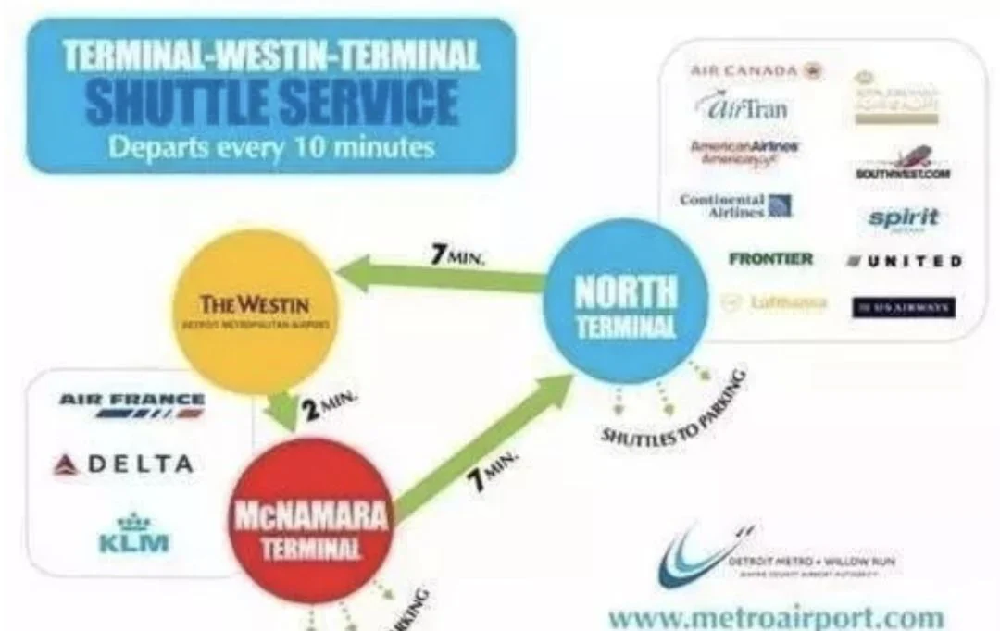

Hakuna kitu kama kuunganisha ndege ya kimataifa hadi kimataifa Marekani: mwisho wako uwe wowote, kila mtu anayeingia nchini hupitia uhamiaji kwenye **uwanja wa ndege wa kwanza anapotua**, huchukua mizigo yake iliyokaguliwa, hupitia forodha, hukagua mizigo tena na kupitia usalama wa ndani tena kabla ya kupanda ndege inayofuata. Kwa safari ya kwanza Marekani — kwa utalii, kazi au masomo — sehemu hii ya safari ndiyo ambapo mambo huenda kombo mara nyingi zaidi.

Viwanja vingi vya ndege hupokea kuwasili kwa ndege za kimataifa: Los Angeles, San Francisco, Seattle, New York, Chicago, Atlanta, Washington, Detroit na zaidi. Mwongozo huu una sehemu mbili — **mchakato wa jumla** na **viwanja saba vya ndege vinavyotumika mara nyingi zaidi kama kituo cha kwanza cha kuingia nchini**: Los Angeles (LAX), San Francisco (SFO), Atlanta (ATL), Chicago O'Hare (ORD), New York Newark (EWR), Seattle (SEA) na Detroit (DTW) — na unaonyesha ni basi gani la kuhamisha abiria au treni gani ya kuchukua na ni njia ipi ya kufuata katika kila kimoja.

## 1. Mchakato wa kuunganisha ndege baada ya kuwasili Marekani

Popote utakapotua, kuunganisha ndege Marekani hupitia hatua tano zilezile: **uhamiaji → kuchukua mizigo → forodha → kukagua mizigo yako tena → kubadilisha vituo na kupitia usalama tena.**

### 1. Uhamiaji

Fuata umati, au alama za Uhamiaji na Kuwasili, hadi ukumbi wa uhamiaji. Wasafiri wenye visa au ESTA hupanga foleni kwenye njia za wageni na kujibu maswali machache rahisi kuhusu safari yao; yeyote anayeelekezwa kwenye ukaguzi wa pili huonwa kwenye kaunta tofauti. **Kupiga picha ni marufuku katika eneo la kusubiri la uhamiaji, na vilevile kutumia simu na vifaa vingine vya kielektroniki** — vifishe kabla ya kujiunga na foleni.

### 2. Kuchukua mizigo

Baada ya uhamiaji, chukua mizigo yako iliyokaguliwa kutoka kwenye mzunguko wa mizigo. Kumbuka kwamba **mizigo haihamishwi kiotomatiki, hata ndege yako inayofuata ikiwa ya ndani** — lazima uiondoe mwenyewe kwenye mkanda na kuichukua kupitia forodha.

### 3. Forodha

Kabidhi fomu ya tamko uliyoijaza kwenye ndege (fomu ya bluu; nakala za ziada zinapatikana kwenye ukumbi wa kuwasili) na upitie forodha. Ikiwa una kitu cha kutangaza, jaza fomu kwa ukweli na utumie njia nyekundu; ikiwa huna, pitia njia ya kijani. Ukisha pita mlango huu, uko rasmi Marekani.

### 4. Kukagua mizigo yako tena

Usitoke moja kwa moja nje ya uwanja wa ndege baada ya forodha — kwanza tafuta **kaunta ya ndege za kuunganisha au ya usafiri wa kupita** na ukabidhi mizigo yako tena. Kwa kawaida kumbi za kuwasili za kimataifa zina kaunta za usafiri wa kupita kwa mashirika makubwa: kwa mfano, kwenye Kituo cha 5 cha Chicago O'Hare, United na American kila moja ina yake. Ikiwa shirika lako halina kaunta ya usafiri wa kupita katika kituo ulichotua, lazima upeleke mizigo kwenye kituo ndege yako inayofuata inaondoka na kuikagua huko.

### 5. Kubadilisha vituo na kupitia usalama tena

Kisha fuata kadi yako ya kupanda ndege hadi kituo na ukumbi sahihi. Viwanja vya ndege vya Marekani ni vikubwa, na vituo kwa kawaida huunganishwa kwa treni ya ndani au basi la kuhamisha abiria; **lazima upitie usalama mara moja zaidi kabla ya kuingia eneo la kuondoka la ndani**, kama ulivyofanya mwanzoni mwa safari yako. Chaguo za uhamisho wa ndani katika viwanja saba viko hapa chini, na maelezo ya kila uwanja yako katika sehemu inayofuata.

| Uwanja wa ndege | Jinsi unavyohama kati ya vituo | Onyo la mstari mmoja |
| --- | --- | --- |
| LAX Los Angeles | Basi la bure la kuhamisha abiria kati ya vituo, njia kadhaa za kutembea | Vituo tisa tofauti; kutembea kati yao ni polepole |
| SFO San Francisco | AirTrain (njia nyekundu na bluu) | Kuwasili kwa ndege za kimataifa ni katika Kituo cha Kimataifa |
| ATL Atlanta | Plane Train ya chini ya ardhi | Usiichanganye na MARTA, metro ya jiji |
| ORD Chicago | Treni ya uwanja wa ndege ATS | Kuwasili kwa ndege za kimataifa ni Kituo cha 5; tumia ATS |
| EWR Newark | AirTrain (vituo vitatu: A, B, C) | Kuwasili kwa ndege za kimataifa kwa kiasi kikubwa ni Kituo cha B |
| SEA Seattle | Kwa kiasi kikubwa kwa miguu, ndani ya kituo kikuu | Herufi iliyo kwenye namba ya lango lako ni ukumbi |
| DTW Detroit | Tramu ya ndani ya kituo, basi la kuhamisha abiria kati ya vituo | Delta iko McNamara; mashirika mengine yako Kituo cha Kaskazini |

### 6. Muda gani wa kuunganisha ndege wa kutenga

Nyenzo za awali ni wazi kuhusu viwanja vikubwa vya ndege: muda mwingi kila mara ni bora.

| Uwanja wa ndege | Tenga | Kwa nini |
| --- | --- | --- |
| ORD Chicago | Saa 2 au zaidi | Kuwasili kwa ndege za kimataifa ni Kituo cha 5; unatumia ATS na kupitia usalama tena |
| DTW Detroit | Saa 2 au zaidi | Dakika 90 ni chache sana, na basi la kuhamisha abiria kati ya vituo huongeza sehemu nyingine |
| LAX Los Angeles | Angalau dakika 40 ikiwa unatembea kati ya vituo | Vituo tisa tofauti na mzunguko wa basi wa njia moja |
| Viwanja vingine | Saa 1.5–2 | Foleni za uhamiaji, kuchukua mizigo, forodha na usalama |

Katika msimu wa kilele, karibu na sikukuu za umma na kwa kuwasili jioni, ongeza dakika 30–60 nyingine kwa starehe.

## 2. Viwanja saba vya ndege

### 1. LAX Uwanja wa Ndege wa Kimataifa wa Los Angeles

Los Angeles ina **vituo tisa** (Vituo 1–8 pamoja na Kituo cha Kimataifa cha Tom Bradley, TBIT, kinachoitwa pia Kituo cha B) na **kila kimoja ni jengo tofauti**, likiunganishwa tu kwa barabara, mabasi ya kuhamisha abiria na njia chache za kutembea. TBIT kwa sasa ni kituo kikuu cha kuwasili kwa ndege za kimataifa, na ndege nyingi za mashirika makubwa ya China hutua hapo.

Mambo mawili ni muhimu unapobadilisha vituo kwenye LAX:

- **Tumia basi la kuhamisha abiria kati ya vituo pekee** (linaloitwa Shuttle Bus A katika nyenzo za awali). Mabasi mengine kadhaa huenda kwenye maeneo ya kuegesha magari, kituo cha kukodisha magari na stesheni ya metro — ukipanda lisilo sahihi utatoka uwanja wa ndege.
- **Basi hilo hufanya mzunguko wa njia moja**, kwa hiyo mzunguko kamili unaweza kuchukua muda mrefu; na kutoka TBIT lazima utembee hadi mwisho wowote wa kituo ili kuona kituo cha basi, kwa sababu alama za katikati ni mbovu. Kuna njia za kutembea kati ya vituo vingine jirani, lakini kutembea kutoka TBIT hadi eneo la United huchukua **angalau dakika 40** — usijaribu ikiwa muda wako wa kuunganisha ndege ni mfupi.

Kuhusu mizigo: kila kituo kina ukumbi wake wa uhamiaji, na mchakato ni uleule kama katika viwanja vingine — uhamiaji, kuchukua mizigo, forodha. Baada ya forodha, kumbuka kwamba **si kila shirika lina kaunta ya usafiri wa kupita katika kituo ulichotua**; huenda ukalazimika kubingiria mizigo yako hadi kwenye kituo ndege yako inayofuata inaondoka.

### 2. SFO Uwanja wa Ndege wa Kimataifa wa San Francisco

Uwanja wa Kimataifa wa San Francisco ni kituo kikuu kikubwa cha United na kituo cha msingi cha Alaska Airlines, kwa hiyo abiria wa United hasa mara nyingi huunganisha ndege hapa. Uwanja una **vituo vinne**: Vituo 1, 2 na 3 huhudumia ndege za ndani, na **ndege zote za kimataifa huwasili katika Kituo cha Kimataifa**, kilichogawanywa katika maeneo mawili ya kupanda ndege, A na G.

Baada ya uhamiaji na kuchukua mizigo, endelea: abiria wenye bidhaa za kutangaza hujaza fomu, wengine wote hupitia moja kwa moja forodha. Ikiwa unaunganisha ndege, soma alama kwa makini — **Ukumbi wa Kuwasili na Toko la Ndege za Kuunganisha ziko pembezoni tofauti za ukumbi**, kwa hiyo kugeuka vibaya kunakugharimu matembezi marefu ya kuzunguka.

Fuata alama na utafikia kaunta ya mizigo ya kuunganisha ya shirika lako; mizigo ikiisha kabidhiwa, **AirTrain** ya uwanja wa ndege hubeba abiria kati ya vituo.

AirTrain ina njia mbili: **njia nyekundu** hupita kwenye vituo, majengo ya kuegesha magari ya vituo na stesheni ya BART, na **njia ya bluu** huongeza kituo cha kukodisha magari. Bado unahitaji kupitia usalama kabla ya kuingia kituo kinachofuata, kama tu ungefanya unapoondoka kwa ndege ya ndani. Nyenzo za awali pia zinaeleza kwamba mikokoteni ya mizigo kwenye SFO ni bure.

### 3. ATL Uwanja wa Ndege wa Kimataifa wa Hartsfield–Jackson Atlanta

Atlanta ni **kituo kikuu kikubwa cha Delta**, na ndege za Delta kutoka Shanghai mara nyingi huunganisha hapa. Uwanja una **kituo kimoja cha ndege za ndani** (na pande za Kaskazini na Kusini) na **kituo cha ndege za kimataifa** (Ukumbi F); abiria hushughulika kwa hakika na **kumbi saba: T, A, B, C, D, E na F**, na kila ndege hutumia kituo na lango lililowekwa kwa kiasi kikubwa.

Kumbi hizo huunganishwa kwa **Plane Train ya chini ya ardhi**, inayotembea mara nyingi sana — kutoka T hadi mwisho wa mbali F huchukua takriban dakika kumi na mbili. Nyenzo za awali huiita treni hii ya uwanja wa ndege "metro ya chini ya ardhi", jambo ambalo ni rahisi kuichanganya na **MARTA, metro ya jiji**: stesheni ya MARTA iko upande wa **kituo cha ndege za ndani** na ndiyo njia ya kufika katikati ya jiji la Atlanta. Huhitaji kuitumia kuunganisha ndege. Baada ya uhamiaji, fuata alama za Plane Train na utakuwa unaelekea ndege yako inayofuata.

Vikumbusho vya nyenzo za awali:

- **Mikokoteni ya mizigo ya Atlanta inatozwa**, hulipwa kwa kadi ya mkopo.
- **Wi-Fi ya uwanja wa ndege inatozwa**, kwa hiyo usitegemee kuwa mtandaoni mara tu unapotua.
- Katika muda wa kiangazi Atlanta iko saa 12 nyuma ya China; wakati wa baridi ni saa 13. Weka saa yako kwa muda wa eneo mara tu ukiwa ndani ya ndege, ili uweze kuhukumu utakapotua na kama muda wako wa kuunganisha ndege ni mzuri.
- Kutoka Shanghai hadi Atlanta ni takriban saa 14 angani.

### 4. ORD Uwanja wa Ndege wa Kimataifa wa Chicago O'Hare

Chicago O'Hare ni mojawapo ya viwanja vya ndege vyenye shughuli nyingi zaidi Amerika Kaskazini na lango la kuingilia kwa wasafiri wanaoelekea miji kote Marekani. Ina **malango 186** katika **vituo vinne (1, 2, 3 na 5) na kumbi tisa (B, C, E, F, G, H, K, L na M)**, na **ndege zote za kimataifa hutua Kituo cha 5**.

Baada ya kutua, chukua fomu yako ya tamko na fuata umati hadi forodha — "fuata umati" hufanya kazi vizuri hapa. **Kupiga picha na kutumia simu na vifaa vingine vya kielektroniki ni marufuku kabisa katika eneo la kusubiri la uhamiaji**, kwa hiyo vifishe wakati ukiwa kwenye foleni. Ukisha pitia forodha na kuwa na mizigo yako, **usitoke moja kwa moja nje ya uwanja wa ndege**: tumia lifti zilizo pande zote mbili kwenda juu hadi treni ya uwanja wa ndege.

Treni ya ndani ni **ATS (Mfumo wa Usafiri wa Uwanja wa Ndege)**, na vituo vyake hufuata mpangilio huu: vituo vitatu vya ndege za ndani → kituo cha ndege za kimataifa → maeneo ya kuegesha magari → stesheni ya metro ya CTA → kituo cha mabasi. **Angalia ni kituo gani ndege yako inayofuata inaondoka kabla ya kupanda**, na ukipotea, muulize mfanyakazi yeyote wa ardhini mahali basi la kuhamisha abiria lilipo. Kwa ujumla, Kituo cha 1 kinatawaliwa na United, Kituo cha 3 na American, na Kituo cha 2 kinatumiwa kwa pamoja na mashirika kadhaa ya ndege za ndani.

ATS inapokushusha kwenye kituo sahihi cha ndege za ndani, **lazima upitie usalama wa ndani wa Marekani tena**; baada ya usalama, tafuta lango la ndege yako inayofuata na subiri hapo. Nyenzo za awali zinaongeza kwamba Wi-Fi ya uwanja wa ndege wa Chicago inatozwa na si ya bei nafuu, kwa hiyo jiandae kuwa nje ya mtandao, na kwamba unapaswa kutenga **angalau saa mbili** kwa kuunganisha ndege.

### 5. EWR Uwanja wa Ndege wa Kimataifa wa Newark Liberty, New York

Newark iko takriban maili 16 kutoka Manhattan na ni mojawapo ya viwanja vitatu vya ndege vinavyohudumia eneo la jiji la New York — vingine ni John F. Kennedy (JFK) na LaGuardia (LGA), ambapo LGA ndilo lililo karibu zaidi na Manhattan na ndilo chaguo la kawaida kwa safari ya kutalii jijini. Newark ni miongoni mwa viwanja vya ndege vyenye shughuli nyingi zaidi nchini na ni **kituo kikuu cha United** ("Continental Airlines" ya nyenzo za awali iliunganishwa na United mwaka 2012), inayotumia Kituo cha C na sehemu ya Kituo cha A.

Newark ina **vituo vitatu — A, B na C — na Kituo cha B ndicho kituo kikuu cha ndege za kimataifa**, ingawa ndege kutoka China zinaweza pia kuwasili Kituo cha C. Baada ya kutua, fuata umati au alama za Uhamiaji ili kukamilisha taratibu; sehemu ya uhamiaji ya Kituo cha C imeonyeshwa hapa chini.

Kisha chukua mizigo yako — kumbuka kwamba **mikokoteni ya mizigo kwenye EWR inagharimu $5**, kwa hiyo kuwa na noti au sarafu tayari. Chukua mizigo kupitia forodha; ikiwa huna cha kutangaza, toka nje na utafute kaunta ya usafiri wa kupita, na ukabidhi mizigo tena.

Baada ya mizigo kukaguliwa tena, elekea kituo ndege yako inayofuata inaondoka. **AirTrain** ya uwanja wa ndege husafiri kati ya Vituo A, B na C — **takriban kila dakika 15 wakati wa shughuli ndogo na kila dakika 3 wakati wa kilele** — na pia huunganisha majengo ya kuegesha magari P2, P3 na P4 na stesheni ya treni ya NJ Transit na Amtrak, ambayo unaweza kufika moja kwa moja New York Penn Station.

### 6. SEA Uwanja wa Ndege wa Kimataifa wa Seattle–Tacoma

Kuunganisha ndege huko Seattle ni rahisi kiasi: fuata abiria wenzako kutoka kwenye ndege hadi ukumbi wa uhamiaji, pitia uhamiaji, chukua mizigo yako (kuchukua mizigo), pitia forodha, kagua mizigo tena na upitie usalama mara moja zaidi. Ikiwa unaweza kusoma Kiingereza, au unafuata umati tu, ni vigumu kukosea.

Kaunta za kujisajili zote ziko kwenye **kituo kikuu**, ilhali ndege hutua kwenye kumbi tofauti. Seattle ina **kumbi nne — A, B, C na D** — zenye rangi za kijani hafifu, machungwa, kijani kizito na manjano kahawia. Unaweza kujua ndege yako inayofuata inaondoka wapi mara tu unapopata kadi yako ya kupanda ndege China, kwa sababu **namba za malango za Seattle ni herufi moja pamoja na tarakimu mbili, na herufi ni ukumbi**: C inamaanisha ukumbi C, D inamaanisha ukumbi D.

### 7. DTW Uwanja wa Ndege wa Detroit Metropolitan Wayne County

Detroit ni **kituo kikuu cha Delta** na mojawapo ya viwanja vya ndege vya kisasa zaidi nchini. Ina **vituo viwili**: Kituo cha McNamara na Kituo cha Kaskazini. **Delta na washirika wake wa SkyTeam hutumia McNamara**, ilhali mashirika mengine hutumia Kituo cha Kaskazini.

Kuwasili kwa ndege za kimataifa kwenye McNamara huja kwenye **ngazi ya kijani** (ngazi ya chini): pitia forodha, chukua mizigo yako kwenye ngazi hiyo hiyo, na uikague tena hapo ikiwa unahitaji. Kisha panda juu hadi **Ngazi ya 2 ya bluu** — ndege nyingi za Delta huondoka kwenye **Ukumbi A**, na kufikia Ukumbi B au C unaweza kupitia Light Tunnel maarufu au kupanda Express Tram ya ndani ya kituo.

Kwa **Kituo cha Kaskazini**, panda basi la kuhamisha abiria kati ya vituo — huduma ya Kituo–Westin–Kituo, **kila dakika 10**, takriban dakika 7 kutoka McNamara hadi Kituo cha Kaskazini na kituo kimoja kwenye hoteli ya Westin njiani. Kituo cha Kaskazini chenyewe ni rahisi, lakini **unapitia usalama tena kabla ya kuingia**.

Ingawa ni wa kisasa, Detroit bado inahitaji muda mkarimu wa kuunganisha ndege: **tenga saa mbili au zaidi — dakika 90 ni chache sana** — kwa hiyo zingatia hilo unapokata tikiti.

## 3. Maelezo ambayo ni rahisi kuyakosa

- **Mikokoteni ya mizigo:** nyenzo za awali zinaeleza kuwa ni bure kwenye SFO, hutozwa kwenye ATL (kwa kadi) na $5 kwenye EWR — kubeba noti ndogo na kadi ya mkopo inayofanya kazi hakugharimu chochote.
- **Wi-Fi ya uwanja wa ndege:** inatozwa kwenye ATL na ORD, kwa hiyo huenda usiwe mtandaoni mara tu unapotua; weka taarifa zozote muhimu za mawasiliano mahali unapoweza kuzisoma bila mtandao.
- **Tofauti za muda:** Atlanta iko saa 12 nyuma ya China wakati wa kiangazi na saa 13 wakati wa baridi. Weka saa yako kwa muda wa eneo ukiwa angani na nyakati za kuwasili na kuunganisha ndege zitakuwa rahisi zaidi kuhukumu.
- **Simu na kamera:** kutumia simu na vifaa vingine vya kielektroniki ni marufuku katika maeneo ya kusubiri ya uhamiaji na forodha — na usipige picha.
- **Unabeba mizigo yako mwenyewe:** iwe na tikiti ya moja kwa moja au la, ukishaingia Marekani unachukua mizigo yako, unaipitisha forodha na kuikagua tena; kamwe hazikufuati kiotomatiki hadi ndege inayofuata.

Michoro ya viwanja vya ndege hapa inatoka kwenye nyenzo za awali, na viwanja vya ndege na mashirika hubadilika kila mara — Continental Airlines iliyokuwa kwenye chanzo iliunganishwa na United, US Airways na American, na Northwest na Delta. Angalia na uwanja wa ndege na shirika lako kwa siku unayosafiri.

## Viungo vinavyohusiana

- **Kwenye tovuti hii**: [Los Angeles LAX](/airport/LAX), [San Francisco SFO](/airport/SFO), [Atlanta ATL](/airport/ATL), [Chicago O'Hare ORD](/airport/ORD), [Newark EWR](/airport/EWR), [Seattle SEA](/airport/SEA), [Marekani (US)](/country/US)
- **Wikipedia**: [Los Angeles LAX](https://en.wikipedia.org/wiki/Los_Angeles_International_Airport), [San Francisco SFO](https://en.wikipedia.org/wiki/San_Francisco_International_Airport), [Atlanta ATL](https://en.wikipedia.org/wiki/Hartsfield%E2%80%93Jackson_Atlanta_International_Airport), [Chicago O'Hare ORD](https://en.wikipedia.org/wiki/O'Hare_International_Airport), [Newark EWR](https://en.wikipedia.org/wiki/Newark_Liberty_International_Airport), [Seattle SEA](https://en.wikipedia.org/wiki/Seattle%E2%80%93Tacoma_International_Airport), [Detroit DTW](https://en.wikipedia.org/wiki/Detroit_Metropolitan_Wayne_County_Airport)
- **Baidu Baike**: [Los Angeles LAX](https://baike.baidu.com/item/%E6%B4%9B%E6%9D%89%E7%9F%B6%E5%9B%BD%E9%99%85%E6%9C%BA%E5%9C%BA), [San Francisco SFO](https://baike.baidu.com/item/%E6%97%A7%E9%87%91%E5%B1%B1%E5%9B%BD%E9%99%85%E6%9C%BA%E5%9C%BA), [Atlanta ATL](https://baike.baidu.com/item/%E5%93%88%E8%8C%A8%E8%8F%B2%E5%B0%94%E5%BE%B7-%E6%9D%B0%E5%85%8B%E9%80%8A%E4%BA%9A%E7%89%B9%E5%85%B0%E5%A4%A7%E5%9B%BD%E9%99%85%E6%9C%BA%E5%9C%BA), [Chicago O'Hare ORD](https://baike.baidu.com/item/%E5%A5%A5%E9%BB%91%E5%B0%94%E5%9B%BD%E9%99%85%E6%9C%BA%E5%9C%BA), [Newark EWR](https://baike.baidu.com/item/%E7%BA%BD%E7%93%A6%E5%85%8B%E8%87%AA%E7%94%B1%E5%9B%BD%E9%99%85%E6%9C%BA%E5%9C%BA), [Seattle SEA](https://baike.baidu.com/item/%E8%A5%BF%E9%9B%85%E5%9B%BE-%E5%A1%94%E7%A7%91%E9%A9%AC%E5%9B%BD%E9%99%85%E6%9C%BA%E5%9C%BA), [Detroit DTW](https://baike.baidu.com/item/%E5%BA%95%E7%89%B9%E5%BE%8B%E9%83%BD%E4%BC%9A%E9%9F%A6%E6%81%A9%E5%8E%BF%E6%9C%BA%E5%9C%BA)
