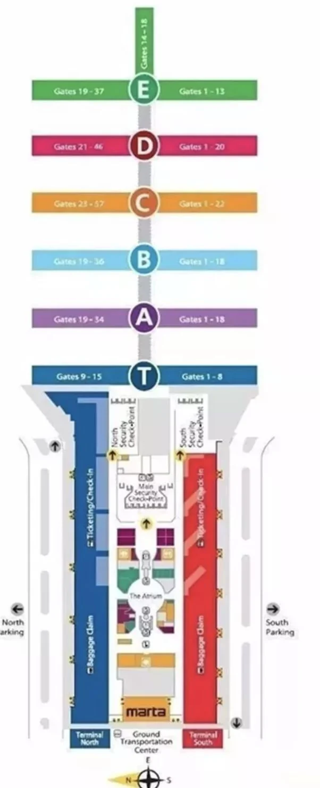

Amerika Birleşik Devletleri'nde uluslararasından uluslararasıya transit diye bir şey yoktur: son varış noktanız ne olursa olsun, ülkeye giren herkes **indiği ilk havalimanında** göçmenlik işlemlerini tamamlar, kayıtlı bagajını alır, gümrükten geçer, bagajı yeniden teslim eder ve bir sonraki uçağa binmeden önce yeniden iç hat güvenliğinden geçer. ABD'ye ilk seyahatte — turizm, iş ya da eğitim için — işlerin en sık ters gittiği yer yolculuğun bu kısmıdır.

Birçok havalimanı uluslararası varışları kabul eder: Los Angeles, San Francisco, Seattle, New York, Chicago, Atlanta, Washington, Detroit ve daha fazlası. Bu rehber iki bölümden oluşuyor — **genel süreç** ve **ilk giriş noktası olarak en sık kullanılan yedi havalimanı**: Los Angeles (LAX), San Francisco (SFO), Atlanta (ATL), Chicago O'Hare (ORD), New York Newark (EWR), Seattle (SEA) ve Detroit (DTW) — ve her birinde hangi servis otobüsüne ya da trene binileceğini, hangi koridorun izleneceğini ortaya koyuyor.

## 1. ABD'ye vardıktan sonra aktarma süreci

Nereye inerseniz inin, ABD'de bir aktarma aynı beş adımdan geçer: **göçmenlik → bagaj alım → gümrük → bagajı yeniden teslim etme → terminal değiştirme ve yeniden güvenlik kontrolü.**

### 1. Göçmenlik

Kalabalığı ya da Göçmenlik ve Varış tabelalarını takip ederek göçmenlik salonuna gidin. Vizesi veya ESTA'sı olan yolcular ziyaretçi gişelerinde kuyruğa girer ve yolculuklarıyla ilgili birkaç basit soruyu yanıtlar; ikincil incelemeye yönlendirilenler ayrı bir gişede görülür. **Göçmenlik bekleme alanında fotoğraf çekmek ve telefon ile diğer elektronik cihazları kullanmak yasaktır** — kuyruğa girmeden önce onları kaldırın.

### 2. Bagaj alım

Göçmenlikten sonra kayıtlı bagajınızı döner banttan alın. Unutmayın: **devam uçuşunuz iç hat olsa bile bagajlar otomatik olarak aktarılmaz** — onları kendiniz banttan alıp gümrükten dışarı taşımanız gerekir.

### 3. Gümrük

Uçakta doldurduğunuz beyanname formunu (mavi form; yedek kopyalar varış salonunda bulunur) teslim edip gümrükten geçin. Beyan edecek bir şeyiniz varsa formu dürüstçe doldurun ve kırmızı kanalı kullanın; yoksa yeşil kanaldan geçin. Bu kapıdan geçtiğinizde resmen Amerika Birleşik Devletleri'ndesiniz.

### 4. Bagajı yeniden teslim etme

Gümrükten sonra doğrudan havalimanından çıkmayın — önce **aktarma uçuşları veya transit gişesini** bulun ve bagajınızı yeniden teslim edin. Uluslararası varış salonlarında genellikle ana havayolları için transit gişeleri vardır; örneğin Chicago O'Hare'in Terminal 5'inde United ve American'ın ayrı gişeleri bulunur. Havayolunuzun indiğiniz terminalde transit masası yoksa bagajları bir sonraki uçuşunuzun kalkacağı terminale götürüp orada teslim etmeniz gerekir.

### 5. Terminal değiştirme ve yeniden güvenlik kontrolü

Ardından biniş kartınızı izleyerek doğru terminale ve koridora gidin. ABD havalimanları büyüktür ve terminaller genellikle bir iç tren veya servis otobüsüyle birbirine bağlanır; **iç hat kalkış alanına girmeden önce, tıpkı yolculuğunuzun başında yaptığınız gibi bir kez daha güvenlikten geçmelisiniz**. Yedi havalimanındaki iç aktarma seçenekleri aşağıda, her havalimanının ayrıntıları ise bir sonraki bölümde.

| Havalimanı | Terminaller arasında nasıl geçilir | Tek satırlık uyarı |
| --- | --- | --- |
| LAX Los Angeles | Ücretsiz terminaller arası servis otobüsü, bazı yürüyüş yolları | Dokuz ayrı terminal; aralarında yürümek yavaş |
| SFO San Francisco | AirTrain (kırmızı ve mavi hatlar) | Uluslararası varışlar Uluslararası Terminal'de |
| ATL Atlanta | Yeraltı Plane Train | Şehir metrosu MARTA ile karıştırmayın |
| ORD Chicago | ATS havalimanı treni | Uluslararası varışlar Terminal 5'te; ATS'ye binin |
| EWR Newark | AirTrain (üç durak: A, B, C) | Uluslararası varışlar esas olarak Terminal B'de |
| SEA Seattle | Çoğunlukla ana terminal içinde yürüyerek | Kapı numaranızdaki harf koridoru gösterir |
| DTW Detroit | Terminal içi tramvay, terminaller arası servis | Delta McNamara'da; diğer havayolları Kuzey Terminal'de |

### 6. Ne kadar aktarma süresi bırakılmalı

Kaynak materyal büyük havalimanlar konusunda açık: daha fazla zaman her zaman daha iyidir.

| Havalimanı | Ayrılacak süre | Neden |
| --- | --- | --- |
| ORD Chicago | 2 saat veya daha fazla | Uluslararası varışlar Terminal 5'te; ATS'ye binip yeniden güvenlikten geçersiniz |
| DTW Detroit | 2 saat veya daha fazla | 90 dakika çok sıkı ve terminal servisi bir bacak daha ekliyor |
| LAX Los Angeles | Terminaller arasında yürüyorsanız en az 40 dakika | Dokuz ayrı terminal ve tek yönlü servis döngüsü |
| Diğer havalimanları | 1,5–2 saat | Göçmenlik, bagaj alım, gümrük ve güvenlik kuyrukları |

Yoğun sezonda, resmi tatiller civarında ve akşam varışlarında rahatlık için 30–60 dakika daha ekleyin.

## 2. Yedi havalimanı

### 1. LAX Los Angeles Uluslararası Havalimanı

Los Angeles'ta **dokuz terminal** var (Terminal 1–8 ile Tom Bradley Uluslararası Terminali, TBIT, aynı zamanda Terminal B olarak da anılır) ve **her biri ayrı bir binadır**; yalnızca yollar, servis otobüsleri ve birkaç yürüyüş yoluyla bağlanır. TBIT şu anda ana uluslararası varış noktası ve büyük Çinli havayollarının uçuşlarının çoğu buraya iniyor.

LAX'te terminal değiştirirken iki şey önemli:

- **Yalnızca terminaller arası servis otobüsüne binin** (kaynak materyalde Shuttle Bus A olarak geçer). Otoparklara, araç kiralama merkezine ve metro istasyonuna giden başka birçok otobüs var — yanlış olana binerseniz havalimanından çıkarsınız.
- **Servis otobüsü tek yönlü bir döngü izler**, bu yüzden tam bir tur uzun sürebilir; ayrıca TBIT'ten durağı görmek için terminalin iki ucundan birine yürümeniz gerekir, çünkü aradaki tabelalar zayıf. Bazı komşu terminaller arasında yürüyüş yolları var, ancak TBIT'ten United bölgesine yürümek **en az 40 dakika** sürer — aktarmanız sıkışıksa bunu denemeyin.

Bagaj konusunda: her terminalin kendi göçmenlik salonu var ve süreç diğer havalimanlarındakiyle aynı — göçmenlik, bagaj alım, gümrük. Gümrükten sonra unutmayın: **her havayolunun, indiğiniz terminalde transit gişesi yoktur**; bagajlarınızı bir sonraki uçuşunuzun kalkacağı terminale tekerlekli olarak götürmeniz gerekebilir.

### 2. SFO San Francisco Uluslararası Havalimanı

San Francisco Uluslararası, United için büyük bir merkez ve Alaska Airlines için odak şehir; bu yüzden özellikle United yolcuları burada sık sık aktarma yapar. Havalimanında **dört terminal** var: Terminal 1, 2 ve 3 iç hat uçuşlarını işler ve **tüm uluslararası uçuşlar, A ve G olmak üzere iki biniş alanına ayrılan Uluslararası Terminal'e** iner.

Göçmenlik ve bagaj alımdan sonra yürümeye devam edin: beyan edecek eşyası olan yolcular form doldurur, diğer herkes doğrudan gümrükten geçer. Aktarma yapıyorsanız tabelaları dikkatle okuyun — **Varış Lobisi ile Aktarma Uçuşları Çıkışı salonun karşılıklı uçlarındadır**, yanlış dönüş size uzun bir yürüyüşe mal olur.

Tabelaları takip ederseniz havayolunuzun aktarma bagaj masasına ulaşırsınız; bagajlar teslim edildikten sonra havalimanının **AirTrain**'i yolcuları terminaller arasında taşır.

AirTrain'in iki hattı var: **kırmızı hat** terminallerde, terminal otoparklarında ve BART istasyonunda durur; **mavi hat** buna araç kiralama merkezini ekler. İç hat uçuşuna çıkıyormuş gibi bir sonraki terminale girmeden önce yine güvenlikten geçmeniz gerekir. Kaynak materyal ayrıca SFO'da bagaj arabalarının ücretsiz olduğunu belirtiyor.

### 3. ATL Hartsfield–Jackson Atlanta Uluslararası Havalimanı

Atlanta, **Delta'nın en büyük merkezi** ve Şanghay'dan gelen Delta uçuşları çok sık burada aktarma yapar. Havalimanında **bir iç hat terminali** (Kuzey ve Güney taraflarıyla) ve **bir uluslararası terminal** (Koridor F) var; yolcuların gerçekte uğraştığı şey ise **yedi koridor: T, A, B, C, D, E ve F**; her uçuş oldukça sabit bir terminal ve kapı kullanıyor.

Koridorlar, çok sık çalışan **yeraltı Plane Train** ile birbirine bağlanır — T'den en uzak uçtaki F'ye yaklaşık on iki dakika sürer. Kaynak materyal bu havalimanı trenini "metro" olarak adlandırıyor; bu, **şehir metrosu MARTA** ile kolayca karıştırılır: MARTA'nın istasyonu **iç hat terminali** tarafındadır ve Atlanta merkezine gitmenin yoludur. Aktarma için ona ihtiyacınız yok. Göçmenlikten sonra Plane Train tabelalarını izleyin, bir sonraki uçuşunuza doğru gidiyorsunuz.

Kaynak materyalin hatırlatmaları:

- Atlanta'da **bagaj arabaları ücretlidir**, kredi kartıyla ödenir.
- **Havalimanı Wi-Fi'ı ücretlidir**, bu yüzden indiğiniz anda çevrimiçi olmayı beklemeyin.
- Yaz saati uygulamasında Atlanta, Çin'in 12 saat gerisindedir; kışın 13. Saatinizi uçaktayken yerel saate ayarlayın, böylece ne zaman ineceğinizi ve aktarmanızın rahat olup olmadığını değerlendirebilirsiniz.
- Şanghay'dan Atlanta havada yaklaşık 14 saat.

### 4. ORD Chicago O'Hare Uluslararası Havalimanı

Chicago O'Hare, Kuzey Amerika'nın en yoğun havalimanlarından biri ve ABD genelindeki şehirlere devam eden yolcular için bir kapı. **186 kapısı** vardır: **dört terminal (1, 2, 3 ve 5) ve dokuz koridor (B, C, E, F, G, H, K, L ve M)**; **tüm uluslararası uçuşlar Terminal 5'e yanaşıyor**.

İndikten sonra beyanname formunuzu alın ve gümrüğe doğru kalabalığı izleyin — "kalabalığı izlemek" burada iyi işe yarar. **Göçmenlik bekleme alanında fotoğraf çekmek ve telefon ile diğer elektronik cihazları kullanmak kesinlikle yasaktır**, bu yüzden kuyrukta beklerken onları kaldırın. Gümrükten geçip bagajınızı aldıktan sonra **doğrudan havalimanından çıkmayın**: iki yandaki asansörlerle havalimanı trenine çıkın.

İç tren **ATS (Airport Transit System)** ve durakları şu sırayla gelir: üç iç hat terminali → uluslararası terminal → otoparklar → CTA metro istasyonu → otobüs terminali. **Binmeden önce bir sonraki uçuşunuzun hangi terminalden kalkacağını kontrol edin** ve kaybolursanız yer personelinden herhangi birine aktarma servisinin nerede olduğunu sorun. Genel olarak Terminal 1'e United, Terminal 3'e American hâkimdir ve Terminal 2 birkaç iç hat taşıyıcısı tarafından paylaşılır.

ATS sizi doğru iç hat terminalinde bıraktığında **yeniden ABD iç hat güvenliğinden geçmelisiniz**; güvenliğin ötesinde bir sonraki uçuşunuzun kapısını bulun ve orada bekleyin. Kaynak materyal, Chicago'da havalimanı Wi-Fi'ının ücretli ve ucuz olmadığını, bu yüzden çevrimdışı olmaya hazırlıklı olmanız gerektiğini ve aktarma için **en az iki saat** bırakmanız gerektiğini ekliyor.

### 5. EWR New York Newark Liberty Uluslararası Havalimanı

Newark, Manhattan'dan yaklaşık 16 mil uzakta ve New York metropoliten bölgesine hizmet eden üç havalimanından biri — diğerleri John F. Kennedy (JFK) ve LaGuardia (LGA); LGA Manhattan'a en yakın olanı ve şehre bir gezi için olağan tercih. Newark ülkenin en yoğun havalimanları arasında ve **United'ın merkezi** (kaynak materyaldeki "Continental Airlines" 2012'de United'a katıldı); Terminal C'yi ve Terminal A'nın bir bölümünü kullanıyor.

Newark'ta **üç terminal var — A, B ve C — ve Terminal B ana uluslararası terminal**, ancak Çin'den gelen uçuşlar Terminal C'ye de inebilir. İndikten sonra kalabalığı ya da Göçmenlik tabelalarını izleyerek işlemleri tamamlayın; Terminal C'nin göçmenlik noktası aşağıda gösteriliyor.

Ardından bagajınızı alın — unutmayın: **EWR'de bagaj arabaları 5 $**, bu yüzden yanınızda banknot veya bozuk para bulundurun. Bagajları gümrükten geçirin; beyan edecek bir şeyiniz yoksa dışarı çıkıp transit gişesini bulun ve bagajları yeniden teslim edin.

Bagaj yeniden teslim edildikten sonra bir sonraki uçuşunuzun kalkacağı terminale yönelin. Havalimanının **AirTrain**'i A, B ve C terminalleri arasında çalışır — **yoğun olmayan saatlerde yaklaşık her 15 dakikada, yoğun saatlerde her 3 dakikada** — ve ayrıca P2, P3 ve P4 otoparklarını, doğrudan New York Penn Station'a ulaşabileceğiniz NJ Transit ve Amtrak tren istasyonunu birbirine bağlar.

### 6. SEA Seattle–Tacoma Uluslararası Havalimanı

Seattle'da aktarma yapmak nispeten basit: uçaktan inen diğer yolcuları göçmenlik salonuna kadar izleyin, göçmenlikten geçin, bagajınızı alın (bagaj alım), gümrükten geçin, bagajı yeniden teslim edin ve bir kez daha güvenlikten geçin. İngilizce okuyabiliyorsanız veya sadece kalabalığı izliyorsanız yanlış gitmeniz zor.

Check-in gişelerinin hepsi **ana terminalde**, uçaklar ise farklı koridorlara yanaşıyor. Seattle'da **dört koridor — A, B, C ve D** var — açık yeşil, turuncu, koyu yeşil ve hardal rengiyle kodlanmış. Bir sonraki uçuşunuzun nereden kalkacağını Çin'de biniş kartınızı alır almaz anlayabilirsiniz, çünkü **Seattle kapı numaraları bir harf ve iki rakamdan oluşur ve harf koridoru gösterir**: C, C koridoru demektir; D, D koridoru.

### 7. DTW Detroit Metropolitan Wayne County Havalimanı

Detroit, **Delta için bir merkez** ve ülkenin en modern havalimanlarından biri. **İki terminali** var: McNamara Terminali ve Kuzey Terminali. **Delta ve SkyTeam ortakları McNamara'yı** kullanırken diğer havayolları Kuzey Terminali'ni kullanıyor.

McNamara'daki uluslararası varışlar **yeşil kata** (alt kat) gelir: gümrükten geçin, bagajınızı aynı katta alın ve gerekirse orada yeniden teslim edin. Ardından üst kattaki **mavi 2. Kat**a çıkın — Delta uçuşlarının çoğu **A Koridoru'ndan** kalkar ve B veya C Koridoru'na ulaşmak için ünlü Işık Tüneli'nden yürüyebilir ya da terminal içi Express Tramvay'a binebilirsiniz.

**Kuzey Terminali** için terminaller arası servisi kullanın — Terminal–Westin–Terminal hizmeti, **her 10 dakikada bir**, McNamara'dan Kuzey Terminali'ne yaklaşık 7 dakika ve yolda Westin otelinde bir durak. Kuzey Terminali'nin kendisi basit, ancak **girmeden önce yeniden güvenlikten geçersiniz**.

Ne kadar modern olsa da Detroit yine de geniş bir aktarma süresi gerektiriyor: **iki saat veya daha fazla bırakın — 90 dakika çok sıkı** — rezervasyon yaparken bunu göz önünde bulundurun.

## 3. Gözden kaçması kolay ayrıntılar

- **Bagaj arabaları:** kaynak materyal SFO'da ücretsiz, ATL'de (kartla) ücretli ve EWR'de 5 $ olduğunu belirtiyor — yanınızda biraz banknot ve çalışan bir kredi kartı taşımak hiçbir şeye mal olmaz.
- **Havalimanı Wi-Fi'ı:** ATL ve ORD'de ücretli, bu yüzden indiğiniz anda çevrimiçi olmayabilirsiniz; önemli iletişim bilgilerini çevrimdışı okuyabileceğiniz bir yerde tutun.
- **Saat farkları:** Atlanta yaz saati uygulamasında Çin'in 12 saat, kışın 13 saat gerisindedir. Saatinizi havadayken yerel saate ayarlayın; varış ve aktarma saatlerini değerlendirmek çok daha kolaylaşır.
- **Telefonlar ve kameralar:** göçmenlik ve gümrük bekleme alanlarında telefon ve diğer elektronik cihazların kullanımı yasaktır — fotoğraf da çekmeyin.
- **Bagajınızı kendiniz taşırsınız:** tek biletle olsun olmasın, ABD'ye girdiğinizde bagajınızı alır, gümrükten geçirir ve yeniden teslim edersiniz; bagajlar bir sonraki uçuşa asla otomatik olarak sizinle gitmez.

Buradaki havalimanı şemaları kaynak materyalden geliyor ve havalimanları ile havayolları sürekli değişiyor — kaynaktaki Continental Airlines United'a, US Airways American'a ve Northwest Delta'ya katıldı. Seyahat ettiğiniz gün için havalimanına ve havayolunuza danışın.

## İlgili bağlantılar

- **Bu sitede**: [Los Angeles LAX](/airport/LAX), [San Francisco SFO](/airport/SFO), [Atlanta ATL](/airport/ATL), [Chicago O'Hare ORD](/airport/ORD), [Newark EWR](/airport/EWR), [Seattle SEA](/airport/SEA), [Amerika Birleşik Devletleri (US)](/country/US)
- **Wikipedia**: [Los Angeles LAX](https://en.wikipedia.org/wiki/Los_Angeles_International_Airport), [San Francisco SFO](https://en.wikipedia.org/wiki/San_Francisco_International_Airport), [Atlanta ATL](https://en.wikipedia.org/wiki/Hartsfield%E2%80%93Jackson_Atlanta_International_Airport), [Chicago O'Hare ORD](https://en.wikipedia.org/wiki/O'Hare_International_Airport), [Newark EWR](https://en.wikipedia.org/wiki/Newark_Liberty_International_Airport), [Seattle SEA](https://en.wikipedia.org/wiki/Seattle%E2%80%93Tacoma_International_Airport), [Detroit DTW](https://en.wikipedia.org/wiki/Detroit_Metropolitan_Wayne_County_Airport)
- **Baidu Baike**: [Los Angeles LAX](https://baike.baidu.com/item/%E6%B4%9B%E6%9D%89%E7%9F%B6%E5%9B%BD%E9%99%85%E6%9C%BA%E5%9C%BA), [San Francisco SFO](https://baike.baidu.com/item/%E6%97%A7%E9%87%91%E5%B1%B1%E5%9B%BD%E9%99%85%E6%9C%BA%E5%9C%BA), [Atlanta ATL](https://baike.baidu.com/item/%E5%93%88%E8%8C%A8%E8%8F%B2%E5%B0%94%E5%BE%B7-%E6%9D%B0%E5%85%8B%E9%80%8A%E4%BA%9A%E7%89%B9%E5%85%B0%E5%A4%A7%E5%9B%BD%E9%99%85%E6%9C%BA%E5%9C%BA), [Chicago O'Hare ORD](https://baike.baidu.com/item/%E5%A5%A5%E9%BB%91%E5%B0%94%E5%9B%BD%E9%99%85%E6%9C%BA%E5%9C%BA), [Newark EWR](https://baike.baidu.com/item/%E7%BA%BD%E7%93%A6%E5%85%8B%E8%87%AA%E7%94%B1%E5%9B%BD%E9%99%85%E6%9C%BA%E5%9C%BA), [Seattle SEA](https://baike.baidu.com/item/%E8%A5%BF%E9%9B%85%E5%9B%BE-%E5%A1%94%E7%A7%91%E9%A9%AC%E5%9B%BD%E9%99%85%E6%9C%BA%E5%9C%BA), [Detroit DTW](https://baike.baidu.com/item/%E5%BA%95%E7%89%B9%E5%BE%8B%E9%83%BD%E4%BC%9A%E9%9F%A6%E6%81%A9%E5%8E%BF%E6%9C%BA%E5%9C%BA)
