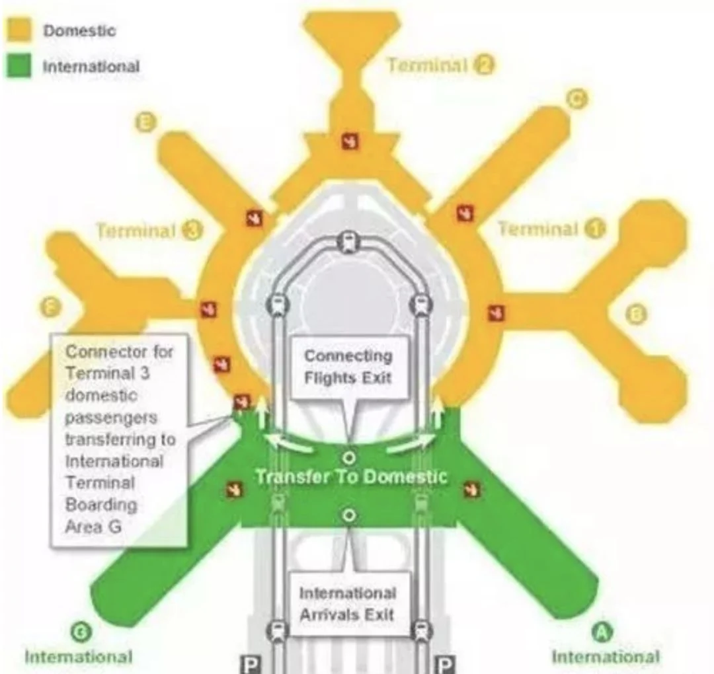

Ở Hoa Kỳ không có khái niệm trung chuyển quốc tế sang quốc tế: dù điểm đến cuối cùng là đâu, mọi người nhập cảnh đều làm thủ tục nhập cảnh tại **sân bay đầu tiên nơi họ hạ cánh**, nhận hành lý ký gửi, qua hải quan, gửi lại hành lý và qua an ninh nội địa lần nữa trước khi lên chuyến tiếp theo. Với lần đầu đến Mỹ — du lịch, công tác hay du học — đây là phần của hành trình hay xảy ra trục trặc nhất.

Nhiều sân bay đón chuyến quốc tế: Los Angeles, San Francisco, Seattle, New York, Chicago, Atlanta, Washington, Detroit và nhiều nơi khác. Hướng dẫn này gồm hai phần — **quy trình chung** và **bảy sân bay thường được dùng làm cửa ngõ nhập cảnh đầu tiên**: Los Angeles (LAX), San Francisco (SFO), Atlanta (ATL), Chicago O'Hare (ORD), New York Newark (EWR), Seattle (SEA) và Detroit (DTW) — và trình bày nên đi xe đưa đón hay tàu nào, theo hành lang nào ở từng sân bay.

## 1. Quy trình trung chuyển sau khi đến Mỹ

Dù hạ cánh ở đâu, một chuyến nối ở Mỹ đều qua năm bước giống nhau: **nhập cảnh → nhận hành lý → hải quan → gửi lại hành lý → đổi nhà ga và qua an ninh lần nữa.**

### 1. Nhập cảnh

Đi theo đám đông hoặc biển Immigration and Arrival đến sảnh nhập cảnh. Du khách có thị thực hoặc ESTA xếp hàng ở làn du khách và trả lời vài câu hỏi đơn giản về chuyến đi; ai bị chuyển sang kiểm tra thứ cấp sẽ được xử lý tại quầy riêng. **Cấm chụp ảnh trong khu vực chờ nhập cảnh, cũng như dùng điện thoại và thiết bị điện tử khác** — hãy cất chúng đi trước khi vào hàng.

### 2. Nhận hành lý

Sau nhập cảnh, nhận hành lý ký gửi từ băng chuyền. Lưu ý **hành lý không được chuyển tự động, ngay cả khi chuyến tiếp theo là nội địa** — bạn phải tự lấy khỏi băng tải và mang qua hải quan.

### 3. Hải quan

Nộp tờ khai bạn đã điền trên máy bay (tờ màu xanh; bản dự phòng có ở sảnh đến) và làm thủ tục hải quan. Nếu có thứ cần khai, hãy điền trung thực và đi làn đỏ; nếu không, đi qua làn xanh. Khi đã qua cửa này, bạn chính thức ở trong nước Mỹ.

### 4. Gửi lại hành lý

Đừng đi thẳng ra khỏi sân bay sau hải quan — trước tiên hãy tìm **quầy nối chuyến hoặc trung chuyển** và gửi lại hành lý. Các sảnh đến quốc tế thường có quầy trung chuyển cho các hãng chính: tại Nhà ga 5 của Chicago O'Hare, chẳng hạn, United và American mỗi hãng có quầy riêng. Nếu hãng của bạn không có quầy trung chuyển ở nhà ga bạn đến, bạn phải mang hành lý đến nhà ga chuyến tiếp khởi hành và ký gửi ở đó.

### 5. Đổi nhà ga và qua an ninh lần nữa

Sau đó đi theo thẻ lên máy bay đến đúng nhà ga và khu cổng. Các sân bay Mỹ rộng, và nhà ga thường được nối bằng tàu nội bộ hoặc xe đưa đón; **bạn phải qua an ninh một lần nữa trước khi vào khu khởi hành nội địa**, đúng như khi bắt đầu hành trình. Các lựa chọn trung chuyển nội bộ ở bảy sân bay ở bên dưới, với chi tiết từng sân bay trong phần tiếp theo.

| Sân bay | Cách di chuyển giữa các nhà ga | Cảnh báo một dòng |
| --- | --- | --- |
| LAX Los Angeles | Xe buýt đưa đón miễn phí giữa các nhà ga, một số lối đi bộ | Chín nhà ga riêng biệt; đi bộ giữa chúng rất chậm |
| SFO San Francisco | AirTrain (tuyến đỏ và xanh) | Chuyến quốc tế đến ở Nhà ga Quốc tế |
| ATL Atlanta | Plane Train dưới lòng đất | Đừng nhầm với MARTA, tàu điện ngầm thành phố |
| ORD Chicago | Tàu ATS của sân bay | Chuyến quốc tế đến ở Nhà ga 5; đi ATS |
| EWR Newark | AirTrain (ba điểm dừng: A, B, C) | Chuyến quốc tế đến chủ yếu ở Nhà ga B |
| SEA Seattle | Chủ yếu đi bộ, trong nhà ga chính | Chữ cái trong số cổng là khu |
| DTW Detroit | Tàu trong nhà ga, xe đưa đón giữa nhà ga | Delta ở McNamara; các hãng khác ở Nhà ga Bắc |

### 6. Cần bao nhiêu thời gian nối chuyến

Tư liệu gốc nói rõ về các sân bay lớn: càng nhiều thời gian càng tốt.

| Sân bay | Nên dành | Lý do |
| --- | --- | --- |
| ORD Chicago | 2 giờ trở lên | Chuyến quốc tế đến ở Nhà ga 5; bạn đi ATS và qua an ninh lần nữa |
| DTW Detroit | 2 giờ trở lên | 90 phút rất căng, và xe đưa đón giữa nhà ga thêm một chặng |
| LAX Los Angeles | Ít nhất 40 phút nếu đi bộ giữa các nhà ga | Chín nhà ga riêng biệt và xe đưa đón chạy một chiều |
| Các sân bay khác | 1,5–2 giờ | Hàng đợi nhập cảnh, nhận hành lý, hải quan và an ninh |

Vào mùa cao điểm, quanh ngày lễ và với chuyến đến buổi tối, hãy cộng thêm 30–60 phút cho thoải mái.

## 2. Bảy sân bay

### 1. LAX Sân bay Quốc tế Los Angeles

Los Angeles có **chín nhà ga** (Nhà ga 1–8 cộng Nhà ga Quốc tế Tom Bradley, TBIT, còn gọi là Nhà ga B) và **mỗi nhà ga là một tòa nhà riêng**, chỉ nối với nhau bằng đường bộ, xe buýt đưa đón và vài lối đi bộ. TBIT hiện là điểm đến quốc tế chính, và phần lớn chuyến bay của các hãng Trung Quốc lớn hạ cánh ở đây.

Hai điều quan trọng khi đổi nhà ga tại LAX:

- **Chỉ đi xe buýt đưa đón giữa các nhà ga** (trong tư liệu gốc gọi là Shuttle Bus A). Một số xe buýt khác chạy đến bãi đỗ xe, trung tâm thuê xe và ga tàu điện ngầm — lên nhầm xe là bạn rời khỏi sân bay.
- **Xe đưa đón chạy vòng một chiều**, nên một vòng đầy có thể mất nhiều thời gian; và từ TBIT bạn phải đi bộ đến một đầu nhà ga mới thấy điểm dừng, vì biển chỉ dẫn ở giữa kém. Có lối đi bộ giữa một số nhà ga liền kề, nhưng đi bộ từ TBIT đến khu United mất **ít nhất 40 phút** — đừng thử nếu thời gian nối chuyến eo hẹp.

Về hành lý: mỗi nhà ga có sảnh nhập cảnh riêng, và quy trình giống các sân bay khác — nhập cảnh, nhận hành lý, hải quan. Sau hải quan, lưu ý **không phải hãng nào cũng có quầy trung chuyển ở nhà ga bạn đến**; bạn có thể phải đẩy hành lý đến nhà ga chuyến tiếp khởi hành.

### 2. SFO Sân bay Quốc tế San Francisco

San Francisco International là trung tâm lớn của United và thành phố trọng điểm của Alaska Airlines, nên hành khách United đặc biệt hay nối chuyến ở đây. Sân bay có **bốn nhà ga**: Nhà ga 1, 2 và 3 phục vụ chuyến nội địa, và **mọi chuyến quốc tế đều đến Nhà ga Quốc tế**, chia thành hai khu lên máy bay A và G.

Sau nhập cảnh và nhận hành lý, hãy tiếp tục đi: hành khách có hàng cần khai điền tờ khai, những người khác đi thẳng qua hải quan. Nếu nối chuyến, hãy đọc kỹ biển chỉ dẫn — **Sảnh đến và Lối ra nối chuyến ở hai đầu đối diện của sảnh**, nên rẽ nhầm sẽ mất một quãng đường vòng dài.

Đi theo biển chỉ dẫn, bạn sẽ đến quầy hành lý nối chuyến của hãng; sau khi gửi xong hành lý, **AirTrain** của sân bay đưa hành khách giữa các nhà ga.

AirTrain có hai tuyến: **tuyến đỏ** dừng ở các nhà ga, bãi đỗ xe của nhà ga và ga BART, còn **tuyến xanh** có thêm trung tâm thuê xe. Bạn vẫn phải qua an ninh trước khi vào nhà ga tiếp theo, giống như khi khởi hành nội địa. Tư liệu gốc cũng ghi rằng xe đẩy hành lý ở SFO miễn phí.

### 3. ATL Sân bay Quốc tế Hartsfield–Jackson Atlanta

Atlanta là **trung tâm lớn nhất của Delta**, và các chuyến Delta từ Thượng Hải rất hay nối chuyến ở đây. Sân bay có **một nhà ga nội địa** (với phía Bắc và Nam) và **một nhà ga quốc tế** (Khu F); điều hành khách thực sự tiếp xúc là **bảy khu: T, A, B, C, D, E và F**, mỗi chuyến dùng một nhà ga và cổng khá cố định.

Các khu được nối bằng **Plane Train dưới lòng đất**, chạy rất thường xuyên — từ T đến đầu xa F mất khoảng mười mấy phút. Tư liệu gốc gọi tàu sân bay này là "tàu điện ngầm", dễ nhầm với **MARTA, hệ thống tàu điện ngầm thành phố**: ga MARTA nằm phía **nhà ga nội địa** và là cách vào trung tâm Atlanta. Bạn không cần nó để nối chuyến. Sau nhập cảnh, đi theo biển Plane Train là bạn đang hướng đến chuyến tiếp theo.

Những lưu ý của tư liệu gốc:

- **Xe đẩy hành lý ở Atlanta có tính phí**, trả bằng thẻ tín dụng.
- **Wi-Fi sân bay có tính phí**, nên đừng trông vào việc lên mạng ngay khi hạ cánh.
- Vào giờ mùa hè, Atlanta chậm hơn Trung Quốc 12 giờ; mùa đông là 13 giờ. Hãy chỉnh đồng hồ theo giờ địa phương khi đã lên máy bay, để bạn ước được lúc hạ cánh và liệu thời gian nối chuyến có thoải mái không.
- Từ Thượng Hải đến Atlanta mất khoảng 14 giờ bay.

### 4. ORD Sân bay Quốc tế Chicago O'Hare

Chicago O'Hare là một trong những sân bay bận rộn nhất Bắc Mỹ và là cửa ngõ cho du khách đi tiếp đến các thành phố khắp nước Mỹ. Sân bay có **186 cổng** trong **bốn nhà ga (1, 2, 3 và 5) và chín khu (B, C, E, F, G, H, K, L và M)**, và **mọi chuyến quốc tế đều vào Nhà ga 5**.

Sau khi hạ cánh, cầm tờ khai và đi theo đám đông đến hải quan — "đi theo đám đông" ở đây rất hiệu quả. **Cấm nghiêm ngặt chụp ảnh và dùng điện thoại cùng thiết bị điện tử khác trong khu vực chờ nhập cảnh**, nên hãy cất chúng đi khi xếp hàng. Khi đã qua hải quan và có hành lý, **đừng đi thẳng ra khỏi sân bay**: đi thang máy ở hai bên lên tàu sân bay.

Tàu nội bộ là **ATS (Airport Transit System)**, các điểm dừng theo thứ tự: ba nhà ga nội địa → nhà ga quốc tế → bãi đỗ xe → ga tàu điện ngầm CTA → bến xe buýt. **Hãy kiểm tra chuyến tiếp khởi hành từ nhà ga nào trước khi lên tàu**, và nếu lạc, hỏi bất kỳ nhân viên mặt đất nào vị trí xe trung chuyển. Nói chung, Nhà ga 1 do United chi phối, Nhà ga 3 do American, và Nhà ga 2 được nhiều hãng nội địa chia sẻ.

Khi ATS thả bạn ở đúng nhà ga nội địa, **bạn phải qua an ninh nội địa Mỹ lần nữa**; qua an ninh, tìm cổng chuyến tiếp và chờ ở đó. Tư liệu gốc thêm rằng Wi-Fi sân bay Chicago có tính phí và không rẻ, nên hãy chuẩn bị tinh thần không có mạng, và bạn nên dành **ít nhất hai giờ** để nối chuyến.

### 5. EWR Sân bay Quốc tế Newark Liberty của New York

Newark cách Manhattan khoảng 16 dặm và là một trong ba sân bay phục vụ vùng đô thị New York — hai sân bay còn lại là John F. Kennedy (JFK) và LaGuardia (LGA), với LGA gần Manhattan nhất và thường được chọn cho chuyến tham quan thành phố. Newark nằm trong số sân bay bận rộn nhất nước và là **trung tâm của United** ("Continental Airlines" trong tư liệu gốc đã sáp nhập vào United năm 2012), hãng dùng Nhà ga C và một phần Nhà ga A.

Newark có **ba nhà ga — A, B và C — và Nhà ga B là nhà ga quốc tế chính**, dù chuyến từ Trung Quốc cũng có thể đến Nhà ga C. Sau khi hạ cánh, đi theo đám đông hoặc biển Immigration để làm thủ tục; điểm nhập cảnh của Nhà ga C được thể hiện bên dưới.

Sau đó nhận hành lý — lưu ý **xe đẩy hành lý ở EWR có giá 5 USD**, nên hãy chuẩn bị tiền giấy hoặc tiền xu. Mang hành lý qua hải quan; nếu không có gì để khai, đi ra và tìm quầy trung chuyển, rồi gửi lại hành lý.

Sau khi gửi lại hành lý, hướng đến nhà ga chuyến tiếp khởi hành. **AirTrain** của sân bay chạy giữa Nhà ga A, B và C — **khoảng 15 phút một chuyến ngoài cao điểm và 3 phút một chuyến vào giờ cao điểm** — và cũng nối các bãi đỗ P2, P3, P4 cùng ga tàu NJ Transit và Amtrak, từ đó bạn có thể đến thẳng New York Penn Station.

### 6. SEA Sân bay Quốc tế Seattle–Tacoma

Nối chuyến ở Seattle tương đối đơn giản: đi theo hành khách cùng chuyến xuống sảnh nhập cảnh, làm thủ tục nhập cảnh, nhận hành lý, qua hải quan, gửi lại hành lý và qua an ninh lần nữa. Nếu đọc được tiếng Anh, hoặc chỉ cần đi theo đám đông, khó mà đi sai.

Quầy làm thủ tục đều ở **nhà ga chính**, còn máy bay đỗ ở các khu khác nhau. Seattle có **bốn khu — A, B, C và D** — mã màu xanh lá nhạt, cam, xanh lá đậm và vàng nâu. Bạn có thể biết chuyến tiếp khởi hành từ đâu ngay khi nhận thẻ lên máy bay ở Trung Quốc, vì **số cổng ở Seattle là một chữ cái cộng hai chữ số, và chữ cái là khu**: C nghĩa là khu C, D nghĩa là khu D.

### 7. DTW Sân bay Detroit Metropolitan Wayne County

Detroit là **trung tâm của Delta** và là một trong những sân bay hiện đại nhất nước. Sân bay có **hai nhà ga**: Nhà ga McNamara và Nhà ga Bắc. **Delta và các đối tác SkyTeam dùng McNamara**, còn các hãng khác dùng Nhà ga Bắc.

Chuyến quốc tế đến McNamara vào ở **tầng xanh lá** (tầng dưới): làm thủ tục hải quan, nhận hành lý cùng tầng, và gửi lại ở đó nếu cần. Sau đó lên **tầng 2 màu xanh dương** — phần lớn chuyến Delta khởi hành từ **Khu A**, và để đến Khu B hoặc C, bạn có thể đi bộ qua Đường hầm Ánh sáng nổi tiếng hoặc đi Express Tram trong nhà ga.

Để đến **Nhà ga Bắc**, đi xe đưa đón giữa nhà ga — dịch vụ Terminal–Westin–Terminal, **10 phút một chuyến**, khoảng 7 phút từ McNamara đến Nhà ga Bắc với một điểm dừng ở khách sạn Westin trên đường. Bản thân Nhà ga Bắc đơn giản, nhưng **bạn phải qua an ninh lần nữa trước khi vào**.

Hiện đại là vậy, Detroit vẫn cần thời gian nối chuyến rộng rãi: **hãy dành hai giờ trở lên — 90 phút là rất căng** — nên hãy ghi nhớ điều đó khi đặt vé.

## 3. Những chi tiết dễ bỏ sót

- **Xe đẩy hành lý:** tư liệu gốc ghi miễn phí ở SFO, có tính phí ở ATL (bằng thẻ) và 5 USD ở EWR — mang theo ít tiền giấy và một thẻ tín dụng hoạt động chẳng tốn gì.
- **Wi-Fi sân bay:** có tính phí ở ATL và ORD, nên bạn có thể không lên mạng được ngay khi hạ cánh; hãy lưu các thông tin liên hệ thiết yếu ở nơi đọc được khi ngoại tuyến.
- **Chênh lệch múi giờ:** Atlanta chậm hơn Trung Quốc 12 giờ vào giờ mùa hè và 13 giờ vào mùa đông. Chỉnh đồng hồ theo giờ địa phương khi đang bay, giờ đến và thời gian nối chuyến sẽ dễ ước lượng hơn nhiều.
- **Điện thoại và máy ảnh:** cấm dùng điện thoại và thiết bị điện tử khác trong khu chờ nhập cảnh và hải quan — và không chụp ảnh.
- **Bạn tự mang hành lý:** dù có vé xuyên suốt hay không, khi vào Mỹ bạn phải nhận hành lý, mang qua hải quan và ký gửi lại; hành lý không bao giờ tự theo bạn đến chuyến tiếp.

Các sơ đồ sân bay ở đây lấy từ tư liệu gốc, và sân bay cùng hãng hàng không thay đổi liên tục — Continental Airlines trong nguồn đã sáp nhập vào United, US Airways vào American và Northwest vào Delta. Hãy kiểm tra với sân bay và hãng của bạn cho ngày bạn đi.

## Liên kết liên quan

- **Trên trang này**: [Los Angeles LAX](/airport/LAX), [San Francisco SFO](/airport/SFO), [Atlanta ATL](/airport/ATL), [Chicago O'Hare ORD](/airport/ORD), [Newark EWR](/airport/EWR), [Seattle SEA](/airport/SEA), [Hoa Kỳ (US)](/country/US)
- **Wikipedia**: [Los Angeles LAX](https://en.wikipedia.org/wiki/Los_Angeles_International_Airport), [San Francisco SFO](https://en.wikipedia.org/wiki/San_Francisco_International_Airport), [Atlanta ATL](https://en.wikipedia.org/wiki/Hartsfield%E2%80%93Jackson_Atlanta_International_Airport), [Chicago O'Hare ORD](https://en.wikipedia.org/wiki/O'Hare_International_Airport), [Newark EWR](https://en.wikipedia.org/wiki/Newark_Liberty_International_Airport), [Seattle SEA](https://en.wikipedia.org/wiki/Seattle%E2%80%93Tacoma_International_Airport), [Detroit DTW](https://en.wikipedia.org/wiki/Detroit_Metropolitan_Wayne_County_Airport)
- **Baidu Baike**: [Los Angeles LAX](https://baike.baidu.com/item/%E6%B4%9B%E6%9D%89%E7%9F%B6%E5%9B%BD%E9%99%85%E6%9C%BA%E5%9C%BA), [San Francisco SFO](https://baike.baidu.com/item/%E6%97%A7%E9%87%91%E5%B1%B1%E5%9B%BD%E9%99%85%E6%9C%BA%E5%9C%BA), [Atlanta ATL](https://baike.baidu.com/item/%E5%93%88%E8%8C%A8%E8%8F%B2%E5%B0%94%E5%BE%B7-%E6%9D%B0%E5%85%8B%E9%80%8A%E4%BA%9A%E7%89%B9%E5%85%B0%E5%A4%A7%E5%9B%BD%E9%99%85%E6%9C%BA%E5%9C%BA), [Chicago O'Hare ORD](https://baike.baidu.com/item/%E5%A5%A5%E9%BB%91%E5%B0%94%E5%9B%BD%E9%99%85%E6%9C%BA%E5%9C%BA), [Newark EWR](https://baike.baidu.com/item/%E7%BA%BD%E7%93%A6%E5%85%8B%E8%87%AA%E7%94%B1%E5%9B%BD%E9%99%85%E6%9C%BA%E5%9C%BA), [Seattle SEA](https://baike.baidu.com/item/%E8%A5%BF%E9%9B%85%E5%9B%BE-%E5%A1%94%E7%A7%91%E9%A9%AC%E5%9B%BD%E9%99%85%E6%9C%BA%E5%9C%BA), [Detroit DTW](https://baike.baidu.com/item/%E5%BA%95%E7%89%B9%E5%BE%8B%E9%83%BD%E4%BC%9A%E9%9F%A6%E6%81%A9%E5%8E%BF%E6%9C%BA%E5%9C%BA)
