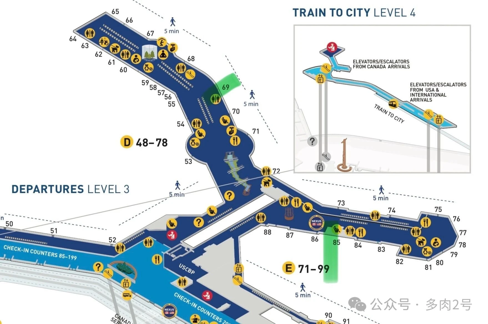

Tranzitní letenka Air Canada ze Seattlu do Šanghaje přes Vancouver: AC8801 (Seattle–Vancouver) s přestupem na AC25 (Vancouver–Šanghaj). Přestup ve Vancouveru znamená:

1. Zavazadla nevyzvedáváte
2. Neprocházíte znovu bezpečnostní kontrolou
3. Kanadskou celní kontrolou _opravdu_ procházíte

Viz přiložená mapa terminálů YVR – příletové a odletové brány těchto dvou letů jsou blízko sebe (označené zeleně, ale v různých podlažích).

## Kroky ve Vancouveru

Sledujte visuté značení s nápisem **Welcome to Vancouver**.

### 1. Mějte připravené všechny cestovní doklady

Mějte všechny doklady po ruce a ujistěte se, že máte vyplněné všechny příslušné formuláře.
(Všechny doklady mějte po ruce a přesvědčte se, že jste vyplnili každý formulář, který potřebujete.)

### 2. Sledujte značení International Connections

Sledujte značení International Connections a zařaďte se do fronty Satellite Primary Inspection.
(Sledujte značky „International Connections“ do kanálu Satellite Primary Inspection.)

### 3. Projděte hlavní celní kontrolou Canada Customs

Projděte hlavní celní kontrolou Canada Customs.
(Absolvujte hlavní kontrolu Canada Customs.)

### 4. Vyjeďte eskalátorem do odletové haly ve 3. podlaží

Vyjeďte eskalátorem do odletové haly ve 3. podlaží k navazujícímu letu.
(Eskalátorem se vyvezte do odletové haly ve 3. podlaží k dalšímu letu.)

### 5. O odbavených zavazadlech

Vaše odbavená zavazadla budou doručena do konečné destinace, pokud vám při odbavení neřeknou jinak.
(Vaše odbavená zavazadla putují přímo do konečné destinace, pokud při odbavení nedostanete jiné pokyny.)

## Satellite Primary Inspection

V angličtině se tato kontrola nazývá **Satellite Primary Inspection**. Cestující zde sami vyplňují celní prohlášení; samoobslužné automaty nabízejí čínštinu a prohlášení můžete podat předem i v aplikaci letecké společnosti – u automatu pak stačí naskenovat QR kód a vytisknout potvrzení. Podrobný postup najdete v [tomto průvodci na Zhihu](https://zhuanlan.zhihu.com/p/354710620?share_code=JvkT8dGqN7C8&utm_psn=1980894915480265719).

## Dodatek: mapy terminálů YVR

## Související odkazy

- **Na tomto webu**: [Mezinárodní letiště Vancouver (YVR)](/airport/YVR), [Kanada (CA)](/country/CA)
- **Wikipedia**: [Mezinárodní letiště Vancouver](https://en.wikipedia.org/wiki/Vancouver_International_Airport)
- **Baidu Baike**: [Mezinárodní letiště Vancouver](https://baike.baidu.com/item/%E6%B8%A9%E5%93%A5%E5%8D%8E%E5%9B%BD%E9%99%85%E6%9C%BA%E5%9C%BA)
