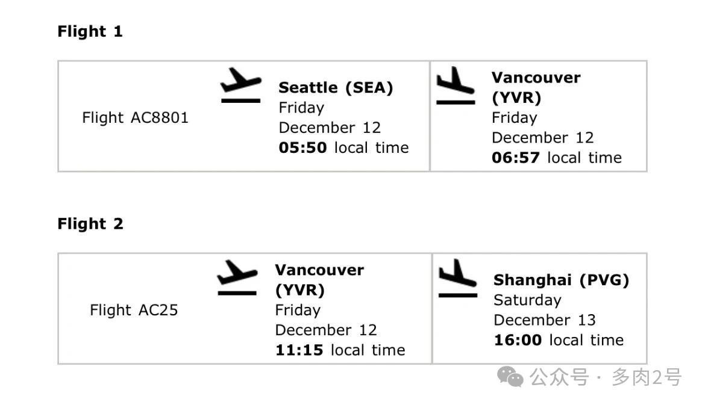
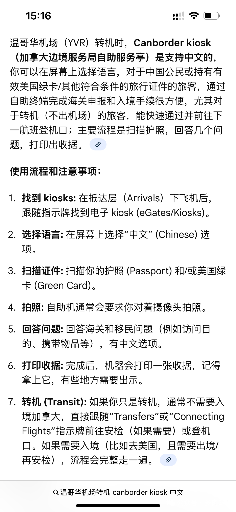
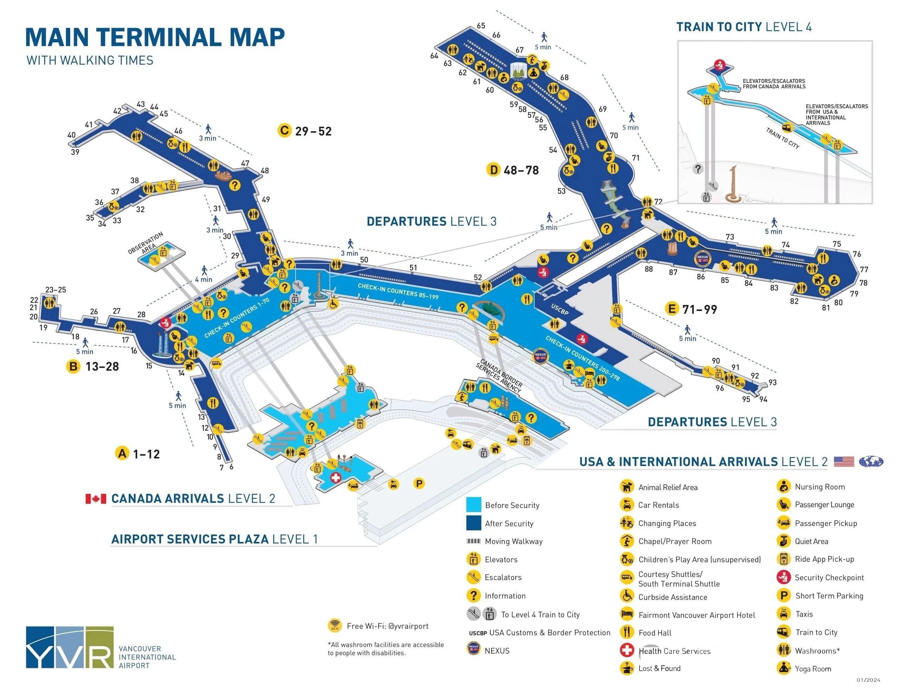
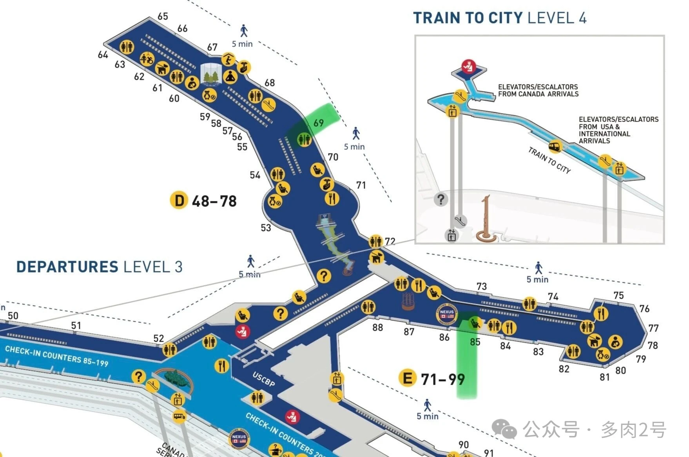

Un biglietto unico Air Canada da Seattle a Shanghai via Vancouver: AC8801 (Seattle–Vancouver) in coincidenza con AC25 (Vancouver–Shanghai). Transitare da Vancouver significa:

1. Non ritirate i bagagli
2. Non ripassate dai controlli di sicurezza
3. _Dovete_ però passare la dogana canadese

Vedete la mappa del terminal YVR allegata: i gate di arrivo e di partenza di questi due voli sono vicini (segnati in verde, ma su livelli diversi).

## Le fasi a Vancouver

Seguite i cartelli sospesi **Welcome to Vancouver**.

### 1. Tenete a portata di mano tutti i documenti di viaggio

Tenete a portata di mano tutti i documenti e assicuratevi di aver compilato tutti i moduli necessari.
(Conservate ogni documento a portata di mano e controllate che ogni modulo richiesto sia stato compilato.)

### 2. Seguite il cartello International Connections

Seguite il cartello International Connections ed entrate nella fila della Satellite Primary Inspection.
(Seguite le indicazioni "International Connections" verso il canale della Satellite Primary Inspection.)

### 3. Passate la Primary Inspection della dogana canadese

Superate la Primary Inspection della dogana canadese.
(Completate il controllo principale della dogana canadese.)

### 4. Prendete la scala mobile per il livello 3, partenze

Prendete la scala mobile fino al livello 3 Partenze per il volo successivo.
(Salite con la scala mobile alla hall partenze del livello 3 per il volo in coincidenza.)

### 5. I bagagli imbarcati

I bagagli imbarcati saranno consegnati alla destinazione finale, salvo diverse indicazioni al check-in.
(I bagagli da stiva proseguono direttamente fino alla destinazione finale, salvo diverse istruzioni al check-in.)

## Satellite Primary Inspection

In inglese si chiama **Satellite Primary Inspection**. Qui i passeggeri compilano da soli la dichiarazione doganale; le macchine self-service offrono il cinese e potete anche dichiarare in anticipo nell'app della compagnia: alla macchina basta scansionare un codice QR e stampare la ricevuta. Per i passaggi dettagliati, vedete [questa guida su Zhihu](https://zhuanlan.zhihu.com/p/354710620?share_code=JvkT8dGqN7C8&utm_psn=1980894915480265719).

## Appendice: mappe del terminal YVR

## Link utili

- **Su questo sito**: [Aeroporto internazionale di Vancouver (YVR)](/airport/YVR), [Canada (CA)](/country/CA)
- **Wikipedia**: [Vancouver International Airport](https://en.wikipedia.org/wiki/Vancouver_International_Airport)
- **Baidu Baike**: [Vancouver International Airport](https://baike.baidu.com/item/%E6%B8%A9%E5%93%A5%E5%8D%8E%E5%9B%BD%E9%99%85%E6%9C%BA%E5%9C%BA)
