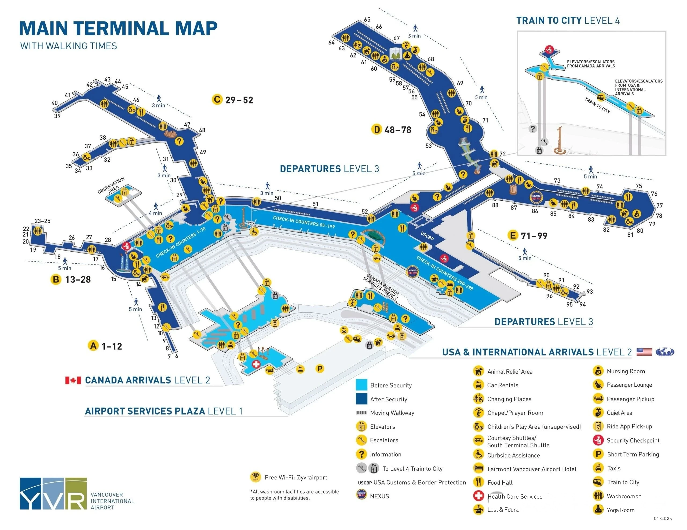

Bilet łączony Air Canada z Seattle do Szanghaju przez Vancouver: AC8801 (Seattle–Vancouver) z przesiadką na AC25 (Vancouver–Szanghaj). Przesiadka w Vancouver oznacza, że:

1. Nie odbierasz bagażu
2. Nie przechodzisz ponownie kontroli bezpieczeństwa
3. Przechodzisz _jednak_ kontrolę celną Kanady

Zobacz załączoną mapę terminali YVR — bramki przylotu i odlotu tych dwóch lotów są blisko siebie (zaznaczone na zielono, ale na różnych poziomach).

## Kolejne kroki w Vancouver

Kieruj się znakami nad głową do **Welcome to Vancouver**.

### 1. Miej pod ręką wszystkie dokumenty podróży

Miej pod ręką wszystkie dokumenty i upewnij się, że wypełniono wszystkie wymagane formularze.
(Trzymaj przy sobie każdy dokument i sprawdź, czy wypełniono każdy potrzebny formularz.)

### 2. Kieruj się znakiem International Connections

Kieruj się znakiem International Connections i ustaw się w kolejce do Satellite Primary Inspection.
(Idź za znakami „International Connections” do kanału Satellite Primary Inspection.)

### 3. Przejdź kontrolę pierwszego stopnia Canada Customs Primary Inspection

Przejdź kontrolę pierwszego stopnia Canada Customs Primary Inspection.
(Wykonaj główną kontrolę kanadyjskiej służby celnej.)

### 4. Wjedź schodami ruchomymi na poziom 3, do hali odlotów

Wjedź schodami ruchomymi na poziom 3 do hali odlotów, skąd odlatuje twój kolejny samolot.
(Skieruj się schodami ruchomymi do hali odlotów na poziomie 3, gdzie czeka twój dalszy lot.)

### 5. Co z bagażem rejestrowanym

Twój bagaż rejestrowany zostanie dostarczony do miejsca docelowego, chyba że przy odprawie otrzymasz inną informację.
(Bagaż rejestrowany leci bezpośrednio do miejsca docelowego, chyba że przy odprawie usłyszysz coś innego.)

## Satellite Primary Inspection

W języku angielskim etap ten nazywa się **Satellite Primary Inspection**. Pasażerowie sami wypełniają tu deklarację celną; automaty samoobsługowe oferują język chiński, a deklarację można też złożyć wcześniej w aplikacji linii lotniczej — przy automacie wystarczy zeskanować kod QR i wydrukować potwierdzenie. Szczegółowy opis kroków znajdziesz w [tym poradniku na Zhihu](https://zhuanlan.zhihu.com/p/354710620?share_code=JvkT8dGqN7C8&utm_psn=1980894915480265719).

## Dodatek: mapy terminali YVR

## Powiązane linki

- **W tym serwisie**: [Lotnisko międzynarodowe w Vancouver (YVR)](/airport/YVR), [Kanada (CA)](/country/CA)
- **Wikipedia**: [Port lotniczy Vancouver](https://en.wikipedia.org/wiki/Vancouver_International_Airport)
- **Baidu Baike**: [Port lotniczy Vancouver](https://baike.baidu.com/item/%E6%B8%A9%E5%93%A5%E5%8D%8E%E5%9B%BD%E9%99%85%E6%9C%BA%E5%9C%BA)
