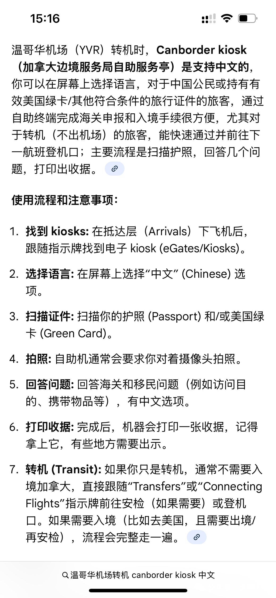

Tikiti moja la Air Canada kutoka Seattle kwenda Shanghai kupitia Vancouver: AC8801 (Seattle–Vancouver) likiunganishwa na AC25 (Vancouver–Shanghai). Kubadilisha ndege Vancouver kunamaanisha:

1. Huchukui mizigo yako
2. Hupiti ukaguzi wa usalama tena
3. Unapita _kwa kweli_ Forodha ya Kanada

Tazama ramani ya terminal ya YVR iliyoambatishwa — malango ya kuwasili na kuondoka ya ndege hizi mbili yako karibu (yamewekwa alama ya kijani, lakini yako kwenye ngazi tofauti).

## Hatua za Vancouver

Fuata alama za juu hadi **Welcome to Vancouver**.

### 1. Kuwa na nyaraka zako zote za safari tayari

Kuwa na nyaraka zote mkononi na uhakikishe kwamba fomu zote zinazohitajika zimejazwa.
(Weka kila nyaraka karibu nawe na uhakikishe kwamba fomu yoyote unayohitaji imejazwa.)

### 2. Fuata alama ya International Connections

Fuata alama ya International Connections na uingie kwenye foleni ya Satellite Primary Inspection.
(Fuata alama za "International Connections" hadi kwenye njia ya Satellite Primary Inspection.)

### 3. Pita Ukaguzi Mkuu wa Forodha ya Kanada

Pita Ukaguzi Mkuu wa Forodha ya Kanada.
(Kamilisha ukaguzi mkuu wa Forodha ya Kanada.)

### 4. Panda escalator hadi ngazi ya 3 ya kuondoka

Panda escalator hadi eneo la Kuondoka la ngazi ya 3 kwa ndege yako inayofuata.
(Panda escalator hadi ukumbi wa kuondoka wa ngazi ya 3 kwa safari yako inayoendelea.)

### 5. Kuhusu mizigo yako iliyosajiliwa

Mizigo yako iliyosajiliwa itasafirishwa hadi mwisho wa safari, isipokuwa uambiwe vinginevyo wakati wa kusajili.
(Mizigo yako iliyosajiliwa huenda moja kwa moja hadi mwisho wa safari isipokuwa uambiwe vinginevyo wakati wa kusajili.)

## Satellite Primary Inspection

Kwa Kiingereza hatua hii inaitwa **Satellite Primary Inspection**. Abiria hujaza tamko lao la forodha wenyewe hapa; mashine za kujihudumia zina lugha ya Kichina, na unaweza pia kutoa tamko mapema kwenye programu ya shirika la ndege — kwenye mashine unachofanya ni kuchanganua msimbo wa QR na kuchapisha risiti. Kwa hatua za kina, tazama [mwongozo huu kwenye Zhihu](https://zhuanlan.zhihu.com/p/354710620?share_code=JvkT8dGqN7C8&utm_psn=1980894915480265719).

## Kiambatisho: Ramani za terminal za YVR

## Viungo vinavyohusiana

- **Kwenye tovuti hii**: [Uwanja wa Ndege wa Kimataifa wa Vancouver (YVR)](/airport/YVR), [Kanada (CA)](/country/CA)
- **Wikipedia**: [Uwanja wa Ndege wa Kimataifa wa Vancouver](https://en.wikipedia.org/wiki/Vancouver_International_Airport)
- **Baidu Baike**: [Uwanja wa Ndege wa Kimataifa wa Vancouver](https://baike.baidu.com/item/%E6%B8%A9%E5%93%A5%E5%8D%8E%E5%9B%BD%E9%99%85%E6%9C%BA%E5%9C%BA)
