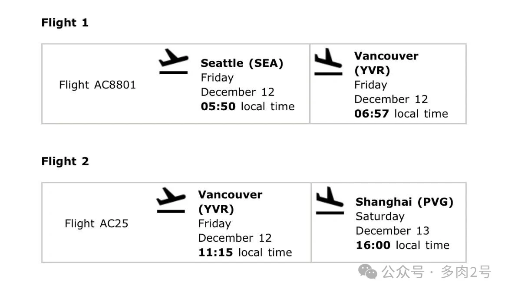

Một vé hành trình Air Canada từ Seattle đến Thượng Hải qua Vancouver: AC8801 (Seattle–Vancouver) nối với AC25 (Vancouver–Thượng Hải). Trung chuyển tại Vancouver nghĩa là:

1. Bạn không nhận hành lý
2. Bạn không phải qua an ninh lần nữa
3. Bạn _vẫn phải_ làm thủ tục Hải quan Canada

Xem bản đồ nhà ga YVR đính kèm — cổng đến và cổng khởi hành của hai chuyến bay này ở gần nhau (đánh dấu màu xanh lá, nhưng ở các tầng khác nhau).

## Các bước tại Vancouver

Đi theo biển chỉ dẫn trên cao đến **Welcome to Vancouver**.

### 1. Chuẩn bị sẵn mọi giấy tờ du lịch

Hãy cầm sẵn mọi giấy tờ và bảo đảm đã điền xong tất cả các mẫu đơn cần thiết.
(Giữ mọi giấy tờ trong tay và chắc chắn rằng mọi mẫu đơn bạn cần đã được điền.)

### 2. Đi theo biển International Connections

Đi theo biển International Connections và vào hàng Kiểm tra sơ cấp vệ tinh.
(Đi theo biển "International Connections" vào kênh Kiểm tra sơ cấp vệ tinh.)

### 3. Làm thủ tục Kiểm tra sơ cấp Hải quan Canada

Làm thủ tục Kiểm tra sơ cấp Hải quan Canada.
(Hoàn tất bước kiểm tra chính của Hải quan Canada.)

### 4. Đi thang cuốn lên tầng 3 khu khởi hành

Đi thang cuốn lên tầng 3 Khu khởi hành để đến chuyến bay tiếp theo.
(Đi thang cuốn lên sảnh khởi hành tầng 3 cho chuyến bay nối tiếp.)

### 5. Về hành lý ký gửi

Hành lý ký gửi của bạn sẽ được chuyển đến điểm đến cuối cùng, trừ khi được thông báo khác tại quầy làm thủ tục.
(Hành lý ký gửi đi thẳng đến điểm đến cuối cùng trừ khi bạn được thông báo khác khi làm thủ tục.)

## Kiểm tra sơ cấp vệ tinh

Trong tiếng Anh, đây là **Satellite Primary Inspection**. Hành khách tự hoàn thành khai báo hải quan tại đây; máy tự phục vụ có tiếng Trung, và bạn cũng có thể khai báo trước trong ứng dụng của hãng hàng không — tại máy, bạn chỉ cần quét mã QR và in biên nhận. Để biết các bước chi tiết, xem [hướng dẫn này trên Zhihu](https://zhuanlan.zhihu.com/p/354710620?share_code=JvkT8dGqN7C8&utm_psn=1980894915480265719).

## Phụ lục: Bản đồ nhà ga YVR

## Liên kết liên quan

- **Trên trang này**: [Sân bay Quốc tế Vancouver (YVR)](/airport/YVR), [Canada (CA)](/country/CA)
- **Wikipedia**: [Vancouver International Airport](https://en.wikipedia.org/wiki/Vancouver_International_Airport)
- **Baidu Baike**: [Vancouver International Airport](https://baike.baidu.com/item/%E6%B8%A9%E5%93%A5%E5%8D%8E%E5%9B%BD%E9%99%85%E6%9C%BA%E5%9C%BA)
