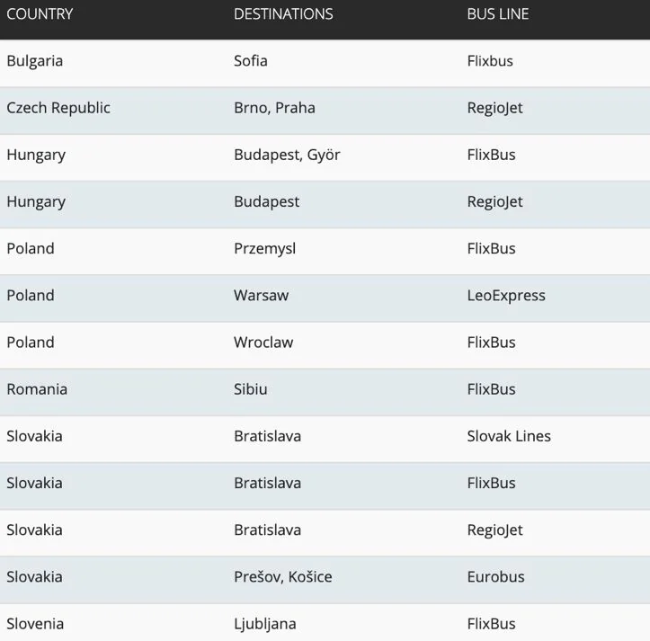
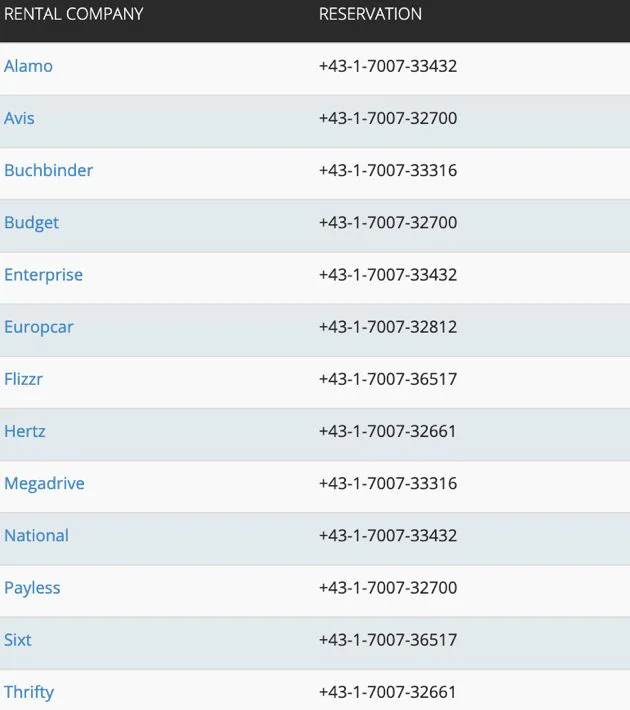
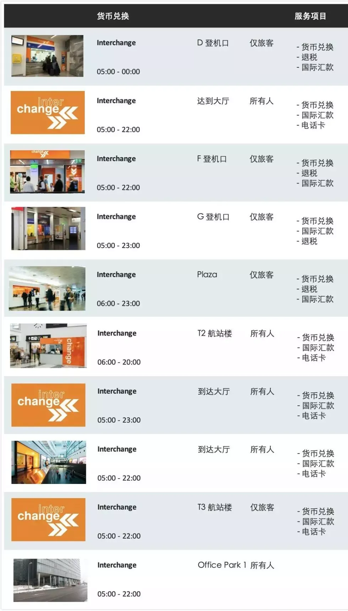

ভিয়েনা আন্তর্জাতিক বিমানবন্দর (এয়ারপোর্ট কোড **VIE**) শহরের কেন্দ্র থেকে প্রায় ১৮ কিমি দূরে অবস্থিত এবং এটি অস্ট্রিয়ার বৃহত্তম আন্তর্জাতিক হাব — সেই সাথে মধ্য ও পূর্ব ইউরোপের মধ্যে অন্যতম গুরুত্বপূর্ণ ট্রান্সফার পয়েন্ট। বিমানবন্দর থেকে শহরে পৌঁছাতে মাত্র ১৬–২৫ মিনিট লাগে, তবে এক্সপ্রেস ট্রেন, S-Bahn, বাস ও ট্যাক্সি—সবই গতি আর দামের মধ্যে সমঝোতা করে, আর চেক-ইন হল ও নিরাপত্তা প্রবেশপথগুলো টার্মিনাল ও গন্তব্য অনুযায়ী আলাদা। কোন ভবন ও কোন প্রবেশপথ আপনার, তা জানা থাকলে সত্যিই অনেক সময় বাঁচে।

এই গাইডটি পাঁচটি অংশে **টার্মিনাল ও গেট এলাকা**, **শহরে যাতায়াত**, **প্রস্থান প্রক্রিয়া**, **বিমানবন্দরের সুবিধা** এবং **আপনার ফ্লাইটকে ঘিরে দিনের পরিকল্পনা** নিয়ে আলোচনা করে।

বিমানবন্দরের বিন্যাস দেখতে যতটা জটিল, আসলে ততটা নয়: টার্মিনালগুলো একই ছাদের নিচে, প্রস্থান উপরের তলায় আর আগমন নিচের তলায়, এবং নিরাপত্তা প্রবেশপথগুলো গেট অনুযায়ী ভাগ করা। আগে থেকে আসলে তিনটি বিষয় ঠিক করতে হয় — আপনার ফ্লাইট কোন ভবন ব্যবহার করে, শহর থেকে আপনি কীভাবে আসবেন, এবং চেক-ইন ও নিরাপত্তা তল্লাশির জন্য কত সময় রাখবেন। এগুলো ঠিক করে ফেললে লাগেজ সাময়িকভাবে রাখা, কাস্টমসের ভাতা আর মুদ্রা বিনিময়—সবই সেখানে পৌঁছে দেখে নেওয়া যায়।

## ১. টার্মিনাল ও গেট এলাকা

ভিয়েনা বিমানবন্দরে তিনটি টার্মিনাল চালু আছে — **টার্মিনাল ১, টার্মিনাল ১এ ও টার্মিনাল ৩** — যা একই ছাদের নিচে পাশাপাশি অবস্থিত, তাই এক থেকে আরেকটিতে হেঁটে যাওয়া যায়। টার্মিনাল ৩-এর SKYLINK সম্প্রসারণ ২০১২ সালে চালু হয় এবং এটি Airbus A380-এর মতো বড় বিমানও সামলাতে পারে; দূরপাল্লার ফ্লাইটের প্রধান ভবন এটি।

বিমানবন্দরটি পরিচালনা করে Flughafen Wien AG; যাত্রীসেবা, ব্যাগেজ হ্যান্ডলিং ও গ্রাউন্ড হ্যান্ডলিং ভিয়েনা এয়ারপোর্ট, Swissport, Austrian Airlines এবং অন্যরা মিলে সম্পাদন করে। চেক-ইন ডেস্ক এয়ারলাইন অনুযায়ী বরাদ্দ হয়, তাই আপনার ফ্লাইট **কোন টার্মিনাল** ব্যবহার করে তা নিশ্চিত করুন — বর্তমানে টার্মিনাল ১, টার্মিনাল ১এ বা টার্মিনাল ৩। বিমানবন্দরের পুরোনো নথিতে একটি স্থানের জন্য এখনও “Terminal 2” নামটি ব্যবহৃত হয়, তবে সেখানে আর চেক-ইন হয় না।

### পাঁচটি গেট এলাকা: B, C, D, F ও G

গেটগুলোকে পাঁচটি পিয়ারে ভাগ করা হয়েছে, আর এই ভাগই ঠিক করে আপনি কোন নিরাপত্তা প্রবেশপথ ব্যবহার করবেন এবং পাসপোর্ট কন্ট্রোল পার হবেন কি না। Pier D-কে আগে Hall A বলা হতো এবং এটি পূর্ব পিয়ার নামে পরিচিত; pier C হলো পশ্চিম পিয়ার।

| পিয়ার | গেট | মূল ভবনের সাথে সংযোগ | ফ্লাইট |
| --- | --- | --- | --- |
| B (টার্মিনাল ১-এর দিক) | B22–B43 | বাস | ইউরোপীয় শেনজেন ফ্লাইট |
| C (পশ্চিম পিয়ার, টার্মিনাল ১-এর দিক) | C31–C42, যার মধ্যে C35–C41 ট্রান্সফার গেট | জেট ব্রিজ | বেশিরভাগ শেনজেন, কিছু আন্তর্জাতিক |
| C (পশ্চিম পিয়ার, টার্মিনাল ১-এর দিক) | C71–C75 | বাস, গেট C31 হয়ে পৌঁছাতে হয় | শুধু শেনজেন |
| D (পূর্ব পিয়ার, আগে Hall A) | D21–D29 | জেট ব্রিজ | আন্তর্জাতিক ফ্লাইট |
| D (পূর্ব পিয়ার, আগে Hall A) | D31–D37, D61–D70 | বাস | আন্তর্জাতিক ফ্লাইট |
| F, G (টার্মিনাল ৩) | F ও G গেট | জেট ব্রিজ | শেনজেন (F) ও অ-শেনজেন (G) |

জেট ব্রিজযুক্ত গেট থেকে সরাসরি বিমানে ওঠা যায়; বাস গেট হিসেবে চিহ্নিত গেট মানে নিচে নেমে শাটল বাসে যেতে হবে, যা বোর্ডিংয়ের সময়ের মধ্যে ধরতে হবে। C71–C75 একটি আলাদা বাস-গেট গ্রুপ, যেখানে যেতে হয় গেট C31 হয়ে, তাই সেখান থেকে প্রস্থান করলে হাঁটা ও অপেক্ষার জন্য বাড়তি সময় রাখুন।

### আন্তর্জাতিক ট্রান্সফার: অস্ট্রিয়ায় প্রবেশ না করেই বিমান বদল

ভিয়েনা যদি শুধুই যাত্রাবিরতি হয়, তবে **আন্তর্জাতিক ট্রান্সফারে অস্ট্রিয়ায় প্রবেশের প্রয়োজন নেই**। আন্তর্জাতিক ফ্লাইটে পিয়ার C-তে নামলে সাইন অনুসরণ করে নিচতলার **Transitzone**-এ যান এবং পরবর্তী আন্তর্জাতিক ফ্লাইটের জন্য পিয়ার D-তে যাওয়ার শাটল বাস নিন। পিয়ার D-তে নেমে অন্য আন্তর্জাতিক ফ্লাইটে গেলে পিয়ার D-এর ভেতরেই Transitzone ও শাটল বাস ব্যবহার করে একইভাবে ট্রান্সফার করবেন। পিয়ার D-তে ট্রানজিট এলাকা ও পাসপোর্ট কন্ট্রোল এলাকা থাকে হলের প্রবেশপথে এবং জেট ব্রিজ ও বাস গেটের কাছে — “Transfer” সাইন অনুসরণ করুন।

## ২. শহরে যাওয়া ও ফিরে আসা

বিমানবন্দর থেকে ভিয়েনায় যাওয়ার পাঁচটি উপায় আছে: **সিটি এয়ারপোর্ট ট্রেন** সবচেয়ে দ্রুত, **বিমানবন্দর বাস** শহরের কেন্দ্র ও পশ্চিম স্টেশন পর্যন্ত যায়, **S7 S-Bahn ও Railjet ট্রেন** সবচেয়ে সাশ্রয়ী, **ট্যাক্সি** রাতের আগমন ও ভারী ব্যাগের জন্য উপযুক্ত, আর **গাড়ি ভাড়া** ভিয়েনা থেকে শুরু হওয়া রোড ট্রিপের জন্য ভালো। নিচের রুট, সময় ও ভাড়া বিমানবন্দর ও পরিচালনাকারী সংস্থাগুলোর প্রকাশিত তথ্য অনুযায়ী; ভ্রমণের দিনে তাদের ওয়েবসাইট দেখে নিন।

শুধু সিদ্ধান্তটা জানতে চাইলে: সময় গুরুত্বপূর্ণ হলে এবং ট্রেন বদলের ঝামেলা এড়াতে চাইলে **CAT** নিন; বাজেট সবার আগে হলে এবং অতিরিক্ত দশ মিনিট সমস্যা না হলে **S7** নিন; পরবর্তী লেগ যদি দেশীয় দূরপাল্লার ট্রেন হয় তবে **Railjet** নিন; Westbahnhof বা Donauzentrum-এর দিকে থাকলে **বাস** নিন; রাতে নামার পর ভারী ব্যাগ থাকলে **ট্যাক্সি** নিন। টেবিলে এদের তুলনা দেওয়া আছে; নিচের অংশে একে একে আলোচনা করা হয়েছে।

| বিকল্প | শহরের কেন্দ্র পর্যন্ত | একমুখী ভাড়া | যাদের জন্য উপযুক্ত |
| --- | --- | --- | --- |
| সিটি এয়ারপোর্ট ট্রেন (CAT) | Wien Mitte পর্যন্ত ১৬ মিনিট | €14.90 | সময়ের চাপ, ট্রেন বদল নেই |
| S7 S-Bahn | Wien Mitte পর্যন্ত প্রায় ২৫ মিনিট | প্রায় €5 | বাজেট প্রাধান্য, ধীরে গেলেও চলবে |
| Railjet | Wien Hauptbahnhof পর্যন্ত ১৫ মিনিট | সেই দিনের ÖBB ভাড়া | দেশীয় দূরপাল্লার ট্রেনে সংযোগ |
| বিমানবন্দর বাস | স্টপ অনুযায়ী ২০–৪০ মিনিট | প্রায় €8 | Westbahnhof বা Donauzentrum-এর দিকে থাকলে |
| ট্যাক্সি | প্রায় ২০–৩০ মিনিট | মিটার অনুযায়ী | রাতের আগমন, দল, ভারী ব্যাগ |

### ১. সিটি এয়ারপোর্ট ট্রেন (CAT) — সবচেয়ে দ্রুত

সিটি এয়ারপোর্ট ট্রেন বিমানবন্দর থেকে শহরের কেন্দ্রের **Wien Mitte (Landstraße)** পর্যন্ত **১৬ মিনিটে** বিনা স্টপে চলে, তাই এটি সবচেয়ে কম চাপের উপায় — সড়ক যানজট এখানে কোনো ভূমিকাই রাখে না।

- **সময়সূচি:** ০৫:৩৭–২৩:২৯ (শহরের কেন্দ্র → বিমানবন্দর); ০৬:০৯–২৩:৩৯ (বিমানবন্দর → শহরের কেন্দ্র), মোটামুটি প্রতি ৩০ মিনিটে।
- **স্টপ:** বিমানবন্দর ↔ Wien Mitte, সেন্ট স্টিফেনস ক্যাথিড্রাল থেকে প্রায় **১০ মিনিট** হাঁটা।
- **ভাড়া:** একমুখী €14.90, রিটার্ন টিকিটে খরচ কম। ভিয়েনার শহর পরিবহনের টিকিট ও Vienna City Card CAT-এ **বৈধ নয়**; আলাদা টিকিট লাগবে।
- **টিকিট:** আগমন হলে CAT-এর আলাদা কাউন্টার আছে, যেখানে টিকিট কিনতে ও CAT-এর যেকোনো সেবা সম্পর্কে জিজ্ঞাসা করতে পারেন।
- **ব্যাগেজের জন্য শহরে চেক-ইন:** শহরের কেন্দ্রে CAT টার্মিনালে প্রস্থানের ২৪ ঘণ্টা আগে থেকে ৭৫ মিনিট আগ পর্যন্ত কর্মীযুক্ত ডেস্ক বা স্ব-পরিষেবা কিয়স্কে চেক-ইন করে বোর্ডিং পাস নিতে পারেন।

### ২. বিমানবন্দর বাস — সর্বাধিক কভারেজ

বিমানবন্দর বাস (Vienna Airport Lines / Postbus) বিমানবন্দরকে ভিয়েনার প্রধান পরিবহন কেন্দ্রগুলোর সাথে যুক্ত করে, আর তিনটি শহরমুখী রুট মিলে সব মেট্রো লাইন কভার করে। Wien Westbahnhof ও Wien Hauptbahnhof-মুখী সার্ভিস **প্রতি ৩০ মিনিটে** চলে; বিমানবন্দর ↔ Morzinplatz/Schwedenplatz রুট **সারাদিন-সারারাত** চলে এবং সময় লাগে মাত্র **২০ মিনিট**।

- **ভাড়া:** একমুখী প্রায় €8, বাসে বা কাউন্টারে কেনা যায়।
- **রুট ও স্টপ:** নিচের টেবিল দেখুন।

| গন্তব্য | বাস লাইন | যাত্রার সময় |
| --- | --- | --- |
| Wien Morzinplatz/Schwedenplatz | Vienna Airport Lines | ২০ মিনিট |
| Wien Donauzentrum (VIC হয়ে) | Vienna Airport Lines | ৪০ মিনিট |
| Wien Westbahnhof (Hauptbahnhof হয়ে) | Vienna Airport Lines | ৪০ মিনিট |
| Wien Erdberg (VIB) | AirLiner | ১৫ মিনিট |
| Graz (Pinggau হয়ে) | Dr. Richard / FlixBus | ২ ঘণ্টা ৪০ মিনিট |
| Münchendorf (Fischamend হয়ে) | Postbus | ৫০ মিনিট |
| Ebreichsdorf (Gramatneusiedl হয়ে) | Postbus | ৭৩ মিনিট |
| Neusiedl a. See (Bruck/Leitha হয়ে) | Postbus | ৭০ মিনিট |

### ৩. দূরপাল্লার কোচ — প্রতিবেশী রাজধানীগুলোর পথে

Bratislava, Budapest, Prague বা Brno-র জন্য বিমানবন্দর থেকে ছাড়া কোচ প্রায়ই ট্রেনের চেয়ে সরাসরি, এবং এর অনেকগুলোই বিমানবন্দর থেকেই শুরু হয় — ভিয়েনা যদি অন্য কোথাও যাওয়ার পথে যাত্রাবিরতি হয় তবে এটি সুবিধাজনক।

| দেশ | গন্তব্য | পরিচালনাকারী |
| --- | --- | --- |
| বুলগেরিয়া | Sofia | Flixbus |
| চেকিয়া | Brno, Praha | RegioJet |
| হাঙ্গেরি | Budapest, Győr | FlixBus |
| হাঙ্গেরি | Budapest | RegioJet |
| পোল্যান্ড | Przemyśl | FlixBus |
| পোল্যান্ড | Warsaw | LeoExpress |
| পোল্যান্ড | Wrocław | FlixBus |
| রোমানিয়া | Sibiu | FlixBus |
| স্লোভাকিয়া | Bratislava | Slovak Lines / FlixBus / RegioJet |
| স্লোভাকিয়া | Prešov, Košice | Eurobus |
| স্লোভেনিয়া | Ljubljana | FlixBus |

### ৪. S-Bahn ও ÖBB ট্রেন — সেরা মূল্য

শহরের টিকিটের দামে ভ্রমণ করতে চাইলে উত্তর হলো **S7** S-Bahn: বিমানবন্দর থেকে Wien Mitte পর্যন্ত প্রায় **২৫ মিনিট**, CAT ভাড়ার প্রায় এক-তৃতীয়াংশ, আর সেই টিকিটেই শহরের মেট্রো ও ট্রাম চলে যায়।

ÖBB-র Railjet ট্রেন বিমানবন্দরকে আরও দূরের জায়গার সাথে যুক্ত করে: সরাসরি Wien Hauptbahnhof (১৫ মিনিট), St. Pölten, Linz, Salzburg, Innsbruck, Graz ও Klagenfurt, সাথে Brno, Praha, Győr ও Budapest-এ আন্তঃসীমান্ত সার্ভিস। Wien Hauptbahnhof (ভিয়েনা সেন্ট্রাল স্টেশন)-এ আপনি আরও অনেক গন্তব্যের জন্য ট্রেন বদলাতে পারেন।

- **ভাড়া:** S7-এ একমুখী প্রায় €5 (VOR পরিবহন সংস্থা জোন অনুযায়ী ভাড়া নির্ধারণ করে, আর বিমানবন্দর ভিয়েনার মূল জোনের বাইরে — শহরের টিকিট আগে থেকে থাকলে শুধু বিমানবন্দর অংশের অতিরিক্ত ভাড়া দিতে হবে)।
- **টিকিট:** ÖBB কাউন্টার বিমানবন্দরের আগমন হলে, অল্প হাঁটা দূরত্বে, এবং ÖBB মেশিন ও ÖBB অ্যাপেও টিকিট পাওয়া যায়।
- **সময়সূচি:** নিচের টেবিল দেখুন; ওই দিনের ÖBB ও VOR-এর নিজস্ব ঘোষণাই চূড়ান্ত।

| গন্তব্য | লাইন | যাত্রার সময় |
| --- | --- | --- |
| Wien Mitte | Schnellbahn S7 | ২৫ মিনিট |
| Wien Hauptbahnhof | Railjet | ১৫ মিনিট |
| St. Pölten Hbf | Railjet | ৫৫ মিনিট |
| Linz Hbf | Railjet | ১ ঘণ্টা ৪১ মিনিট |
| Salzburg Hbf | Railjet | ২ ঘণ্টা ৪৯ মিনিট |
| Innsbruck Hbf | Railjet | ৪ ঘণ্টা ৪০ মিনিট |
| Graz Hbf | Railjet * | ৩ ঘণ্টা ০০ মিনিট |
| Klagenfurt Hbf | Railjet ** | ৪ ঘণ্টা ১৭ মিনিট |
| Brno | Railjet ** | ২ ঘণ্টা ০৩ মিনিট |
| Praha | Railjet ** | ৪ ঘণ্টা ৩৪ মিনিট |
| Győr | Railjet ** | ১ ঘণ্টা ৫০ মিনিট |
| Budapest | Railjet ** | ২ ঘণ্টা ৫৯ মিনিট |

\* ও \*\* চিহ্নিত সার্ভিসে সাধারণত Wien Hauptbahnhof-এ ট্রেন বদলাতে হয়; ওই দিনের ÖBB সময়সূচি দেখে নিন।

### ৫. ট্যাক্সি

আগমন হল-এর বাইরের ট্যাক্সি স্ট্যান্ড থেকে ট্যাক্সি নিন, বা “City Transfer” ডেস্ক থেকে পাঠানো গাড়ি ব্যবহার করুন; ফোনে আগে থেকেও ট্যাক্সি বুক করা যায়।

| ট্যাক্সি কোম্পানি | ফোন |
| --- | --- |
| Airport Driver | +43-1-22822 |
| Airport Services | +43-1-7007-33151 |
| ATS Airport Transfer Service | +43-1-7007-35905 |
| Flughafentaxi ttc | +43-1-7007-33141 |
| 40100 | +43-1-40100 |

### ৬. গাড়ি ভাড়া

ভাড়ার ডেস্কগুলো একসাথে **P4 বহুতল কার পার্কের লেভেল ০-এ**, যেখানে Hertz, Sixt, Europcar, Avis, Budget, Enterprise, Alamo ও National-এর কাউন্টার আছে — সেখান থেকে সরাসরি মোটরওয়ে নেটওয়ার্কে উঠে পড়া যায়।

| ভাড়া কোম্পানি | রিজার্ভেশন |
| --- | --- |
| Alamo | +43-1-7007-33432 |
| Avis | +43-1-7007-32700 |
| Buchbinder | +43-1-7007-33316 |
| Budget | +43-1-7007-32700 |
| Enterprise | +43-1-7007-33432 |
| Europcar | +43-1-7007-32812 |
| Flizzr | +43-1-7007-36517 |
| Hertz | +43-1-7007-32661 |
| Megadrive | +43-1-7007-33316 |
| National | +43-1-7007-33432 |
| Payless | +43-1-7007-32700 |
| Sixt | +43-1-7007-36517 |
| Thrifty | +43-1-7007-32661 |

## ৩. প্রস্থান: চেক-ইন, ব্যাগ ড্রপ, নিরাপত্তা তল্লাশি

সাধারণ ক্রম হলো **চেক-ইন → ব্যাগ জমা → নিরাপত্তা তল্লাশি → (অ-শেনজেন ফ্লাইটে) পাসপোর্ট কন্ট্রোল → বোর্ডিং**। শেনজেন ফ্লাইটের প্রস্থানের ২ ঘণ্টা আগে এবং অ-শেনজেন বা দূরপাল্লার ফ্লাইটের ৩ ঘণ্টা আগে পৌঁছান; পিক সিজনে ও সরকারি ছুটির আশপাশে আধা ঘণ্টা যোগ করুন।

দূরপাল্লার ফ্লাইটের জন্য অতিরিক্ত এক ঘণ্টা বাড়তি সতর্কতা নয়। ভিয়েনা **শেনজেন ও অ-শেনজেন প্রবাহ** সম্পূর্ণ আলাদা রাখে: শেনজেন ফ্লাইটে নিরাপত্তা তল্লাশি শেষে সরাসরি গেটে হেঁটে যাওয়া যায়, আর অ-শেনজেন ফ্লাইটে নিরাপত্তা তল্লাশির পর ভবনের অন্য অংশে আবার পাসপোর্ট কন্ট্রোলের লাইনে দাঁড়াতে হয়। চেক-ইন, ব্যাগ ড্রপ, নিরাপত্তা তল্লাশি, পাসপোর্ট কন্ট্রোল আর গেট পর্যন্ত হাঁটা—সব মিলিয়ে সময় লাগে, তাই পাসপোর্ট, ভিসা, বোর্ডিং পাস ও ব্যাগের রসিদ একই পকেটে রাখলে প্রতিটি চেকপয়েন্টে খোঁজাখুঁজি এড়ানো যায়।

### ১. চেক-ইন

- **স্ব-পরিষেবা চেক-ইন:** ক্রেডিট কার্ড বা Miles & More কার্ড, আপনার নাম, বুকিং রেফারেন্স ব্যবহার করুন, অথবা শুধু পাসপোর্ট স্ক্যান করে স্ব-পরিষেবা মেশিন থেকে বোর্ডিং পাস নিন। চেক করার ব্যাগ থাকলে মেশিনই বলে দেবে কোন ব্যাগ-ড্রপ কাউন্টারে যেতে হবে।
- **কাউন্টারে:** আপনার ফ্লাইট অনুযায়ী টার্মিনাল ১, টার্মিনাল ১এ বা টার্মিনাল ৩-এ চেক-ইন করে বোর্ডিং পাস নিন।
- **অনলাইন চেক-ইন:** বেশিরভাগ এয়ারলাইন তাদের ওয়েবসাইট বা অ্যাপে এটি দেয়, যা বিমানবন্দরে লাইনে দাঁড়ানো বাঁচায়; বোর্ডিং পাস সেখানেই প্রিন্ট করে নিন। চেক করার ব্যাগ নিয়ে ভ্রমণ করলে আগে সংশ্লিষ্ট কাউন্টারে জিজ্ঞাসা করুন।
- **Wien Mitte-তে চেক-ইন:** কিছু এয়ারলাইন Wien Mitte-তে সিটি এয়ারপোর্ট ট্রেন টার্মিনালে চেক-ইনের সুবিধা দেয়, যেখানে পাসপোর্ট দেখিয়ে বোর্ডিং পাস নেওয়া যায়। এয়ারলাইনগুলোর সর্বশেষ তালিকার জন্য cityairporttrain.com দেখুন বা +43 1 25250 নম্বরে ফোন করুন।

### ২. স্ব-পরিষেবা ব্যাগ ড্রপ

ভিয়েনা বিমানবন্দরের স্ব-পরিষেবা ব্যাগ ড্রপ ব্যাগ জমা দেওয়াকে চারটি ধাপে সংক্ষিপ্ত করে: **বোর্ডিং পাস স্ক্যান করুন → ব্যাগে ট্যাগ লাগান → ক্লেইম ট্যাগটি রেখে দিন → নিরাপত্তা তল্লাশির দিকে এগিয়ে যান।**

চেক-ইন আইল্যান্ডের পাশের স্ব-পরিষেবা বেল্টে বোর্ডিং পাস স্ক্যান করে ফ্লাইট নিশ্চিত করুন, প্রিন্ট করা ট্যাগ সুটকেসের হ্যান্ডেলে লাগান, ব্যাগ বেল্টে রাখুন এবং ক্লেইম ট্যাগটি রেখে দিন — ব্যাগ যদি হারিয়ে যায়, এটিই আপনার একমাত্র নথি।

### ৩. ব্যাগেজ সংক্রান্ত বিষয়

- **অতিরিক্ত ওজনের ব্যাগেজ বা পোষা প্রাণীর** জন্য **টার্মিনাল ১ বা টার্মিনাল ৩-এর অতিমাপ ব্যাগেজ কাউন্টার** ব্যবহার করুন।
- ব্যাগে আপনার নাম ও ঠিকানা লাগান এবং পুরোনো ট্যাগ খুলে ফেলুন — পুরোনো বারকোড সর্টিং সিস্টেমকে বিভ্রান্ত করে এবং ব্যাগ ভুল পথে যাওয়ার সম্ভাবনা বাড়ায়।
- মূল্যবান জিনিস, গুরুত্বপূর্ণ নথি ও ওষুধ চেক না করে নিজের সাথে বহন করুন।
- প্রয়োজনে স্ট্র্যাপ বা প্যাডলক দিয়ে ব্যাগ সুরক্ষিত করুন, অথবা বিমানবন্দরের ব্যাগেজ র্যাপিং সেবা ব্যবহার করুন (নিচের সুবিধা অংশ দেখুন)।

### ৪. নিরাপত্তা তল্লাশি ও পাসপোর্ট কন্ট্রোল

নিরাপত্তা প্রবেশপথ গেট গ্রুপ অনুযায়ী ভাগ করা, আর ভুল প্রবেশপথ বেছে নিলে দীর্ঘ হাঁটার খেসারত দিতে হবে:

- **নিরাপত্তা প্রবেশপথ ২:** B, C ও D গেট থেকে প্রস্থানের জন্য।
- **নিরাপত্তা প্রবেশপথ ৩:** F ও G গেট থেকে প্রস্থানের জন্য।

নিরাপত্তা তল্লাশির পর প্রস্থান এলাকায় দোকান ও রেস্তোরাঁ আছে; বিদায় জানাতে আসা বন্ধু ও পরিবারের সদস্যরা আপনার সাথে ভেতরে যেতে পারবেন না।

- **শেনজেন দেশের** জন্য **B, C ও F** গেট ব্যবহার করুন।
- **অ-শেনজেন দেশের** জন্য **D ও G** গেট ব্যবহার করুন, এবং গেটে যাওয়ার আগে **পাসপোর্ট কন্ট্রোল** পার হতে হবে।

অ-ইইউ পাসপোর্টধারী যাত্রীদের সাধারণত পাসপোর্ট কন্ট্রোলের আগে স্ব-পরিষেবা কিয়স্কে **EES নিবন্ধন** (আঙুলের ছাপ ও মুখের ছবি) সম্পন্ন করতে হয়। প্রথম প্রবেশে এতে কয়েক মিনিট বেশি লাগে — কম সময়ের সংযোগে এটি হিসাবে ধরুন।

## ৪. বিমানবন্দরের সুবিধা ও ব্যবহারিক তথ্য

ভিয়েনার সুবিধাগুলো একটি সহজ নিয়ম অনুসরণ করে: **প্রস্থান স্তরে চেক-ইন ও নিরাপত্তা তল্লাশি, আর আগমন স্তরে ব্যাগ, তথ্য ও স্থল পরিবহন**; রেস্তোরাঁ, দোকান ও বসার জায়গা মূলত এয়ারসাইডে কেন্দ্রীভূত। লাগেজ সংরক্ষণ, কাস্টমস সিল ও হারানো জিনিসের দপ্তর—সবই আগমন স্তর ০-এ এবং টার্মিনাল ১-এর আশপাশে; নিরাপত্তা তল্লাশি পেরোনোর পর শুধু এয়ারসাইড সেবাগুলোই হাতের নাগালে থাকে। নিচের অংশগুলো সবচেয়ে বেশি ব্যবহৃত থেকে কম ব্যবহৃত ক্রমে সাজানো।

### জিজ্ঞাসা ও ব্যাগেজ সেবা

**তিনটি তথ্য ডেস্ক** আছে: দুটি টার্মিনাল ১ ও ৩-এর প্রস্থান স্তরে, আর একটি টার্মিনাল ৩-এর আগমন হলে। ব্যাগেজ ও সুবিধা সংক্রান্ত সব প্রশ্নের উত্তর এখানেই পাওয়া যাবে।

টার্মিনাল ১ ও ৩-এর চেক-ইন এলাকার **ব্যাগেজ সেবা কেন্দ্র** **০০:০০–২৪:০০** খোলা থাকে এবং এগুলো দেয়:

| সেবা | মূল্য | তথ্য |
| --- | --- | --- |
| লাগেজ সংরক্ষণ | প্রতিটি জিনিসের জন্য দিনে €4; অতিমাপ জিনিসের জন্য প্রতিটি দিনে €8 | জিনিস সর্বোচ্চ ৬ মাস পর্যন্ত রাখা যায় |
| ব্যাগেজ র্যাপিং | প্রতিটি জিনিসের জন্য €12 | আপনার ব্যাগ ক্ষতি, স্যাঁতসেঁতে ও চুরি থেকে রক্ষায় প্রতিরক্ষামূলক ফিল্মে মোড়া হয়; টার্মিনাল ১ ও ৩-এর ব্যাগেজ এলাকায় পাওয়া যায় |
| ব্যাগেজ ডেলিভারি | সর্বোচ্চ ৫টি জিনিসের জন্য €15 থেকে শুরু, অতিরিক্ত প্রতিটি জিনিসে €3 | অন্তত ৭২ ঘণ্টা আগে service@viennaairport.com-এ ইমেইল করে বুক করুন, অথবা সরাসরি বিমানবন্দরের অনলাইন শপে বুক করুন |
| সেফ ডিপোজিট বক্স | দিনে €6 | নথি, চাবি ও অনুরূপ জিনিসের জন্য; অস্ত্র, বিস্ফোরক, দাহ্য বা অন্যান্য বিপজ্জনক পণ্য এবং পচনশীল বা তীব্র গন্ধযুক্ত জিনিস রাখা যাবে না |
| ওয়ারড্রোব | প্রতিটি সেটের জন্য দিনে €2 | এক সেট বলতে একটি জ্যাকেট বা কোট, জুতা, গহনা, গ্লাভস ও একটি স্কার্ফ |

### চিকিৎসা কেন্দ্র, নামাজের ঘর ও হারানো জিনিস

- **চিকিৎসা কেন্দ্র:** টার্মিনাল ১, লেভেল ১ করিডর, ফার্মেসির বিপরীতে, **০৭:০০–১৯:০০** খোলা। টিকার মধ্যে আছে পীতজ্বর, টাইফয়েড, জলাতঙ্ক, হেপাটাইটিস এ ও বি (শিশুদের জন্যও), ম্যালেরিয়া, টিক-বাহিত এনসেফালাইটিস, ইনফ্লুয়েঞ্জা, ডিপথেরিয়া/পোলিও/টিটেনাস/পেরটুসিসের সমন্বিত টিকা, মেনিনোকক্কাল রোগ ও জাপানি এনসেফালাইটিস — টিকা মজুদ আছে কি না আগে ফোন করে জেনে নিন।
- **নামাজের ঘর:** টার্মিনালে একটি নামাজের ঘর আছে; এর অবস্থান জানতে তথ্য ডেস্কে জিজ্ঞাসা করুন।
- **হারানো জিনিস:** টার্মিনাল ১-এর লেভেল ০-এ হারানো জিনিসের দপ্তর, অথবা টার্মিনাল ৩-এর আগমন হলের তথ্য ডেস্ক।
- **ডাকযোগে হারানো জিনিস ফেরত পাঠানো:** A-2320 Schwechat-এ Mail Boxes Etc.-এর ডেলিভারি ও প্যাকিং সেবা ব্যবহার করুন, অথবা আপনার পছন্দের যেকোনো কুরিয়ার; যোগাযোগের ঠিকানা mbe0045@mbe.at। ৮ দিনের বেশি সময় জিনিস রাখলে সংরক্ষণ চার্জ লাগে, এবং **জিনিস পাঠানোর আগে পেমেন্ট নিশ্চিত হতে হবে**: কার্ডে পেমেন্টে ইনভয়েস ও পেমেন্ট লিংক ইমেইলে আসে; ব্যাংক ট্রান্সফারে পেমেন্ট রেফারেন্স ঘরে ইনভয়েস নম্বর লিখুন, নইলে আপনার পেমেন্ট শনাক্ত করা যাবে না।

### কাস্টমস ও শুল্কমুক্ত ভাতা

ইইউ-র বাইরে থেকে অস্ট্রিয়ায় প্রবেশকারী যাত্রীরা শুল্কমুক্ত ভাতার মধ্যে নিচের জিনিস আনতে পারেন। **একই ভ্রমণে থাকা যাত্রীরা তাদের ভাতা একত্রে ব্যবহার করতে পারবেন না** — এই নিয়মটি প্রায়ই উপেক্ষিত হয়:

| বিভাগ | শুল্কমুক্ত ভাতা |
| --- | --- |
| পণ্যের মোট মূল্য | সর্বোচ্চ **€430** (শুধু বিমানে আসা যাত্রীদের জন্য; স্থলপথে আসলে €300) |
| সিগারেট | ২০০ |
| বা সিগার | ৫০ |
| বা সিগারিলো | ১০০ |
| বা তামাক | ২৫০ গ্রাম |
| বা উপরের একাধিকের সমন্বয় | — |
| সাথে ওয়াইন | ৪ লিটার |
| সাথে ২২% অ্যালকোহলের বেশি শক্তিশালী স্পিরিট | ১ লিটার |
| বা ২২%-এর নিচে স্পিরিট বা অ্যাপেরিটিফ | ২ লিটার |
| বা স্পার্কলিং ওয়াইন বা লিকার | ২ লিটার |
| বা উপরের একাধিকের সমন্বয় | — |

- **বয়সসীমা:** ১৫ বছরের কম বয়সী যাত্রীদের ভাতা €150; অ্যালকোহল ও তামাকের ভাতা ১৭ বছর বয়স থেকে প্রযোজ্য।
- **নগদ অর্থ ঘোষণা:** ইইউ-তে ঢোকার বা ইইউ থেকে বেরোনোর সময় **€10,000**-এর বেশি নগদ বা অন্যান্য পেমেন্ট উপায় (ট্রাভেলার্স চেক, স্বর্ণের বার, স্বর্ণমুদ্রা ইত্যাদি) নিয়ে গেলে কাস্টমসে ঘোষণা দিতে হবে; ফর্ম কাস্টমস কাউন্টার বা কাস্টমস অফিসে পাওয়া যায়।
- **রপ্তানি রিফান্ড সিল:** রপ্তানির জন্য কাস্টমস অফিস আগমন স্তর ০-এ।

### মুদ্রা বিনিময় ও এটিএম

বিমানবন্দরের মুদ্রা বিনিময় ডেস্ক পরিচালনা করে **Interchange**, যার শাখা আছে গেটে, আগমন হলে ও টার্মিনালগুলোতে, সাধারণত সকাল ৫টা থেকে রাত পর্যন্ত খোলা; এটিএম আরও বেশি জায়গায় ছড়ানো, আগমন হল থেকে গেট পিয়ার পর্যন্ত।

| অবস্থান | সময় | প্রবেশাধিকার |
| --- | --- | --- |
| D গেট | ০৫:০০–০০:০০ | শুধু যাত্রী |
| F গেট | ০৫:০০–২২:০০ | শুধু যাত্রী |
| G গেট | ০৫:০০–২৩:০০ | শুধু যাত্রী |
| Plaza | ০৬:০০–২৩:০০ | শুধু যাত্রী |
| টার্মিনাল ৩ | ০৫:০০–২২:০০ | শুধু যাত্রী |
| আগমন হল (৩টি ডেস্ক) | ০৫:০০–২২:০০, একটি ২৩:০০ পর্যন্ত | সবার জন্য |
| টার্মিনাল ২ | ০৬:০০–২০:০০ | সবার জন্য |
| Office Park 1 | ০৫:০০–২২:০০ | সবার জন্য |

ডেস্কগুলো মুদ্রা বিনিময়, ট্যাক্স রিফান্ড ও আন্তর্জাতিক ট্রান্সফার দেয়; আগমন হল ও টার্মিনাল ২ ও ৩-এর কিছু ডেস্ক ফোন কার্ডও বিক্রি করে।

এটিএম আছে আগমন হল, C/D/F/G গেট, Plaza, কার পার্ক ৮, টার্মিনাল ১, ২ ও ৩-এর পাবলিক এলাকা, Office Park 1, Office Park 3 এবং VIP/GAC এলাকায়। আগমন হল, কার পার্ক, টার্মিনাল ও অফিস ভবনের এটিএম সবার জন্য খোলা; গেট ও Plaza-এর এটিএম শুধু যাত্রীদের জন্য।

### ওয়াই-ফাই, বিদ্যুৎ ও সিম কার্ড

- **ওয়াই-ফাই:** পুরো টার্মিনালে কভারেজ আছে, তাই অপেক্ষার সময় ফ্লাইটের খবর দেখতে ও বাড়িতে মেসেজ পাঠাতে পারবেন।
- **বিদ্যুৎ ও কাজ:** F ও G গেটে আলাদা ওয়ার্ক স্পেস আছে, যেখানে চার্জে লাগিয়ে ল্যাপটপ ব্যবহার করতে পারবেন।
- **সিম কার্ড ও মেরামত:** Mr. Mobile ফোন, ট্যাবলেট ও ল্যাপটপ মেরামত, ধার করা হ্যান্ডসেট এবং প্রিপেইড সিম কার্ড দেয়।

## ৫. আপনার ফ্লাইটকে ঘিরে দিনের পরিকল্পনা

উপরের সবকিছু মূলত তিনটি ভ্রমণে গিয়ে ঠেকে। প্রতিটির সময়ের হিসাব আলাদা, তবে নিয়ম একটাই: **আগে টার্মিনাল ও গেট নিশ্চিত করুন, তারপর পরিবহন বেছে নিন।**

### নেমে সরাসরি শহরে যাওয়া

দিনের বেলা হালকা ব্যাগ নিয়ে নামলে S7 সবচেয়ে সহজ উপায়: S-Bahn সাইন অনুসরণ করে প্ল্যাটফর্মে নামুন, Wien Mitte-র টিকিট কিনুন, আর প্রায় পঁচিশ মিনিট পরেই মেট্রোতে উঠে যাবেন। সময় কম থাকলে বা শিশুদের সাথে ভ্রমণ করলে CAT নিন; রাতে নামার পর কয়েক ইউরো বাঁচাতে শেষ ট্রেনের পেছনে না দৌড়ে আগমন হলের বাইরে ট্যাক্সির লাইনে দাঁড়ান।

### শহর থেকে ফ্লাইট ধরতে

CAT ও S7—দুটোই Wien Mitte থেকে ছাড়ে; CAT প্রায় দশ মিনিট দ্রুত এবং দাম দুই গুণেরও বেশি। আসল সময়টা লাগে **বিমানবন্দরে**: গেট থেকে পিছনের দিকে হিসাব করুন—নিরাপত্তা তল্লাশি, ব্যাগ ড্রপ ও চেক-ইন—শেনজেন ফ্লাইটে ২ ঘণ্টা, অ-শেনজেনে ৩ ঘণ্টা। শহরে আধা ঘণ্টা বেশি রাখার চেয়ে বিমানবন্দরে আধা ঘণ্টা বেশি রাখাই অনেক বেশি কাজে দেয়। পিক সিজন, সরকারি ছুটি এবং ভোরের ফ্লাইটের ঢল—প্রতিটির জন্য আরও আধা ঘণ্টা ধরুন।

### ভিয়েনায় সংযোগ

আন্তর্জাতিক থেকে আন্তর্জাতিক সংযোগে অস্ট্রিয়ায় প্রবেশের প্রয়োজন নেই: Transfer সাইন অনুসরণ করে ট্রানজিট জোন দিয়ে যান। তবে পরবর্তী ফ্লাইট যদি শেনজেন হয়, তাহলে আপনাকে প্রবেশ করতে হবে এবং আবার নিরাপত্তা তল্লাশি পেরোতে হবে, তাই সংযোগটিকে আগমনের মতো ধরেই সময় বরাদ্দ করুন। ফ্লাইটের মধ্যে দুই ঘণ্টা আরামদায়ক; টার্মিনাল বদলালে বা ব্যাগ নিয়ে আবার চেক-ইন করতে হলে তিন ঘণ্টা রাখুন।

## সম্পর্কিত লিংক

- **এই সাইটে**: [ভিয়েনা আন্তর্জাতিক বিমানবন্দর (VIE)](/airport/VIE), [অস্ট্রিয়া (AT)](/country/AT)
- **উইকিপিডিয়া**: [ভিয়েনা আন্তর্জাতিক বিমানবন্দর](https://en.wikipedia.org/wiki/Vienna_International_Airport)
- **বাইদু বাইকে**: [ভিয়েনা আন্তর্জাতিক বিমানবন্দর](https://baike.baidu.com/item/%E7%BB%B4%E4%B9%9F%E7%BA%B3%E5%9B%BD%E9%99%85%E6%9C%BA%E5%9C%BA)

ছবির সূত্র: Vienna Airport। ভাড়া, খোলার সময় ও কাউন্টারের অবস্থান বিমানবন্দর ও পরিচালনাকারী সংস্থাগুলোর প্রকাশিত তথ্য অনুযায়ী; ভ্রমণের দিনে তাদের ওয়েবসাইট দেখে নিন।
