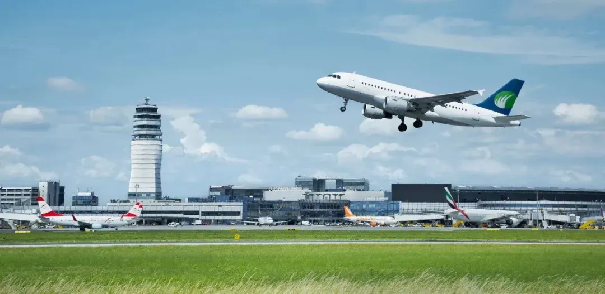

Der Flughafen Wien (Flughafencode **VIE**) liegt etwa 18 km vom Stadtzentrum entfernt und ist Österreichs größtes internationales Drehkreuz — und einer der wichtigsten Umsteigepunkte zwischen Mittel- und Osteuropa. Der Flughafen ist nur 16–25 Minuten von der Stadt entfernt, aber Expresszug, S-Bahn, Busse und Taxis tauschen Geschwindigkeit gegen Preis, und die Check-in-Hallen und Sicherheitseingänge sind nach Terminal und Ziel getrennt. Zu wissen, welches Gebäude und welcher Eingang Ihre sind, spart echte Zeit.

Dieser Leitfaden behandelt in fünf Teilen **die Terminals und Gate-Bereiche**, **den Transport in die Stadt**, **den Abflugablauf**, **die Einrichtungen des Flughafens** und **die Planung des Tages rund um den Flug**.

Der Aufbau des Flughafens ist einfacher, als er aussieht: Die Terminals liegen unter einem Dach, die Abflugbereiche oben, die Ankunftsbereiche unten, und die Sicherheitseingänge sind nach Gate-Gruppe geordnet. Wirklich im Voraus entscheiden müssen Sie nur drei Dinge — welches Gebäude Ihr Flug nutzt, wie Sie aus der Stadt anreisen und wie viel Zeit Sie für Check-in und Sicherheitskontrolle einplanen. Sind diese drei Punkte geklärt, können Gepäckaufbewahrung, Zollfreimengen und Geldwechsel bis zur Ankunft am Flughafen warten.

## 1. Terminals und Gate-Bereiche

Der Flughafen Wien hat drei genutzte Terminals — **Terminal 1, Terminal 1A und Terminal 3** — unter einem Dach angeordnet, sodass Sie zwischen ihnen zu Fuß gehen können. Der 2012 eröffnete SKYLINK-Zubau von Terminal 3 kann Flugzeuge bis zur Größe eines Airbus A380 abfertigen; er ist das Hauptgebäude für Langstreckenflüge.

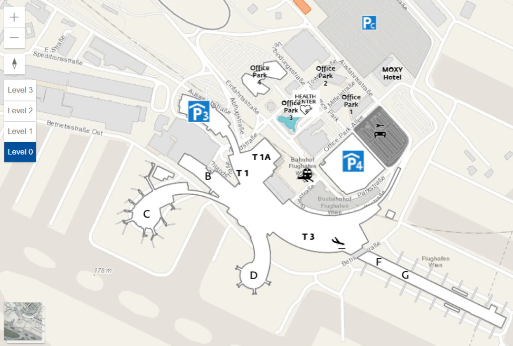

Der Flughafen wird von der Flughafen Wien AG betrieben, Passagierdienste, Gepäckabfertigung und Bodenabfertigung teilen sich Flughafen Wien, Swissport, Austrian Airlines und andere. Die Check-in-Schalter sind nach Airline vergeben, prüfen Sie also, **welches Terminal** Ihr Flug nutzt — derzeit Terminal 1, Terminal 1A oder Terminal 3. Älteres Material des Flughafens verwendet für einen Standort noch die Bezeichnung „Terminal 2“, dort wird aber kein Check-in mehr abgewickelt.

### Fünf Gate-Bereiche: B, C, D, F und G

Die Gates sind in fünf Piers gruppiert, und die Gruppe entscheidet, welchen Sicherheitseingang Sie nutzen und ob Sie durch die Passkontrolle gehen. Pier D hieß früher Halle A und wird als Ostpier bezeichnet; Pier C ist der Westpier.

| Pier | Gates | Anbindung an das Hauptgebäude | Flüge |
| --- | --- | --- | --- |
| B (Seite Terminal 1) | B22–B43 | Bus | Europäische Schengen-Flüge |
| C (Westpier, Seite Terminal 1) | C31–C42, davon C35–C41 als Transfer-Gates | Fluggastbrücke | Überwiegend Schengen, einige internationale Flüge |
| C (Westpier, Seite Terminal 1) | C71–C75 | Bus, über Gate C31 erreichbar | Nur Schengen |
| D (Ostpier, früher Halle A) | D21–D29 | Fluggastbrücke | Internationale Flüge |
| D (Ostpier, früher Halle A) | D31–D37, D61–D70 | Bus | Internationale Flüge |
| F, G (Terminal 3) | Gates F und G | Fluggastbrücke | Schengen (F) und Nicht-Schengen (G) |

Fluggastbrücken-Gates führen direkt ins Flugzeug; als Bus-Gates gekennzeichnete Gates bedeuten einen Weg nach unten und eine Fahrt mit dem Shuttlebus, was in Ihre Boardingzeit gehört. C71–C75 ist eine separate Bus-Gate-Gruppe, die über Gate C31 erreicht wird, planen Sie also zusätzliche Geh- und Wartezeit ein, wenn Sie von dort abfliegen.

### Internationale Transfers: umsteigen, ohne nach Österreich einzureisen

Wenn Wien nur ein Zwischenstopp ist, **erfordern internationale Transfers keine Einreise nach Österreich**. Kommen Sie mit einem internationalen Flug am Pier C an, folgen Sie den Schildern nach unten zur **Transitzone** im Erdgeschoss und nehmen Sie den Shuttlebus zum Pier D für Ihren Weiterflug. Kommen Sie am Pier D an und fliegen Sie mit einem weiteren internationalen Flug weiter, vollziehen Sie denselben Transfer innerhalb von Pier D über die Transitzone und den Shuttlebus. Am Pier D liegen der Transitbereich und der Bereich der Passkontrolle an den Eingängen zu den Hallen und an den Fluggastbrücken- und Bus-Gates — folgen Sie den Schildern „Transfer“.

## 2. In die Stadt und zurück

Es gibt fünf Wege vom Flughafen nach Wien: Der **City Airport Train** ist der schnellste, die **Flughafenbusse** bedienen das Stadtzentrum und den Westbahnhof, **S-Bahn S7 und Railjet** bieten das beste Preis-Leistungs-Verhältnis, **Taxis** eignen sich für späte Ankünfte und schweres Gepäck, und **Mietwagen** für eine Rundreise, die in Wien beginnt. Die folgenden Routen, Zeiten und Fahrpreise entsprechen den Veröffentlichungen des Flughafens und der Betreiber; prüfen Sie die Websites der Betreiber am Reisetag.

Wenn Sie nur das Fazit wollen: Nehmen Sie den **CAT**, wenn die Zeit drängt und Sie keine Umsteigeverbindung austüfteln möchten; die **S7**, wenn zuerst das Budget zählt und zehn Minuten mehr in Ordnung sind; einen **Railjet**, wenn die nächste Etappe ein inländischer Fernzug ist; den **Bus**, wenn Sie in Richtung Westbahnhof oder Donauzentrum wohnen; ein **Taxi** nach einer späten Landung mit schwerem Gepäck. Die folgende Tabelle vergleicht die Optionen, die Abschnitte danach nehmen jede einzelne durch.

| Verkehrsmittel | In die Stadt | Einzelfahrt | Geeignet für |
| --- | --- | --- | --- |
| CAT (City Airport Train) | 16 Min. nach Wien Mitte | 14,90 € | Zeitdruck, keine Umstiege |
| S-Bahn S7 | ca. 25 Min. nach Wien Mitte | ca. 5 € | Budget zuerst, etwas langsamer ist in Ordnung |
| Railjet | 15 Min. nach Wien Hauptbahnhof | ÖBB-Tagespreis | Anschluss an einen inländischen Fernzug |
| Flughafenbus | 20–40 Min., je nach Haltestelle | ca. 8 € | Unterkunft in Richtung Westbahnhof oder Donauzentrum |
| Taxi | ca. 20–30 Min. | nach Taxameter | Späte Ankünfte, Gruppen, schweres Gepäck |

### 1. City Airport Train (CAT) — am schnellsten

Der City Airport Train fährt ohne Halt vom Flughafen zur **Wien Mitte (Landstraße)** im Stadtzentrum in **16 Minuten**, was ihn zur entspanntesten Anreise macht — Straßenverkehr spielt schlicht keine Rolle.

- **Betriebszeiten:** 05:37–23:29 (Stadtzentrum → Flughafen); 06:09–23:39 (Flughafen → Stadtzentrum), etwa alle 30 Minuten.
- **Halte:** Flughafen ↔ Wien Mitte, etwa **10 Minuten** zu Fuß vom Stephansdom.
- **Fahrpreis:** 14,90 € einfache Fahrt, mit günstigeren Rückfahrkarten. Die Fahrscheine des Wiener Stadtverkehrs und die Vienna City Card gelten **nicht** im CAT; Sie brauchen einen eigenen Fahrschein.
- **Fahrkarten:** In der Ankunftshalle gibt es einen eigenen CAT-Schalter, an dem Sie Fahrkarten kaufen und sich zu allen CAT-Leistungen beraten lassen können.
- **Stadt-Check-in für Gepäck:** Am CAT-Terminal im Stadtzentrum können Sie von 24 Stunden bis 75 Minuten vor Abflug einchecken und eine Bordkarte erhalten, an besetzten Schaltern oder an Selbstbedienungsterminals.

### 2. Flughafenbusse — größte Abdeckung

Die Flughafenbusse (Vienna Airport Lines / Postbus) verbinden den Flughafen mit den wichtigsten Verkehrsknoten Wiens, und die drei Stadtlinien decken zusammen jede U-Bahn-Linie ab. Die Verbindungen nach Wien Westbahnhof und Wien Hauptbahnhof fahren **alle 30 Minuten**; die Strecke Flughafen ↔ Morzinplatz/Schwedenplatz fährt **rund um die Uhr** und dauert nur **20 Minuten**.

- **Fahrpreis:** etwa 8 € einfache Fahrt, gekauft im Bus oder am Schalter.
- **Strecken und Halte:** siehe die Tabelle unten.

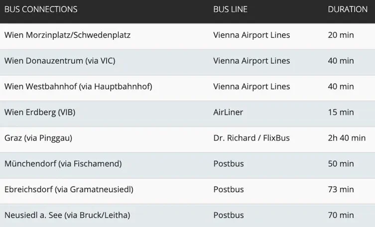

| Ziel | Buslinie | Fahrzeit |
| --- | --- | --- |
| Wien Morzinplatz/Schwedenplatz | Vienna Airport Lines | 20 min |
| Wien Donauzentrum (über VIC) | Vienna Airport Lines | 40 min |
| Wien Westbahnhof (über Hauptbahnhof) | Vienna Airport Lines | 40 min |
| Wien Erdberg (VIB) | AirLiner | 15 min |
| Graz (über Pinggau) | Dr. Richard / FlixBus | 2 Std. 40 min |
| Münchendorf (über Fischamend) | Postbus | 50 min |
| Ebreichsdorf (über Gramatneusiedl) | Postbus | 73 min |
| Neusiedl a. See (über Bruck/Leitha) | Postbus | 70 min |

### 3. Fernbusse — weiter zu den Nachbarhauptstädten

Für Bratislava, Budapest, Prag oder Brünn sind die Busse vom Flughafen oft direkter als der Zug, und viele von ihnen starten am Flughafen — praktisch, wenn Wien ein Zwischenstopp auf dem Weg woandershin ist.

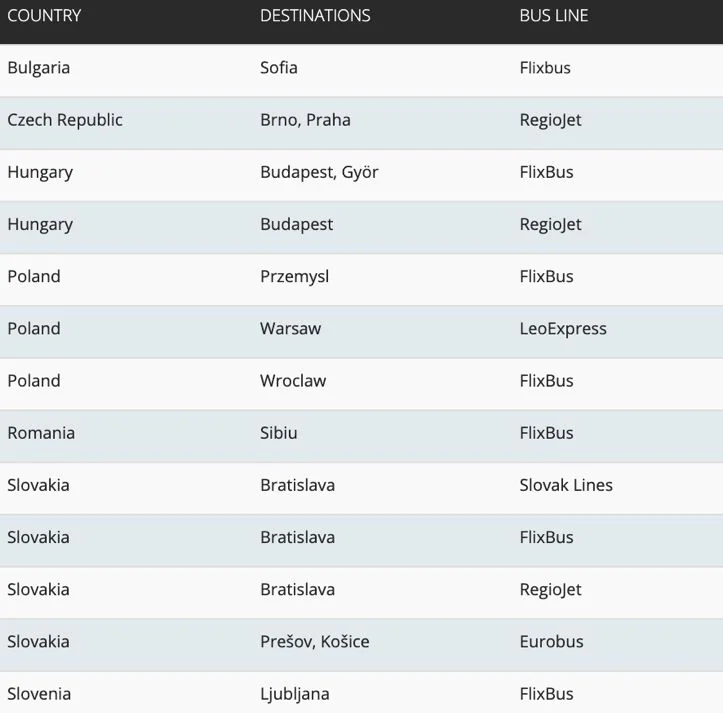

| Land | Ziel | Betreiber |
| --- | --- | --- |
| Bulgarien | Sofia | Flixbus |
| Tschechien | Brünn, Prag | RegioJet |
| Ungarn | Budapest, Győr | FlixBus |
| Ungarn | Budapest | RegioJet |
| Polen | Przemyśl | FlixBus |
| Polen | Warschau | LeoExpress |
| Polen | Breslau | FlixBus |
| Rumänien | Sibiu | FlixBus |
| Slowakei | Bratislava | Slovak Lines / FlixBus / RegioJet |
| Slowakei | Prešov, Košice | Eurobus |
| Slowenien | Ljubljana | FlixBus |

### 4. S-Bahn und ÖBB-Züge — bestes Preis-Leistungs-Verhältnis

Wer zum Preis eines Stadttickets reisen will, nimmt die S-Bahn **S7**: etwa **25 Minuten** vom Flughafen zur Wien Mitte, zu rund einem Drittel des CAT-Preises, und der Fahrschein deckt anschließend U-Bahn und Straßenbahn in der Stadt ab.

Die Railjet-Züge der ÖBB verbinden den Flughafen mit viel weiter entfernten Zielen: direkt nach Wien Hauptbahnhof (15 Minuten), St. Pölten, Linz, Salzburg, Innsbruck, Graz und Klagenfurt, mit grenzüberschreitenden Verbindungen nach Brünn, Prag, Győr und Budapest. Am Wien Hauptbahnhof können Sie zu vielen weiteren Zielen umsteigen.

- **Fahrpreis:** etwa 5 € einfache Fahrt mit der S7 (der Verkehrsverbund VOR rechnet nach Zonen ab, und der Flughafen liegt außerhalb der Kernzone Wiens — wenn Sie bereits ein Stadtticket haben, zahlen Sie nur den Zuschlag für die Flughafenstrecke).
- **Fahrkarten:** Der ÖBB-Schalter ist in der Ankunftshalle des Flughafens, nur einen kurzen Fußweg entfernt; Fahrkarten gibt es auch an ÖBB-Automaten und in der ÖBB-App.
- **Fahrplan:** siehe die Tabelle unten; maßgeblich sind die aktuellen Angaben von ÖBB und VOR am Reisetag.

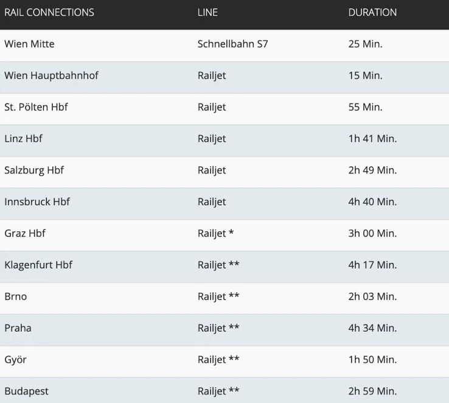

| Ziel | Linie | Fahrzeit |
| --- | --- | --- |
| Wien Mitte | Schnellbahn S7 | 25 min |
| Wien Hauptbahnhof | Railjet | 15 min |
| St. Pölten Hbf | Railjet | 55 min |
| Linz Hbf | Railjet | 1 Std. 41 min |
| Salzburg Hbf | Railjet | 2 Std. 49 min |
| Innsbruck Hbf | Railjet | 4 Std. 40 min |
| Graz Hbf | Railjet * | 3 Std. 00 min |
| Klagenfurt Hbf | Railjet ** | 4 Std. 17 min |
| Brünn | Railjet ** | 2 Std. 03 min |
| Prag | Railjet ** | 4 Std. 34 min |
| Győr | Railjet ** | 1 Std. 50 min |
| Budapest | Railjet ** | 2 Std. 59 min |

Verbindungen mit \* und \*\* erfordern in der Regel einen Umstieg am Wien Hauptbahnhof; prüfen Sie den Fahrplan der ÖBB für den jeweiligen Tag.

### 5. Taxis

Nehmen Sie ein Taxi vom Taxistand vor der Ankunftshalle oder ein Fahrzeug, das vom Schalter „City Transfer“ vermittelt wird; Sie können auch vorab telefonisch eines buchen.

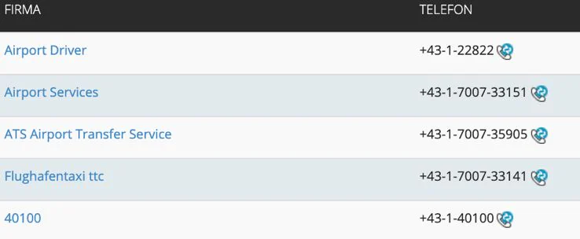

| Taxiunternehmen | Telefon |
| --- | --- |
| Airport Driver | +43-1-22822 |
| Airport Services | +43-1-7007-33151 |
| ATS Airport Transfer Service | +43-1-7007-35905 |
| Flughafentaxi ttc | +43-1-7007-33141 |
| 40100 | +43-1-40100 |

### 6. Mietwagen

Die Mietwagenschalter liegen gemeinsam auf **Ebene 0 des Parkhauses P4**, wo Hertz, Sixt, Europcar, Avis, Budget, Enterprise, Alamo und National eigene Schalter haben — Sie fahren direkt auf das Autobahnnetz.

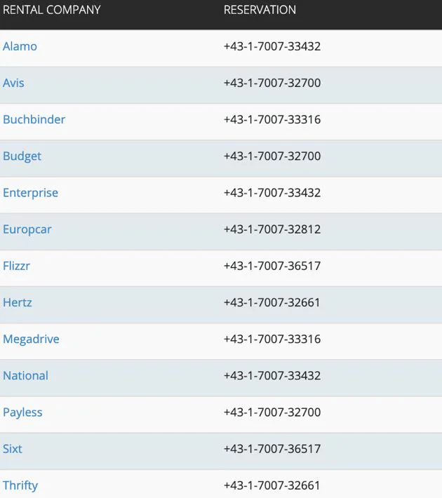

| Mietwagenunternehmen | Reservierung |
| --- | --- |
| Alamo | +43-1-7007-33432 |
| Avis | +43-1-7007-32700 |
| Buchbinder | +43-1-7007-33316 |
| Budget | +43-1-7007-32700 |
| Enterprise | +43-1-7007-33432 |
| Europcar | +43-1-7007-32812 |
| Flizzr | +43-1-7007-36517 |
| Hertz | +43-1-7007-32661 |
| Megadrive | +43-1-7007-33316 |
| National | +43-1-7007-33432 |
| Payless | +43-1-7007-32700 |
| Sixt | +43-1-7007-36517 |
| Thrifty | +43-1-7007-32661 |

## 3. Abflug: Check-in, Gepäckabgabe, Sicherheitskontrolle

Der übliche Ablauf ist **einchecken → Gepäck abgeben → Sicherheitskontrolle → (bei Nicht-Schengen-Flügen) Passkontrolle → boarden**. Seien Sie 2 Stunden vor einem Schengen-Abflug und 3 Stunden vor einem Nicht-Schengen- oder Langstreckenflug am Flughafen; in der Hochsaison und an Feiertagen rechnen Sie eine halbe Stunde mehr.

Die zusätzliche Stunde für einen Langstreckenflug ist keine Vorsicht, sondern gerechtfertigt. Wien trennt die **Schengen- und die Nicht-Schengen-Abläufe** vollständig: Ein Schengen-Flug passiert die Sicherheitskontrolle und geht dann zum Gate, während ein Nicht-Schengen-Flug nach der Sicherheitskontrolle in einem anderen Teil des Gebäudes noch einmal zur Passkontrolle ansteht. Check-in, Gepäckabgabe, Sicherheitskontrolle, Passkontrolle und der Weg zum Gate summieren sich — und wenn Reisepass, Visum, Bordkarte und Gepäckabschnitt in derselben Tasche stecken, entfällt jedes Suchen an den Kontrollpunkten.

### 1. Check-in

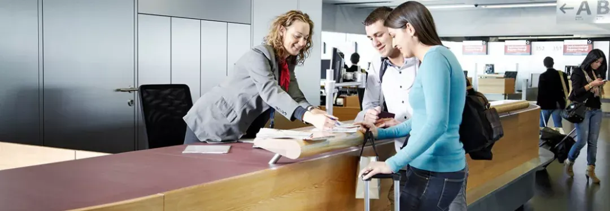

- **Selbstbedienungs-Check-in:** Nutzen Sie eine Kreditkarte oder eine Miles-&-More-Karte, Ihren Namen, Ihre Buchungsnummer oder scannen Sie einfach Ihren Reisepass, um an den Selbstbedienungsterminals eine Bordkarte zu erhalten. Wenn Sie Gepäck aufzugeben haben, zeigt Ihnen das Terminal, welchen Gepäckabgabeschalter Sie nutzen sollen.
- **Am Schalter:** Je nach Flug checken Sie in Terminal 1, Terminal 1A oder Terminal 3 ein und erhalten dort Ihre Bordkarte.
- **Online-Check-in:** Die meisten Airlines bieten ihn auf ihrer Website oder in ihrer App an, was das Anstehen am Flughafen erspart; drucken Sie Ihre Bordkarte dort aus. Wenn Sie Gepäck aufzugeben haben, fragen Sie zuerst am zuständigen Schalter nach.
- **Check-in in der Wien Mitte:** Einige Airlines bieten den Check-in am Terminal des City Airport Train in der Wien Mitte an, wo Sie Ihren Reisepass vorzeigen und Ihre Bordkarte erhalten. Die aktuelle Liste der Airlines finden Sie auf cityairporttrain.com oder telefonisch unter +43 1 25250.

### 2. Selbstbedienungs-Gepäckabgabe

Die Selbstbedienungs-Gepäckabgabe am Flughafen Wien fasst die Übergabe in vier Schritten zusammen: **Bordkarte scannen → Anhänger am Koffer befestigen → Abschnitt als Beleg behalten → zur Sicherheitskontrolle weitergehen.**

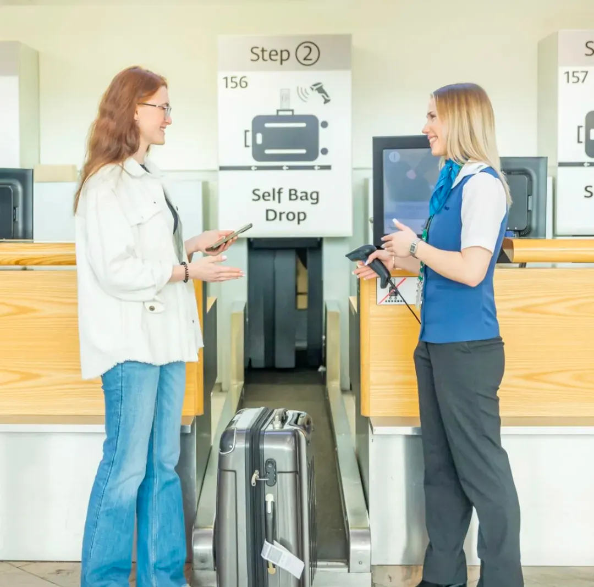

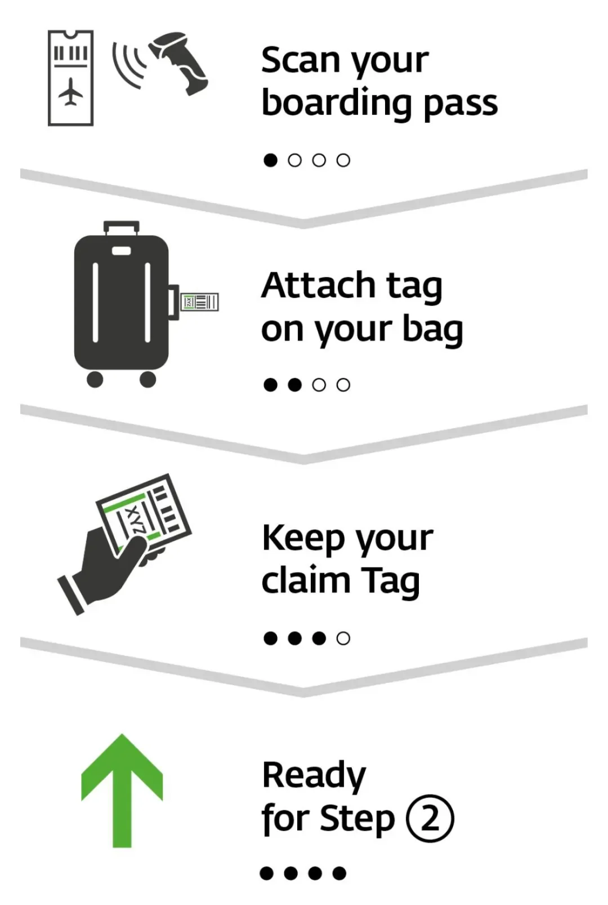

An den Selbstbedienungsbändern neben den Check-in-Inseln scannen Sie Ihre Bordkarte zur Bestätigung des Fluges, befestigen den gedruckten Anhänger am Koffergriff, legen den Koffer auf das Band und behalten den Abschnitt — geht der Koffer verloren, ist er Ihr einziger Nachweis.

### 3. Hinweise zum Gepäck

- Für **Übergepäck oder Tiere** nutzen Sie die **Schalter für Sondergepäck in Terminal 1 oder Terminal 3**.
- Schreiben Sie Ihren Namen und Ihre Adresse auf den Koffer und entfernen Sie alte Anhänger — alte Barcodes verwirren das Sortiersystem und machen eine Fehlleitung wahrscheinlicher.
- Wertsachen, wichtige Dokumente und Medikamente tragen Sie bei sich, statt sie aufzugeben.
- Sichern Sie den Koffer bei Bedarf mit einem Gurt oder Vorhängeschloss oder nutzen Sie den Gepäckverschweißservice des Flughafens (siehe den Abschnitt zu den Einrichtungen unten).

### 4. Sicherheitskontrolle und Passkontrolle

Die Sicherheitseingänge sind nach Gate-Gruppe getrennt, und der falsche kostet Sie einen langen Weg:

- **Sicherheitseingang 2:** für Abflüge von den Gates B, C und D.
- **Sicherheitseingang 3:** für Abflüge von den Gates F und G.

Hinter der Sicherheitskontrolle gibt es Geschäfte und Restaurants im Abflugbereich; Begleitpersonen können nicht mit Ihnen passieren.

- Für **Schengen-Staaten** nutzen Sie die Gates **B, C und F**.
- Für **Nicht-Schengen-Staaten** nutzen Sie die Gates **D und G**, und Sie müssen vor dem Weitergehen zum Gate die **Passkontrolle** passieren.

Reisende mit einem Nicht-EU-Reisepass müssen vor der Passkontrolle in der Regel außerdem die **EES-Registrierung** (Fingerabdrücke und Gesichtsbild) an einem Selbstbedienungsterminal abschließen. Bei der ersten Einreise kostet das einige Minuten zusätzlich — planen Sie diese Zeit bei einer knappen Umsteigeverbindung ein.

## 4. Einrichtungen des Flughafens und praktische Informationen

Die Einrichtungen folgen einer einfachen Regel: **Die Abflugebene ist für Check-in und Sicherheitskontrolle zuständig, die Ankunftsebene für Gepäck, Auskunft und Bodenverkehr**, und Restaurants, Geschäfte und Sitzgelegenheiten konzentrieren sich im Abflugbereich hinter der Sicherheitskontrolle. Gepäckaufbewahrung, der Zollstempel für die Rückerstattung und das Fundbüro liegen alle auf der Ankunftsebene 0 und rund um Terminal 1; sobald Sie die Sicherheitskontrolle passiert haben, sind nur noch die Dienste im Abflugbereich erreichbar. Die folgenden Abschnitte sind von der häufigsten zur seltensten Nutzung geordnet.

### Auskunft und Gepäckservices

Es gibt **drei Informationsschalter**: zwei auf den Abflugebenen von Terminal 1 und Terminal 3 und einen in der Ankunftshalle von Terminal 3. Fragen zu Gepäck und Einrichtungen werden hier beantwortet.

Die **Gepäckservicezentren** in den Check-in-Bereichen von Terminal 1 und Terminal 3 sind **00:00–24:00** geöffnet und bieten:

| Leistung | Preis | Hinweise |
| --- | --- | --- |
| Gepäckaufbewahrung | 4 € pro Stück und Tag; übergroße Stücke 8 € pro Stück und Tag | Gegenstände können bis zu 6 Monate gelagert werden |
| Gepäckverschweißung | 12 € pro Stück | Ihr Gepäckstück wird in Schutzfolie versiegelt, gegen Beschädigung, Feuchtigkeit und Diebstahl; erhältlich in den Gepäckbereichen von Terminal 1 und Terminal 3 |
| Gepäckzustellung | ab 15 € für bis zu 5 Stück, 3 € für jedes weitere Stück | Mindestens 72 Stunden im Voraus buchen per E-Mail an service@viennaairport.com oder direkt im Online-Shop des Flughafens |
| Schließfächer | 6 € pro Tag | Für Dokumente, Schlüssel und Ähnliches; Waffen, Sprengstoffe, brennbare oder andere gefährliche Güter sowie verderbliche oder stark riechende Gegenstände dürfen nicht eingelagert werden |
| Garderobe | 2 € pro Set und Tag | Ein Set besteht aus Jacke oder Mantel, Schuhen, Schmuck, Handschuhen und Schal |

### Medizinisches Zentrum, Gebetsraum und Fundbüro

- **Medizinisches Zentrum:** Terminal 1, Korridor auf Ebene 1, gegenüber der Apotheke, geöffnet **07:00–19:00**. Geimpft wird unter anderem gegen Gelbfieber, Typhus, Tollwut, Hepatitis A und B (auch für Kinder), Malaria, FSME, Influenza, die Kombinationsimpfung gegen Diphtherie/Polio/Tetanus/Pertussis, Meningokokken-Erkrankungen und Japanische Enzephalitis — rufen Sie vorher an und prüfen Sie den Bestand.
- **Gebetsraum:** Es gibt einen Gebetsraum im Terminal; fragen Sie am Informationsschalter nach dem Standort.
- **Fundbüro:** das Fundbüro auf Ebene 0 von Terminal 1 oder der Informationsschalter in der Ankunftshalle von Terminal 3.
- **Rücksendung verlorener Gegenstände per Post:** Nutzen Sie den Versand- und Verpackungsservice von Mail Boxes Etc. in A-2320 Schwechat oder einen beliebigen Kurier; die Kontaktadresse ist mbe0045@mbe.at. Für länger als 8 Tage aufbewahrte Gegenstände fällt eine Lagergebühr an, und **die Zahlung muss eingehen, bevor der Gegenstand versendet wird**: Bei Kartenzahlung kommen Rechnung und Zahlungslink per E-Mail; bei Überweisungen geben Sie die Rechnungsnummer im Verwendungszweck an, sonst kann Ihre Zahlung nicht zugeordnet werden.

### Zoll und Duty-Free-Freimengen

Reisende, die aus einem Staat außerhalb der EU nach Österreich einreisen, dürfen im Rahmen der Freimengen Folgendes mitbringen. **Reisende derselben Reise können ihre Freimengen nicht zusammenlegen** — eine Regel, die oft übersehen wird:

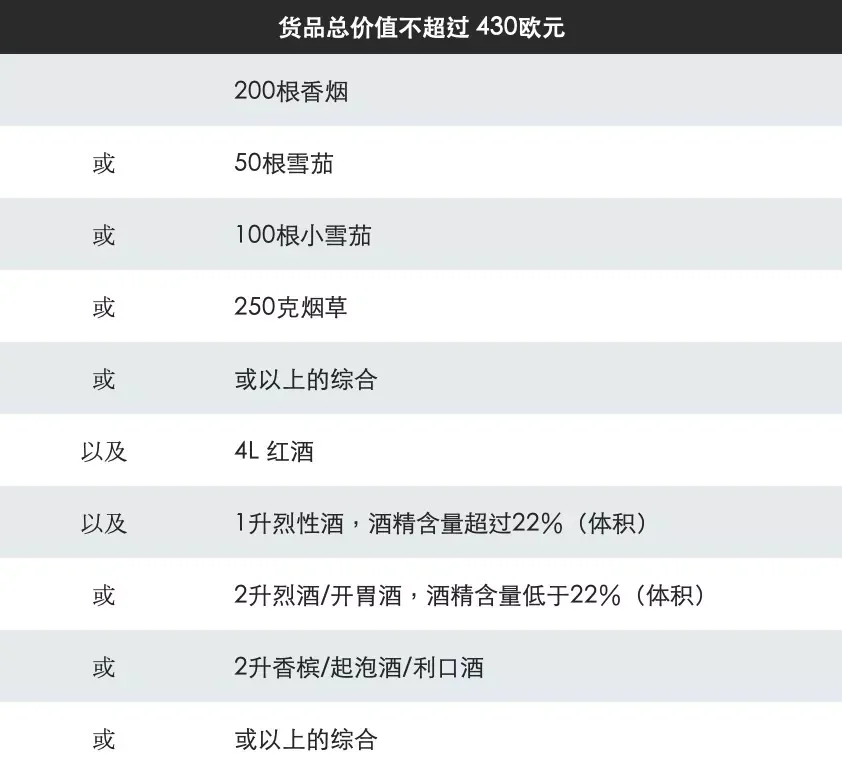

| Kategorie | Zollfreimenge |
| --- | --- |
| Gesamtwert der Waren | bis zu **430 €** (nur Flugreisende; 300 € bei Anreise auf dem Landweg) |
| Zigaretten | 200 |
| oder Zigarren | 50 |
| oder Zigarillos | 100 |
| oder Tabak | 250 g |
| oder eine Kombination daraus | — |
| plus Wein | 4 l |
| plus Spirituosen über 22 % Alkohol | 1 l |
| oder Spirituosen oder Aperitifs unter 22 % | 2 l |
| oder Sekt oder Liköre | 2 l |
| oder eine Kombination daraus | — |

- **Altersgrenzen:** Passagiere unter 15 Jahren haben eine Freimenge von 150 €; die Alkohol- und Tabakfreimengen gelten ab 17 Jahren.
- **Bargeldanmeldung:** Wer mehr als **10.000 €** in Bargeld oder anderen Zahlungsmitteln (Reiseschecks, Goldbarren, Goldmünzen und Ähnliches) in die EU ein- oder aus der EU ausführt, muss dies beim Zoll anmelden; Formulare gibt es am Zollschalter oder in einem Zollamt.
- **Ausfuhrstempel für die Rückerstattung:** Das Zollamt für Ausfuhren befindet sich auf der Ankunftsebene 0.

### Geldwechsel und Geldautomaten

Die Wechselstuben des Flughafens werden von **Interchange** betrieben, mit Filialen an den Gates, in der Ankunftshalle und in den Terminals, in der Regel von 5 Uhr morgens bis in den späten Abend geöffnet; Geldautomaten sind noch weiter verbreitet, von der Ankunftshalle bis zu den Gate-Piers.

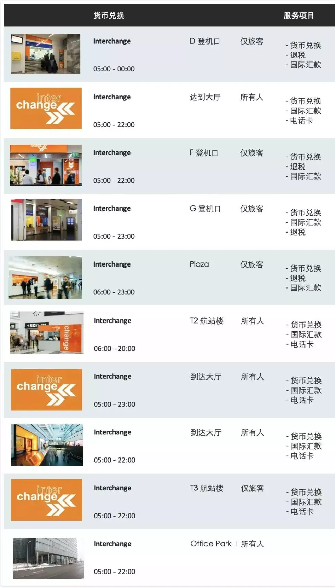

| Standort | Öffnungszeiten | Zugang |
| --- | --- | --- |
| Gate D | 05:00–00:00 | Nur für Passagiere |
| Gate F | 05:00–22:00 | Nur für Passagiere |
| Gate G | 05:00–23:00 | Nur für Passagiere |
| Plaza | 06:00–23:00 | Nur für Passagiere |
| Terminal 3 | 05:00–22:00 | Nur für Passagiere |
| Ankunftshalle (3 Schalter) | 05:00–22:00, einer bis 23:00 | Für alle |
| Terminal 2 | 06:00–20:00 | Für alle |
| Office Park 1 | 05:00–22:00 | Für alle |

Die Schalter bieten Geldwechsel, Steuererstattungen und internationale Überweisungen; einige Schalter in der Ankunftshalle sowie in Terminal 2 und 3 verkaufen auch Telefonkarten.

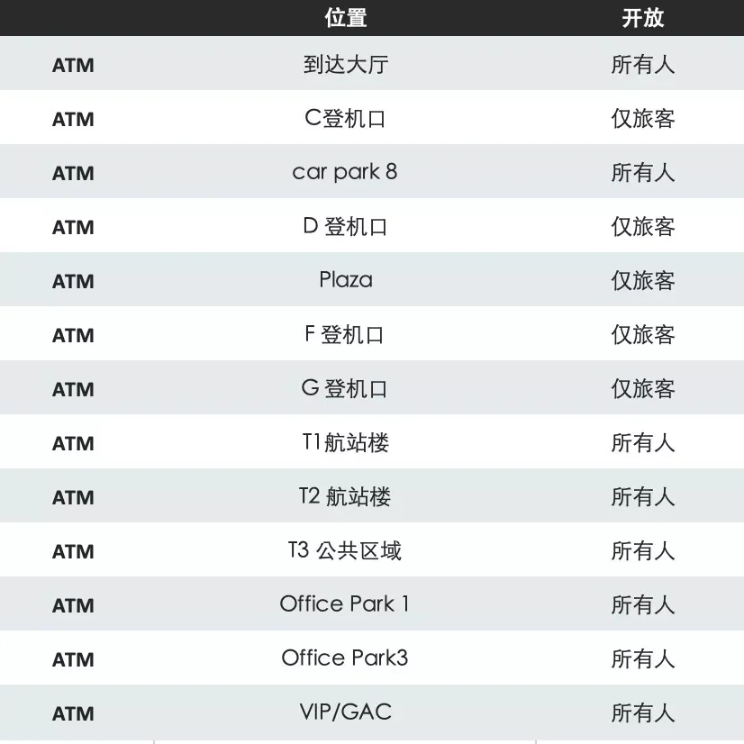

Geldautomaten gibt es in der Ankunftshalle, an den Gates C/D/F/G, im Plaza, im Parkhaus 8, in den öffentlichen Bereichen von Terminal 1, 2 und 3, im Office Park 1, im Office Park 3 und im VIP/GAC-Bereich. Die Geldautomaten in der Ankunftshalle, den Parkhäusern, Terminals und Bürogebäuden stehen allen offen; die an den Gates und im Plaza sind nur für Passagiere.

### WLAN, Strom und SIM-Karten

- **WLAN:** deckt das gesamte Terminal ab, sodass Sie während des Wartens Flüge prüfen und Nachrichten nach Hause schicken können.
- **Strom und Arbeiten:** An den Gates F und G gibt es eigene Arbeitsplätze, an denen Sie ein Laptop anschließen und nutzen können.
- **SIM-Karten und Reparaturen:** Mr. Mobile bietet Reparaturen für Telefone, Tablets und Laptops, Leihgeräte und Prepaid-SIM-Karten.

## 5. Den Tag um den Flug herum planen

Alles oben Genannte läuft auf drei Situationen hinaus. Jede hat ein eigenes Zeitbudget, aber alle teilen eine Regel: **Klären Sie zuerst Terminal und Gate, dann wählen Sie das Verkehrsmittel.**

### Ankunft und direkt in die Stadt

Bei einer Landung am Tag und leichtem Gepäck ist die **S7** der einfachste Weg hinein: Folgen Sie den S-Bahn-Schildern hinunter zum Bahnsteig, kaufen Sie eine Fahrkarte nach Wien Mitte, und etwa fünfundzwanzig Minuten später sitzen Sie in der U-Bahn. Nehmen Sie den **CAT**, wenn Sie knapp bei Zeit sind oder mit Kindern reisen; nach einer späten Landung stellen Sie sich lieber draußen vor der Ankunftshalle beim Taxi an, statt dem letzten Zug hinterherzujagen, um ein paar Euro zu sparen.

### Vom Stadtzentrum zum Flug

CAT und S7 fahren beide von Wien Mitte ab; der CAT ist etwa zehn Minuten schneller und kostet mehr als das Doppelte. Die Zeit, auf die es wirklich ankommt, ist die **am Flughafen**: Rechnen Sie vom Gate rückwärts über Sicherheitskontrolle, Gepäckabgabe und Check-in — 2 Stunden für einen Schengen-Flug, 3 für einen Nicht-Schengen-Flug. Eine halbe Stunde mehr in der Stadt bringt deutlich weniger als eine halbe Stunde mehr am Flughafen. Hochsaison, Feiertage und der Andrang am frühen Morgen verdienen jeweils noch eine halbe Stunde.

### Umsteigen in Wien

Ein Anschlussflug von international zu international erfordert keine Einreise nach Österreich: Folgen Sie den „Transfer“-Schildern durch die Transitzone. Ist der Weiterflug jedoch ein Schengen-Flug, reisen Sie ein und passieren die Sicherheitskontrolle erneut — kalkulieren Sie die Umsteigezeit dann wie eine Ankunft. Zwei Stunden zwischen den Flügen sind komfortabel; planen Sie drei ein, wenn Sie das Terminal wechseln oder ein Gepäckstück wieder abholen und neu aufgeben müssen.

## Weiterführende Links

- **Auf dieser Website**: [Flughafen Wien (VIE)](/airport/VIE), [Österreich (AT)](/country/AT)
- **Wikipedia**: [Flughafen Wien](https://en.wikipedia.org/wiki/Vienna_International_Airport)
- **Baidu Baike**: [Flughafen Wien](https://baike.baidu.com/item/%E7%BB%B4%E4%B9%9F%E7%BA%B3%E5%9B%BD%E9%99%85%E6%9C%BA%E5%9C%BA)

Bildquelle: Flughafen Wien. Fahrpreise, Öffnungszeiten und Schalterstandorte entsprechen den Veröffentlichungen des Flughafens und der Betreiber; prüfen Sie deren Websites am Reisetag.
