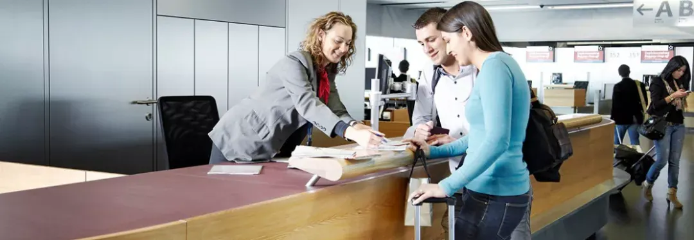

वियना अंतर्राष्ट्रीय हवाई अड्डा (हवाई अड्डा कोड **VIE**) शहर के केंद्र से लगभग 18 किमी दूर है और ऑस्ट्रिया का सबसे बड़ा अंतरराष्ट्रीय हब है — साथ ही मध्य और पूर्वी यूरोप के बीच सबसे महत्वपूर्ण ट्रांसफ़र केंद्रों में से एक। हवाई अड्डा शहर से बस 16–25 मिनट दूर है, लेकिन एक्सप्रेस ट्रेन, S-Bahn, बसें और टैक्सी सभी गति और कीमत के बीच सौदा करते हैं, और चेक-इन हॉल तथा सुरक्षा द्वार टर्मिनल और गंतव्य के हिसाब से बँटे हैं। यह जानना कि कौन-सा भवन और कौन-सा द्वार आपका है, सचमुच समय बचाता है।

यह गाइड पाँच भागों में **टर्मिनल और गेट क्षेत्र**, **शहर तक परिवहन**, **प्रस्थान प्रक्रिया**, **हवाई अड्डे की सुविधाएँ** और **अपनी उड़ान के हिसाब से दिन की योजना** को समेटती है।

हवाई अड्डे का लेआउट दिखने से आसान है: टर्मिनल एक ही छत के नीचे हैं, प्रस्थान ऊपर की मंज़िल पर और आगमन नीचे, और सुरक्षा द्वार गेट के हिसाब से समूहों में हैं। असल में पहले से तय करने वाली बातें तीन हैं — आपकी उड़ान कौन-सा भवन इस्तेमाल करती है, आप शहर से कैसे पहुँचेंगे, और चेक-इन तथा सुरक्षा के लिए कितना समय रखना है। ये तय हो जाएँ तो सामान रखने, सीमा शुल्क भत्तों और करेंसी एक्सचेंज को वहाँ पहुँचने तक टाला जा सकता है।

## 1. टर्मिनल और गेट क्षेत्र

वियना हवाई अड्डे पर तीन टर्मिनल चालू हैं — **टर्मिनल 1, टर्मिनल 1A और टर्मिनल 3** — जो एक ही छत के नीचे एक कतार में हैं, इसलिए आप इनके बीच पैदल चल सकते हैं। टर्मिनल 3 का SKYLINK विस्तार 2012 में खुला और एयरबस A380 जितने बड़े विमान भी संभाल सकता है; लंबी दूरी की उड़ानों के लिए यही मुख्य भवन है।

हवाई अड्डा Flughafen Wien AG चलाती है, और यात्री सेवाएँ, सामान हैंडलिंग तथा ग्राउंड हैंडलिंग वियना एयरपोर्ट, Swissport, Austrian Airlines और अन्य के बीच बँटी हैं। चेक-इन डेस्क एयरलाइन के हिसाब से तय होते हैं, इसलिए पक्का करें कि आपकी उड़ान **कौन-सा टर्मिनल** इस्तेमाल करती है — फ़िलहाल टर्मिनल 1, टर्मिनल 1A या टर्मिनल 3। हवाई अड्डे की पुरानी सामग्री में किसी स्थान के लिए अब भी “टर्मिनल 2” नाम मिलता है, लेकिन वहाँ अब चेक-इन नहीं होता।

### पाँच गेट क्षेत्र: B, C, D, F और G

गेट पाँच पियरों में बँटे हैं, और यही समूह तय करता है कि आप कौन-सा सुरक्षा द्वार इस्तेमाल करेंगे और पासपोर्ट नियंत्रण से गुज़रना होगा या नहीं। पियर D को पहले हॉल A कहा जाता था और इसे पूर्वी पियर कहते हैं; पियर C पश्चिमी पियर है।

| पियर | गेट | मुख्य भवन से कनेक्शन | उड़ानें |
| --- | --- | --- | --- |
| B (टर्मिनल 1 की ओर) | B22–B43 | बस | यूरोपीय शेंगेन उड़ानें |
| C (पश्चिमी पियर, टर्मिनल 1 की ओर) | C31–C42, जिनमें C35–C41 ट्रांसफ़र गेट हैं | जेट ब्रिज | ज़्यादातर शेंगेन, कुछ अंतरराष्ट्रीय |
| C (पश्चिमी पियर, टर्मिनल 1 की ओर) | C71–C75 | बस, गेट C31 से होकर पहुँचें | केवल शेंगेन |
| D (पूर्वी पियर, पहले हॉल A) | D21–D29 | जेट ब्रिज | अंतरराष्ट्रीय उड़ानें |
| D (पूर्वी पियर, पहले हॉल A) | D31–D37, D61–D70 | बस | अंतरराष्ट्रीय उड़ानें |
| F, G (टर्मिनल 3) | F और G गेट | जेट ब्रिज | शेंगेन (F) और गैर-शेंगेन (G) |

जिन गेटों पर जेट ब्रिज है, वहाँ से आप सीधे विमान में चले जाते हैं; बस गेट के रूप में चिह्नित गेटों का मतलब है नीचे जाना और शटल बस की सवारी, जिसे अपने बोर्डिंग समय में शामिल रखें। C71–C75 एक अलग बस-गेट समूह है जहाँ गेट C31 से होकर पहुँचा जाता है, इसलिए अगर आपकी उड़ान वहाँ से है तो ज़्यादा चलने और इंतज़ार का समय रखें।

### अंतरराष्ट्रीय ट्रांसफ़र: ऑस्ट्रिया में प्रवेश किए बिना विमान बदलें

अगर वियना सिर्फ़ एक ठहराव है, तो **अंतरराष्ट्रीय ट्रांसफ़र के लिए ऑस्ट्रिया में प्रवेश करना ज़रूरी नहीं**। अंतरराष्ट्रीय उड़ान से पियर C पर पहुँचने पर संकेतों का पालन करते हुए नीचे ग्राउंड फ़्लोर पर **Transitzone** तक जाएँ और अपनी आगे की अंतरराष्ट्रीय उड़ान के लिए पियर D तक शटल बस लें। पियर D पर पहुँचकर किसी दूसरी अंतरराष्ट्रीय उड़ान से आगे जा रहे हों, तो वही ट्रांसफ़र पियर D के अंदर ही Transitzone और शटल बस के ज़रिए करें। पियर D पर ट्रांज़िट क्षेत्र और पासपोर्ट नियंत्रण क्षेत्र हॉल के प्रवेश द्वारों पर तथा जेट ब्रिज और बस गेटों पर हैं — “Transfer” संकेतों का पालन करें।

## 2. शहर में जाना और वापस आना

हवाई अड्डे से वियना पहुँचने के पाँच रास्ते हैं: **City Airport Train** सबसे तेज़ है, **हवाई अड्डा बसें** शहर के केंद्र और पश्चिमी स्टेशन तक जाती हैं, **S7 S-Bahn और Railjet ट्रेनें** सबसे अच्छा मूल्य देती हैं, **टैक्सी** देर से आने और भारी सामान के लिए ठीक है, और **कार किराया** उस सड़क यात्रा के लिए जो वियना से शुरू हो। नीचे दिए मार्ग, समय और किराए हवाई अड्डे और ऑपरेटरों द्वारा प्रकाशित हैं; यात्रा के दिन ऑपरेटरों की साइट देख लें।

अगर आपको सीधा निष्कर्ष चाहिए: जब समय मायने रखे और आप बदलाव का हिसाब नहीं लगाना चाहें तो **CAT** लें; जब बजट पहले हो और दस मिनट ज़्यादा लगना ठीक हो तो **S7** लें; जब अगला चरण घरेलू लंबी दूरी की ट्रेन हो तो **Railjet** लें; अगर आप Westbahnhof या Donauzentrum की ओर ठहर रहे हैं तो **बस** लें; देर से लैंडिंग और भारी सामान के बाद **टैक्सी** लें। नीचे की तालिका इनकी तुलना करती है; आगे के हिस्से हर एक को बारी-बारी समझाते हैं।

| विकल्प | शहर के केंद्र तक | एकतरफ़ा किराया | किसके लिए सबसे अच्छा |
| --- | --- | --- | --- |
| City Airport Train (CAT) | Wien Mitte तक 16 मिनट | €14.90 | समय की कमी, कोई बदलाव नहीं |
| S7 S-Bahn | Wien Mitte तक लगभग 25 मिनट | लगभग €5 | बजट पहले, थोड़ा धीमा चलेगा |
| Railjet | Wien Hauptbahnhof तक 15 मिनट | उस दिन का ÖBB किराया | घरेलू लंबी दूरी की ट्रेन से कनेक्शन |
| हवाई अड्डा बस | स्टॉप के अनुसार 20–40 मिनट | लगभग €8 | Westbahnhof या Donauzentrum की ओर ठहरने पर |
| टैक्सी | लगभग 20–30 मिनट | मीटर से | देर से आगमन, समूह, भारी सामान |

### 1. City Airport Train (CAT) — सबसे तेज़

City Airport Train हवाई अड्डे से शहर के केंद्र में **Wien Mitte (Landstraße)** तक **16 मिनट** में बिना रुके चलती है, जिससे यह अंदर आने का सबसे कम तनाव वाला तरीका है — सड़क यातायात यहाँ कोई कारक ही नहीं है।

- **समय:** 05:37–23:29 (शहर का केंद्र → हवाई अड्डा); 06:09–23:39 (हवाई अड्डा → शहर का केंद्र), लगभग हर 30 मिनट में।
- **स्टॉप:** हवाई अड्डा ↔ Wien Mitte, सेंट स्टीफ़न कैथेड्रल से लगभग **10 मिनट** पैदल।
- **किराया:** एकतरफ़ा €14.90, वापसी टिकट सस्ते हैं। वियना के सिटी ट्रांसपोर्ट टिकट और Vienna City Card CAT पर **मान्य नहीं** हैं; आपको अलग टिकट लेना होगा।
- **टिकट:** आगमन हॉल में समर्पित CAT काउंटर है जहाँ आप टिकट खरीद सकते हैं और CAT की किसी भी सेवा के बारे में पूछ सकते हैं।
- **सामान के लिए सिटी चेक-इन:** शहर के केंद्र में CAT टर्मिनल पर आप स्टाफ़ वाले डेस्क या सेल्फ़-सर्विस कियोस्क पर, प्रस्थान से 24 घंटे पहले से 75 मिनट पहले तक चेक-इन करके बोर्डिंग पास ले सकते हैं।

### 2. हवाई अड्डा बसें — सबसे व्यापक कवरेज

हवाई अड्डा बसें (Vienna Airport Lines / Postbus) हवाई अड्डे को वियना के मुख्य परिवहन केंद्रों से जोड़ती हैं, और तीन शहर मार्ग मिलकर हर मेट्रो लाइन को कवर करते हैं। Wien Westbahnhof और Wien Hauptbahnhof की ओर सेवाएँ **हर 30 मिनट में** चलती हैं; हवाई अड्डा ↔ Morzinplatz/Schwedenplatz मार्ग **चौबीसों घंटे** चलता है और सिर्फ़ **20 मिनट** लेता है।

- **किराया:** एकतरफ़ा लगभग €8, बस में या काउंटर पर खरीदें।
- **मार्ग और स्टॉप:** नीचे तालिका देखें।

| गंतव्य | बस लाइन | यात्रा समय |
| --- | --- | --- |
| Wien Morzinplatz/Schwedenplatz | Vienna Airport Lines | 20 मिनट |
| Wien Donauzentrum (VIC के रास्ते) | Vienna Airport Lines | 40 मिनट |
| Wien Westbahnhof (Hauptbahnhof के रास्ते) | Vienna Airport Lines | 40 मिनट |
| Wien Erdberg (VIB) | AirLiner | 15 मिनट |
| Graz (Pinggau के रास्ते) | Dr. Richard / FlixBus | 2 घं 40 मिनट |
| Münchendorf (Fischamend के रास्ते) | Postbus | 50 मिनट |
| Ebreichsdorf (Gramatneusiedl के रास्ते) | Postbus | 73 मिनट |
| Neusiedl a. See (Bruck/Leitha के रास्ते) | Postbus | 70 मिनट |

### 3. लंबी दूरी की कोच — पड़ोसी राजधानियों तक आगे

ब्रातिस्लावा, बुडापेस्ट, प्राग या ब्रनो के लिए हवाई अड्डे से कोच अक्सर ट्रेन से ज़्यादा सीधी होती हैं, और उनमें से कई हवाई अड्डे से ही शुरू होती हैं — अगर कहीं और जाते समय वियना सिर्फ़ ठहराव है तो यह सुविधाजनक है।

| देश | गंतव्य | ऑपरेटर |
| --- | --- | --- |
| बुल्गारिया | सोफ़िया | Flixbus |
| चेकिया | Brno, Praha | RegioJet |
| हंगरी | Budapest, Győr | FlixBus |
| हंगरी | Budapest | RegioJet |
| पोलैंड | Przemyśl | FlixBus |
| पोलैंड | Warsaw | LeoExpress |
| पोलैंड | Wrocław | FlixBus |
| रोमानिया | Sibiu | FlixBus |
| स्लोवाकिया | Bratislava | Slovak Lines / FlixBus / RegioJet |
| स्लोवाकिया | Prešov, Košice | Eurobus |
| स्लोवेनिया | Ljubljana | FlixBus |

### 4. S-Bahn और ÖBB ट्रेनें — सबसे अच्छा मूल्य

शहर के टिकट की कीमत पर सफ़र करना हो तो **S7** S-Bahn जवाब है: हवाई अड्डे से Wien Mitte तक लगभग **25 मिनट**, CAT किराए के मोटे तौर पर एक-तिहाई पर, और इसके बाद वही टिकट शहर की मेट्रो और ट्राम पर भी चलता है।

ÖBB की Railjet ट्रेनें हवाई अड्डे को कहीं दूर के स्थानों से जोड़ती हैं: सीधे Wien Hauptbahnhof (15 मिनट), St. Pölten, Linz, Salzburg, Innsbruck, Graz और Klagenfurt तक, और सीमा पार सेवाएँ Brno, Praha, Győr और Budapest तक। Wien Hauptbahnhof (वियना सेंट्रल स्टेशन) पर आप कई और गंतव्यों के लिए बदल सकते हैं।

- **किराया:** S7 पर एकतरफ़ा लगभग €5 (VOR परिवहन संघ ज़ोन के हिसाब से दाम तय करता है, और हवाई अड्डा वियना के कोर ज़ोन से बाहर है — अगर आपके पास पहले से सिटी टिकट है, तो आपको सिर्फ़ हवाई अड्डा-खंड का अतिरिक्त शुल्क देना होता है)।
- **टिकट:** ÖBB काउंटर हवाई अड्डे के आगमन हॉल में है, थोड़ी दूर पैदल; टिकट ÖBB मशीनों और ÖBB ऐप पर भी मिलते हैं।
- **समय-सारिणी:** नीचे तालिका देखें; उस दिन के लिए ÖBB और VOR की अपनी घोषणाएँ अंतिम हैं।

| गंतव्य | लाइन | यात्रा समय |
| --- | --- | --- |
| Wien Mitte | Schnellbahn S7 | 25 मिनट |
| Wien Hauptbahnhof | Railjet | 15 मिनट |
| St. Pölten Hbf | Railjet | 55 मिनट |
| Linz Hbf | Railjet | 1 घं 41 मिनट |
| Salzburg Hbf | Railjet | 2 घं 49 मिनट |
| Innsbruck Hbf | Railjet | 4 घं 40 मिनट |
| Graz Hbf | Railjet * | 3 घं 00 मिनट |
| Klagenfurt Hbf | Railjet ** | 4 घं 17 मिनट |
| Brno | Railjet ** | 2 घं 03 मिनट |
| Praha | Railjet ** | 4 घं 34 मिनट |
| Győr | Railjet ** | 1 घं 50 मिनट |
| Budapest | Railjet ** | 2 घं 59 मिनट |

\* और \*\* चिह्नित सेवाओं में आमतौर पर Wien Hauptbahnhof पर ट्रेन बदलनी पड़ती है; उस दिन की ÖBB समय-सारिणी देखें।

### 5. टैक्सी

आगमन हॉल के बाहर टैक्सी स्टैंड से टैक्सी लें, या “City Transfer” डेस्क से भेजी गई गाड़ी लें; आप फ़ोन से पहले ही बुक भी कर सकते हैं।

| टैक्सी कंपनी | फ़ोन |
| --- | --- |
| Airport Driver | +43-1-22822 |
| Airport Services | +43-1-7007-33151 |
| ATS Airport Transfer Service | +43-1-7007-35905 |
| Flughafentaxi ttc | +43-1-7007-33141 |
| 40100 | +43-1-40100 |

### 6. कार किराया

किराये के डेस्क **मल्टी-स्टोरी कार पार्क P4 के लेवल 0** पर एक साथ हैं, जहाँ Hertz, Sixt, Europcar, Avis, Budget, Enterprise, Alamo और National के काउंटर हैं — आप सीधे निकलकर मोटरवे नेटवर्क पर पहुँच जाते हैं।

| किराया कंपनी | आरक्षण |
| --- | --- |
| Alamo | +43-1-7007-33432 |
| Avis | +43-1-7007-32700 |
| Buchbinder | +43-1-7007-33316 |
| Budget | +43-1-7007-32700 |
| Enterprise | +43-1-7007-33432 |
| Europcar | +43-1-7007-32812 |
| Flizzr | +43-1-7007-36517 |
| Hertz | +43-1-7007-32661 |
| Megadrive | +43-1-7007-33316 |
| National | +43-1-7007-33432 |
| Payless | +43-1-7007-32700 |
| Sixt | +43-1-7007-36517 |
| Thrifty | +43-1-7007-32661 |

## 3. प्रस्थान: चेक-इन, बैग ड्रॉप, सुरक्षा

मानक क्रम है **चेक-इन → सामान जमा करें → सुरक्षा → (गैर-शेंगेन उड़ानों के लिए) पासपोर्ट नियंत्रण → बोर्डिंग**। शेंगेन प्रस्थान से 2 घंटे पहले और गैर-शेंगेन या लंबी दूरी की उड़ान से 3 घंटे पहले पहुँचें; पीक सीज़न और सार्वजनिक छुट्टियों के आसपास आधा घंटा और जोड़ लें।

लंबी दूरी की उड़ान के लिए अतिरिक्त घंटा बिना वजह नहीं है। वियना **शेंगेन और गैर-शेंगेन प्रवाह** को पूरी तरह अलग रखता है: शेंगेन उड़ान सुरक्षा से गुज़रकर सीधे गेट तक चली जाती है, जबकि गैर-शेंगेन उड़ान को सुरक्षा के बाद भवन के दूसरे हिस्से में पासपोर्ट नियंत्रण के लिए फिर कतार में लगना पड़ता है। चेक-इन, बैग ड्रॉप, सुरक्षा, पासपोर्ट नियंत्रण और गेट तक पैदल चलना — सब जोड़ लें, और पासपोर्ट, वीज़ा, बोर्डिंग पास तथा बैग की रसीद एक ही जेब में रखने से हर चौकी पर ढूँढ़ने से बचाव होता है।

### 1. चेक-इन

- **सेल्फ़-सर्विस चेक-इन:** क्रेडिट कार्ड या Miles & More कार्ड, अपना नाम, अपना बुकिंग संदर्भ, या सिर्फ़ अपना पासपोर्ट स्कैन करके सेल्फ़-सर्विस मशीन से बोर्डिंग पास लें। अगर सामान चेक-इन करना है, तो मशीन बताती है कि कौन-से बैग-ड्रॉप काउंटर पर जाना है।
- **काउंटर पर:** अपनी उड़ान के हिसाब से टर्मिनल 1, टर्मिनल 1A या टर्मिनल 3 पर चेक-इन करें और बोर्डिंग पास लें।
- **ऑनलाइन चेक-इन:** ज़्यादातर एयरलाइनें अपनी वेबसाइट या ऐप पर यह सुविधा देती हैं, जिससे हवाई अड्डे पर कतार से बचाव होता है; अपना बोर्डिंग पास वहीं प्रिंट कर लें। अगर आपके साथ चेक-इन करने वाला सामान है, तो पहले संबंधित काउंटर पर पूछ लें।
- **Wien Mitte पर चेक-इन:** कुछ एयरलाइनें Wien Mitte पर City Airport Train टर्मिनल में चेक-इन देती हैं, जहाँ आप पासपोर्ट दिखाकर बोर्डिंग पास लेते हैं। एयरलाइनों की मौजूदा सूची के लिए cityairporttrain.com देखें या +43 1 25250 पर कॉल करें।

### 2. सेल्फ़ बैग ड्रॉप

वियना हवाई अड्डे का सेल्फ़ बैग ड्रॉप सामान सौंपने की प्रक्रिया को चार चरणों में समेटता है: **अपना बोर्डिंग पास स्कैन करें → बैग पर टैग लगाएँ → अपना क्लेम टैग रखें → सुरक्षा की ओर बढ़ें।**

चेक-इन आइलैंड के बगल वाली सेल्फ़-सर्विस बेल्टों पर अपना बोर्डिंग पास स्कैन करके उड़ान की पुष्टि करें, छपा टैग सूटकेस के हैंडल पर लगाएँ, बैग बेल्ट पर रखें, और क्लेम टैग अपने पास रखें — अगर बैग भटक जाए, तो वही आपका एकमात्र रिकॉर्ड होता है।

### 3. सामान से जुड़ी बातें

- **ज़्यादा वज़न वाले सामान या पालतू जानवरों** के लिए **टर्मिनल 1 या टर्मिनल 3 के ओवरसाइज़्ड बैगेज काउंटर** इस्तेमाल करें।
- बैग पर अपना नाम और पता लगाएँ और पुराने टैग हटाएँ — पुराने बारकोड छँटाई प्रणाली को भ्रमित करते हैं और बैग के ग़लत जगह जाने की संभावना बढ़ाते हैं।
- कीमती सामान, ज़रूरी दस्तावेज़ और दवाइयाँ चेक-इन करने की बजाय अपने साथ रखें।
- ज़रूरत हो तो बैग को स्ट्रैप या ताले से सुरक्षित करें, या हवाई अड्डे की बैगेज रैपिंग सेवा लें (नीचे सुविधाओं वाला हिस्सा देखें)।

### 4. सुरक्षा और पासपोर्ट नियंत्रण

सुरक्षा द्वार गेट समूह के हिसाब से बँटे हैं, और ग़लत द्वार लंबी पैदल दूरी का कारण बनता है:

- **सुरक्षा द्वार 2:** गेट B, C और D से प्रस्थान के लिए।
- **सुरक्षा द्वार 3:** गेट F और G से प्रस्थान के लिए।

सुरक्षा के आगे प्रस्थान क्षेत्र में दुकानें और रेस्तराँ हैं; आपको विदा करने आए परिवार और दोस्त आपके साथ अंदर नहीं जा सकते।

- **शेंगेन देशों** के लिए गेट **B, C और F** इस्तेमाल करें।
- **गैर-शेंगेन देशों** के लिए गेट **D और G** हैं, और गेट तक जाने से पहले आपको **पासपोर्ट नियंत्रण** से गुज़रना ही होगा।

गैर-EU पासपोर्ट वाले यात्रियों को आमतौर पर पासपोर्ट नियंत्रण से पहले सेल्फ़-सर्विस कियोस्क पर **EES पंजीकरण** (फ़िंगरप्रिंट और चेहरे की छवि) भी करना पड़ता है। पहली बार प्रवेश पर इसमें कुछ अतिरिक्त मिनट लगते हैं — कड़े कनेक्शन में इसका समय जोड़ लें।

## 4. हवाई अड्डे की सुविधाएँ और काम की जानकारी

वियना की सुविधाएँ एक सीधे नियम पर चलती हैं: **प्रस्थान स्तर पर चेक-इन और सुरक्षा होते हैं, आगमन स्तर पर सामान, जानकारी और ज़मीनी परिवहन**, और रेस्तराँ, दुकानें तथा बैठने की जगहें एयरसाइड पर केंद्रित हैं। सामान रखने की सुविधा, सीमा शुल्क की मुहर और खोया-पाया — सब आगमन लेवल 0 पर और टर्मिनल 1 के आसपास हैं; सुरक्षा पार करने के बाद सिर्फ़ एयरसाइड सेवाएँ ही पहुँच में रहती हैं। नीचे के हिस्से सबसे ज़्यादा इस्तेमाल से सबसे कम की ओर हैं।

### पूछताछ और सामान सेवाएँ

**तीन सूचना डेस्क** हैं: दो टर्मिनल 1 और 3 के प्रस्थान स्तरों पर, और एक टर्मिनल 3 के आगमन हॉल में। सामान और सुविधाओं से जुड़े सभी सवालों के जवाब यहाँ मिल सकते हैं।

टर्मिनल 1 और 3 के चेक-इन क्षेत्रों में **सामान सेवा केंद्र** **00:00–24:00** खुले रहते हैं और ये सेवाएँ देते हैं:

| सेवा | कीमत | नोट्स |
| --- | --- | --- |
| सामान रखने की सुविधा | €4 प्रति आइटम प्रति दिन; बड़े आइटम €8 प्रति आइटम प्रति दिन | सामान 6 महीने तक रखा जा सकता है |
| बैगेज रैपिंग | €12 प्रति आइटम | आपका बैग नुकसान, नमी और चोरी से बचाने के लिए सुरक्षात्मक फ़िल्म में सील कर दिया जाता है; टर्मिनल 1 और 3 के सामान क्षेत्रों में उपलब्ध |
| सामान डिलीवरी | 5 आइटम तक €15 से शुरू, हर अतिरिक्त आइटम पर €3 | कम से कम 72 घंटे पहले service@viennaairport.com पर ईमेल करके बुक करें, या सीधे हवाई अड्डे के ऑनलाइन शॉप में बुक करें |
| सेफ़ डिपॉज़िट बॉक्स | €6 प्रति दिन | दस्तावेज़ों, चाबियों और ऐसी ही चीज़ों के लिए; हथियार, विस्फोटक, ज्वलनशील या अन्य खतरनाक सामान, और जल्दी खराब होने वाली या तेज़ गंध वाली चीज़ें नहीं रखी जा सकतीं |
| वार्डरोब | €2 प्रति सेट प्रति दिन | एक सेट का मतलब एक जैकेट या कोट, जूते, गहने, दस्ताने और एक स्कार्फ़ |

### चिकित्सा केंद्र, प्रार्थना कक्ष और खोया-पाया

- **चिकित्सा केंद्र:** टर्मिनल 1, लेवल 1 गलियारा, फ़ार्मेसी के सामने, **07:00–19:00** खुला। टीकों में पीत ज्वर (येलो फ़ीवर), टाइफ़ॉइड, रेबीज़, हेपेटाइटिस A और B (बच्चों के लिए भी), मलेरिया, टिक-जनित इंसेफ़ेलाइटिस, इन्फ़्लुएंज़ा, डिप्थीरिया/पोलियो/टिटनेस/पर्टुसिस का संयुक्त टीका, मेनिंजोकोकल रोग और जापानी इंसेफ़ेलाइटिस शामिल हैं — स्टॉक की पुष्टि के लिए पहले फ़ोन करें।
- **प्रार्थना कक्ष:** टर्मिनल में एक प्रार्थना कक्ष है; इसकी जगह के लिए सूचना डेस्क पर पूछें।
- **खोया-पाया:** टर्मिनल 1 के लेवल 0 पर खोया-पाया कार्यालय, या टर्मिनल 3 के आगमन हॉल में सूचना डेस्क।
- **खोई चीज़ें डाक से भेजना:** A-2320 Schwechat में Mail Boxes Etc. की डिलीवरी और पैकिंग सेवा का उपयोग करें, या अपनी पसंद का कोई भी कूरियर; संपर्क पता mbe0045@mbe.at है। 8 दिन से ज़्यादा रखी चीज़ों पर भंडारण शुल्क लगता है, और **चीज़ भेजने से पहले भुगतान पूरा होना चाहिए**: कार्ड भुगतान के लिए इनवॉइस और भुगतान लिंक ईमेल से आते हैं; बैंक ट्रांसफ़र के लिए भुगतान संदर्भ फ़ील्ड में इनवॉइस नंबर डालें, वरना आपका भुगतान पहचाना नहीं जा सकेगा।

### सीमा शुल्क और शुल्क-मुक्त भत्ते

EU के बाहर से ऑस्ट्रिया में प्रवेश करने वाले यात्री शुल्क-मुक्त भत्तों के भीतर निम्नलिखित ला सकते हैं। **एक ही यात्रा पर जाने वाले यात्री अपने भत्ते आपस में नहीं जोड़ सकते** — यह नियम अक्सर छूट जाता है:

| श्रेणी | शुल्क-मुक्त भत्ता |
| --- | --- |
| सामान का कुल मूल्य | **€430** तक (केवल हवाई यात्री; ज़मीनी मार्ग से आने वालों के लिए €300) |
| सिगरेट | 200 |
| या सिगार | 50 |
| या सिगारिलो | 100 |
| या तंबाकू | 250 ग्राम |
| या उपरोक्त का मिश्रण | — |
| साथ में वाइन | 4 लीटर |
| साथ में 22% से अधिक अल्कोहल वाली स्पिरिट | 1 लीटर |
| या 22% से कम अल्कोहल वाली स्पिरिट या एपेरिटिफ़ | 2 लीटर |
| या स्पार्कलिंग वाइन या लिकर | 2 लीटर |
| या उपरोक्त का मिश्रण | — |

- **आयु सीमाएँ:** 15 वर्ष से कम उम्र के यात्रियों का भत्ता €150 है; शराब और तंबाकू के भत्ते 17 वर्ष की आयु से लागू होते हैं।
- **नकदी घोषणा:** EU में आते या जाते समय **€10,000** से ज़्यादा नकदी या भुगतान के अन्य साधन (ट्रैवलर चेक, सोने की ईंटें, सोने के सिक्के वगैरह) सीमा शुल्क को बताना ज़रूरी है; फ़ॉर्म सीमा शुल्क काउंटर या सीमा शुल्क कार्यालय पर मिलते हैं।
- **निर्यात रिफ़ंड की मुहर:** निर्यात के लिए सीमा शुल्क कार्यालय आगमन लेवल 0 पर है।

### करेंसी एक्सचेंज और ATM

हवाई अड्डे के करेंसी एक्सचेंज डेस्क **Interchange** चलाती है, जिनकी शाखाएँ गेटों पर, आगमन हॉल में और टर्मिनलों में हैं, आमतौर पर सुबह 5 बजे से देर शाम तक खुली रहती हैं; ATM और भी ज़्यादा जगहों पर हैं, आगमन हॉल से लेकर गेट पियरों तक।

| स्थान | समय | प्रवेश |
| --- | --- | --- |
| गेट D | 05:00–00:00 | केवल यात्री |
| गेट F | 05:00–22:00 | केवल यात्री |
| गेट G | 05:00–23:00 | केवल यात्री |
| प्लाज़ा | 06:00–23:00 | केवल यात्री |
| टर्मिनल 3 | 05:00–22:00 | केवल यात्री |
| आगमन हॉल (3 डेस्क) | 05:00–22:00, एक 23:00 तक | सभी के लिए |
| टर्मिनल 2 | 06:00–20:00 | सभी के लिए |
| Office Park 1 | 05:00–22:00 | सभी के लिए |

ये डेस्क करेंसी एक्सचेंज, टैक्स रिफ़ंड और अंतरराष्ट्रीय ट्रांसफ़र देते हैं; आगमन हॉल तथा टर्मिनल 2 और 3 के कुछ डेस्क फ़ोन कार्ड भी बेचते हैं।

ATM आगमन हॉल, गेट C/D/F/G, प्लाज़ा, कार पार्क 8, टर्मिनल 1, 2 और 3 के सार्वजनिक क्षेत्रों, Office Park 1, Office Park 3 और VIP/GAC क्षेत्र में हैं। आगमन हॉल, कार पार्कों, टर्मिनलों और कार्यालय भवनों के ATM सभी के लिए खुले हैं; गेटों और प्लाज़ा वाले सिर्फ़ यात्रियों के लिए हैं।

### Wi-Fi, बिजली और SIM कार्ड

- **Wi-Fi:** पूरे टर्मिनल में उपलब्ध है, इसलिए इंतज़ार के दौरान आप उड़ानों की जाँच और घर पर संदेश भेज सकते हैं।
- **बिजली और काम:** गेट F और G में समर्पित कार्यस्थल हैं जहाँ आप प्लग लगाकर लैपटॉप इस्तेमाल कर सकते हैं।
- **SIM कार्ड और मरम्मत:** Mr. Mobile फ़ोन, टैबलेट और लैपटॉप की मरम्मत, किराए के हैंडसेट और प्रीपेड SIM कार्ड देता है।

## 5. अपनी उड़ान के हिसाब से दिन की योजना

ऊपर का सारा कुछ तीन यात्राओं पर उतरता है। हर एक का समय-बजट अलग है, पर एक नियम साझा है: **पहले टर्मिनल और गेट की पुष्टि करें, फिर परिवहन चुनें।**

### पहुँचकर सीधे शहर में जाना

हल्के सामान के साथ दिन में लैंडिंग हो, तो S7 सबसे आसान रास्ता है: S-Bahn संकेतों का पालन करते हुए प्लेटफ़ॉर्म तक जाएँ, Wien Mitte का टिकट खरीदें, और लगभग पच्चीस मिनट बाद आप मेट्रो पर होंगे। अगर समय कम है या बच्चों के साथ यात्रा कर रहे हैं तो CAT लें; देर से लैंडिंग के बाद कुछ यूरो बचाने के लिए आखिरी ट्रेन के पीछे भागने की बजाय आगमन के बाहर टैक्सी की कतार में लगें।

### शहर से उड़ान पकड़ना

CAT और S7 दोनों Wien Mitte से निकलती हैं; CAT लगभग दस मिनट तेज़ है और दोगुने से ज़्यादा महँगी। असल में मायने रखने वाला समय **हवाई अड्डे पर** है: गेट से पीछे की ओर हिसाब लगाएँ — सुरक्षा, बैग ड्रॉप और चेक-इन — शेंगेन उड़ान के लिए 2 घंटे, गैर-शेंगेन के लिए 3। शहर में आधा घंटा जोड़ने से कहीं ज़्यादा काम हवाई अड्डे पर आधा घंटा जोड़ना करता है। पीक सीज़न, सार्वजनिक छुट्टियाँ और सुबह की भीड़ — हर एक के लिए आधा घंटा और रखें।

### वियना में कनेक्शन

अंतरराष्ट्रीय-से-अंतरराष्ट्रीय कनेक्शन में ऑस्ट्रिया में प्रवेश करना ज़रूरी नहीं: ट्रांज़िट ज़ोन से होकर Transfer संकेतों का पालन करें। लेकिन अगर आगे की उड़ान शेंगेन है, तो आप प्रवेश करते हैं और दोबारा सुरक्षा से गुज़रते हैं, इसलिए कनेक्शन का समय आगमन की तरह रखें। उड़ानों के बीच दो घंटे आरामदायक हैं; अगर टर्मिनल बदलना है या सामान वापस लेकर दोबारा चेक-इन करना है तो तीन घंटे रखें।

## संबंधित लिंक

- **इस साइट पर**: [वियना अंतर्राष्ट्रीय हवाई अड्डा (VIE)](/airport/VIE), [ऑस्ट्रिया (AT)](/country/AT)
- **विकिपीडिया**: [वियना अंतर्राष्ट्रीय हवाई अड्डा](https://en.wikipedia.org/wiki/Vienna_International_Airport)
- **बाइडू बाइके**: [वियना अंतर्राष्ट्रीय हवाई अड्डा](https://baike.baidu.com/item/%E7%BB%B4%E4%B9%9F%E7%BA%B3%E5%9B%BD%E9%99%85%E6%9C%BA%E5%9C%BA)

छवि स्रोत: Vienna Airport। किराए, खुलने के घंटे और काउंटरों की जगहें हवाई अड्डे और ऑपरेटरों द्वारा प्रकाशित हैं; यात्रा के दिन उनकी वेबसाइट देखें।
