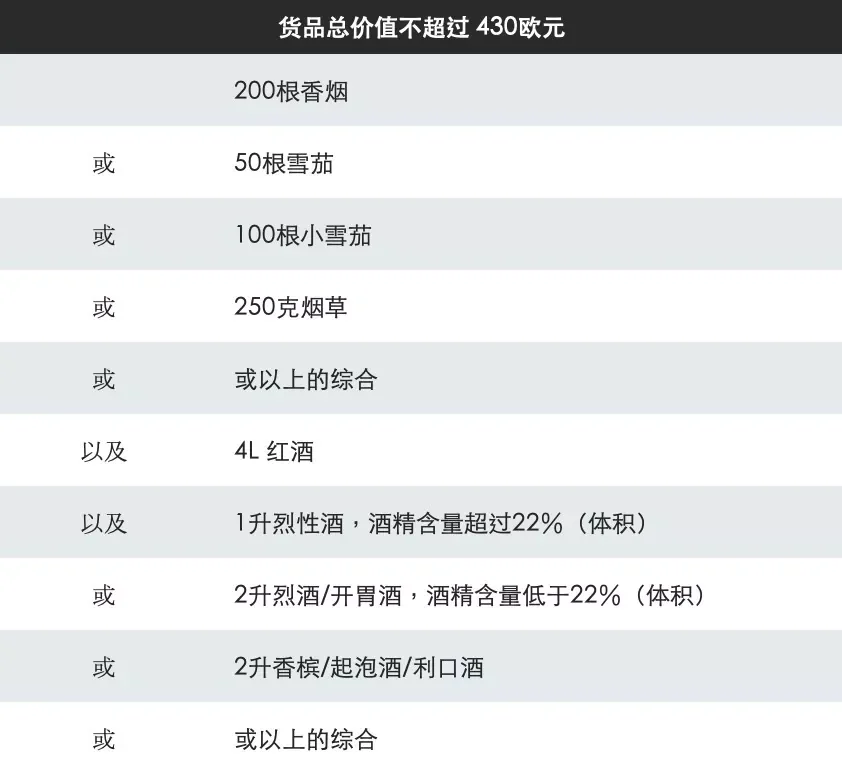

Bandara Internasional Wina (kode bandara **VIE**) terletak sekitar 18 km dari pusat kota dan merupakan hub internasional terbesar Austria — sekaligus salah satu titik transit terpenting antara Eropa tengah dan timur. Bandara ini hanya 16–25 menit dari pusat kota, tetapi kereta ekspres, S-Bahn, bus, dan taksi semuanya mempertukarkan kecepatan dengan harga, dan aula check-in serta pintu masuk keamanan dipisahkan berdasarkan terminal dan tujuan. Mengetahui gedung dan pintu masuk mana yang menjadi milik Anda menghemat waktu nyata.

Panduan ini membahas **terminal dan area gerbang**, **transportasi ke kota**, **proses keberangkatan**, **fasilitas bandara**, dan **merencanakan hari di sekitar penerbangan Anda** dalam lima bagian.

Tata letak bandara lebih sederhana daripada tampilannya: terminal berada di bawah satu atap, keberangkatan di lantai atas dan kedatangan di lantai bawah, dan pintu masuk keamanan dikelompokkan berdasarkan gerbang. Yang benar-benar perlu diputuskan sebelumnya ada tiga hal — gedung mana yang digunakan penerbangan Anda, bagaimana Anda masuk dari kota, dan berapa banyak waktu yang disisakan untuk check-in dan keamanan. Setelah itu dipastikan, penitipan bagasi, batas bea cukai, dan penukaran mata uang dapat menunggu sampai Anda tiba.

## 1. Terminal dan area gerbang

Bandara Wina memiliki tiga terminal yang digunakan — **Terminal 1, Terminal 1A, dan Terminal 3** — berjajar di bawah satu atap, sehingga Anda dapat berjalan di antaranya. Ekstensi SKYLINK di Terminal 3 dibuka pada 2012 dan dapat menampung pesawat sebesar Airbus A380; ini adalah gedung utama untuk penerbangan jarak jauh.

Bandara ini dioperasikan oleh Flughafen Wien AG, dengan layanan penumpang, penanganan bagasi, dan penanganan darat dibagi antara Vienna Airport, Swissport, Austrian Airlines, dan lainnya. Konter check-in dialokasikan berdasarkan maskapai, jadi pastikan **terminal mana** yang digunakan penerbangan Anda — saat ini Terminal 1, Terminal 1A, atau Terminal 3. Materi bandara lama masih memakai nama “Terminal 2” untuk suatu lokasi, tetapi lokasi itu tidak lagi menangani check-in.

### Lima area gerbang: B, C, D, F, dan G

Gerbang dikelompokkan menjadi lima pier, dan kelompoknya menentukan pintu masuk keamanan mana yang Anda gunakan dan apakah Anda melewati pemeriksaan paspor. Pier D dulunya disebut Hall A dan dikenal sebagai pier timur; pier C adalah pier barat.

| Pier | Gerbang | Koneksi ke gedung utama | Penerbangan |
| --- | --- | --- | --- |
| B (sisi Terminal 1) | B22–B43 | Bus | Penerbangan Schengen Eropa |
| C (pier barat, sisi Terminal 1) | C31–C42, dengan C35–C41 sebagai gerbang transit | Garbarata | Sebagian besar Schengen, beberapa internasional |
| C (pier barat, sisi Terminal 1) | C71–C75 | Bus, dicapai melalui gerbang C31 | Hanya Schengen |
| D (pier timur, dahulu Hall A) | D21–D29 | Garbarata | Penerbangan internasional |
| D (pier timur, dahulu Hall A) | D31–D37, D61–D70 | Bus | Penerbangan internasional |
| F, G (Terminal 3) | Gerbang F dan G | Garbarata | Schengen (F) dan non-Schengen (G) |

Gerbang dengan jet bridge langsung menuju pesawat; gerbang yang ditandai sebagai gerbang bus berarti turun ke lantai bawah dan naik shuttle, yang perlu diperhitungkan dalam waktu boarding Anda. C71–C75 adalah kelompok gerbang bus terpisah yang dicapai melalui gerbang C31, jadi sediakan waktu berjalan dan menunggu ekstra jika Anda berangkat dari sana.

### Transit internasional: ganti pesawat tanpa masuk Austria

Jika Wina hanya persinggahan, **transit internasional tidak mengharuskan masuk Austria**. Tiba di pier C dengan penerbangan internasional, ikuti tanda turun ke **Transitzone** di lantai dasar dan naik bus shuttle ke pier D untuk penerbangan internasional lanjutan Anda. Tiba di pier D dan melanjutkan dengan penerbangan internasional lain, Anda melakukan transit yang sama di dalam pier D menggunakan Transitzone dan bus shuttle. Di pier D, area transit dan area pemeriksaan paspor berada di pintu masuk aula serta di gerbang jet bridge dan gerbang bus — ikuti tanda “Transfer”.

## 2. Masuk ke kota dan kembali

Ada lima cara masuk ke Wina dari bandara: **City Airport Train** paling cepat, **bus bandara** mencakup pusat kota dan stasiun barat, **S-Bahn S7 dan kereta Railjet** memberikan nilai terbaik, **taksi** cocok untuk kedatangan larut dan bagasi berat, dan **persewaan mobil** cocok untuk perjalanan darat yang dimulai di Wina. Rute, waktu, dan tarif di bawah ini sesuai yang diterbitkan bandara dan operator; periksa situs operator pada hari Anda bepergian.

Jika Anda hanya ingin kesimpulannya: naik **CAT** saat waktu penting dan Anda enggan memikirkan pergantian; naik **S7** saat anggaran menjadi prioritas dan sepuluh menit ekstra tidak masalah; naik **Railjet** saat etape berikutnya adalah kereta jarak jauh domestik; naik **bus** jika Anda menginap ke arah Westbahnhof atau Donauzentrum; naik **taksi** setelah mendarat larut dengan bagasi berat. Tabel membandingkannya; bagian di bawah membahas masing-masing secara bergiliran.

| Pilihan | Ke pusat kota | Tarif sekali jalan | Paling cocok untuk |
| --- | --- | --- | --- |
| City Airport Train (CAT) | 16 menit ke Wien Mitte | €14,90 | Waktu mendesak, tanpa pergantian |
| S7 S-Bahn | sekitar 25 menit ke Wien Mitte | sekitar €5 | Anggaran prioritas, lebih lambat tidak masalah |
| Railjet | 15 menit ke Wien Hauptbahnhof | Tarif ÖBB hari itu | Sambungan ke kereta jarak jauh domestik |
| Bus bandara | 20–40 menit tergantung halte | sekitar €8 | Menginap ke arah Westbahnhof atau Donauzentrum |
| Taksi | sekitar 20–30 menit | Berdasarkan argo | Kedatangan larut, rombongan, bagasi berat |

### 1. City Airport Train (CAT) — tercepat

City Airport Train berjalan tanpa henti dari bandara ke **Wien Mitte (Landstraße)** di pusat kota dalam **16 menit**, menjadikannya cara masuk yang paling tidak membuat stres — lalu lintas jalan sama sekali bukan faktor.

- **Jam operasi:** 05:37–23:29 (pusat kota → bandara); 06:09–23:39 (bandara → pusat kota), kira-kira setiap 30 menit.
- **Halte:** bandara ↔ Wien Mitte, sekitar **10 menit** berjalan kaki dari Katedral St. Stephen.
- **Tarif:** €14,90 sekali jalan, dengan tiket pulang-pergi yang lebih murah. Tiket transportasi kota Wina dan Vienna City Card **tidak** berlaku di CAT; Anda perlu tiket terpisah.
- **Tiket:** aula kedatangan memiliki konter CAT khusus tempat Anda dapat membeli tiket dan menanyakan layanan CAT apa pun.
- **Check-in kota untuk bagasi:** di terminal CAT di pusat kota Anda dapat check-in dan mengambil boarding pass, di konter berpetugas atau kios swalayan, dari 24 jam hingga 75 menit sebelum keberangkatan.

### 2. Bus bandara — cakupan terluas

Bus bandara (Vienna Airport Lines / Postbus) menghubungkan bandara ke hub transportasi utama Wina, dan tiga rute kota di antaranya mencakup setiap jalur metro. Layanan menuju Wien Westbahnhof dan Wien Hauptbahnhof beroperasi **setiap 30 menit**; rute bandara ↔ Morzinplatz/Schwedenplatz beroperasi **sepanjang waktu** dan hanya memakan waktu **20 menit**.

- **Tarif:** sekitar €8 sekali jalan, dibeli di dalam bus atau di konter.
- **Rute dan halte:** lihat tabel di bawah.

| Tujuan | Jalur bus | Waktu perjalanan |
| --- | --- | --- |
| Wien Morzinplatz/Schwedenplatz | Vienna Airport Lines | 20 menit |
| Wien Donauzentrum (via VIC) | Vienna Airport Lines | 40 menit |
| Wien Westbahnhof (via Hauptbahnhof) | Vienna Airport Lines | 40 menit |
| Wien Erdberg (VIB) | AirLiner | 15 menit |
| Graz (via Pinggau) | Dr. Richard / FlixBus | 2 jam 40 menit |
| Münchendorf (via Fischamend) | Postbus | 50 menit |
| Ebreichsdorf (via Gramatneusiedl) | Postbus | 73 menit |
| Neusiedl a. See (via Bruck/Leitha) | Postbus | 70 menit |

### 3. Bus jarak jauh — menuju ibu kota tetangga

Untuk Bratislava, Budapest, Praha, atau Brno, bus dari bandara sering lebih langsung daripada kereta, dan banyak yang berangkat dari bandara — praktis jika Wina adalah persinggahan dalam perjalanan ke tempat lain.

| Negara | Tujuan | Operator |
| --- | --- | --- |
| Bulgaria | Sofia | Flixbus |
| Ceko | Brno, Praha | RegioJet |
| Hungaria | Budapest, Győr | FlixBus |
| Hungaria | Budapest | RegioJet |
| Polandia | Przemyśl | FlixBus |
| Polandia | Warsawa | LeoExpress |
| Polandia | Wrocław | FlixBus |
| Rumania | Sibiu | FlixBus |
| Slowakia | Bratislava | Slovak Lines / FlixBus / RegioJet |
| Slowakia | Prešov, Košice | Eurobus |
| Slovenia | Ljubljana | FlixBus |

### 4. Kereta S-Bahn dan ÖBB — nilai terbaik

Untuk bepergian dengan harga tiket kota, **S7** S-Bahn adalah jawabannya: sekitar **25 menit** dari bandara ke Wien Mitte, dengan tarif kira-kira sepertiga tarif CAT, dan tiketnya kemudian mencakup metro dan trem di kota.

Kereta Railjet ÖBB menghubungkan bandara ke tempat-tempat yang jauh lebih luar: langsung ke Wien Hauptbahnhof (15 menit), St. Pölten, Linz, Salzburg, Innsbruck, Graz, dan Klagenfurt, dengan layanan lintas batas ke Brno, Praha, Győr, dan Budapest. Di Wien Hauptbahnhof (Stasiun Pusat Wina) Anda dapat berganti untuk banyak tujuan lain.

- **Tarif:** sekitar €5 sekali jalan dengan S7 (asosiasi transportasi VOR menetapkan harga berdasarkan zona, dan bandara berada di luar zona inti Wina — jika Anda sudah memegang tiket kota, Anda hanya membayar tambahan bagian bandara).
- **Tiket:** konter ÖBB berada di aula kedatangan bandara, tidak jauh berjalan, dan tiket juga dijual di mesin ÖBB serta di aplikasi ÖBB.
- **Jadwal:** lihat tabel di bawah; pengumuman ÖBB dan VOR untuk hari itu yang berlaku.

| Tujuan | Jalur | Waktu perjalanan |
| --- | --- | --- |
| Wien Mitte | Schnellbahn S7 | 25 menit |
| Wien Hauptbahnhof | Railjet | 15 menit |
| St. Pölten Hbf | Railjet | 55 menit |
| Linz Hbf | Railjet | 1 jam 41 menit |
| Salzburg Hbf | Railjet | 2 jam 49 menit |
| Innsbruck Hbf | Railjet | 4 jam 40 menit |
| Graz Hbf | Railjet * | 3 jam 00 menit |
| Klagenfurt Hbf | Railjet ** | 4 jam 17 menit |
| Brno | Railjet ** | 2 jam 03 menit |
| Praha | Railjet ** | 4 jam 34 menit |
| Győr | Railjet ** | 1 jam 50 menit |
| Budapest | Railjet ** | 2 jam 59 menit |

Layanan bertanda \* dan \*\* biasanya memerlukan pergantian kereta di Wien Hauptbahnhof; periksa jadwal ÖBB untuk hari itu.

### 5. Taksi

Naik taksi dari tempat pangkalan di luar aula kedatangan, atau gunakan kendaraan yang dikirim oleh meja “City Transfer”; Anda juga dapat memesannya melalui telepon sebelumnya.

| Perusahaan taksi | Telepon |
| --- | --- |
| Airport Driver | +43-1-22822 |
| Airport Services | +43-1-7007-33151 |
| ATS Airport Transfer Service | +43-1-7007-35905 |
| Flughafentaxi ttc | +43-1-7007-33141 |
| 40100 | +43-1-40100 |

### 6. Persewaan mobil

Meja persewaan berkumpul di **level 0 parkir bertingkat P4**, tempat Hertz, Sixt, Europcar, Avis, Budget, Enterprise, Alamo, dan National semuanya memiliki konter — Anda langsung berkendara keluar ke jaringan jalan tol.

| Perusahaan persewaan | Reservasi |
| --- | --- |
| Alamo | +43-1-7007-33432 |
| Avis | +43-1-7007-32700 |
| Buchbinder | +43-1-7007-33316 |
| Budget | +43-1-7007-32700 |
| Enterprise | +43-1-7007-33432 |
| Europcar | +43-1-7007-32812 |
| Flizzr | +43-1-7007-36517 |
| Hertz | +43-1-7007-32661 |
| Megadrive | +43-1-7007-33316 |
| National | +43-1-7007-33432 |
| Payless | +43-1-7007-32700 |
| Sixt | +43-1-7007-36517 |
| Thrifty | +43-1-7007-32661 |

## 3. Keberangkatan: check-in, penyerahan bagasi, keamanan

Urutan standarnya adalah **check-in → serahkan bagasi → keamanan → (penerbangan non-Schengen) pemeriksaan paspor → boarding**. Tiba 2 jam sebelum keberangkatan Schengen dan 3 jam sebelum penerbangan non-Schengen atau jarak jauh; tambahkan setengah jam pada musim puncak dan sekitar hari libur nasional.

Tambahan satu jam untuk penerbangan jarak jauh bukan sekadar tambahan. Wina memisahkan **arus Schengen dan non-Schengen** sepenuhnya: penerbangan Schengen melewati keamanan dan berjalan ke gerbang, sedangkan penerbangan non-Schengen mengantre lagi untuk pemeriksaan paspor di bagian lain gedung, setelah keamanan. Check-in, penyerahan bagasi, keamanan, pemeriksaan paspor, dan berjalan ke gerbang semuanya bertambah, dan menyimpan paspor, visa, boarding pass, serta tanda terima bagasi di satu kantong menghemat pencarian di setiap pos pemeriksaan.

### 1. Check-in

- **Check-in mandiri:** gunakan kartu kredit atau kartu Miles & More, nama Anda, referensi pemesanan, atau cukup pindai paspor untuk mendapatkan boarding pass dari mesin swalayan. Jika Anda memiliki bagasi untuk diserahkan, mesin memberi tahu konter penyerahan bagasi mana yang harus digunakan.
- **Di konter:** tergantung penerbangan Anda, check-in dan ambil boarding pass di Terminal 1, Terminal 1A, atau Terminal 3.
- **Check-in online:** sebagian besar maskapai menawarkannya di situs web atau aplikasi mereka, yang menghemat antrean di bandara; cetak boarding pass Anda di sana. Jika Anda bepergian dengan bagasi untuk diserahkan, tanyakan dulu di konter yang sesuai.
- **Check-in di Wien Mitte:** beberapa maskapai menawarkan check-in di terminal City Airport Train di Wien Mitte, tempat Anda menunjukkan paspor dan menerima boarding pass. Untuk daftar maskapai terkini, lihat cityairporttrain.com atau telepon +43 1 25250.

### 2. Penyerahan bagasi mandiri

Penyerahan bagasi mandiri di Bandara Wina memadatkan proses menjadi empat langkah: **pindai boarding pass → tempelkan label pada bagasi → simpan tanda terima bagasi → lanjut ke keamanan.**

Di sabuk swalayan di samping pulau check-in, pindai boarding pass untuk mengonfirmasi penerbangan, tempelkan label yang dicetak pada pegangan koper, letakkan bagasi di sabuk, dan simpan tanda terima bagasi — jika bagasi tersesat, itu satu-satunya catatan yang Anda miliki.

### 3. Catatan bagasi

- Untuk **bagasi kelebihan berat atau hewan peliharaan**, gunakan **konter bagasi ukuran besar di Terminal 1 atau Terminal 3**.
- Tempelkan nama dan alamat Anda pada bagasi dan lepaskan label lama — barcode lama membingungkan sistem penyortiran dan membuat bagasi salah rute lebih mungkin terjadi.
- Bawa barang berharga, dokumen penting, dan obat-obatan bersama Anda daripada menyerahkannya sebagai bagasi.
- Amankan bagasi dengan tali atau gembok jika perlu, atau gunakan layanan pembungkusan bagasi bandara (lihat bagian fasilitas di bawah).

### 4. Keamanan dan pemeriksaan paspor

Pintu masuk keamanan dipisahkan berdasarkan kelompok gerbang, dan salah memilih berarti berjalan jauh:

- **Pintu masuk keamanan 2:** untuk keberangkatan dari gerbang B, C, dan D.
- **Pintu masuk keamanan 3:** untuk keberangkatan dari gerbang F dan G.

Setelah pemeriksaan keamanan ada toko dan restoran di area keberangkatan; teman dan keluarga yang mengantar tidak dapat melewati bersama Anda.

- Untuk **negara Schengen**, gunakan gerbang **B, C, dan F**.
- Untuk **negara non-Schengen**, gunakan gerbang **D dan G**, dan Anda harus melewati **pemeriksaan paspor** sebelum melanjutkan ke gerbang.

Pelancong dengan paspor non-UE biasanya juga perlu menyelesaikan **registrasi EES** (sidik jari dan gambar wajah) di kios swalayan sebelum pemeriksaan paspor. Pada masuk pertama, ini memakan beberapa menit ekstra — perhitungkan dalam koneksi yang ketat.

## 4. Fasilitas bandara dan informasi praktis

Fasilitas Wina mengikuti aturan sederhana: **level keberangkatan menangani check-in dan keamanan, level kedatangan menangani bagasi, informasi, dan transportasi darat**, dan restoran, toko, serta tempat duduk terkonsentrasi di sisi udara. Penitipan bagasi, stempel bea cukai, dan barang hilang semuanya berada di level kedatangan 0 dan sekitar Terminal 1; setelah melewati keamanan, hanya layanan sisi udara yang dapat dijangkau. Bagian di bawah diurutkan dari yang paling sering hingga paling jarang digunakan.

### Informasi dan layanan bagasi

Ada **tiga meja informasi**: dua di level keberangkatan Terminal 1 dan 3, dan satu di aula kedatangan Terminal 3. Pertanyaan tentang bagasi dan fasilitas semuanya dapat dijawab di sini.

**Pusat layanan bagasi** di area check-in Terminal 1 dan 3 buka **00:00–24:00** dan menawarkan:

| Layanan | Harga | Catatan |
| --- | --- | --- |
| Penitipan bagasi | €4 per barang per hari; barang ukuran besar €8 per barang per hari | Barang dapat disimpan hingga 6 bulan |
| Pembungkusan bagasi | €12 per barang | Bagasi Anda disegel dengan film pelindung terhadap kerusakan, kelembapan, dan pencurian; tersedia di area bagasi Terminal 1 dan 3 |
| Pengiriman bagasi | mulai €15 untuk hingga 5 barang, €3 untuk setiap barang tambahan | Pesan setidaknya 72 jam sebelumnya dengan mengirim email ke service@viennaairport.com, atau pesan langsung di toko online bandara |
| Kotak simpan aman | €6 per hari | Untuk dokumen, kunci, dan sejenisnya; senjata, bahan peledak, barang mudah terbakar atau berbahaya lainnya, serta barang mudah rusak atau berbau menyengat tidak boleh disimpan |
| Lemari pakaian | €2 per set per hari | Satu set adalah jaket atau mantel, sepatu, perhiasan, sarung tangan, dan syal |

### Pusat medis, ruang doa, dan barang hilang

- **Pusat medis:** Terminal 1, koridor level 1, di seberang apotek, buka **07:00–19:00**. Vaksinasi meliputi demam kuning, tifus, rabies, hepatitis A dan B (juga untuk anak-anak), malaria, ensefalitis bawaan kutu, influenza, vaksin kombinasi difteri/polio/tetanus/pertusis, penyakit meningokokus, dan ensefalitis Jepang — telepon lebih dulu untuk memeriksa ketersediaan.
- **Ruang doa:** ada ruang doa di terminal; tanyakan lokasinya di meja informasi.
- **Barang hilang:** kantor barang hilang di level 0 Terminal 1, atau meja informasi di aula kedatangan Terminal 3.
- **Mengembalikan barang hilang melalui pos:** gunakan layanan pengiriman dan pengemasan Mail Boxes Etc. di A-2320 Schwechat, atau kurir pilihan Anda; alamat kontak adalah mbe0045@mbe.at. Barang yang disimpan lebih dari 8 hari dikenakan biaya penyimpanan, dan **pembayaran harus lunas sebelum barang dikirim**: untuk pembayaran kartu, faktur dan tautan pembayaran dikirim melalui email; untuk transfer bank, masukkan nomor faktur di kolom referensi pembayaran, jika tidak pembayaran Anda tidak dapat diidentifikasi.

### Bea cukai dan batas bebas pajak

Pelancong yang masuk Austria dari luar UE dapat membawa barang berikut dalam batas bebas pajak. **Pelancong dalam perjalanan yang sama tidak dapat menggabungkan batas mereka** — aturan yang sering terlewat:

| Kategori | Batas bebas pajak |
| --- | --- |
| Total nilai barang | hingga **€430** (hanya pelancong udara; €300 untuk kedatangan darat) |
| Rokok | 200 |
| atau cerutu | 50 |
| atau cerutu kecil | 100 |
| atau tembakau | 250 g |
| atau kombinasi di atas | — |
| ditambah anggur | 4 L |
| ditambah minuman keras di atas 22% alkohol berdasarkan volume | 1 L |
| atau minuman keras atau aperitif di bawah 22% | 2 L |
| atau anggur bersoda atau likueur | 2 L |
| atau kombinasi di atas | — |

- **Batas usia:** penumpang di bawah 15 tahun memiliki batas €150; batas alkohol dan tembakau berlaku mulai usia 17 tahun.
- **Deklarasi uang tunai:** membawa lebih dari **€10.000** dalam bentuk uang tunai atau alat pembayaran lain (cek perjalanan, batangan emas, koin emas, dan sejenisnya) masuk atau keluar UE harus dideklarasikan ke bea cukai; formulir tersedia di konter bea cukai atau kantor bea cukai.
- **Stempel pengembalian pajak ekspor:** kantor bea cukai untuk ekspor berada di level kedatangan 0.

### Penukaran mata uang dan ATM

Meja penukaran mata uang bandara dijalankan oleh **Interchange**, dengan cabang di gerbang, di aula kedatangan, dan di terminal, umumnya buka dari pukul 5 pagi hingga larut malam; ATM tersebar lebih luas lagi, dari aula kedatangan hingga pier gerbang.

| Lokasi | Jam | Akses |
| --- | --- | --- |
| Gerbang D | 05:00–00:00 | Hanya penumpang |
| Gerbang F | 05:00–22:00 | Hanya penumpang |
| Gerbang G | 05:00–23:00 | Hanya penumpang |
| Plaza | 06:00–23:00 | Hanya penumpang |
| Terminal 3 | 05:00–22:00 | Hanya penumpang |
| Aula kedatangan (3 meja) | 05:00–22:00, satu hingga 23:00 | Semua orang |
| Terminal 2 | 06:00–20:00 | Semua orang |
| Office Park 1 | 05:00–22:00 | Semua orang |

Meja-meja itu menawarkan penukaran mata uang, pengembalian pajak, dan transfer internasional; beberapa meja di aula kedatangan serta Terminal 2 dan 3 juga menjual kartu telepon.

ATM berada di aula kedatangan, gerbang C/D/F/G, Plaza, parkir mobil 8, area publik Terminal 1, 2, dan 3, Office Park 1, Office Park 3, dan area VIP/GAC. ATM di aula kedatangan, parkir mobil, terminal, dan gedung perkantoran terbuka untuk semua orang; ATM di gerbang dan Plaza hanya untuk penumpang.

### Wi-Fi, daya, dan kartu SIM

- **Wi-Fi:** mencakup seluruh terminal, sehingga Anda dapat memeriksa penerbangan dan mengirim pesan ke rumah sambil menunggu.
- **Daya dan kerja:** gerbang F dan G memiliki ruang kerja khusus tempat Anda dapat mencolokkan perangkat dan menggunakan laptop.
- **Kartu SIM dan perbaikan:** Mr. Mobile menawarkan perbaikan ponsel, tablet, dan laptop, pinjaman ponsel, serta kartu SIM prabayar.

## 5. Merencanakan hari di sekitar penerbangan Anda

Semua di atas bermuara pada tiga perjalanan. Masing-masing memiliki anggaran waktu berbeda, tetapi berbagi satu aturan: **pastikan terminal dan gerbangnya dulu, baru pilih transportasinya.**

### Tiba dan langsung menuju kota

Untuk pendaratan siang hari dengan bagasi ringan, S7 adalah cara termudah masuk: ikuti tanda S-Bahn turun ke peron, beli tiket ke Wien Mitte, dan sekitar dua puluh lima menit kemudian Anda sudah berada di metro. Naik CAT jika waktu Anda terbatas atau bepergian dengan anak-anak; setelah mendarat larut, antre taksi di luar kedatangan daripada mengejar kereta terakhir untuk menghemat beberapa euro.

### Mengejar penerbangan dari kota

CAT dan S7 sama-sama berangkat dari Wien Mitte; CAT sekitar sepuluh menit lebih cepat dan berbiaya lebih dari dua kali lipat. Waktu yang benar-benar penting adalah **di bandara**: hitung mundur dari gerbang melalui keamanan, penyerahan bagasi, dan check-in — 2 jam untuk penerbangan Schengen, 3 jam untuk non-Schengen. Menambahkan setengah jam di kota jauh kurang berguna daripada menambahkannya di bandara. Musim puncak, hari libur nasional, dan antrean pagi hari masing-masing layak mendapat tambahan setengah jam.

### Transit di Wina

Koneksi internasional ke internasional tidak mengharuskan masuk Austria: ikuti tanda Transfer melalui zona transit. Namun, jika penerbangan lanjutan adalah Schengen, Anda benar-benar masuk dan melewati keamanan lagi, jadi anggarkan koneksi seperti kedatangan. Dua jam antar penerbangan sudah nyaman; sediakan tiga jam jika Anda berganti terminal atau perlu mengambil dan memeriksa ulang bagasi.

## Tautan terkait

- **Di situs ini**: [Bandara Internasional Wina (VIE)](/airport/VIE), [Austria (AT)](/country/AT)
- **Wikipedia**: [Bandara Internasional Wina](https://en.wikipedia.org/wiki/Vienna_International_Airport)
- **Baidu Baike**: [Bandara Internasional Wina](https://baike.baidu.com/item/%E7%BB%B4%E4%B9%9F%E7%BA%B3%E5%9B%BD%E9%99%85%E6%9C%BA%E5%9C%BA)

Sumber gambar: Vienna Airport. Tarif, jam buka, dan lokasi konter sesuai yang diterbitkan bandara dan operator; periksa situs web mereka pada hari Anda bepergian.
