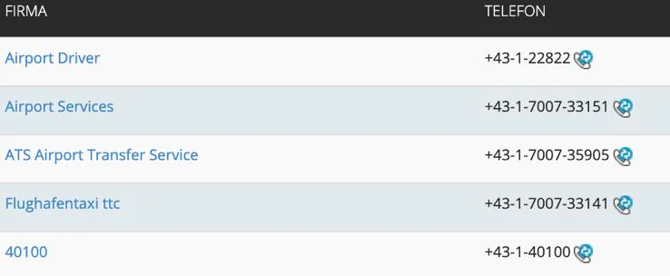

ウィーン国際空港（空港コード**VIE**）は市中心部から約18kmに位置し、オーストリア最大の国際ハブであり、中欧・東欧を結ぶ最も重要な乗り継ぎ地点の一つです。空港から市内まではわずか16〜25分ですが、特急列車、Sバーン、バス、タクシーは速さと価格のバランスがそれぞれ異なり、チェックインロビーと保安検査口もターミナルと目的地によって分かれています。自分が使う建物と入口を把握しておけば、実際に時間を節約できます。

このガイドでは、**ターミナルとゲートエリア**、**市内への交通**、**出発の手順**、**空港施設**、**飛行機に合わせた一日の計画**の5部構成で説明します。

空港の配置は見た目よりシンプルです。ターミナルは一つの屋根の下に並び、出発は上階、到着は下階、保安検査口はゲートごとにまとまっています。事前に決めるべきことは3つだけです。自分の便がどの建物を使うか、市内からどうやって来るか、チェックインと保安検査にどれだけ時間を残すか。これが決まれば、手荷物預かり、税関の免税範囲、両替は現地に着いてからで間に合います。

## 1. ターミナルとゲートエリア

ウィーン空港には現在3つのターミナル、**ターミナル1、ターミナル1A、ターミナル3**があり、一つの屋根の下に並んでいるため徒歩で移動できます。ターミナル3の増築部SKYLINKは2012年に開業し、エアバスA380のような大型機も受け入れられます。長距離路線の主要な建物です。

空港はFlughafen Wien AGが運営し、旅客サービス、手荷物処理、グランドハンドリングはウィーン空港、Swissport、オーストリア航空などが分担しています。チェックインカウンターは航空会社ごとに割り当てられるため、自分の便が**どのターミナル**を使うか確認してください。現在はターミナル1、ターミナル1A、ターミナル3のいずれかです。古い空港資料には「ターミナル2」という名称が残っていますが、現在チェックインは行っていません。

### 5つのゲートエリア：B、C、D、F、G

ゲートは5つのピアに分かれ、そのグループによって使う保安検査口と、入国審査を通るかどうかが決まります。ピアDは以前ホールAと呼ばれ、東ピアとして知られています。ピアCは西ピアです。

| ピア | ゲート | 本館への接続 | 便 |
| --- | --- | --- | --- |
| B（ターミナル1側） | B22〜B43 | バス | 欧州シェンゲン域内便 |
| C（西ピア、ターミナル1側） | C31〜C42（うちC35〜C41は乗り継ぎゲート） | ボーディングブリッジ | 主にシェンゲン域内、一部国際線 |
| C（西ピア、ターミナル1側） | C71〜C75 | バス。ゲートC31経由 | シェンゲン域内のみ |
| D（東ピア、旧ホールA） | D21〜D29 | ボーディングブリッジ | 国際線 |
| D（東ピア、旧ホールA） | D31〜D37、D61〜D70 | バス | 国際線 |
| F、G（ターミナル3） | F、Gゲート | ボーディングブリッジ | シェンゲン域内（F）と域外（G） |

ボーディングブリッジ付きのゲートはそのまま機内へ搭乗できます。バスゲートと表示されたゲートでは、下の階へ降りてシャトルバスに乗るため、その時間も搭乗時刻に含めて考えてください。C71〜C75はゲートC31を通って向かう別のバスゲート群なので、そこから出発する場合は徒歩と待ち時間を多めに見てください。

### 国際線の乗り継ぎ：オーストリアに入国せずに乗り換える

ウィーンが経由地にすぎない場合、**国際線から国際線への乗り継ぎではオーストリアに入国する必要はありません**。国際線でピアCに到着したら、表示に従って1階の**Transitzone**へ降り、シャトルバスで後続の国際線が出るピアDへ向かいます。ピアDに到着して別の国際線へ乗り継ぐ場合も、ピアD内のTransitzoneとシャトルバスを使って同じように乗り継ぎます。ピアDでは、トランジットエリアと入国審査エリアがホールの入口、ボーディングブリッジ、バスゲートのそばにあります。「Transfer」の表示に従ってください。

## 2. 市内へのアクセスと帰り方

空港からウィーン市内へは5つの方法があります。**シティ・エアポート・トレイン（CAT）**が最速、**空港バス**が市中心部と西駅をカバー、**S7 Sバーンとレイルジェット**が最も割安、**タクシー**が深夜到着や重い荷物に向き、**レンタカー**がウィーン発のドライブ旅行に向いています。以下の路線、所要時間、運賃は空港と各運行事業者の発表によるものです。旅行当日は事業者のサイトで確認してください。

結論だけ知りたい場合。時間が大切で乗り換えを考えたくないなら**CAT**、予算優先で10分余分にかかってもよいなら**S7**、次の区間が国内の長距離列車なら**レイルジェット**、西駅やドナウツェントルム方面に泊まるなら**バス**、遅い時間の到着で荷物が重いなら**タクシー**です。下表で比較し、以下の各節で順に説明します。

| 手段 | 中心部まで | 片道運賃 | 向いている人 |
| --- | --- | --- | --- |
| シティ・エアポート・トレイン（CAT） | Wien Mitteまで16分 | 14.90ユーロ | 時間に余裕がなく、乗り換えを避けたい |
| S7 Sバーン | Wien Mitteまで約25分 | 約5ユーロ | 予算優先、遅くてもよい |
| レイルジェット | Wien Hauptbahnhofまで15分 | その日のÖBB運賃 | 国内の長距離列車に乗り継ぐ |
| 空港バス | 停留所により20〜40分 | 約8ユーロ | 西駅やドナウツェントルム方面に泊まる |
| タクシー | 約20〜30分 | メーター制 | 深夜到着、グループ、重い荷物 |

### 1. シティ・エアポート・トレイン（CAT）— 最速

シティ・エアポート・トレインは空港から市中心部の**Wien Mitte（Landstraße）**まで**16分**でノンストップ運行し、道路渋滞の影響を受けない最も気楽な方法です。

- **運行時間：** 05:37〜23:29（市中心部→空港）、06:09〜23:39（空港→市中心部）。おおむね30分間隔。
- **停車駅：** 空港↔Wien Mitte。シュテファン大聖堂から徒歩約**10分**。
- **運賃：** 片道14.90ユーロ。往復券は割安です。ウィーンの市内交通券とウィーン・シティ・カードはCATでは**使えません**。別途切符が必要です。
- **切符：** 到着ホールにCAT専用カウンターがあり、切符の購入やCATのサービスについて相談できます。
- **市内での手荷物チェックイン：** 市中心部のCATターミナルでは、有人カウンターかセルフキオスクで、出発の24時間前から75分前までチェックインと搭乗券の受け取りができます。

### 2. 空港バス — 最も広いカバー範囲

空港バス（Vienna Airport Lines / Postbus）は空港とウィーンの主要交通ハブを結び、3つの市内路線で地下鉄の全路線をカバーします。Wien WestbahnhofとWien Hauptbahnhof方面は**30分間隔**、空港↔Morzinplatz/Schwedenplatz線は**24時間運行**で所要**20分**です。

- **運賃：** 片道約8ユーロ。車内またはカウンターで購入します。
- **路線と停留所：** 下表のとおりです。

| 行き先 | バス路線 | 所要時間 |
| --- | --- | --- |
| Wien Morzinplatz/Schwedenplatz | Vienna Airport Lines | 20分 |
| Wien Donauzentrum（VIC経由） | Vienna Airport Lines | 40分 |
| Wien Westbahnhof（Hauptbahnhof経由） | Vienna Airport Lines | 40分 |
| Wien Erdberg（VIB） | AirLiner | 15分 |
| グラーツ（Pinggau経由） | Dr. Richard / FlixBus | 2時間40分 |
| Münchendorf（Fischamend経由） | Postbus | 50分 |
| Ebreichsdorf（Gramatneusiedl経由） | Postbus | 73分 |
| Neusiedl a. See（Bruck/Leitha経由） | Postbus | 70分 |

### 3. 長距離コーチ — 近隣の首都へ

ブラチスラバ、ブダペスト、プラハ、ブルノへは、空港発のコーチが鉄道より直行的なことが多く、多くは空港を起点にしているため、ウィーンが途中の経由地の場合に便利です。

| 国 | 行き先 | 運行事業者 |
| --- | --- | --- |
| ブルガリア | ソフィア | Flixbus |
| チェコ | ブルノ、プラハ | RegioJet |
| ハンガリー | ブダペスト、ジェール | FlixBus |
| ハンガリー | ブダペスト | RegioJet |
| ポーランド | プシェムィシル | FlixBus |
| ポーランド | ワルシャワ | LeoExpress |
| ポーランド | ヴロツワフ | FlixBus |
| ルーマニア | シビウ | FlixBus |
| スロバキア | ブラチスラバ | Slovak Lines / FlixBus / RegioJet |
| スロバキア | プレショフ、コシツェ | Eurobus |
| スロベニア | リュブリャナ | FlixBus |

### 4. SバーンとÖBBの列車 — 最も割安

市内交通券と同じ価格で移動するなら、**S7** Sバーンが答えです。空港からWien Mitteまで約**25分**、CATの約3分の1の運賃で、切符は市内の地下鉄とトラムにも使えます。

ÖBBのレイルジェットは空港ともっと遠くを結びます。Wien Hauptbahnhofへ直通で15分、St. Pölten、Linz、Salzburg、Innsbruck、Graz、Klagenfurtへも直通し、ブルノ、プラハ、ジェール、ブダペストへの国際列車もあります。Wien Hauptbahnhof（ウィーン中央駅）では多くの目的地へ乗り換えられます。

- **運賃：** S7の片道約5ユーロ（VOR交通連合はゾーン制で、空港はウィーンの中心ゾーン外です。すでに市内交通券を持っている場合は、空港区間の追加運賃だけを払います）。
- **切符：** ÖBBのカウンターは空港到着ホールにあり、少し歩いた場所です。ÖBBの券売機とÖBBアプリでも購入できます。
- **時刻表：** 下表のとおりです。当日のÖBBとVORの案内が最終的な判断基準です。

| 行き先 | 路線 | 所要時間 |
| --- | --- | --- |
| Wien Mitte | Schnellbahn S7 | 25分 |
| Wien Hauptbahnhof | レイルジェット | 15分 |
| St. Pölten Hbf | レイルジェット | 55分 |
| Linz Hbf | レイルジェット | 1時間41分 |
| Salzburg Hbf | レイルジェット | 2時間49分 |
| Innsbruck Hbf | レイルジェット | 4時間40分 |
| Graz Hbf | レイルジェット * | 3時間00分 |
| Klagenfurt Hbf | レイルジェット ** | 4時間17分 |
| ブルノ | レイルジェット ** | 2時間03分 |
| プラハ | レイルジェット ** | 4時間34分 |
| ジェール | レイルジェット ** | 1時間50分 |
| ブダペスト | レイルジェット ** | 2時間59分 |

\*と\*\*の付いた列車は通常、Wien Hauptbahnhofで乗り換えが必要です。当日のÖBB時刻表を確認してください。

### 5. タクシー

到着ホール外のタクシー乗り場から乗るか、「City Transfer」デスクが手配する車を利用します。電話で事前予約することもできます。

| タクシー会社 | 電話 |
| --- | --- |
| Airport Driver | +43-1-22822 |
| Airport Services | +43-1-7007-33151 |
| ATS Airport Transfer Service | +43-1-7007-35905 |
| Flughafentaxi ttc | +43-1-7007-33141 |
| 40100 | +43-1-40100 |

### 6. レンタカー

レンタカーのデスクは**P4立体駐車場の0階**に集まっており、Hertz、Sixt、Europcar、Avis、Budget、Enterprise、Alamo、Nationalのカウンターがあります。そのまま高速道路網へ出られます。

| レンタカー会社 | 予約番号 |
| --- | --- |
| Alamo | +43-1-7007-33432 |
| Avis | +43-1-7007-32700 |
| Buchbinder | +43-1-7007-33316 |
| Budget | +43-1-7007-32700 |
| Enterprise | +43-1-7007-33432 |
| Europcar | +43-1-7007-32812 |
| Flizzr | +43-1-7007-36517 |
| Hertz | +43-1-7007-32661 |
| Megadrive | +43-1-7007-33316 |
| National | +43-1-7007-33432 |
| Payless | +43-1-7007-32700 |
| Sixt | +43-1-7007-36517 |
| Thrifty | +43-1-7007-32661 |

## 3. 出発：チェックイン、手荷物預け、保安検査

標準的な流れは、**チェックイン → 手荷物預け → 保安検査 →（シェンゲン域外便は）入国審査 → 搭乗**です。シェンゲン域内便は出発2時間前、域外便や長距離便は3時間前に到着してください。繁忙期と祝日前後はさらに30分加えます。

長距離便の余分な1時間は、念のための水増しではありません。ウィーンは**シェンゲン域内と域外の流れを完全に分けています**。シェンゲン域内便は保安検査を抜けてゲートへ歩くだけですが、域外便は保安検査の後、建物の別の場所で入国審査に並び直します。チェックイン、手荷物預け、保安検査、入国審査、ゲートまでの徒歩が積み重なるため、パスポート、ビザ、搭乗券、手荷物引換証を一つのポケットにまとめておくと、各チェックポイントで探す手間が省けます。

### 1. チェックイン

- **セルフチェックイン：** クレジットカードかMiles & Moreカード、氏名、予約番号、またはパスポートをスキャンするだけで、セルフ端末から搭乗券を受け取れます。預ける荷物がある場合、端末が使用する手荷物預けカウンターを表示します。
- **カウンター：** 便に応じて、ターミナル1、ターミナル1A、ターミナル3のいずれかでチェックインし、搭乗券を受け取ります。
- **オンラインチェックイン：** ほとんどの航空会社がウェブサイトやアプリで提供しており、空港での行列を避けられます。搭乗券はそこで印刷してください。預ける荷物がある場合は、先に該当カウンターで確認します。
- **Wien Mitteでのチェックイン：** 一部の航空会社はWien Mitteのシティ・エアポート・トレイン・ターミナルでチェックインを提供しており、パスポートを提示して搭乗券を受け取れます。現在の対象航空会社はcityairporttrain.comで確認するか、+43 1 25250へ電話してください。

### 2. セルフ手荷物預け

ウィーン空港のセルフ手荷物預けは、手続きを4つのステップにまとめています。**搭乗券をスキャン → タグを荷物に付ける → 引換証を受け取る → 保安検査へ進む。**

チェックインアイランド横のセルフサービスベルトで、搭乗券をスキャンして便を確認し、印刷されたタグをスーツケースの取っ手に付け、荷物をベルトに載せ、引換証を保管します。荷物が見つからなくなった場合、それが唯一の記録になります。

### 3. 手荷物に関する注意

- **重量超過の荷物やペット**は、**ターミナル1またはターミナル3の大型手荷物カウンター**を利用してください。
- 荷物に氏名と住所を書き、古いタグは外してください。古いバーコードは仕分けシステムを混乱させ、誤配送の可能性を高めます。
- 貴重品、重要書類、薬は預けずに手元に持ってください。
- 必要に応じてストラップや南京錠で荷物を固定するか、空港の手荷物ラッピングサービスを利用してください（下の施設の節を参照）。

### 4. 保安検査と入国審査

保安検査口はゲートグループごとに分かれており、間違えると長く歩くことになります。

- **保安検査口2：** ゲートB、C、Dからの出発者向け。
- **保安検査口3：** ゲートF、Gからの出発者向け。

保安検査の先には出発エリアのショップとレストランがあります。見送りの家族や友人は一緒に通過できません。

- **シェンゲン域内諸国**へはゲート**B、C、F**を使います。
- **シェンゲン域外諸国**へはゲート**D、G**を使い、ゲートへ向かう前に**入国審査**を通る必要があります。

EU以外のパスポートの旅行者は通常、入国審査の前にセルフキオスクで**EES登録**（指紋と顔画像）も済ませる必要があります。初回入国では数分余分にかかるため、乗り継ぎが厳しい場合は時間に含めてください。

## 4. 空港施設と実用情報

ウィーンの施設には簡単な原則があります。**出発階はチェックインと保安検査、到着階は手荷物、案内、地上交通**を担当し、レストラン、ショップ、座席はエアサイドに集中しています。手荷物預かり、税関のスタンプ、忘れ物取扱所はすべて到着階0階とターミナル1周辺にあり、保安検査を抜けた後はエアサイドのサービスしか利用できません。以下の節は利用頻度の高い順に並べています。

### 案内と手荷物サービス

**案内カウンターは3か所**あります。ターミナル1とターミナル3の出発階に2か所、ターミナル3の到着ホールに1か所です。手荷物や施設に関する質問はここで対応できます。

ターミナル1とターミナル3のチェックインエリアにある**手荷物サービスセンター**は**00:00〜24:00**営業しており、次のサービスを提供しています。

| サービス | 料金 | 備考 |
| --- | --- | --- |
| 手荷物預かり | 1個1日4ユーロ、大型品は1個1日8ユーロ | 最長6か月まで保管可能 |
| 手荷物ラッピング | 1個12ユーロ | 破損、湿気、盗難から守る保護フィルムで荷物を包む。ターミナル1と3の手荷物エリアで利用可能 |
| 手荷物配送 | 5個まで15ユーロから、追加1個につき3ユーロ | 72時間前までにservice@viennaairport.comへメールで予約するか、空港のオンラインショップで直接予約 |
| セーフティボックス | 1日6ユーロ | 書類、鍵など向け。武器、爆発物、可燃物その他の危険物、生鮮品や強い臭いのあるものは保管不可 |
| クローク | 1セット1日2ユーロ | 1セットは上着またはコート、靴、宝飾品、手袋、スカーフ |

### 医療センター、礼拝室、忘れ物取扱所

- **医療センター：** ターミナル1の1階通路、薬局の向かい。**07:00〜19:00**営業。ワクチンは黄熱、腸チフス、狂犬病、A型・B型肝炎（小児も可）、マラリア、ダニ媒介性脳炎、インフルエンザ、ジフテリア・ポリオ・破傷風・百日咳の混合ワクチン、髄膜炎菌感染症、日本脳炎など。在庫は事前に電話で確認してください。
- **礼拝室：** ターミナル内に礼拝室があります。場所は案内カウンターで尋ねてください。
- **忘れ物取扱所：** ターミナル1の0階にある忘れ物取扱所、またはターミナル3到着ホールの案内カウンター。
- **忘れ物の郵送：** A-2320 SchwechatのMail Boxes Etc.の配送・梱包サービス、または希望する宅配業者を利用してください。連絡先はmbe0045@mbe.atです。8日を超えて保管された品には保管料がかかり、**発送前に支払いが完了している必要があります**。カード決済の場合は請求書と支払いリンクがメールで届きます。銀行振込の場合は振込参照欄に請求書番号を入れてください。そうしないと入金を特定できません。

### 税関と免税範囲

EU域外からオーストリアに入国する旅行者は、免税範囲内で次のものを持ち込めます。**同じ旅行に参加する旅行者同士でも免税枠を合算できません**。見落とされがちなルールです。

| 区分 | 免税範囲 |
| --- | --- |
| 品物の総額 | **430ユーロ**まで（航空機到着のみ。陸路到着は300ユーロ） |
| 紙巻きたばこ | 200本 |
| または葉巻 | 50本 |
| またはシガリロ | 100本 |
| またはたばこ | 250g |
| または上記の組み合わせ | — |
| 加えてワイン | 4L |
| 加えてアルコール度数22%超の蒸留酒 | 1L |
| または度数22%以下の蒸留酒・食前酒 | 2L |
| またはスパークリングワイン・リキュール | 2L |
| または上記の組み合わせ | — |

- **年齢制限：** 15歳未満の乗客は免税枠が150ユーロです。酒類とたばこの免税枠は17歳から適用されます。
- **現金申告：** **1万ユーロ**を超える現金やその他の支払手段（トラベラーズチェック、金地金、金貨など）をEUに持ち込む、またはEUから持ち出す場合は税関への申告が必要です。用紙は税関カウンターか税関事務所で入手できます。
- **輸出還付のスタンプ：** 輸出用の税関事務所は到着階0階にあります。

### 両替とATM

空港の両替所は**Interchange**が運営しており、ゲート、到着ホール、ターミナル内に支店があります。おおむね午前5時から夜遅くまで営業し、ATMは到着ホールからゲートピアまでさらに広く設置されています。

| 場所 | 営業時間 | 利用者 |
| --- | --- | --- |
| ゲートD | 05:00〜00:00 | 搭乗客のみ |
| ゲートF | 05:00〜22:00 | 搭乗客のみ |
| ゲートG | 05:00〜23:00 | 搭乗客のみ |
| プラザ | 06:00〜23:00 | 搭乗客のみ |
| ターミナル3 | 05:00〜22:00 | 搭乗客のみ |
| 到着ホール（3デスク） | 05:00〜22:00、1か所は23:00まで | 誰でも |
| ターミナル2 | 06:00〜20:00 | 誰でも |
| Office Park 1 | 05:00〜22:00 | 誰でも |

各デスクでは両替、税金還付、国際送金を扱っています。到着ホールとターミナル2、3の一部デスクではプリペイドSIMカードも販売しています。

ATMは到着ホール、ゲートC/D/F/G、プラザ、8番駐車場、ターミナル1、2、3の公共エリア、Office Park 1、Office Park 3、VIP/GACエリアにあります。到着ホール、駐車場、ターミナル、オフィスビルのATMは誰でも利用できます。ゲートとプラザのATMは搭乗客専用です。

### Wi-Fi、電源、SIMカード

- **Wi-Fi：** ターミナル全体をカバーしているので、待ち時間にフライト情報を確認したり、家族に連絡したりできます。
- **電源と仕事：** ゲートFとGには専用のワークスペースがあり、電源を取ってノートPCを使えます。
- **SIMカードと修理：** Mr. Mobileが携帯電話、タブレット、ノートPCの修理、貸出端末、プリペイドSIMカードを提供しています。

## 5. 飛行機に合わせた一日の計画

以上は結局、3つの移動に集約されます。それぞれ時間の配分は異なりますが、共通するルールは1つです。**まずターミナルとゲートを確認し、それから交通手段を選ぶ。**

### 到着してそのまま市内へ

日中の到着で荷物が軽ければ、S7が最も楽な入り方です。Sバーンの表示に従ってホームへ降り、Wien Mitteまでの切符を買えば、約25分後には地下鉄に乗っています。時間が惜しい場合や子ども連れならCATを利用します。遅い時間の到着後は、数ユーロを節約して最終列車を追うより、到着口の外でタクシーに並びましょう。

### 市内から飛行機に乗る

CATもS7もWien Mitteから出ます。CATは約10分速く、運賃は2倍以上です。実際に重要なのは**空港での時間**です。ゲートから逆算して保安検査、手荷物預け、チェックインを計算します。シェンゲン域内便は2時間、域外便は3時間です。市内で30分を足すより、空港で30分を足すほうがはるかに有用です。繁忙期、祝日、早朝の混雑にはそれぞれさらに30分を見てください。

### ウィーンで乗り継ぐ

国際線から国際線への乗り継ぎは、オーストリアに入国する必要がありません。Transferの表示に従ってトランジットゾーンを通ります。ただし後続便がシェンゲン域内便の場合は入国して保安検査をやり直すため、到着と同じ時間配分で考えてください。便間2時間あれば余裕があり、ターミナルを変える場合や荷物を受け取って再預け入れする場合は3時間を見てください。

## 関連リンク

- **このサイト内**：[ウィーン国際空港（VIE）](/airport/VIE)、[オーストリア（AT）](/country/AT)
- **Wikipedia**：[ウィーン国際空港](https://en.wikipedia.org/wiki/Vienna_International_Airport)
- **百度百科**：[ウィーン国際空港](https://baike.baidu.com/item/%E7%BB%B4%E4%B9%9F%E7%BA%B3%E5%9B%BD%E9%99%85%E6%9C%BA%E5%9C%BA)

画像出典：ウィーン空港。運賃、営業時間、カウンターの場所は空港と各運行事業者の発表によるものです。旅行当日は各社のウェブサイトで確認してください。
