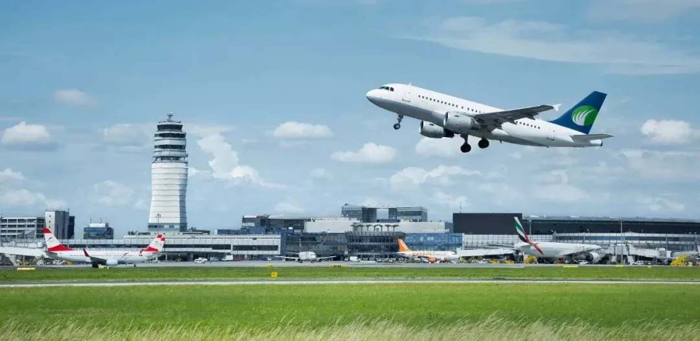
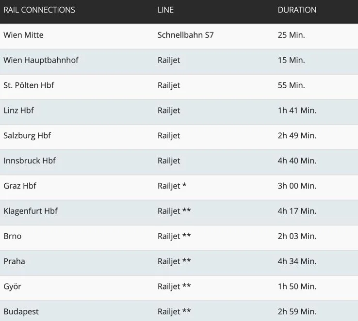

Lotnisko międzynarodowe w Wiedniu (kod lotniska **VIE**) leży około 18 km od centrum miasta i jest największym międzynarodowym węzłem Austrii — a zarazem jednym z najważniejszych punktów przesiadkowych między Europą Środkową a Wschodnią. Lotnisko dzieli od centrum zaledwie 16–25 minut, ale pociąg ekspresowy, S-Bahn, autobusy i taksówki każą wybierać między szybkością a ceną, a hale odpraw i wejścia do kontroli bezpieczeństwa są podzielone według terminali i kierunków. Świadomość, który budynek i które wejście są twoje, oszczędza naprawdę dużo czasu.

Ten przewodnik w pięciu częściach omawia **terminale i strefy bramek**, **transport do miasta**, **proces odlotu**, **udogodnienia na lotnisku** oraz **planowanie dnia wokół lotu**.

Układ lotniska jest prostszy, niż wygląda: terminale mieszczą się pod jednym dachem, odloty są na piętrze, przyloty na parterze, a wejścia do kontroli bezpieczeństwa pogrupowano według bramek. Tak naprawdę z góry trzeba ustalić trzy rzeczy — z którego budynku odlatuje twój samolot, jak dostaniesz się z miasta i ile czasu zarezerwować na odprawę oraz kontrolę bezpieczeństwa. Gdy to załatwisz, przechowalnia bagażu, limity celne i kantor mogą poczekać do przyjazdu.

## 1. Terminale i strefy bramek

Lotnisko w Wiedniu ma trzy czynne terminale — **Terminal 1, Terminal 1A i Terminal 3** — ustawione pod jednym dachem, więc można przechodzić między nimi pieszo. Rozbudowa Terminala 3, SKYLINK, otwarta w 2012 roku, przyjmuje samoloty tak duże jak Airbus A380; to główny budynek dla lotów długodystansowych.

Lotniskiem zarządza Flughafen Wien AG, a obsługa pasażerów, bagażu i obsługa naziemna są dzielone między Vienna Airport, Swissport, Austrian Airlines i inne firmy. Stanowiska odprawy przydzielane są według linii lotniczych, więc potwierdź, **z którego terminala** odlatuje twój lot — obecnie Terminala 1, Terminala 1A lub Terminala 3. Starsze materiały lotniska wciąż używają nazwy „Terminal 2” dla jednej z lokalizacji, ale nie odprawia się tam już pasażerów.

### Pięć stref bramek: B, C, D, F i G

Bramki są pogrupowane w pięć pirsów, a grupa decyduje o tym, z którego wejścia do kontroli bezpieczeństwa korzystasz i czy przechodzisz kontrolę paszportową. Pirs D nazywał się kiedyś Halą A i jest znany jako pirs wschodni; pirs C to pirs zachodni.

| Pirs | Bramki | Połączenie z budynkiem głównym | Loty |
| --- | --- | --- | --- |
| B (strona Terminala 1) | B22–B43 | Autobus | Europejskie loty strefy Schengen |
| C (pirs zachodni, strona Terminala 1) | C31–C42, w tym C35–C41 to bramki przesiadkowe | Rękaw | Głównie Schengen, część międzynarodowych |
| C (pirs zachodni, strona Terminala 1) | C71–C75 | Autobus, dojazd przez bramkę C31 | Tylko Schengen |
| D (pirs wschodni, dawna Hala A) | D21–D29 | Rękaw | Loty międzynarodowe |
| D (pirs wschodni, dawna Hala A) | D31–D37, D61–D70 | Autobus | Loty międzynarodowe |
| F, G (Terminal 3) | bramki F i G | Rękaw | Schengen (F) i non-Schengen (G) |

Bramki z rękawem prowadzą bezpośrednio do samolotu; bramki oznaczone jako autobusowe oznaczają zejście na niższy poziom i przejazd autobusem, co trzeba doliczyć do czasu wejścia na pokład. C71–C75 to osobna grupa bramek autobusowych, do której dociera się przez bramkę C31, więc jeśli stamtąd odlatujesz, zarezerwuj dodatkowy czas na dojście i oczekiwanie.

### Przesiadki międzynarodowe: zmiana samolotu bez wjazdu do Austrii

Jeśli Wiedeń jest tylko przystankiem, **przy przesiadce międzynarodowej nie musisz wjeżdżać do Austrii**. Przylatując na pirs C lotem międzynarodowym, zejdź zgodnie ze znakami do **Transitzone** na parterze i przejedź autobusem shuttle na pirs D, skąd odlatuje twój dalszy lot międzynarodowy. Przylatując na pirs D i kontynuując podróż innym lotem międzynarodowym, dokonujesz tej samej przesiadki w obrębie pirsu D, korzystając ze strefy tranzytowej i autobusu shuttle. Na pirsie D strefa tranzytowa i strefa kontroli paszportowej znajdują się przy wejściach do hal oraz przy bramkach z rękawem i bramkach autobusowych — kieruj się znakami „Transfer”.

## 2. Dojazd do miasta i powrót

Z lotniska do Wiednia można dostać się na pięć sposobów: **City Airport Train** jest najszybszy, **autobusy lotniskowe** obsługują centrum i dworzec zachodni, **S-Bahn S7 i pociągi Railjet** dają najlepszy stosunek ceny do jakości, **taksówki** sprawdzają się przy późnych przylotach i ciężkim bagażu, a **wynajem samochodu** przy podróży drogowej rozpoczynanej w Wiedniu. Trasy, czasy i ceny poniżej podano za lotniskiem i przewoźnikami; w dniu podróży sprawdź strony przewoźników.

Jeśli chcesz znać tylko wniosek: wybierz **CAT**, gdy liczy się czas, a nie chcesz głowić się nad przesiadką; wybierz **S7**, gdy najważniejszy jest budżet i dziesięć dodatkowych minut nie robi różnicy; wybierz **Railjet**, gdy kolejny etap to krajowy pociąg dalekobieżny; wybierz **autobus**, jeśli nocujesz w stronę Westbahnhof lub Donauzentrum; wybierz **taksówkę** po późnym lądowaniu z ciężkim bagażem. Tabela porównuje te opcje, a kolejne sekcje opisują każdą z osobna.

| Opcja | Do centrum | Cena w jedną stronę | Najlepsza dla |
| --- | --- | --- | --- |
| City Airport Train (CAT) | 16 min do Wien Mitte | 14,90 € | presja czasu, bez przesiadek |
| S-Bahn S7 | około 25 min do Wien Mitte | około 5 € | priorytet budżetu, wolniej jest w porządku |
| Railjet | 15 min do Wien Hauptbahnhof | taryfa ÖBB z danego dnia | przesiadka na krajowy pociąg dalekobieżny |
| Autobus lotniskowy | 20–40 min w zależności od przystanku | około 8 € | nocleg w stronę Westbahnhof lub Donauzentrum |
| Taksówka | około 20–30 min | według taksometru | późne przyloty, grupy, ciężki bagaż |

### 1. City Airport Train (CAT) — najszybszy

City Airport Train jeździ bez postoju z lotniska do **Wien Mitte (Landstraße)** w centrum w **16 minut**, co czyni go najmniej stresującym sposobem dotarcia do miasta — korki po prostu nie mają znaczenia.

- **Godziny:** 05:37–23:29 (centrum → lotnisko); 06:09–23:39 (lotnisko → centrum), mniej więcej co 30 minut.
- **Przystanki:** lotnisko ↔ Wien Mitte, około **10 minut** pieszo od katedry św. Szczepana.
- **Cena:** 14,90 € w jedną stronę, z tańszymi biletami powrotnymi. Bilety komunikacji miejskiej Wiednia i Vienna City Card **nie** obowiązują w CAT; potrzebny jest osobny bilet.
- **Bilety:** w hali przylotów jest dedykowane stanowisko CAT, gdzie można kupić bilety i zapytać o usługi CAT.
- **Odprawa bagażowa w mieście:** w terminalu CAT w centrum można się odprawić i odebrać kartę pokładową, przy stanowiskach z obsługą lub w samoobsługowych kioskach, od 24 godzin do 75 minut przed odlotem.

### 2. Autobusy lotniskowe — najszerszy zasięg

Autobusy lotniskowe (Vienna Airport Lines / Postbus) łączą lotnisko z głównymi węzłami komunikacyjnymi Wiednia, a trzy trasy miejskie razem obejmują wszystkie linie metra. Kursy w stronę Wien Westbahnhof i Wien Hauptbahnhof jeżdżą **co 30 minut**; trasa lotnisko ↔ Morzinplatz/Schwedenplatz działa **całą dobę** i zajmuje zaledwie **20 minut**.

- **Cena:** około 8 € w jedną stronę, bilet kupisz w pojeździe lub w kasie.
- **Trasy i przystanki:** patrz tabela poniżej.

| Cel | Linia autobusowa | Czas jazdy |
| --- | --- | --- |
| Wien Morzinplatz/Schwedenplatz | Vienna Airport Lines | 20 min |
| Wien Donauzentrum (przez VIC) | Vienna Airport Lines | 40 min |
| Wien Westbahnhof (przez Hauptbahnhof) | Vienna Airport Lines | 40 min |
| Wien Erdberg (VIB) | AirLiner | 15 min |
| Graz (przez Pinggau) | Dr. Richard / FlixBus | 2 godz. 40 min |
| Münchendorf (przez Fischamend) | Postbus | 50 min |
| Ebreichsdorf (przez Gramatneusiedl) | Postbus | 73 min |
| Neusiedl a. See (przez Bruck/Leitha) | Postbus | 70 min |

### 3. Autokary dalekobieżne — dalej do sąsiednich stolic

Do Bratysławy, Budapesztu, Pragi czy Brna autokary z lotniska są często bardziej bezpośrednie niż pociąg, a wiele z nich odjeżdża właśnie z lotniska — wygodne, jeśli Wiedeń jest tylko przystankiem w drodze gdzie indziej.

| Kraj | Cel | Przewoźnik |
| --- | --- | --- |
| Bułgaria | Sofia | Flixbus |
| Czechy | Brno, Praha | RegioJet |
| Węgry | Budapest, Győr | FlixBus |
| Węgry | Budapest | RegioJet |
| Polska | Przemyśl | FlixBus |
| Polska | Warszawa | LeoExpress |
| Polska | Wrocław | FlixBus |
| Rumunia | Sibiu | FlixBus |
| Słowacja | Bratislava | Slovak Lines / FlixBus / RegioJet |
| Słowacja | Prešov, Košice | Eurobus |
| Słowenia | Ljubljana | FlixBus |

### 4. S-Bahn i pociągi ÖBB — najlepszy stosunek ceny do jakości

Aby podróżować w cenie biletu miejskiego, wybierz S-Bahn **S7**: około **25 minut** z lotniska do Wien Mitte, za mniej więcej jedną trzecią ceny CAT, a bilet obejmuje wtedy metro i tramwaje w mieście.

Pociągi Railjet ÖBB łączą lotnisko z miejscami znacznie dalej: bezpośrednio z Wien Hauptbahnhof (15 minut), St. Pölten, Linzem, Salzburgiem, Innsbruckiem, Grazem i Klagenfurtem, a także z połączeniami transgranicznymi do Brna, Pragi, Győr i Budapesztu. Na Wien Hauptbahnhof (dworcu głównym w Wiedniu) można się przesiąść na wiele innych kierunków.

- **Cena:** około 5 € w jedną stronę pociągiem S7 (związek transportowy VOR liczy ceny według stref, a lotnisko leży poza strefą podstawową Wiednia — jeśli masz już bilet miejski, dopłacasz tylko za odcinek lotniskowy).
- **Bilety:** kasa ÖBB znajduje się w hali przylotów lotniska, kilka kroków dalej; bilety sprzedają też automaty ÖBB i aplikacja ÖBB.
- **Rozkład:** patrz tabela poniżej; rozstrzygające są komunikaty ÖBB i VOR na dany dzień.

| Cel | Linia | Czas jazdy |
| --- | --- | --- |
| Wien Mitte | Schnellbahn S7 | 25 min |
| Wien Hauptbahnhof | Railjet | 15 min |
| St. Pölten Hbf | Railjet | 55 min |
| Linz Hbf | Railjet | 1 godz. 41 min |
| Salzburg Hbf | Railjet | 2 godz. 49 min |
| Innsbruck Hbf | Railjet | 4 godz. 40 min |
| Graz Hbf | Railjet \* | 3 godz. 00 min |
| Klagenfurt Hbf | Railjet \*\* | 4 godz. 17 min |
| Brno | Railjet \*\* | 2 godz. 03 min |
| Praha | Railjet \*\* | 4 godz. 34 min |
| Győr | Railjet \*\* | 1 godz. 50 min |
| Budapest | Railjet \*\* | 2 godz. 59 min |

Połączenia oznaczone \* i \*\* zwykle wymagają przesiadki na Wien Hauptbahnhof; sprawdź rozkład ÖBB na dany dzień.

### 5. Taksówki

Taksówkę złapiesz na postoju przed halą przylotów albo skorzystasz z samochodu zamówionego przez stanowisko „City Transfer”; można też zamówić taksówkę telefonicznie z wyprzedzeniem.

| Firma taksówkowa | Telefon |
| --- | --- |
| Airport Driver | +43-1-22822 |
| Airport Services | +43-1-7007-33151 |
| ATS Airport Transfer Service | +43-1-7007-35905 |
| Flughafentaxi ttc | +43-1-7007-33141 |
| 40100 | +43-1-40100 |

### 6. Wynajem samochodu

Stanowiska wynajmu skupione są na **poziomie 0 parkingu wielopoziomowego P4**, gdzie swoje kasy mają Hertz, Sixt, Europcar, Avis, Budget, Enterprise, Alamo i National — wyjeżdżasz prosto na sieć autostrad.

| Firma wynajmu | Rezerwacja |
| --- | --- |
| Alamo | +43-1-7007-33432 |
| Avis | +43-1-7007-32700 |
| Buchbinder | +43-1-7007-33316 |
| Budget | +43-1-7007-32700 |
| Enterprise | +43-1-7007-33432 |
| Europcar | +43-1-7007-32812 |
| Flizzr | +43-1-7007-36517 |
| Hertz | +43-1-7007-32661 |
| Megadrive | +43-1-7007-33316 |
| National | +43-1-7007-33432 |
| Payless | +43-1-7007-32700 |
| Sixt | +43-1-7007-36517 |
| Thrifty | +43-1-7007-32661 |

## 3. Odlot: odprawa, nadanie bagażu, kontrola bezpieczeństwa

Standardowa kolejność to **odprawa → nadanie bagażu → kontrola bezpieczeństwa → (loty poza Schengen) kontrola paszportowa → wejście na pokład**. Staw się na lotnisku 2 godziny przed odlotem w strefie Schengen i 3 godziny przed lotem poza Schengen lub długodystansowym; w szczycie sezonu i w okolicach świąt dodaj pół godziny.

Dodatkowa godzina przy locie długodystansowym to nie zapas na wszelki wypadek. Wiedeń całkowicie rozdziela **potoki Schengen i non-Schengen**: lot w strefie Schengen przechodzi kontrolę bezpieczeństwa i idzie do bramki, a lot poza Schengen po kontroli bezpieczeństwa ponownie staje w kolejce do kontroli paszportowej w innej części budynku. Odprawa, nadanie bagażu, kontrola bezpieczeństwa, kontrola paszportowa i droga do bramki sumują się, a trzymanie paszportu, wizy, karty pokładowej i kwitu bagażowego w jednej kieszeni oszczędza szukania na każdym punkcie kontrolnym.

### 1. Odprawa

- **Odprawa samoobsługowa:** użyj karty kredytowej lub karty Miles & More, swojego nazwiska, numeru rezerwacji albo po prostu zeskanuj paszport, aby otrzymać kartę pokładową z samoobsługowego automatu. Jeśli masz bagaż do nadania, automat wskaże, do którego stanowiska nadania bagażu podejść.
- **Przy stanowisku:** w zależności od lotu odpraw się i odbierz kartę pokładową na Terminalu 1, Terminalu 1A lub Terminalu 3.
- **Odprawa online:** większość linii oferuje ją na swojej stronie lub w aplikacji, co pozwala uniknąć kolejek na lotnisku; wydrukuj tam kartę pokładową. Jeśli podróżujesz z bagażem do nadania, najpierw zapytaj przy odpowiednim stanowisku.
- **Odprawa na Wien Mitte:** niektóre linie oferują odprawę w terminalu City Airport Train na Wien Mitte, gdzie okazujesz paszport i otrzymujesz kartę pokładową. Aktualną listę linii znajdziesz na cityairporttrain.com lub pod numerem +43 1 25250.

### 2. Samodzielne nadanie bagażu

Samoobsługowe nadanie bagażu na lotnisku w Wiedniu sprowadza przekazanie bagażu do czterech kroków: **zeskanuj kartę pokładową → przymocuj metkę do bagażu → zatrzymaj kwit bagażowy → przejdź do kontroli bezpieczeństwa.**

Przy samoobsługowych taśmach obok wysp odprawy zeskanuj kartę pokładową, aby potwierdzić lot, przymocuj wydrukowaną metkę do rączki walizki, połóż bagaż na taśmie i zachowaj kwit bagażowy — jeśli bagaż zaginie, to jedyny dowód, jaki masz.

### 3. Uwagi dotyczące bagażu

- W przypadku **bagażu ponadwymiarowego lub zwierząt** skorzystaj ze **stanowisk bagażu ponadgabarytowego na Terminalu 1 lub Terminalu 3**.
- Umieść na bagażu imię, nazwisko i adres i usuń stare metki — stare kody kreskowe mylą system sortowania i zwiększają ryzyko błędnego skierowania bagażu.
- Wartościowe przedmioty, ważne dokumenty i leki miej przy sobie, a nie w bagażu rejestrowanym.
- W razie potrzeby zabezpiecz bagaż paskiem lub kłódką albo skorzystaj z usługi owijania bagażu na lotnisku (patrz sekcja o udogodnieniach poniżej).

### 4. Kontrola bezpieczeństwa i kontrola paszportowa

Wejścia do kontroli bezpieczeństwa są podzielone według grup bramek, a niewłaściwe oznacza długi spacer:

- **Wejście do kontroli bezpieczeństwa 2:** dla odlotów z bramek B, C i D.
- **Wejście do kontroli bezpieczeństwa 3:** dla odlotów z bramek F i G.

Za kontrolą bezpieczeństwa, w strefie odlotów, znajdują się sklepy i restauracje; osoby odprowadzające nie mogą przejść tam razem z tobą.

- W przypadku **krajów strefy Schengen** korzystaj z bramek **B, C i F**.
- W przypadku **krajów spoza Schengen** korzystaj z bramek **D i G** i przed dojściem do bramki musisz przejść **kontrolę paszportową**.

Podróżni z paszportami spoza UE zwykle muszą też przejść **rejestrację w systemie EES** (odciski palców i zdjęcie twarzy) w samoobsługowym kiosku przed kontrolą paszportową. Przy pierwszym wjeździe zajmuje to kilka dodatkowych minut — uwzględnij to przy krótkiej przesiadce.

## 4. Udogodnienia na lotnisku i informacje praktyczne

Udogodnienia w Wiedniu rządzą się prostą zasadą: **poziom odlotów obsługuje odprawę i kontrolę bezpieczeństwa, poziom przylotów — bagaż, informację i transport naziemny**, a restauracje, sklepy i miejsca do siedzenia skupiają się w strefie airside. Przechowalnia bagażu, pieczątka celna i biuro rzeczy znalezionych znajdują się na poziomie przylotów 0 i wokół Terminala 1; po przejściu kontroli bezpieczeństwa dostępne są już tylko usługi airside. Poniższe sekcje ułożono od najczęściej używanych do najrzadszych.

### Informacja i usługi bagażowe

Na lotnisku są **trzy punkty informacji**: dwa na poziomach odlotów Terminali 1 i 3 oraz jeden w hali przylotów Terminala 3. Odpowiedzi na pytania o bagaż i udogodnienia uzyskasz właśnie tam.

**Centra obsługi bagażu** w strefach odpraw Terminali 1 i 3 są czynne **00:00–24:00** i oferują:

| Usługa | Cena | Uwagi |
| --- | --- | --- |
| Przechowalnia bagażu | 4 € za sztukę za dzień; przedmioty ponadgabarytowe 8 € za sztukę za dzień | Przedmioty można przechowywać do 6 miesięcy |
| Owijanie bagażu | 12 € za sztukę | Bagaż zostaje zamknięty w ochronnej folii chroniącej przed uszkodzeniem, wilgocią i kradzieżą; dostępne w strefach bagażowych Terminali 1 i 3 |
| Dostawa bagażu | od 15 € za maksymalnie 5 sztuk, 3 € za każdą kolejną sztukę | Zamów co najmniej 72 godziny wcześniej, wysyłając e-mail na adres service@viennaairport.com, lub zarezerwuj bezpośrednio w sklepie internetowym lotniska |
| Skrytki depozytowe | 6 € za dzień | Na dokumenty, klucze i podobne przedmioty; nie można przechowywać broni, materiałów wybuchowych, łatwopalnych i innych niebezpiecznych towarów ani rzeczy psujących się lub mocno pachnących |
| Szatnia | 2 € za zestaw za dzień | Jeden zestaw to kurtka lub płaszcz, buty, biżuteria, rękawiczki i szalik |

### Ośrodek medyczny, sala modlitw i biuro rzeczy znalezionych

- **Ośrodek medyczny:** Terminal 1, korytarz na poziomie 1, naprzeciwko apteki, otwarty **07:00–19:00**. Szczepienia obejmują żółtą gorączkę, dur brzuszny, wściekliznę, wirusowe zapalenie wątroby typu A i B (także dla dzieci), malarię, odkleszczowe zapalenie mózgu, grypę, szczepionkę skojarzoną przeciw błonicy/polio/tężcowi/krztuścowi, chorobę meningokokową i japońskie zapalenie mózgu — zadzwoń wcześniej i sprawdź dostępność.
- **Sala modlitw:** w terminalu znajduje się sala modlitw; o jej lokalizację zapytaj w punkcie informacji.
- **Rzeczy znalezione:** biuro rzeczy znalezionych na poziomie 0 Terminala 1 lub punkt informacji w hali przylotów Terminala 3.
- **Zwrot znalezionych rzeczy pocztą:** skorzystaj z usługi dostawy i pakowania Mail Boxes Etc. w A-2320 Schwechat albo z dowolnego wybranego kuriera; adres kontaktowy to mbe0045@mbe.at. Przedmioty przechowywane dłużej niż 8 dni podlegają opłacie za przechowywanie, a **płatność musi zostać zaksięgowana przed wysłaniem przedmiotu**: przy płatności kartą faktura i link do płatności przychodzą e-mailem; przy przelewie bankowym wpisz numer faktury w polu tytułu przelewu, inaczej płatność nie zostanie zidentyfikowana.

### Limity celne i bezcłowe

Podróżni wjeżdżający do Austrii spoza UE mogą wwieźć następujące ilości w ramach limitów bezcłowych. **Podróżni z tej samej podróży nie mogą łączyć swoich limitów** — przepis, o którym często się zapomina:

| Kategoria | Limit bezcłowy |
| --- | --- |
| Łączna wartość towarów | do **430 €** (tylko podróżni samolotem; 300 € przy wjeździe lądem) |
| Papierosy | 200 |
| lub cygara | 50 |
| lub cygaretki | 100 |
| lub tytoń | 250 g |
| lub kombinacja powyższych | — |
| plus wino | 4 l |
| plus alkohole powyżej 22% objętości | 1 l |
| lub alkohole lub aperitify poniżej 22% | 2 l |
| lub wino musujące lub likiery | 2 l |
| lub kombinacja powyższych | — |

- **Limity wieku:** pasażerowie poniżej 15 lat mają limit 150 €; limity alkoholu i tytoniu obowiązują od 17. roku życia.
- **Deklaracje gotówkowe:** przewożenie do UE lub z UE ponad **10 000 €** w gotówce lub innych środkach płatności (czeki podróżne, sztabki złota, monety złote i tym podobne) wymaga zgłoszenia celnego; formularze są dostępne przy stanowisku celnym lub w urzędzie celnym.
- **Pieczątki do zwrotu podatku przy wywozie:** urząd celny ds. wywozu znajduje się na poziomie przylotów 0.

### Kantory i bankomaty

Kantory na lotnisku prowadzi **Interchange**, z oddziałami przy bramkach, w hali przylotów i w terminalach, otwartymi zazwyczaj od 5:00 do późnego wieczora; bankomaty rozmieszczono jeszcze szerzej — od hali przylotów po pirsy bramek.

| Lokalizacja | Godziny | Dostęp |
| --- | --- | --- |
| Brama D | 05:00–00:00 | Tylko pasażerowie |
| Brama F | 05:00–22:00 | Tylko pasażerowie |
| Brama G | 05:00–23:00 | Tylko pasażerowie |
| Plaza | 06:00–23:00 | Tylko pasażerowie |
| Terminal 3 | 05:00–22:00 | Tylko pasażerowie |
| Hala przylotów (3 stanowiska) | 05:00–22:00, jedno do 23:00 | Wszyscy |
| Terminal 2 | 06:00–20:00 | Wszyscy |
| Office Park 1 | 05:00–22:00 | Wszyscy |

Stanowiska oferują wymianę walut, zwrot podatku i przelewy międzynarodowe; niektóre stanowiska w hali przylotów oraz w Terminalach 2 i 3 sprzedają też karty telefoniczne.

Bankomaty znajdują się w hali przylotów, przy bramkach C/D/F/G, w Plaza, na parkingu 8, w strefach ogólnodostępnych Terminali 1, 2 i 3, w Office Park 1, Office Park 3 oraz w strefie VIP/GAC. Bankomaty w hali przylotów, na parkingach, w terminalach i budynkach biurowych są dostępne dla wszystkich; te przy bramkach i w Plaza tylko dla pasażerów.

### Wi-Fi, zasilanie i karty SIM

- **Wi-Fi:** obejmuje cały terminal, więc w czasie oczekiwania możesz sprawdzić loty i napisać do domu.
- **Zasilanie i praca:** bramki F i G mają wydzielone przestrzenie do pracy, gdzie można podłączyć się do prądu i pracować na laptopie.
- **Karty SIM i naprawy:** Mr. Mobile oferuje naprawy telefonów, tabletów i laptopów, telefony do wypożyczenia i karty SIM na przedpłatę.

## 5. Planowanie dnia wokół lotu

Wszystko powyższe sprowadza się do trzech scenariuszy podróży. Każdy ma inny budżet czasu, ale łączy je jedna zasada: **najpierw potwierdź terminal i bramkę, potem wybierz transport.**

### Przylot i bezpośredni wyjazd do miasta

Przy dziennym przylocie z lekkim bagażem najprostszym sposobem dostania się do miasta jest S7: zejdź za znakami S-Bahn na peron, kup bilet do Wien Mitte i po około dwudziestu pięciu minutach jesteś w metrze. Wybierz CAT, jeśli masz mało czasu lub podróżujesz z dziećmi; po późnym przylocie ustaw się w kolejce po taksówkę przed halą przylotów, zamiast gonić ostatni pociąg, żeby zaoszczędzić kilka euro.

### Wylot z miasta

Zarówno CAT, jak i S7 odjeżdżają z Wien Mitte; CAT jest około dziesięciu minut szybszy i kosztuje ponad dwa razy więcej. Czas, który naprawdę się liczy, mija **na lotnisku**: odliczaj od bramki przez kontrolę bezpieczeństwa, nadanie bagażu i odprawę — 2 godziny dla lotu w strefie Schengen, 3 dla lotu poza Schengen. Dodanie pół godziny w mieście jest znacznie mniej przydatne niż dodanie jej na lotnisku. Szczyt sezonu, święta i poranne godziny szczytu zasługują na kolejne pół godziny.

### Przesiadka w Wiedniu

Przesiadka z lotu międzynarodowego na międzynarodowy nie wymaga wjazdu do Austrii: kieruj się znakami Transfer przez strefę tranzytową. Jeśli jednak dalszy lot jest w strefie Schengen, wjeżdżasz do kraju i ponownie przechodzisz kontrolę bezpieczeństwa, więc zaplanuj przesiadkę jak przy przylocie. Dwie godziny między lotami to komfort; zarezerwuj trzy, jeśli zmieniasz terminal lub musisz odebrać i ponownie nadać bagaż.

## Powiązane linki

- **W tym serwisie**: [Lotnisko międzynarodowe w Wiedniu (VIE)](/airport/VIE), [Austria (AT)](/country/AT)
- **Wikipedia**: [Port lotniczy Wiedeń](https://en.wikipedia.org/wiki/Vienna_International_Airport)
- **Baidu Baike**: [Port lotniczy Wiedeń](https://baike.baidu.com/item/%E7%BB%B4%E4%B9%9F%E7%BA%B3%E5%9B%BD%E9%99%85%E6%9C%BA%E5%9C%BA)

Źródło zdjęć: Vienna Airport. Ceny, godziny otwarcia i lokalizacje stanowisk podano za lotniskiem i przewoźnikami; w dniu podróży sprawdź ich strony internetowe.
