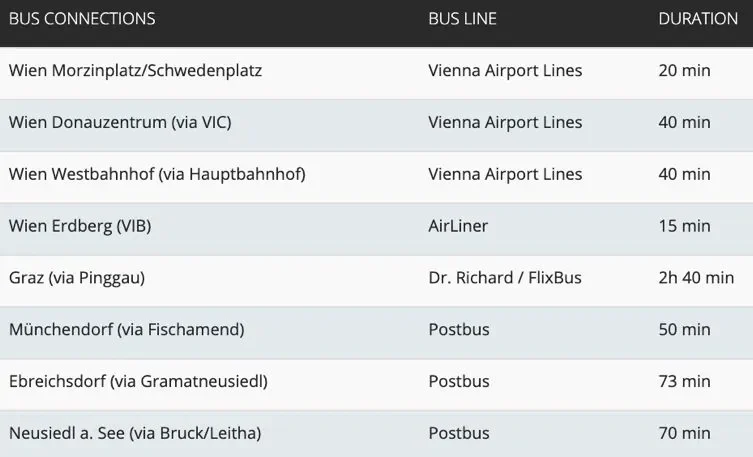

O Aeroporto Internacional de Viena (código **VIE**) fica a cerca de 18 km do centro e é o maior hub internacional da Áustria — além de um dos pontos de conexão mais importantes entre a Europa Central e a Oriental. O aeroporto está a apenas 16–25 minutos da cidade, mas o trem expresso, o S-Bahn, os ônibus e os táxis trocam velocidade por preço, e os saguões de check-in e as entradas de segurança são divididos por terminal e destino. Saber qual prédio e qual entrada são os seus economiza tempo de verdade.

Este guia cobre **os terminais e as áreas de portão**, **o transporte para a cidade**, **o processo de embarque**, **as instalações do aeroporto** e **o planejamento do dia em torno do seu voo** em cinco partes.

O layout do aeroporto é mais simples do que parece: os terminais ficam sob um mesmo teto, os embarques são no andar de cima e as chegadas no de baixo, e as entradas de segurança são agrupadas por portão. O que realmente precisa ser decidido com antecedência são três coisas — qual prédio o seu voo usa, como você chega da cidade e quanto tempo reservar para check-in e segurança. Resolvidas essas, guarda-volumes, franquias alfandegárias e câmbio podem esperar até você estar lá.

## 1. Terminais e áreas de portão

O Aeroporto de Viena tem três terminais em uso — **Terminal 1, Terminal 1A e Terminal 3** — enfileirados sob um mesmo teto, então você pode caminhar entre eles. A extensão SKYLINK do Terminal 3 abriu em 2012 e recebe aeronaves do porte do Airbus A380; é o principal edifício dos voos de longa distância.

O aeroporto é operado pela Flughafen Wien AG, com serviços a passageiros, manuseio de bagagem e handling de solo divididos entre Vienna Airport, Swissport, Austrian Airlines e outras empresas. Os balcões de check-in são alocados por companhia, então confirme **qual terminal** o seu voo usa — atualmente Terminal 1, Terminal 1A ou Terminal 3. Material antigo do aeroporto ainda usa o nome “Terminal 2” para uma localização, mas ele não faz mais check-in.

### Cinco áreas de portão: B, C, D, F e G

Os portões são agrupados em cinco piers, e o grupo define qual entrada de segurança você usa e se passa pelo controle de passaportes. O pier D antes se chamava Saguão A e é conhecido como pier leste; o pier C é o pier oeste.

| Pier | Portões | Ligação com o prédio principal | Voos |
| --- | --- | --- | --- |
| B (lado do Terminal 1) | B22–B43 | Ônibus | Voos europeus Schengen |
| C (pier oeste, lado do Terminal 1) | C31–C42, dos quais C35–C41 são portões de conexão | Ponte de embarque | Principalmente Schengen, alguns internacionais |
| C (pier oeste, lado do Terminal 1) | C71–C75 | Ônibus, com acesso pelo portão C31 | Somente Schengen |
| D (pier leste, antigo Saguão A) | D21–D29 | Ponte de embarque | Voos internacionais |
| D (pier leste, antigo Saguão A) | D31–D37, D61–D70 | Ônibus | Voos internacionais |
| F, G (Terminal 3) | Portões F e G | Ponte de embarque | Schengen (F) e não Schengen (G) |

Portões com ponte de embarque levam direto à aeronave; portões marcados como bus gate significam descer e pegar um ônibus, o que entra no seu tempo de embarque. C71–C75 é um grupo separado de portões de ônibus, acessado pelo portão C31, então reserve tempo extra de caminhada e espera se você partir de lá.

### Conexões internacionais: troque de avião sem entrar na Áustria

Se Viena for apenas uma escala, **as conexões internacionais não exigem entrar na Áustria**. Chegando ao pier C em um voo internacional, siga as placas até a **Transitzone** no térreo e pegue o ônibus shuttle até o pier D para o voo internacional seguinte. Chegando ao pier D e seguindo em outro voo internacional, você faz a mesma conexão dentro do pier D usando a Transitzone e o ônibus shuttle. No pier D, a área de trânsito e a área de controle de passaportes ficam nas entradas dos saguões e nos portões com ponte e de ônibus — siga as placas de “Transfer”.

## 2. Como chegar à cidade e voltar

Há cinco maneiras de ir do aeroporto a Viena: o **City Airport Train** é o mais rápido, os **ônibus do aeroporto** cobrem o centro e a estação oeste, os **trens S7 do S-Bahn e Railjet** oferecem o melhor custo-benefício, os **táxis** atendem bem chegadas tarde da noite e bagagem pesada, e o **aluguel de carro** combina com uma viagem de carro que começa em Viena. As rotas, os tempos e as tarifas abaixo são os publicados pelo aeroporto e pelos operadores; confira os sites dos operadores no dia da viagem.

Se você quer só a conclusão: pegue o **CAT** quando o tempo importa e você prefere não calcular uma troca de trem; pegue o **S7** quando o orçamento vem primeiro e dez minutos a mais não incomodam; pegue um **Railjet** quando o próximo trecho é um trem doméstico de longa distância; pegue o **ônibus** se você vai ficar na direção de Westbahnhof ou Donauzentrum; pegue um **táxi** depois de um pouso tarde da noite com bagagem pesada. A tabela compara as opções; as seções abaixo tratam de cada uma.

| Opção | Até o centro | Tarifa só de ida | Melhor para |
| --- | --- | --- | --- |
| City Airport Train (CAT) | 16 min até Wien Mitte | € 14,90 | Pressa, sem trocas |
| S7 S-Bahn | cerca de 25 min até Wien Mitte | cerca de € 5 | Orçamento primeiro, mais lento está bem |
| Railjet | 15 min até Wien Hauptbahnhof | tarifa ÖBB do dia | Conexão com um trem doméstico de longa distância |
| Ônibus do aeroporto | 20–40 min, dependendo da parada | cerca de € 8 | Hospedagem na direção de Westbahnhof ou Donauzentrum |
| Táxi | cerca de 20–30 min | taxímetro | Chegadas tarde da noite, grupos, bagagem pesada |

### 1. City Airport Train (CAT) — o mais rápido

O City Airport Train vai sem paradas do aeroporto até **Wien Mitte (Landstraße)**, no centro, em **16 minutos**, o que o torna a forma menos estressante de entrar na cidade — o trânsito simplesmente não é um fator.

- **Horários:** 05:37–23:29 (centro → aeroporto); 06:09–23:39 (aeroporto → centro), aproximadamente a cada 30 minutos.
- **Paradas:** aeroporto ↔ Wien Mitte, a cerca de **10 minutos** a pé da Catedral de Santo Estêvão.
- **Tarifa:** € 14,90 só de ida, com passagens de ida e volta mais baratas. Os bilhetes de transporte urbano de Viena e o Vienna City Card **não** valem no CAT; você precisa de um bilhete separado.
- **Bilhetes:** o saguão de chegadas tem um balcão exclusivo do CAT, onde você pode comprar bilhetes e tirar dúvidas sobre qualquer serviço do CAT.
- **Check-in urbano para bagagem:** no terminal do CAT no centro, você pode fazer check-in e retirar o cartão de embarque, em balcões com atendente ou quiosques de autoatendimento, de 24 horas até 75 minutos antes da partida.

### 2. Ônibus do aeroporto — a maior cobertura

Os ônibus do aeroporto (Vienna Airport Lines / Postbus) ligam o aeroporto aos principais hubs de transporte de Viena, e as três rotas urbanas, juntas, cobrem todas as linhas de metrô. Os serviços para Wien Westbahnhof e Wien Hauptbahnhof partem **a cada 30 minutos**; a rota aeroporto ↔ Morzinplatz/Schwedenplatz funciona **24 horas** e leva apenas **20 minutos**.

- **Tarifa:** cerca de € 8 só de ida, comprada a bordo ou no balcão.
- **Rotas e paradas:** veja a tabela abaixo.

| Destino | Linha de ônibus | Tempo de viagem |
| --- | --- | --- |
| Wien Morzinplatz/Schwedenplatz | Vienna Airport Lines | 20 min |
| Wien Donauzentrum (via VIC) | Vienna Airport Lines | 40 min |
| Wien Westbahnhof (via Hauptbahnhof) | Vienna Airport Lines | 40 min |
| Wien Erdberg (VIB) | AirLiner | 15 min |
| Graz (via Pinggau) | Dr. Richard / FlixBus | 2 h 40 min |
| Münchendorf (via Fischamend) | Postbus | 50 min |
| Ebreichsdorf (via Gramatneusiedl) | Postbus | 73 min |
| Neusiedl a. See (via Bruck/Leitha) | Postbus | 70 min |

### 3. Ônibus de longa distância — rumo às capitais vizinhas

Para Bratislava, Budapeste, Praga ou Brno, os ônibus que saem do aeroporto costumam ser mais diretos do que o trem, e muitos começam no aeroporto — prático se Viena é uma escala no caminho para outro lugar.

| País | Destino | Operador |
| --- | --- | --- |
| Bulgária | Sófia | Flixbus |
| Tchéquia | Brno, Praga | RegioJet |
| Hungria | Budapeste, Győr | FlixBus |
| Hungria | Budapeste | RegioJet |
| Polônia | Przemyśl | FlixBus |
| Polônia | Varsóvia | LeoExpress |
| Polônia | Wrocław | FlixBus |
| Romênia | Sibiu | FlixBus |
| Eslováquia | Bratislava | Slovak Lines / FlixBus / RegioJet |
| Eslováquia | Prešov, Košice | Eurobus |
| Eslovênia | Liubliana | FlixBus |

### 4. Trens S-Bahn e ÖBB — o melhor custo-benefício

Para viajar pelo preço de um bilhete urbano, a resposta é o S-Bahn **S7**: cerca de **25 minutos** do aeroporto até Wien Mitte, por aproximadamente um terço da tarifa do CAT, e o bilhete ainda cobre o metrô e os bondes na cidade.

Os trens Railjet da ÖBB ligam o aeroporto a lugares muito mais distantes: direto para Wien Hauptbahnhof (15 minutos), St. Pölten, Linz, Salzburgo, Innsbruck, Graz e Klagenfurt, com serviços transfronteiriços para Brno, Praga, Győr e Budapeste. Em Wien Hauptbahnhof (Estação Central de Viena), você pode trocar de trem para muitos outros destinos.

- **Tarifa:** cerca de € 5 só de ida no S7 (a associação de transporte VOR cobra por zona, e o aeroporto fica fora da zona central de Viena — se você já tem um bilhete urbano, paga apenas o suplemento do trecho do aeroporto).
- **Bilhetes:** o balcão da ÖBB fica no saguão de chegadas do aeroporto, a uma curta caminhada, e os bilhetes também são vendidos nas máquinas da ÖBB e no aplicativo da ÖBB.
- **Horários:** veja a tabela abaixo; os avisos da própria ÖBB e da VOR para o dia são definitivos.

| Destino | Linha | Tempo de viagem |
| --- | --- | --- |
| Wien Mitte | Schnellbahn S7 | 25 min |
| Wien Hauptbahnhof | Railjet | 15 min |
| St. Pölten Hbf | Railjet | 55 min |
| Linz Hbf | Railjet | 1 h 41 min |
| Salzburg Hbf | Railjet | 2 h 49 min |
| Innsbruck Hbf | Railjet | 4 h 40 min |
| Graz Hbf | Railjet * | 3 h 00 min |
| Klagenfurt Hbf | Railjet ** | 4 h 17 min |
| Brno | Railjet ** | 2 h 03 min |
| Praha | Railjet ** | 4 h 34 min |
| Győr | Railjet ** | 1 h 50 min |
| Budapest | Railjet ** | 2 h 59 min |

Os serviços marcados com \* e \*\* geralmente exigem troca de trem em Wien Hauptbahnhof; consulte o horário da ÖBB para o dia.

### 5. Táxis

Pegue um táxi no ponto em frente ao saguão de chegadas, ou use um carro despachado pelo balcão “City Transfer”; você também pode reservar por telefone com antecedência.

| Companhia de táxi | Telefone |
| --- | --- |
| Airport Driver | +43-1-22822 |
| Airport Services | +43-1-7007-33151 |
| ATS Airport Transfer Service | +43-1-7007-35905 |
| Flughafentaxi ttc | +43-1-7007-33141 |
| 40100 | +43-1-40100 |

### 6. Aluguel de carro

Os balcões de aluguel ficam juntos no **nível 0 do estacionamento de vários andares P4**, onde Hertz, Sixt, Europcar, Avis, Budget, Enterprise, Alamo e National têm balcões — você sai dirigindo direto para a malha rodoviária.

| Locadora | Reserva |
| --- | --- |
| Alamo | +43-1-7007-33432 |
| Avis | +43-1-7007-32700 |
| Buchbinder | +43-1-7007-33316 |
| Budget | +43-1-7007-32700 |
| Enterprise | +43-1-7007-33432 |
| Europcar | +43-1-7007-32812 |
| Flizzr | +43-1-7007-36517 |
| Hertz | +43-1-7007-32661 |
| Megadrive | +43-1-7007-33316 |
| National | +43-1-7007-33432 |
| Payless | +43-1-7007-32700 |
| Sixt | +43-1-7007-36517 |
| Thrifty | +43-1-7007-32661 |

## 3. Embarque: check-in, entrega de bagagem e segurança

A sequência padrão é **fazer o check-in → entregar as malas → segurança → (voos não Schengen) controle de passaportes → embarcar**. Chegue 2 horas antes de um embarque Schengen e 3 horas antes de um voo não Schengen ou de longa distância; acrescente meia hora na alta temporada e em feriados.

A hora extra para um voo de longa distância não é excesso de zelo. Viena separa completamente os **fluxos Schengen e não Schengen**: um voo Schengen passa pela segurança e caminha até o portão, enquanto um voo não Schengen enfrenta outra fila para o controle de passaportes em uma parte diferente do edifício, depois da segurança. Check-in, entrega de bagagem, segurança, controle de passaportes e a caminhada até o portão somam, e manter passaporte, visto, cartão de embarque e comprovante de bagagem no mesmo bolso economiza buscas em cada ponto de controle.

### 1. Check-in

- **Check-in de autoatendimento:** use um cartão de crédito ou um cartão Miles & More, seu nome, sua referência de reserva, ou simplesmente escaneie seu passaporte para obter um cartão de embarque nas máquinas de autoatendimento. Se você tiver malas para despachar, a máquina informa qual balcão de entrega usar.
- **No balcão:** dependendo do voo, faça o check-in e retire o cartão de embarque no Terminal 1, no Terminal 1A ou no Terminal 3.
- **Check-in online:** a maioria das companhias oferece o serviço no site ou no aplicativo, o que evita fila no aeroporto; imprima o cartão de embarque por lá. Se você viaja com malas para despachar, pergunte antes no balcão correspondente.
- **Check-in em Wien Mitte:** algumas companhias oferecem check-in no terminal do City Airport Train em Wien Mitte, onde você mostra o passaporte e recebe o cartão de embarque. Para a lista atual de companhias, consulte cityairporttrain.com ou ligue para +43 1 25250.

### 2. Entrega de bagagem self-service

A entrega de bagagem self-service do Aeroporto de Viena resume a operação em quatro etapas: **escaneie seu cartão de embarque → prenda a etiqueta na mala → guarde o comprovante de bagagem → siga para a segurança.**

Nas esteiras de autoatendimento ao lado das ilhas de check-in, escaneie o cartão de embarque para confirmar o voo, prenda a etiqueta impressa na alça da mala, coloque a mala na esteira e guarde o comprovante — se a mala se extraviar, é o único registro que você tem.

### 3. Observações sobre bagagem

- Para **bagagem com excesso de peso ou animais de estimação**, use os **balcões de bagagem fora de medida do Terminal 1 ou do Terminal 3**.
- Coloque seu nome e endereço na mala e remova etiquetas antigas — códigos de barras velhos confundem o sistema de triagem e aumentam a chance de a mala ir para o lugar errado.
- Leve objetos de valor, documentos importantes e medicamentos com você em vez de despachá-los.
- Prenda a mala com uma cinta ou cadeado, se necessário, ou use o serviço de plastificação de bagagem do aeroporto (veja a seção de instalações abaixo).

### 4. Segurança e controle de passaportes

As entradas de segurança são divididas por grupo de portões, e a errada custa uma longa caminhada:

- **Entrada de segurança 2:** para embarques dos portões B, C e D.
- **Entrada de segurança 3:** para embarques dos portões F e G.

Depois da segurança há lojas e restaurantes na área de embarque; amigos e familiares que se despedem não podem passar com você.

- Para **países Schengen**, use os portões **B, C e F**.
- Para **países não Schengen**, use os portões **D e G**, e você precisa passar pelo **controle de passaportes** antes de seguir para o portão.

Viajantes com passaportes de fora da UE geralmente também precisam fazer o **registro no EES** (impressões digitais e imagem facial) em um quiosque de autoatendimento antes do controle de passaportes. Na primeira entrada, isso leva alguns minutos extras — inclua esse tempo em uma conexão apertada.

## 4. Instalações do aeroporto e informações práticas

As instalações de Viena seguem uma regra simples: **o nível de embarque concentra check-in e segurança, o nível de chegadas concentra bagagem, informações e transporte terrestre**, e os restaurantes, lojas e assentos se concentram na área restrita. Guarda-volumes, o carimbo da alfândega e achados e perdidos ficam todos no nível 0 de chegadas e nos arredores do Terminal 1; depois de passar pela segurança, só os serviços da área restrita estão ao alcance. As seções abaixo vão dos mais usados aos menos usados.

### Informações e serviços de bagagem

Há **três balcões de informações**: dois nos níveis de embarque dos Terminais 1 e 3, e um no saguão de chegadas do Terminal 3. Perguntas sobre bagagem e instalações podem ser respondidas aqui.

Os **centros de serviços de bagagem** nas áreas de check-in dos Terminais 1 e 3 funcionam **00:00–24:00** e oferecem:

| Serviço | Preço | Observações |
| --- | --- | --- |
| Guarda-volumes | € 4 por item por dia; itens fora de medida € 8 por item por dia | Os itens podem ficar armazenados por até 6 meses |
| Plastificação de bagagem | € 12 por item | Sua mala é lacrada com filme protetor contra danos, umidade e furto; disponível nas áreas de bagagem dos Terminais 1 e 3 |
| Entrega de bagagem | a partir de € 15 para até 5 itens, € 3 por item extra | Reserve com pelo menos 72 horas de antecedência enviando um e-mail para service@viennaairport.com, ou reserve diretamente na loja online do aeroporto |
| Cofres | € 6 por dia | Para documentos, chaves e itens semelhantes; não podem ser armazenados armas, explosivos, inflamáveis ou outros produtos perigosos, nem itens perecíveis ou de odor forte |
| Guarda-roupa | € 2 por conjunto por dia | Um conjunto é um paletó ou casaco, sapatos, joias, luvas e um cachecol |

### Centro médico, sala de oração e achados e perdidos

- **Centro médico:** Terminal 1, corredor do nível 1, em frente à farmácia, aberto **07:00–19:00**. As vacinas incluem febre amarela, tifo, raiva, hepatites A e B (também para crianças), malária, encefalite transmitida por carrapatos, gripe, a vacina combinada de difteria/pólio/tétano/coqueluche, doença meningocócica e encefalite japonesa — ligue antes para confirmar o estoque.
- **Sala de oração:** há uma sala de oração no terminal; pergunte em um balcão de informações onde fica.
- **Achados e perdidos:** o setor de achados e perdidos no nível 0 do Terminal 1, ou o balcão de informações no saguão de chegadas do Terminal 3.
- **Devolução de objetos perdidos pelo correio:** use o serviço de entrega e embalagem da Mail Boxes Etc. em A-2320 Schwechat, ou qualquer transportadora de sua preferência; o endereço de contato é mbe0045@mbe.at. Itens guardados por mais de 8 dias geram taxa de armazenagem, e **o pagamento precisa ser compensado antes do envio do item**: para pagamentos com cartão, a fatura e o link de pagamento chegam por e-mail; para transferências bancárias, coloque o número da fatura no campo de referência do pagamento, caso contrário seu pagamento não pode ser identificado.

### Alfândega e franquias duty-free

Viajantes que entram na Áustria de fora da UE podem trazer o seguinte dentro das franquias duty-free. **Viajantes na mesma viagem não podem somar suas franquias** — uma regra que muitas vezes passa despercebida:

| Categoria | Franquia duty-free |
| --- | --- |
| Valor total das mercadorias | até **€ 430** (somente viajantes aéreos; € 300 para chegadas por terra) |
| Cigarros | 200 |
| ou charutos | 50 |
| ou cigarrilhas | 100 |
| ou tabaco | 250 g |
| ou uma combinação dos itens acima | — |
| mais vinho | 4 L |
| mais destilados com mais de 22% de álcool em volume | 1 L |
| ou destilados ou aperitivos com menos de 22% | 2 L |
| ou espumante ou licores | 2 L |
| ou uma combinação dos itens acima | — |

- **Limites de idade:** passageiros com menos de 15 anos têm uma franquia de € 150; as franquias de álcool e tabaco valem a partir dos 17 anos.
- **Declaração de dinheiro:** transportar mais de **€ 10.000** em dinheiro ou outros meios de pagamento (cheques de viagem, barras de ouro, moedas de ouro e semelhantes) para dentro ou para fora da UE precisa ser declarado à alfândega; os formulários estão disponíveis no balcão da alfândega ou em um posto aduaneiro.
- **Carimbos de restituição de exportação:** o posto aduaneiro para exportações fica no nível 0 de chegadas.

### Câmbio e caixas eletrônicos

Os balcões de câmbio do aeroporto são operados pela **Interchange**, com agências nos portões, no saguão de chegadas e nos terminais, geralmente abertas das 5h até o fim da noite; os caixas eletrônicos estão ainda mais espalhados, do saguão de chegadas aos piers dos portões.

| Localização | Horário | Acesso |
| --- | --- | --- |
| Portão D | 05:00–00:00 | Somente passageiros |
| Portão F | 05:00–22:00 | Somente passageiros |
| Portão G | 05:00–23:00 | Somente passageiros |
| Plaza | 06:00–23:00 | Somente passageiros |
| Terminal 3 | 05:00–22:00 | Somente passageiros |
| Saguão de chegadas (3 balcões) | 05:00–22:00, um até 23:00 | Todos |
| Terminal 2 | 06:00–20:00 | Todos |
| Office Park 1 | 05:00–22:00 | Todos |

Os balcões oferecem câmbio, restituição de impostos e transferências internacionais; alguns balcões no saguão de chegadas e nos Terminais 2 e 3 também vendem cartões telefônicos.

Há caixas eletrônicos no saguão de chegadas, nos portões C/D/F/G, na Plaza, no estacionamento 8, nas áreas públicas dos Terminais 1, 2 e 3, no Office Park 1, no Office Park 3 e na área VIP/GAC. Os caixas eletrônicos do saguão de chegadas, dos estacionamentos, dos terminais e dos edifícios de escritórios são abertos a todos; os dos portões e da Plaza são somente para passageiros.

### Wi-Fi, energia e chips de celular

- **Wi-Fi:** cobre todo o terminal, então você pode consultar voos e mandar mensagens para casa enquanto espera.
- **Energia e trabalho:** os portões F e G têm espaços de trabalho dedicados, onde você pode conectar equipamentos e usar um notebook.
- **Chips e consertos:** a Mr. Mobile oferece conserto de celulares, tablets e notebooks, aparelhos emprestados e chips pré-pagos.

## 5. Planejando o dia em torno do seu voo

Tudo o que foi dito se resume a três viagens. Cada uma tem um orçamento de tempo diferente, mas todas compartilham uma regra: **confirme primeiro o terminal e o portão, depois escolha o transporte.**

### Chegar e ir direto para a cidade

Para um pouso de dia com bagagem leve, o S7 é a forma mais fácil de entrar: siga as placas do S-Bahn até a plataforma, compre um bilhete para Wien Mitte e, cerca de vinte e cinco minutos depois, você está no metrô. Pegue o CAT se estiver com pouco tempo ou viajando com crianças; depois de um pouso tarde da noite, entre na fila do táxi na saída das chegadas em vez de correr atrás do último trem para economizar alguns euros.

### Pegar um voo saindo da cidade

Tanto o CAT quanto o S7 partem de Wien Mitte; o CAT é cerca de dez minutos mais rápido e custa mais que o dobro. O tempo que realmente importa é **no aeroporto**: conte de trás para frente a partir do portão, passando por segurança, entrega de bagagem e check-in — 2 horas para um voo Schengen, 3 para um não Schengen. Acrescentar meia hora na cidade é bem menos útil do que acrescentá-la no aeroporto. Alta temporada, feriados e o pico do início da manhã merecem mais meia hora cada.

### Conexão em Viena

Uma conexão internacional para internacional não exige entrar na Áustria: siga as placas de Transfer pela zona de trânsito. Se o voo seguinte for Schengen, porém, você entra e passa pela segurança de novo, então calcule a conexão como uma chegada. Duas horas entre voos é confortável; reserve três se você trocar de terminal ou precisar retirar e reenviar uma mala.

## Links relacionados

- **Neste site**: [Aeroporto Internacional de Viena (VIE)](/airport/VIE), [Áustria (AT)](/country/AT)
- **Wikipédia**: [Aeroporto Internacional de Viena](https://en.wikipedia.org/wiki/Vienna_International_Airport)
- **Baidu Baike**: [Aeroporto Internacional de Viena](https://baike.baidu.com/item/%E7%BB%B4%E4%B9%9F%E7%BA%B3%E5%9B%BD%E9%99%85%E6%9C%BA%E5%9C%BA)

Fonte das imagens: Aeroporto de Viena. Tarifas, horários de funcionamento e localização dos balcões são os publicados pelo aeroporto e pelos operadores; confira os sites deles no dia da viagem.
