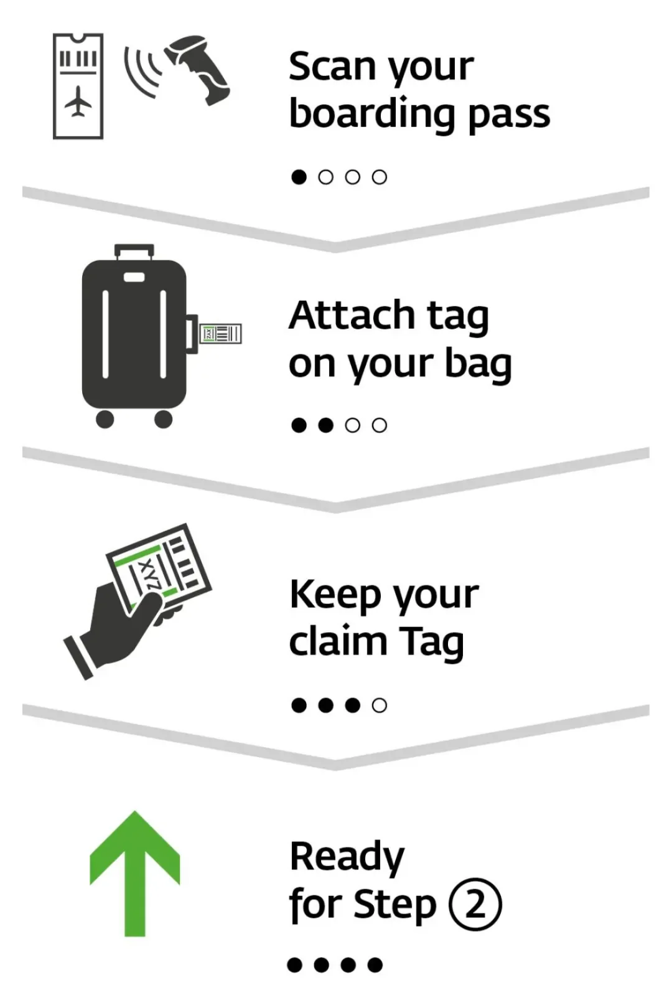

Wiens internationella flygplats (flygplatskod **VIE**) ligger cirka 18 km från stadskärnan och är Österrikes största internationella nav – och en av de viktigaste transferpunkterna mellan Centraleuropa och Östeuropa. Flygplatsen ligger bara 16–25 minuter från centrum, men expresståget, pendeltåget, bussarna och taxibilarna väger alla hastighet mot pris, och incheckningshallarna och säkerhetsentréerna är uppdelade efter terminal och destination. Att veta vilken byggnad och vilken entré som är din sparar verklig tid.

Den här guiden tar upp **terminaler och gateområden**, **transport in till staden**, **avgångsprocessen**, **flygplatsens faciliteter** och **planering av dagen utifrån ditt flyg** i fem delar.

Flygplatsens layout är enklare än den ser ut: terminalerna ligger under ett och samma tak, avgångarna är på övervåningen och ankomsterna på nedervåningen, och säkerhetsentréerna är grupperade efter gate. Det som verkligen måste bestämmas i förväg är tre saker – vilken byggnad ditt flyg använder, hur du tar dig in från staden och hur mycket tid du ska avsätta för incheckning och säkerhetskontroll. När det är klart kan bagageförvaring, tullfria kvoter och valutaväxling vänta tills du är på plats.

## 1. Terminaler och gateområden

Wien flygplats har tre terminaler i drift – **Terminal 1, Terminal 1A och Terminal 3** – som ligger på rad under ett tak, så du kan gå mellan dem. SKYLINK-utbyggnaden av Terminal 3 öppnade 2012 och kan ta emot flygplan så stora som Airbus A380; den är huvudbyggnaden för långdistansflyg.

Flygplatsen drivs av Flughafen Wien AG, där passagerarservice, bagagehantering och marktjänst delas mellan Vienna Airport, Swissport, Austrian Airlines och andra. Incheckningsdiskarna fördelas efter flygbolag, så kontrollera **vilken terminal** ditt flyg avgår från – för närvarande Terminal 1, Terminal 1A eller Terminal 3. Äldre flygplatsmaterial använder fortfarande namnet ”Terminal 2” för en lokal, men där sker ingen incheckning längre.

### Fem gateområden: B, C, D, F och G

Gaterna är grupperade i fem pirer, och gruppen avgör vilken säkerhetsentré du använder och om du passerar passkontroll. Pir D hette tidigare hall A och kallas östpiren; pir C är västpiren.

| Pir | Gater | Anslutning till huvudbyggnaden | Flyg |
| --- | --- | --- | --- |
| B (Terminal 1-sidan) | B22–B43 | Buss | Europeiska Schengenflyg |
| C (västpiren, Terminal 1-sidan) | C31–C42, varav C35–C41 är transfergater | Jetbrygga | Mest Schengen, en del internationella |
| C (västpiren, Terminal 1-sidan) | C71–C75 | Buss, nås via gate C31 | Endast Schengen |
| D (östpiren, tidigare hall A) | D21–D29 | Jetbrygga | Internationella flyg |
| D (östpiren, tidigare hall A) | D31–D37, D61–D70 | Buss | Internationella flyg |
| F, G (Terminal 3) | Gater F och G | Jetbrygga | Schengen (F) och icke-Schengen (G) |

Gater med jetbrygga leder direkt ut till flygplanet; gater som är markerade som bussgater innebär en tur nedför trappan och en bussresa, vilket ska räknas in i din boardingtid. C71–C75 är en separat grupp bussgater som nås via gate C31, så avsätt extra tid för promenad och väntan om du avgår därifrån.

### Internationella transfer: byt flyg utan att resa in i Österrike

Om Wien bara är ett mellanlandningsstopp kräver **internationella transfer inte att du reser in i Österrike**. Om du anländer till pir C med ett internationellt flyg följer du skyltarna ned till **Transitzone** på bottenvåningen och tar transferbussen till pir D för ditt vidare internationella flyg. Om du anländer till pir D och fortsätter med ett annat internationellt flyg gör du samma transfer inne på pir D via Transitzone och transferbussen. På pir D ligger transitområdet och passkontrollsområdet vid ingångarna till hallarna och vid jetbryggorna och bussgaterna – följ skyltarna med ”Transfer”.

## 2. Att ta sig in till staden och tillbaka

Det finns fem sätt att ta sig från flygplatsen in till Wien: **City Airport Train** är snabbast, **flygplatsbussarna** täcker stadskärnan och västra stationen, **S7-pendeltåget och Railjet-tågen** ger bäst värde för pengarna, **taxi** passar vid sena ankomster och tungt bagage, och **biluthyrning** passar en roadtrip som börjar i Wien. Rutter, tider och biljettpriser nedan är enligt flygplatsens och operatörernas publicerade uppgifter; kontrollera operatörernas webbplatser på resdagen.

Om du bara vill ha slutsatsen: ta **CAT** när tiden är viktig och du helst slipper byten; ta **S7** när budgeten går först och tio extra minuter är okej; ta **Railjet** när nästa sträcka är ett inrikes fjärrtåg; ta **bussen** om du ska bo mot Westbahnhof eller Donauzentrum; ta **taxi** efter en sen landning med tungt bagage. Tabellen jämför dem; avsnitten nedan tar upp var och en.

| Alternativ | Till centrum | Enkelbiljett | Bäst för |
| --- | --- | --- | --- |
| City Airport Train (CAT) | 16 min till Wien Mitte | 14,90 € | Tidsbrist, inga byten |
| S7-pendeltåg | cirka 25 min till Wien Mitte | cirka 5 € | Budget först, långsammare går bra |
| Railjet | 15 min till Wien Hauptbahnhof | ÖBB:s dagspris | Anslutning till inrikes fjärrtåg |
| Flygplatsbuss | 20–40 min beroende på hållplats | cirka 8 € | Boende mot Westbahnhof eller Donauzentrum |
| Taxi | cirka 20–30 min | taxameter | Sena ankomster, grupper, tungt bagage |

### 1. City Airport Train (CAT) – snabbast

City Airport Train går utan stopp från flygplatsen till **Wien Mitte (Landstraße)** i stadskärnan på **16 minuter**, vilket gör det till det minst stressiga sättet att ta sig in – biltrafiken är helt enkelt ingen faktor.

- **Öppettider:** 05:37–23:29 (stadskärnan → flygplatsen); 06:09–23:39 (flygplatsen → stadskärnan), ungefär var 30:e minut.
- **Hållplatser:** flygplatsen ↔ Wien Mitte, cirka **10 minuters** promenad från Stefansdomen.
- **Pris:** 14,90 € enkel resa, med billigare tur-och-retur-biljetter. Wiens lokaltrafikbiljetter och Vienna City Card gäller **inte** på CAT; du behöver en separat biljett.
- **Biljetter:** i ankomsthallen finns en egen CAT-disk där du kan köpa biljetter och fråga om alla CAT-tjänster.
- **City check-in för bagage:** i CAT-terminalen i stadskärnan kan du checka in och hämta ett boardingkort, vid bemannade diskar eller självbetjäningskiosker, från 24 timmar till 75 minuter före avgång.

### 2. Flygplatsbussar – bredast täckning

Flygplatsbussarna (Vienna Airport Lines / Postbus) förbinder flygplatsen med Wiens viktigaste transportknutpunkter, och de tre stadslinjerna täcker tillsammans varje tunnelbanelinje. Avgångarna mot Wien Westbahnhof och Wien Hauptbahnhof går **var 30:e minut**; linjen flygplatsen ↔ Morzinplatz/Schwedenplatz går **dygnet runt** och tar bara **20 minuter**.

- **Pris:** cirka 8 € enkel resa, köps ombord eller i disken.
- **Rutter och hållplatser:** se tabellen nedan.

| Destination | Busslinje | Restid |
| --- | --- | --- |
| Wien Morzinplatz/Schwedenplatz | Vienna Airport Lines | 20 min |
| Wien Donauzentrum (via VIC) | Vienna Airport Lines | 40 min |
| Wien Westbahnhof (via Hauptbahnhof) | Vienna Airport Lines | 40 min |
| Wien Erdberg (VIB) | AirLiner | 15 min |
| Graz (via Pinggau) | Dr. Richard / FlixBus | 2 tim 40 min |
| Münchendorf (via Fischamend) | Postbus | 50 min |
| Ebreichsdorf (via Gramatneusiedl) | Postbus | 73 min |
| Neusiedl a. See (via Bruck/Leitha) | Postbus | 70 min |

### 3. Långdistansbussar – vidare till grannhuvudstäderna

Till Bratislava, Budapest, Prag eller Brno är bussarna från flygplatsen ofta mer direkta än tåget, och många av dem utgår från flygplatsen – praktiskt om Wien är ett mellanlandningsstopp på vägen någon annanstans.

| Land | Destination | Operatör |
| --- | --- | --- |
| Bulgarien | Sofia | Flixbus |
| Tjeckien | Brno, Praha | RegioJet |
| Ungern | Budapest, Győr | FlixBus |
| Ungern | Budapest | RegioJet |
| Polen | Przemyśl | FlixBus |
| Polen | Warszawa | LeoExpress |
| Polen | Wrocław | FlixBus |
| Rumänien | Sibiu | FlixBus |
| Slovakien | Bratislava | Slovak Lines / FlixBus / RegioJet |
| Slovakien | Prešov, Košice | Eurobus |
| Slovenien | Ljubljana | FlixBus |

### 4. Pendeltåg och ÖBB-tåg – bäst värde

För att resa till priset av en lokaltrafikbiljett är **S7**-pendeltåget svaret: cirka **25 minuter** från flygplatsen till Wien Mitte, till ungefär en tredjedel av CAT-priset, och biljetten täcker sedan tunnelbana och spårvagnar i staden.

ÖBB:s Railjet-tåg förbinder flygplatsen med platser betydligt längre bort: direkt till Wien Hauptbahnhof (15 minuter), St. Pölten, Linz, Salzburg, Innsbruck, Graz och Klagenfurt, samt gränsöverskridande avgångar till Brno, Praha, Győr och Budapest. På Wien Hauptbahnhof (Wiens centralstation) kan du byta till många fler destinationer.

- **Pris:** cirka 5 € enkel resa med S7 (trafikförbundet VOR prissätter efter zon, och flygplatsen ligger utanför Wiens kärnzon – har du redan en lokaltrafikbiljett betalar du bara tillägget för flygplatssträckan).
- **Biljetter:** ÖBB-disken ligger i flygplatsens ankomsthall, en kort promenad bort, och biljetter säljs även i ÖBB:s biljettautomater och i ÖBB-appen.
- **Tidtabell:** se tabellen nedan; ÖBB:s och VOR:s egna dagliga upplysningar är avgörande.

| Destination | Linje | Restid |
| --- | --- | --- |
| Wien Mitte | Schnellbahn S7 | 25 min |
| Wien Hauptbahnhof | Railjet | 15 min |
| St. Pölten Hbf | Railjet | 55 min |
| Linz Hbf | Railjet | 1 tim 41 min |
| Salzburg Hbf | Railjet | 2 tim 49 min |
| Innsbruck Hbf | Railjet | 4 tim 40 min |
| Graz Hbf | Railjet * | 3 tim 00 min |
| Klagenfurt Hbf | Railjet ** | 4 tim 17 min |
| Brno | Railjet ** | 2 tim 03 min |
| Praha | Railjet ** | 4 tim 34 min |
| Győr | Railjet ** | 1 tim 50 min |
| Budapest | Railjet ** | 2 tim 59 min |

Avgångar markerade med \* och \*\* kräver vanligtvis tågbyte på Wien Hauptbahnhof; kontrollera ÖBB:s tidtabell för dagen.

### 5. Taxi

Ta en taxi från taxiståndet utanför ankomsthallen, eller använd en bil som beställs via disken ”City Transfer”; du kan också boka en i förväg per telefon.

| Taxibolag | Telefon |
| --- | --- |
| Airport Driver | +43-1-22822 |
| Airport Services | +43-1-7007-33151 |
| ATS Airport Transfer Service | +43-1-7007-35905 |
| Flughafentaxi ttc | +43-1-7007-33141 |
| 40100 | +43-1-40100 |

### 6. Biluthyrning

Uthyrningsdiskarna ligger samlade på **plan 0 i parkeringshus P4**, där Hertz, Sixt, Europcar, Avis, Budget, Enterprise, Alamo och National alla har diskar – du kör direkt ut på motorvägsnätet.

| Biluthyrningsföretag | Reservation |
| --- | --- |
| Alamo | +43-1-7007-33432 |
| Avis | +43-1-7007-32700 |
| Buchbinder | +43-1-7007-33316 |
| Budget | +43-1-7007-32700 |
| Enterprise | +43-1-7007-33432 |
| Europcar | +43-1-7007-32812 |
| Flizzr | +43-1-7007-36517 |
| Hertz | +43-1-7007-32661 |
| Megadrive | +43-1-7007-33316 |
| National | +43-1-7007-33432 |
| Payless | +43-1-7007-32700 |
| Sixt | +43-1-7007-36517 |
| Thrifty | +43-1-7007-32661 |

## 3. Avgång: incheckning, bagageinlämning, säkerhetskontroll

Den vanliga ordningen är **checka in → lämna bagaget → säkerhetskontroll → (icke-Schengenflyg) passkontroll → gå ombord**. Var på plats 2 timmar före en Schengenavgång och 3 timmar före ett icke-Schengenflyg eller långdistansflyg; lägg till en halvtimme under högsäsong och kring allmänna helgdagar.

Den extra timmen för ett långdistansflyg är inte utfyllnad. Wien separerar **Schengen- och icke-Schengenflödena** helt: ett Schengenflyg passerar säkerhetskontrollen och går till gaten, medan ett icke-Schengenflyg ställer sig i kö igen för passkontroll i en annan del av byggnaden, efter säkerhetskontrollen. Incheckning, bagageinlämning, säkerhetskontroll, passkontroll och promenaden till gaten summerar, och att ha pass, visum, boardingkort och bagagekvitto i samma ficka sparar letande vid varje kontroll.

### 1. Incheckning

- **Självbetjäningsincheckning:** använd ett kreditkort eller ett Miles & More-kort, ditt namn, din bokningsreferens, eller skanna helt enkelt ditt pass för att få ett boardingkort från självbetjäningsmaskinerna. Har du bagage att checka in talar maskinen om vilken bagageinlämningsdisk du ska använda.
- **Vid disken:** beroende på ditt flyg checkar du in och hämtar ditt boardingkort i Terminal 1, Terminal 1A eller Terminal 3.
- **Onlineincheckning:** de flesta flygbolag erbjuder det på sin webbplats eller i sin app, vilket sparar köande på flygplatsen; skriv ut boardingkortet där. Reser du med bagage som ska checkas in bör du först fråga vid relevant disk.
- **Incheckning på Wien Mitte:** vissa flygbolag erbjuder incheckning i City Airport Train-terminalen på Wien Mitte, där du visar ditt pass och får ditt boardingkort. Aktuell lista över flygbolag finns på cityairporttrain.com eller via telefon +43 1 25250.

### 2. Självbetjänad bagageinlämning

Wien flygplats självbetjänade bagageinlämning komprimerar överlämningen till fyra steg: **skanna ditt boardingkort → sätt taggen på din väska → behåll din kvittotagg → fortsätt till säkerhetskontrollen.**

Vid självbetjäningsbanden bredvid incheckningsöarna skannar du ditt boardingkort för att bekräfta flyget, fäster den utskrivna taggen i handtaget på resväskan, lägger väskan på bandet och behåller kvittotaggen – om väskan kommer bort är den din enda dokumentation.

### 3. Att tänka på med bagaget

- För **överviktigt bagage eller husdjur**, använd **diskarna för skrymmande bagage i Terminal 1 eller Terminal 3**.
- Sätt ditt namn och din adress på väskan och ta bort gamla taggar – gamla streckkoder förvirrar sorteringssystemet och gör att väskan lättare hamnar fel.
- Bär värdesaker, viktiga dokument och mediciner med dig i stället för att checka in dem.
- Säkra väskan med ett band eller hänglås vid behov, eller använd flygplatsens bagageinplastningstjänst (se avsnittet om faciliteter nedan).

### 4. Säkerhetskontroll och passkontroll

Säkerhetsentréerna är uppdelade efter gategrupp, och fel ingång kostar dig en lång promenad:

- **Säkerhetsentré 2:** för avgångar från gate B, C och D.
- **Säkerhetsentré 3:** för avgångar från gate F och G.

Efter säkerhetskontrollen finns butiker och restauranger i avgångsområdet; vänner och familj som följer dig till flygplatsen kan inte följa med igenom.

- För **Schengenländer**, använd gate **B, C och F**.
- För **länder utanför Schengen**, använd gate **D och G**, och du måste passera **passkontroll** innan du fortsätter till gaten.

Resenärer med pass från länder utanför EU behöver vanligtvis också genomföra **EES-registrering** (fingeravtryck och ansiktsbild) vid en självbetjäningskiosk före passkontrollen. Vid en första inresa tar det några extra minuter – räkna in det i en tight anslutning.

## 4. Flygplatsens faciliteter och praktisk information

Wiens faciliteter följer en enkel regel: **avgångsplanet hanterar incheckning och säkerhetskontroll, ankomstplanet hanterar bagage, information och marktransport**, och restauranger, butiker och sittplatser finns samlade på flygsidan. Bagageförvaring, tullstämpeln och hittegods finns alla på ankomstplan 0 och runt Terminal 1; när du väl har passerat säkerhetskontrollen är det bara tjänsterna på flygsidan som är inom räckhåll. Avsnitten nedan går från de mest använda till de minst använda.

### Information och bagagetjänster

Det finns **tre informationsdiskar**: två på avgångsplanen i Terminal 1 och Terminal 3, och en i Terminal 3:s ankomsthall. Frågor om bagage och faciliteter kan alla besvaras här.

**Bagagetjänstecentrumen** i incheckningsområdena i Terminal 1 och Terminal 3 är öppna **00:00–24:00** och erbjuder:

| Tjänst | Pris | Anmärkningar |
| --- | --- | --- |
| Bagageförvaring | 4 € per föremål och dag; skrymmande föremål 8 € per föremål och dag | Föremål kan förvaras i upp till 6 månader |
| Bagageinplastning | 12 € per föremål | Din väska förseglas i skyddsplast mot skador, fukt och stöld; finns i bagageområdena i Terminal 1 och Terminal 3 |
| Bagageleverans | från 15 € för upp till 5 föremål, 3 € för varje extra föremål | Boka minst 72 timmar i förväg genom att mejla service@viennaairport.com, eller boka direkt i flygplatsens webbutik |
| Värdeskåp | 6 € per dag | För dokument, nycklar och liknande; vapen, explosiva varor, brandfarliga eller andra farliga varor samt färskvaror eller starkt luktande föremål får inte förvaras |
| Garderob | 2 € per set och dag | Ett set är en jacka eller kappa, skor, smycken, handskar och en halsduk |

### Medicinsk mottagning, bönerum och hittegods

- **Medicinsk mottagning:** Terminal 1, korridoren på plan 1, mittemot apoteket, öppen **07:00–19:00**. Vaccinationer omfattar gula febern, tyfoidfeber, rabies, hepatit A och B (även för barn), malaria, fästingburen encefalit, influensa, det kombinerade difteri/polio/stelkramp/kikhosta-vaccinet, meningokocksjukdom och japansk encefalit – ring i förväg för att kontrollera lagret.
- **Bönerum:** det finns ett bönerum i terminalen; fråga i en informationsdisk var det ligger.
- **Hittegods:** hittegodskontoret på plan 0 i Terminal 1, eller informationsdisken i Terminal 3:s ankomsthall.
- **Återsända hittegods per post:** använd leverans- och packtjänsten hos Mail Boxes Etc. i A-2320 Schwechat, eller vilken kurir du föredrar; kontaktadressen är mbe0045@mbe.at. Föremål som förvaras längre än 8 dagar medför en förvaringsavgift, och **betalningen måste vara genomförd innan föremålet skickas**: vid kortbetalning kommer fakturan och betalningslänken via e-post; vid banköverföring anger du fakturanumret i fältet för betalningsreferens, annars kan din betalning inte identifieras.

### Tull och tullfria kvoter

Resenärer som reser in i Österrike från länder utanför EU får ta in följande inom de tullfria kvoterna. **Resenärer på samma resa får inte slå samman sina kvoter** – en regel som ofta missas:

| Kategori | Tullfri kvot |
| --- | --- |
| Varornas totalvärde | upp till **430 €** (endast flygresenärer; 300 € för ankomst landvägen) |
| Cigaretter | 200 |
| eller cigarrer | 50 |
| eller cigariller | 100 |
| eller tobak | 250 g |
| eller en kombination av ovanstående | – |
| plus vin | 4 l |
| plus sprit över 22 % alkoholhalt | 1 l |
| eller sprit eller aperitif under 22 % | 2 l |
| eller mousserande vin eller likörer | 2 l |
| eller en kombination av ovanstående | – |

- **Åldersgränser:** passagerare under 15 har en kvot på 150 €; alkohol- och tobakskvoterna gäller från 17 års ålder.
- **Kontantdeklaration:** att föra in eller ut mer än **10 000 €** i kontanter eller andra betalningsmedel (resenärschecker, guldtackor, guldmynt och liknande) till eller från EU måste deklareras för tullen; blanketter finns i tulldisken eller på ett tullkontor.
- **Exportåterbetalningsstämplar:** tullkontoret för export ligger på ankomstplan 0.

### Valutaväxling och bankomater

Flygplatsens valutaväxlingsdiskar drivs av **Interchange**, med filialer vid gaterna, i ankomsthallen och i terminalerna, i allmänhet öppna från klockan 5 på morgonen till sent på kvällen; bankomaterna är ännu mer utspridda, från ankomsthallen till gatepirerna.

| Plats | Öppettider | Åtkomst |
| --- | --- | --- |
| Gate D | 05:00–00:00 | Endast passagerare |
| Gate F | 05:00–22:00 | Endast passagerare |
| Gate G | 05:00–23:00 | Endast passagerare |
| Plaza | 06:00–23:00 | Endast passagerare |
| Terminal 3 | 05:00–22:00 | Endast passagerare |
| Ankomsthall (3 diskar) | 05:00–22:00, en till 23:00 | Alla |
| Terminal 2 | 06:00–20:00 | Alla |
| Office Park 1 | 05:00–22:00 | Alla |

Diskarna erbjuder valutaväxling, skatteåterbetalning och internationella överföringar; vissa diskar i ankomsthallen och Terminal 2 och 3 säljer också telefonkort.

Bankomater finns i ankomsthallen, vid gate C/D/F/G, på Plaza, i parkering 8, i allmänna ytor i Terminal 1, 2 och 3, i Office Park 1, Office Park 3 och VIP/GAC-området. Bankomaterna i ankomsthallen, parkeringshusen, terminalerna och kontorsbyggnaderna är öppna för alla; de vid gaterna och Plaza är endast för passagerare.

### Wi-Fi, el och SIM-kort

- **Wi-Fi:** täcker hela terminalen, så du kan kolla flyg och skriva hem medan du väntar.
- **El och arbete:** gate F och G har särskilda arbetsplatser där du kan koppla in dig och använda en bärbar dator.
- **SIM-kort och reparationer:** Mr. Mobile erbjuder reparation av telefoner, surfplattor och bärbara datorer, lån av telefoner och förbetalda SIM-kort.

## 5. Planera dagen utifrån ditt flyg

Allt ovanstående kokar ner till tre resor. Var och en har en egen tidsbudget, men de delar en regel: **bekräfta terminal och gate först, välj sedan transport.**

### Ankomst och direkt in till staden

Vid en landning på dagen med lätt bagage är S7 det enklaste sättet in: följ S-Bahn-skyltarna ner till plattformen, köp en biljett till Wien Mitte, och ungefär tjugofem minuter senare är du i tunnelbanan. Ta CAT om du har ont om tid eller reser med barn; efter en sen landning ställer du dig i taxikö utanför ankomsthallen i stället för att jaga det sista tåget för att spara några euro.

### Ta flyget från staden

Både CAT och S7 avgår från Wien Mitte; CAT är cirka tio minuter snabbare och kostar mer än dubbelt så mycket. Tiden som verkligen spelar roll är **på flygplatsen**: räkna bakåt från gaten genom säkerhetskontroll, bagageinlämning och incheckning – 2 timmar för ett Schengenflyg, 3 för ett icke-Schengenflyg. Att lägga till en halvtimme i staden är mycket mindre användbart än att lägga den på flygplatsen. Högsäsong, allmänna helgdagar och morgonrusningen förtjänar var och en ytterligare en halvtimme.

### Anslutning i Wien

En anslutning mellan två internationella flyg kräver inte att du reser in i Österrike: följ Transfer-skyltarna genom transitområdet. Om det vidare flyget däremot är ett Schengenflyg reser du in och passerar säkerhetskontrollen igen, så räkna anslutningen som en ankomst. Två timmar mellan flygen är bekvämt; tillåt tre om du byter terminal eller behöver hämta och checka in en väska igen.

## Relaterade länkar

- **På den här webbplatsen**: [Wiens internationella flygplats (VIE)](/airport/VIE), [Österrike (AT)](/country/AT)
- **Wikipedia**: [Wiens internationella flygplats](https://en.wikipedia.org/wiki/Vienna_International_Airport)
- **Baidu Baike**: [Wiens internationella flygplats](https://baike.baidu.com/item/%E7%BB%B4%E4%B9%9F%E7%BA%B3%E5%9B%BD%E9%99%85%E6%9C%BA%E5%9C%BA)

Bildkälla: Vienna Airport. Biljettpriser, öppettider och diskarnas placering är enligt flygplatsens och operatörernas publicerade uppgifter; kontrollera deras webbplatser på resdagen.
