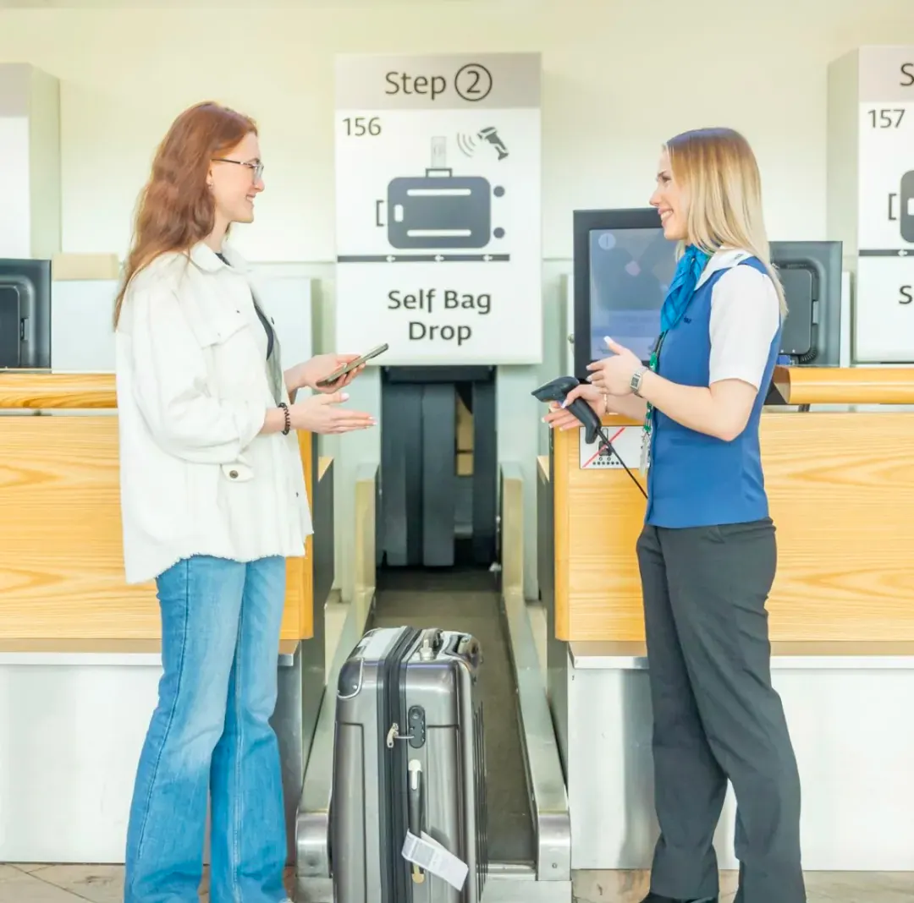

Uwanja wa Ndege wa Kimataifa wa Vienna (msimbo wa uwanja **VIE**) uko takriban kilomita 18 kutoka katikati ya mji na ndio kitovu kikubwa zaidi cha kimataifa cha Austria — na mojawapo ya vituo muhimu zaidi vya kubadilisha ndege kati ya Ulaya ya kati na mashariki. Uwanja huu uko dakika 16–25 tu kutoka mjini, lakini treni ya haraka, S-Bahn, mabasi na teksi zote hubadilisha kasi na bei, na kumbi za kusajili na milango ya ukaguzi wa usalama zimegawanywa kwa terminal na marudio. Kujua ni jengo gani na mlango upi ni wako huokoa muda halisi.

Mwongozo huu unashughulikia **terminal na maeneo ya malango**, **usafiri wa kuelekea mjini**, **mchakato wa kuondoka**, **huduma za uwanja wa ndege** na **kupanga siku yako kulingana na ndege yako** katika sehemu tano.

Muundo wa uwanja huu ni rahisi kuliko unavyodhani: terminal zote ziko chini ya paa moja, kuondoka ni ghorofani na kuwasili ni chini, na milango ya ukaguzi wa usalama imepangwa kwa makundi ya malango. Kinachohitaji kuamuliwa mapema kwa kweli ni mambo matatu — jengo gani ndege yako inatumia, unaingiaje kutoka mjini, na uache muda gani kwa kusajili na ukaguzi wa usalama. Yakishaamuliwa, kuhifadhi mizigo, posho za msamaha wa ushuru na kubadilisha fedha vinaweza kusubiri hadi ufike.

## 1. Terminal na maeneo ya malango

Uwanja wa Ndege wa Vienna una terminal tatu zinazotumika — **Terminal 1, Terminal 1A na Terminal 3** — zilizopangwa chini ya paa moja, hivyo unaweza kutembea kati yao. Upanuzi wa SKYLINK wa Terminal 3 ulifunguliwa mwaka 2012 na unaweza kupokea ndege kubwa kama Airbus A380; ndio jengo kuu la safari za masafa marefu.

Uwanja huu unaendeshwa na Flughafen Wien AG, huku huduma za abiria, utunzaji wa mizigo na huduma za ardhini zikigawanywa kati ya Vienna Airport, Swissport, Austrian Airlines na wengine. Madawati ya kusajili yametengwa kwa shirika la ndege, kwa hivyo hakikisha **terminal ipi** ndege yako inatumia — kwa sasa Terminal 1, Terminal 1A au Terminal 3. Nyenzo za zamani za uwanja bado zinatumia jina "Terminal 2" kwa eneo fulani, lakini halishughulikii kusajili tena.

### Maeneo matano ya malango: B, C, D, F na G

Malango yamepangwa katika gati tano, na kundi hilo huamua mlango upi wa ukaguzi wa usalama unatumia na kama unapita ukaguzi wa pasipoti. Gati D zamani liliitwa Hall A na linajulikana kama gati la mashariki; gati C ni gati la magharibi.

| Gati | Malango | Muunganisho na jengo kuu | Ndege |
| --- | --- | --- | --- |
| B (upande wa Terminal 1) | B22–B43 | Basi | Ndege za Schengen za Ulaya |
| C (gati la magharibi, upande wa Terminal 1) | C31–C42, ambapo C35–C41 ni malango ya kuunganisha | Daraja la ndege | Nyingi ni za Schengen, chache za kimataifa |
| C (gati la magharibi, upande wa Terminal 1) | C71–C75 | Basi, hufikiwa kupitia lango C31 | Schengen pekee |
| D (gati la mashariki, zamani Hall A) | D21–D29 | Daraja la ndege | Ndege za kimataifa |
| D (gati la mashariki, zamani Hall A) | D31–D37, D61–D70 | Basi | Ndege za kimataifa |
| F, G (Terminal 3) | Malango F na G | Daraja la ndege | Schengen (F) na zisizo za Schengen (G) |

Malango yenye daraja la ndege hupanda moja kwa moja ndani ya ndege; malango yanayoonyeshwa kama malango ya basi humaanisha kushuka chini na kupanda basi la kuhamisha, jambo ambalo linapaswa kuhesabiwa katika muda wako wa kupanda. C71–C75 ni kundi tofauti la malango ya basi linalofikiwa kupitia lango C31, kwa hivyo toa muda zaidi wa kutembea na kusubiri ikiwa unaondoka kutoka hapo.

### Uhamisho wa kimataifa: badilisha ndege bila kuingia Austria

Ikiwa Vienna ni kituo cha kupita tu, **uhamisho wa kimataifa hauhitaji kuingia Austria**. Ukifika kwenye gati C kwa ndege ya kimataifa, fuata alama kushuka hadi **Transitzone** kwenye ghorofa ya chini na upande basi la kuhamisha kuelekea gati D kwa ndege yako ya kimataifa inayofuata. Ukifika gati D na kuendelea na ndege nyingine ya kimataifa, unafanya uhamisho huohuo ndani ya gati D ukitumia Transitzone na basi la kuhamisha. Katika gati D eneo la kupita na eneo la ukaguzi wa pasipoti ziko kwenye milango ya kumbi na kwenye daraja la ndege na malango ya basi — fuata alama za "Transfer".

## 2. Kuingia mjini na kurudi

Kuna njia tano za kuingia Vienna kutoka uwanja wa ndege: **City Airport Train** ndiyo ya haraka zaidi, **mabasi ya uwanja wa ndege** hufikia katikati ya mji na kituo cha magharibi, **treni za S7 S-Bahn na Railjet** hutoa thamani bora, **teksi** zinafaa kwa kuwasili usiku na mizigo mizito, na **kukodisha gari** kunafaa kwa safari ya barabara inayoanza Vienna. Njia, muda na nauli zilizo hapa chini ni kama zilivyotangazwa na uwanja wa ndege na waendeshaji; angalia tovuti za waendeshaji siku unayosafiri.

Ikiwa unataka hitimisho tu: chukua **CAT** wakati muda ni muhimu na hupendi kufikiria kubadilisha treni; chukua **S7** wakati bajeti ndiyo kipaumbele na dakika kumi za ziada hazijalishi; chukua **Railjet** wakati kipande kinachofuata ni treni ya masafa marefu ya ndani; chukua **basi** ikiwa unakaa upande wa Westbahnhof au Donauzentrum; chukua **teksi** baada ya kutua usiku kukiwa na mizigo mizito. Jedwali linazilinganisha; sehemu zilizo hapa chini zinashughulikia kila moja kwa zamu.

| Chaguo | Hadi katikati ya mji | Nauli ya safari moja | Inafaa zaidi kwa |
| --- | --- | --- | --- |
| City Airport Train (CAT) | Dakika 16 hadi Wien Mitte | €14.90 | Haraka, bila kubadilisha |
| S7 S-Bahn | Takriban dakika 25 hadi Wien Mitte | Takriban €5 | Bajeti kwanza, polepole ni sawa |
| Railjet | Dakika 15 hadi Wien Hauptbahnhof | Nauli ya ÖBB ya siku | Kuunganisha na treni ya masafa marefu ya ndani |
| Basi la uwanja wa ndege | Dakika 20–40 kulingana na kituo | Takriban €8 | Kukaa upande wa Westbahnhof au Donauzentrum |
| Teksi | Takriban dakika 20–30 | Kwa mita ya teksi | Kuwasili usiku, vikundi, mizigo mizito |

### 1. City Airport Train (CAT) — ya haraka zaidi

City Airport Train husafiri bila kusimama kutoka uwanja wa ndege hadi **Wien Mitte (Landstraße)** katikati ya mji kwa **dakika 16**, jambo linaloifanya kuwa njia isiyo na msongo wowote — msongamano wa barabarani hauzingatiwi kabisa.

- **Saa za kazi:** 05:37–23:29 (katikati ya mji → uwanja wa ndege); 06:09–23:39 (uwanja wa ndege → katikati ya mji), takriban kila dakika 30.
- **Vituo:** uwanja wa ndege ↔ Wien Mitte, takriban **dakika 10** za kutembea kutoka Kanisa Kuu la Mtakatifu Stephen.
- **Nauli:** €14.90 kwa safari moja, na tikiti za kurudi kwa bei nafuu. Tikiti za usafiri wa mjini Vienna na Vienna City Card **hazikubaliki** kwenye CAT; unahitaji tikiti tofauti.
- **Tikiti:** ukumbi wa kuwasili una dawati maalum la CAT ambapo unaweza kununua tikiti na kuuliza kuhusu huduma yoyote ya CAT.
- **Kusajili mizigo mjini:** kwenye kituo cha CAT katikati ya mji unaweza kusajili na kupata kadi ya kupanda, kwenye madawati yenye watumishi au kioski za kujihudumia, kuanzia saa 24 hadi dakika 75 kabla ya kuondoka.

### 2. Mabasi ya uwanja wa ndege — huduma pana zaidi

Mabasi ya uwanja wa ndege (Vienna Airport Lines / Postbus) huunganisha uwanja na vituo vikuu vya usafiri vya Vienna, na njia tatu za mjini kati yao hufikia kila njia ya metro. Huduma kuelekea Wien Westbahnhof na Wien Hauptbahnhof huenda **kila dakika 30**; njia ya uwanja wa ndege ↔ Morzinplatz/Schwedenplatz huenda **mchana na usiku** na inachukua **dakika 20** tu.

- **Nauli:** takriban €8 kwa safari moja, ikinunuliwa ndani ya basi au kwenye dawati.
- **Njia na vituo:** tazama jedwali lililo hapa chini.

| Marudio | Basi | Muda wa safari |
| --- | --- | --- |
| Wien Morzinplatz/Schwedenplatz | Vienna Airport Lines | Dakika 20 |
| Wien Donauzentrum (kupitia VIC) | Vienna Airport Lines | Dakika 40 |
| Wien Westbahnhof (kupitia Hauptbahnhof) | Vienna Airport Lines | Dakika 40 |
| Wien Erdberg (VIB) | AirLiner | Dakika 15 |
| Graz (kupitia Pinggau) | Dr. Richard / FlixBus | Saa 2 dakika 40 |
| Münchendorf (kupitia Fischamend) | Postbus | Dakika 50 |
| Ebreichsdorf (kupitia Gramatneusiedl) | Postbus | Dakika 73 |
| Neusiedl a. See (kupitia Bruck/Leitha) | Postbus | Dakika 70 |

### 3. Mabasi ya masafa marefu — kuendelea hadi miji mikuu jirani

Kwa Bratislava, Budapest, Prague au Brno, mabasi ya kutoka uwanja wa ndege mara nyingi ni ya moja kwa moja zaidi kuliko treni, na mengi yanaanza uwanja wa ndege — jambo la manufaa ikiwa Vienna ni kituo cha kupita njiani kuelekea mahali pengine.

| Nchi | Marudio | Mwendeshaji |
| --- | --- | --- |
| Bulgaria | Sofia | Flixbus |
| Chechia | Brno, Praha | RegioJet |
| Hungaria | Budapest, Győr | FlixBus |
| Hungaria | Budapest | RegioJet |
| Poland | Przemyśl | FlixBus |
| Poland | Warsaw | LeoExpress |
| Poland | Wrocław | FlixBus |
| Romania | Sibiu | FlixBus |
| Slovakia | Bratislava | Slovak Lines / FlixBus / RegioJet |
| Slovakia | Prešov, Košice | Eurobus |
| Slovenia | Ljubljana | FlixBus |

### 4. Treni za S-Bahn na ÖBB — thamani bora

Ili kusafiri kwa bei ya tikiti ya mjini, **S7** S-Bahn ndiyo jibu: takriban **dakika 25** kutoka uwanja wa ndege hadi Wien Mitte, kwa takriban theluthi moja ya nauli ya CAT, na tikiti hiyo inashughulikia metro na tramu mjini.

Treni za Railjet za ÖBB huunganisha uwanja wa ndege na maeneo ya mbali zaidi: moja kwa moja hadi Wien Hauptbahnhof (dakika 15), St. Pölten, Linz, Salzburg, Innsbruck, Graz na Klagenfurt, pamoja na huduma za kuvuka mpaka hadi Brno, Praha, Győr na Budapest. Kwenye Wien Hauptbahnhof (Kituo Kikuu cha Vienna) unaweza kubadilisha kwa marudio mengi zaidi.

- **Nauli:** takriban €5 kwa safari moja kwenye S7 (chama cha usafiri cha VOR hupanga bei kwa kanda, na uwanja wa ndege uko nje ya kanda kuu ya Vienna — ikiwa tayari una tikiti ya mjini, unalipa nyongeza ya sehemu ya uwanja wa ndege pekee).
- **Tikiti:** dawati la ÖBB liko kwenye ukumbi wa kuwasili wa uwanja wa ndege, umbali mdogo wa kutembea, na tikiti pia zinauzwa kwenye mashine za ÖBB na kwenye programu ya ÖBB.
- **Ratiba:** tazama jedwali lililo hapa chini; matangazo ya ÖBB na VOR ya siku husika ndiyo yenye uamuzi wa mwisho.

| Marudio | Njia | Muda wa safari |
| --- | --- | --- |
| Wien Mitte | Schnellbahn S7 | Dakika 25 |
| Wien Hauptbahnhof | Railjet | Dakika 15 |
| St. Pölten Hbf | Railjet | Dakika 55 |
| Linz Hbf | Railjet | Saa 1 dakika 41 |
| Salzburg Hbf | Railjet | Saa 2 dakika 49 |
| Innsbruck Hbf | Railjet | Saa 4 dakika 40 |
| Graz Hbf | Railjet * | Saa 3 dakika 00 |
| Klagenfurt Hbf | Railjet ** | Saa 4 dakika 17 |
| Brno | Railjet ** | Saa 2 dakika 03 |
| Praha | Railjet ** | Saa 4 dakika 34 |
| Győr | Railjet ** | Saa 1 dakika 50 |
| Budapest | Railjet ** | Saa 2 dakika 59 |

Huduma zilizowekwa alama ya \* na \*\* kwa kawaida huhitaji kubadilisha treni kwenye Wien Hauptbahnhof; angalia ratiba ya ÖBB ya siku husika.

### 5. Teksi

Chukua teksi kutoka kituo kilicho nje ya ukumbi wa kuwasili, au tumia gari linalotumwa na dawati la "City Transfer"; unaweza pia kuagiza kwa simu mapema.

| Kampuni ya teksi | Simu |
| --- | --- |
| Airport Driver | +43-1-22822 |
| Airport Services | +43-1-7007-33151 |
| ATS Airport Transfer Service | +43-1-7007-35905 |
| Flughafentaxi ttc | +43-1-7007-33141 |
| 40100 | +43-1-40100 |

### 6. Kukodisha gari

Madawati ya kukodisha gari yako pamoja kwenye **ngazi ya 0 ya eneo la maegesho ya ghorofa P4**, ambapo Hertz, Sixt, Europcar, Avis, Budget, Enterprise, Alamo na National wote wana madawati — unaendesha moja kwa moja hadi kwenye mtandao wa barabara kuu.

| Kampuni ya kukodisha | Uhifadhi |
| --- | --- |
| Alamo | +43-1-7007-33432 |
| Avis | +43-1-7007-32700 |
| Buchbinder | +43-1-7007-33316 |
| Budget | +43-1-7007-32700 |
| Enterprise | +43-1-7007-33432 |
| Europcar | +43-1-7007-32812 |
| Flizzr | +43-1-7007-36517 |
| Hertz | +43-1-7007-32661 |
| Megadrive | +43-1-7007-33316 |
| National | +43-1-7007-33432 |
| Payless | +43-1-7007-32700 |
| Sixt | +43-1-7007-36517 |
| Thrifty | +43-1-7007-32661 |

## 3. Kuondoka: kusajili, kuweka mizigo, ukaguzi wa usalama

Mfululizo wa kawaida ni **sajili → weka mizigo → ukaguzi wa usalama → (ndege zisizo za Schengen) ukaguzi wa pasipoti → panda**. Fika saa 2 kabla ya kuondoka kwa ndege ya Schengen na saa 3 kabla ya ndege isiyo ya Schengen au ya masafa marefu; ongeza nusu saa katika msimu wa shughuli nyingi na karibu na sikukuu za umma.

Saa ya ziada kwa ndege ya masafa marefu si ya kupoteza. Vienna hutenganisha **mtiririko wa Schengen na usio wa Schengen** kabisa: ndege ya Schengen hupita ukaguzi wa usalama na kwenda kwa miguu hadi lango, wakati ndege isiyo ya Schengen hupanga foleni tena kwa ukaguzi wa pasipoti sehemu nyingine ya jengo, baada ya ukaguzi wa usalama. Kusajili, kuweka mizigo, ukaguzi wa usalama, ukaguzi wa pasipoti na kutembea hadi lango huongeza muda, na kuweka pasipoti, viza, kadi ya kupanda na risiti ya mzigo kwenye mfuko mmoja huokoa utafutaji kwenye kila kituo cha ukaguzi.

### 1. Kusajili

- **Kusajili kwa kujihudumia:** tumia kadi ya mkopo au kadi ya Miles & More, jina lako, namba yako ya uhifadhi, au changanua pasipoti yako tu kupata kadi ya kupanda kutoka mashine za kujihudumia. Ikiwa una mizigo ya kusajili, mashine inakuambia dawati lipi la kuweka mizigo la kutumia.
- **Kwenye dawati:** kulingana na ndege yako, sajili na upate kadi yako ya kupanda katika Terminal 1, Terminal 1A au Terminal 3.
- **Kusajili mtandaoni:** mashirika mengi ya ndege hutoa huduma hii kwenye tovuti au programu yao, jambo linaloepusha kupanga foleni uwanja wa ndege; chapisha kadi yako ya kupanda hapo. Ikiwa unasafiri na mizigo ya kusajili, uliza kwenye dawati husika kwanza.
- **Kusajili kwenye Wien Mitte:** mashirika mengine ya ndege hutoa kusajili kwenye kituo cha City Airport Train cha Wien Mitte, ambapo unaonyesha pasipoti yako na kupokea kadi yako ya kupanda. Kwa orodha ya sasa ya mashirika, tazama cityairporttrain.com au piga simu +43 1 25250.

### 2. Kuweka mizigo mwenyewe

Mfumo wa kuweka mizigo mwenyewe wa Uwanja wa Ndege wa Vienna hufupisha uwasilishaji katika hatua nne: **changanua kadi yako ya kupanda → ambatanisha lebo kwenye mzigo wako → weka risiti yako ya mzigo → nenda kwenye ukaguzi wa usalama.**

Kwenye mikanda ya kujihudumia kando ya visiwa vya kusajili, changanua kadi yako ya kupanda kuthibitisha ndege, ambatanisha lebo iliyochapishwa kwenye mpini wa sanduku lako, weka mzigo kwenye mkanda, na uweke risiti ya mzigo — ikiwa mzigo utapotea, ndiyo rekodi pekee uliyo nayo.

### 3. Vidokezo kuhusu mizigo

- Kwa **mizigo inayozidi uzito au wanyama vipenzi**, tumia **madawati ya mizigo mikubwa katika Terminal 1 au Terminal 3**.
- Weka jina lako na anwani kwenye mzigo na ondoa lebo za zamani — misimbo ya barza ya zamani huchanganya mfumo wa kupanga mizigo na kuongeza uwezekano wa mzigo kwenda mahali pasipofaa.
- Beba vitu vya thamani, nyaraka muhimu na dawa pamoja nawe badala ya kuzisajili.
- Funga mzigo kwa kamba au kufuli ikiwa ni lazima, au tumia huduma ya ufungashaji wa mizigo ya uwanja wa ndege (tazama sehemu ya huduma hapa chini).

### 4. Ukaguzi wa usalama na ukaguzi wa pasipoti

Milango ya ukaguzi wa usalama imegawanywa kwa kundi la lango, na kuchagua isivyofaa hukugharimu matembezi marefu:

- **Mlango wa ukaguzi wa usalama 2:** kwa kuondoka kutoka malango B, C na D.
- **Mlango wa ukaguzi wa usalama 3:** kwa kuondoka kutoka malango F na G.

Baada ya ukaguzi wa usalama kuna maduka na migahawa katika eneo la kuondoka; marafiki na familia wanaokuaga hawawezi kupita pamoja nawe.

- Kwa **nchi za Schengen**, tumia malango **B, C na F**.
- Kwa **nchi zisizo za Schengen**, tumia malango **D na G**, na lazima upite **ukaguzi wa pasipoti** kabla ya kuendelea hadi lango.

Wasafiri wenye pasipoti zisizo za Umoja wa Ulaya kwa kawaida pia watahitaji kukamilisha **usajili wa EES** (alama za vidole na picha ya uso) kwenye kioski ya kujihudumia kabla ya ukaguzi wa pasipoti. Kwenye kuingia kwa mara ya kwanza hii huchukua dakika chache za ziada — ihesabu ndani ya muunganisho wenye muda mchache.

## 4. Huduma za uwanja wa ndege na taarifa za kivitendo

Huduma za Vienna zinafuata kanuni rahisi: **ngazi ya kuondoka hushughulikia kusajili na ukaguzi wa usalama, ngazi ya kuwasili hushughulikia mizigo, taarifa na usafiri wa ardhini**, na migahawa, maduka na viti vimejikita upande wa ndani wa ukaguzi. Kuhifadhi mizigo, muhuri wa forodha na mali zilizopotea zote ziko kwenye ngazi ya 0 ya kuwasili na kuzunguka Terminal 1; ukishapita ukaguzi wa usalama, ni huduma za upande wa ndani tu zinazoweza kufikiwa. Sehemu zilizo hapa chini zimepangwa kutoka zinazotumika zaidi hadi zile zinazotumika kidogo.

### Maswali na huduma za mizigo

Kuna **madawati matatu ya taarifa**: mawili kwenye ngazi za kuondoka za Terminal 1 na 3, na moja kwenye ukumbi wa kuwasili wa Terminal 3. Maswali kuhusu mizigo na huduma yote yanaweza kujibiwa hapa.

**Vituo vya huduma za mizigo** katika maeneo ya kusajili ya Terminal 1 na 3 hufunguliwa **00:00–24:00** na hutoa:

| Huduma | Bei | Maelezo |
| --- | --- | --- |
| Kuhifadhi mizigo | €4 kwa kila kitu kwa siku; vitu vikubwa €8 kwa kila kitu kwa siku | Vitu vinaweza kuhifadhiwa hadi miezi 6 |
| Ufungashaji wa mizigo | €12 kwa kila kitu | Mzigo wako hufungwa kwa filamu ya kinga dhidi ya uharibifu, unyevu na wizi; inapatikana katika maeneo ya mizigo ya Terminal 1 na 3 |
| Usafirishaji wa mizigo | kuanzia €15 kwa hadi vitu 5, €3 kwa kila kitu cha ziada | Hifadhi angalau saa 72 mapema kwa kutuma barua pepe kwa service@viennaairport.com, au hifadhi moja kwa moja kwenye duka la mtandaoni la uwanja wa ndege |
| Sanduku za kuhifadhi vitu vya thamani | €6 kwa siku | Kwa nyaraka, funguo na vitu kama hivyo; silaha, vilipuzi, vitu vinavyoweza kuwaka au bidhaa nyingine hatarishi, na vitu viharibikavyo au vyenye harufu kali haziruhusiwi kuhifadhiwa |
| Kabati la nguo | €2 kwa seti kwa siku | Seti moja ni jaketi au koti, viatu, vito, glavu na shali |

### Kituo cha matibabu, chumba cha maombi na mali zilizopotea

- **Kituo cha matibabu:** Terminal 1, korido ya ngazi ya 1, mkabala na duka la dawa, hufunguliwa **07:00–19:00**. Chanjo zinajumuisha homa ya manjano, typhoid, kichaa cha mbwa, hepatitis A na B (pia kwa watoto), malaria, uvimbe wa ubongo unaoenezwa na kupe, mafua ya msimu, chanjo ya pamoja ya diphtheria/polio/tetanusi/kikohozi cha kifaduro, ugonjwa wa meningokokasi na uvimbe wa ubongo wa Kijapani — piga simu kwanza kuhakikisha upatikanaji.
- **Chumba cha maombi:** kuna chumba cha maombi ndani ya terminal; uliza kwenye dawati la taarifa kuhusu mahali pake.
- **Mali zilizopotea:** ofisi ya mali zilizopotea kwenye ngazi ya 0 ya Terminal 1, au dawati la taarifa kwenye ukumbi wa kuwasili wa Terminal 3.
- **Kurudisha vitu vilivyopotea kwa posta:** tumia huduma ya usafirishaji na ufungashaji ya Mail Boxes Etc. iliyoko A-2320 Schwechat, au kampuni yoyote ya usafirishaji unayopendelea; anwani ya mawasiliano ni mbe0045@mbe.at. Vitu vinavyohifadhiwa zaidi ya siku 8 hutoza ada ya kuhifadhi, na **malipo lazima yathibitike kabla kitu kutumwa**: kwa malipo ya kadi ankara na kiungo cha malipo hufika kwa barua pepe; kwa uhawilishaji wa benki, weka namba ya ankara kwenye sehemu ya maelezo ya malipo, vinginevyo malipo yako hayawezi kutambuliwa.

### Forodha na posho za msamaha wa ushuru

Wasafiri wanaoingia Austria kutoka nje ya Umoja wa Ulaya wanaweza kuleta vifuatavyo ndani ya posho za msamaha wa ushuru. **Wasafiri walio kwenye safari moja hawawezi kuunganisha posho zao** — kanuni ambayo mara nyingi hupuuzwa:

| Aina | Posho ya msamaha wa ushuru |
| --- | --- |
| Thamani jumla ya bidhaa | hadi **€430** (wasafiri wa ndege pekee; €300 kwa wanaowasili kwa ardhi) |
| Sigara | 200 |
| au sigari | 50 |
| au sigarillo | 100 |
| au tumbaku | 250 g |
| au mchanganyiko wa hivyo | — |
| pamoja na divai | 4 L |
| pamoja na pombe kali zaidi ya 22% ya alkoholi kwa ujazo | 1 L |
| au pombe kali au aperitifi chini ya 22% | 2 L |
| au divai inayochemka au lika | 2 L |
| au mchanganyiko wa hivyo | — |

- **Mipaka ya umri:** abiria chini ya miaka 15 wana posho ya €150; posho za pombe na tumbaku hutumika kuanzia umri wa miaka 17.
- **Matamko ya fedha taslimu:** kubeba zaidi ya **€10,000** kwa fedha taslimu au njia nyingine za malipo (cheki za wasafiri, baa za dhahabu, sarafu za dhahabu na vitu kama hivyo) kuingia au kutoka Umoja wa Ulaya lazima kutangazwa kwa forodha; fomu zinapatikana kwenye dawati la forodha au ofisi ya forodha.
- **Mihuri ya marejesho ya ushuru wa mauzo ya nje:** ofisi ya forodha ya mauzo ya nje iko ngazi ya 0 ya kuwasili.

### Kubadilisha fedha na ATM

Madawati ya kubadilisha fedha ya uwanja wa ndege yanaendeshwa na **Interchange**, yakiwa na matawi kwenye malango, kwenye ukumbi wa kuwasili na ndani ya terminal, kwa kawaida hufunguliwa kuanzia 05:00 hadi jioni sana; ATM zimeenea hata zaidi, kutoka ukumbi wa kuwasili hadi gati za malango.

| Mahali | Saa | Ufikiaji |
| --- | --- | --- |
| Lango D | 05:00–00:00 | Abiria pekee |
| Lango F | 05:00–22:00 | Abiria pekee |
| Lango G | 05:00–23:00 | Abiria pekee |
| Plaza | 06:00–23:00 | Abiria pekee |
| Terminal 3 | 05:00–22:00 | Abiria pekee |
| Ukumbi wa kuwasili (madawati 3) | 05:00–22:00, moja hadi 23:00 | Kila mtu |
| Terminal 2 | 06:00–20:00 | Kila mtu |
| Office Park 1 | 05:00–22:00 | Kila mtu |

Madawati hutoa kubadilisha fedha, marejesho ya kodi na uhawilishaji wa kimataifa; baadhi ya madawati kwenye ukumbi wa kuwasili na Terminal 2 na 3 pia huuza kadi za simu.

ATM ziko kwenye ukumbi wa kuwasili, lango C/D/F/G, Plaza, maegesho 8, maeneo ya umma ya Terminal 1, 2 na 3, Office Park 1, Office Park 3 na eneo la VIP/GAC. ATM zilizo kwenye ukumbi wa kuwasili, maegesho, terminal na majengo ya ofisi ziko wazi kwa kila mtu; zile zilizo kwenye malango na Plaza ni za abiria pekee.

### Wi-Fi, umeme na kadi za SIM

- **Wi-Fi:** inashughulikia terminal yote, hivyo unaweza kuangalia ndege na kutuma ujumbe nyumbani ukiwa unasubiri.
- **Umeme na kazi:** malango F na G yana maeneo maalum ya kazi ambapo unaweza kuchomeka na kutumia kompyuta mpakato.
- **Kadi za SIM na ukarabatiji:** Mr. Mobile hutoa ukarabatiji wa simu, tabuleti na kompyuta mpakato, simu za kuazima na kadi za SIM za malipo ya awali.

## 5. Kupanga siku yako kulingana na ndege yako

Yote yaliyo hapo juu yanategemea safari tatu. Kila moja ina bajeti tofauti ya muda, lakini zote zinafuata kanuni moja: **thibitisha terminal na lango kwanza, kisha chagua usafiri.**

### Kuwasili na kuelekea mjini moja kwa moja

Kwa kutua mchana ukiwa na mizigo mipepesi, S7 ndiyo njia rahisi zaidi: fuata alama za S-Bahn kushuka hadi jukwaa, nunua tikiti ya Wien Mitte, na baada ya takriban dakika ishirini na tano utakuwa kwenye metro. Chukua CAT ikiwa una uhaba wa muda au unasafiri na watoto; baada ya kutua usiku, panga foleni ya teksi nje ya eneo la kuwasili badala ya kukimbizana na treni ya mwisho ili kuokoa euro chache.

### Kupanda ndege kutoka mjini

CAT na S7 zote zinaondoka Wien Mitte; CAT ni takriban dakika kumi ya haraka zaidi na inagharimu zaidi ya mara mbili. Muda unaojalisha kwa kweli ni **uwanja wa ndege**: hesabu kinyume kutoka lango kupitia ukaguzi wa usalama, kuweka mizigo na kusajili — saa 2 kwa ndege ya Schengen, saa 3 kwa isiyo ya Schengen. Kuongeza nusu saa mjini kuna manufaa machache sana kuliko kuiongeza uwanja wa ndege. Msimu wa shughuli nyingi, sikukuu za umma na kilele cha asubuhi mapema kila kimoja kinahitaji nusu saa zaidi.

### Kuunganisha ndege Vienna

Muunganisho wa kimataifa-hadi-kimataifa hauhitaji kuingia Austria: fuata alama za Transfer kupitia eneo la kupita. Ikiwa ndege inayofuata ni ya Schengen, hata hivyo, unaingia na kupita tena ukaguzi wa usalama, kwa hivyo hesabu muunganisho kama kuwasili. Saa mbili kati ya ndege ni za kutosha kwa raha; toa saa tatu ikiwa unabadilisha terminal au unahitaji kuchukua na kusajili upya mzigo.

## Viungo vinavyohusiana

- **Kwenye tovuti hii**: [Uwanja wa Ndege wa Kimataifa wa Vienna (VIE)](/airport/VIE), [Austria (AT)](/country/AT)
- **Wikipedia**: [Uwanja wa Ndege wa Kimataifa wa Vienna](https://en.wikipedia.org/wiki/Vienna_International_Airport)
- **Baidu Baike**: [Uwanja wa Ndege wa Kimataifa wa Vienna](https://baike.baidu.com/item/%E7%BB%B4%E4%B9%9F%E7%BA%B3%E5%9B%BD%E9%99%85%E6%9C%BA%E5%9C%BA)

Chanzo cha picha: Vienna Airport. Nauli, saa za kufungua na mahali pa madawati ni kama zilivyotangazwa na uwanja wa ndege na waendeshaji; angalia tovuti zao siku unayosafiri.
