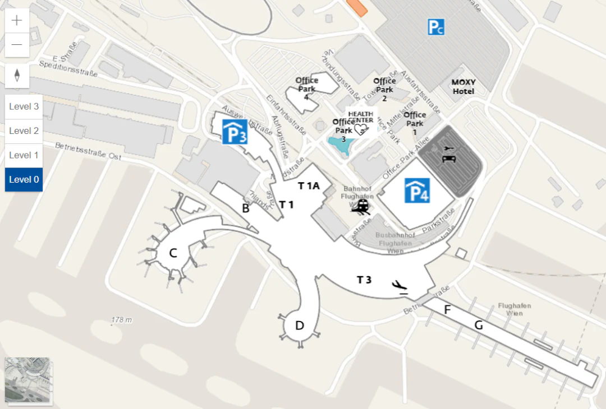

ท่าอากาศยานนานาชาติเวียนนา (รหัสสนามบิน **VIE**) ตั้งอยู่ห่างจากใจกลางเมืองประมาณ 18 กม. และเป็นศูนย์กลางระหว่างประเทศที่ใหญ่ที่สุดของออสเตรีย — และเป็นหนึ่งในจุดเปลี่ยนเครื่องที่สำคัญที่สุดระหว่างยุโรปกลางกับยุโรปตะวันออก สนามบินอยู่ห่างจากตัวเมืองเพียง 16–25 นาที แต่รถไฟด่วน S-Bahn รถบัส และแท็กซี่ต่างแลกความเร็วกับราคา และโถงเช็คอินกับทางเข้าจุดตรวจความปลอดภัยแยกตามอาคารและปลายทาง การรู้ว่าอาคารใดและทางเข้าใดเป็นของคุณช่วยประหยัดเวลาได้จริง

คู่มือนี้ครอบคลุม **อาคารผู้โดยสารและพื้นที่ประตูขึ้นเครื่อง**, **การเดินทางเข้าเมือง**, **ขั้นตอนขาออก**, **สิ่งอำนวยความสะดวกในสนามบิน** และ **การวางแผนวันเดินทางรอบเที่ยวบิน** ในห้าส่วน

ผังสนามบินเรียบง่ายกว่าที่คิด: อาคารผู้โดยสารอยู่ใต้หลังคาเดียวกัน ขาออกอยู่ชั้นบน ขาเข้าอยู่ชั้นล่าง และทางเข้าจุดตรวจความปลอดภัยจัดกลุ่มตามประตูขึ้นเครื่อง สิ่งที่ต้องตัดสินใจล่วงหน้าจริง ๆ มีสามอย่าง — เที่ยวบินของคุณใช้อาคารใด คุณจะเข้าเมืองอย่างไร และควรเผื่อเวลาเท่าไรสำหรับเช็คอินและตรวจความปลอดภัย เมื่อจัดการสามเรื่องนี้แล้ว ฝากกระเป๋า ขีดจำกัดศุลกากร และแลกเงินรอไว้ทำที่สนามบินได้

## 1. อาคารผู้โดยสารและพื้นที่ประตูขึ้นเครื่อง

เวียนนามีอาคารผู้โดยสารที่ใช้งานสามแห่ง — **อาคาร 1, อาคาร 1A และอาคาร 3** — เรียงกันใต้หลังคาเดียว จึงเดินเชื่อมถึงกันได้ ส่วนต่อขยาย SKYLINK ของอาคาร 3 เปิดในปี 2012 และรองรับเครื่องบินใหญ่ได้ถึง Airbus A380 เป็นอาคารหลักสำหรับเที่ยวบินระยะไกล

สนามบินบริหารโดย Flughafen Wien AG โดยบริการผู้โดยสาร การจัดการกระเป๋า และบริการภาคพื้นดินแบ่งกันระหว่าง Vienna Airport, Swissport, Austrian Airlines และอื่น ๆ เคาน์เตอร์เช็คอินจัดสรรตามสายการบิน จึงควรยืนยันว่าเที่ยวบินของคุณใช้**อาคารใด** — ปัจจุบันคืออาคาร 1, อาคาร 1A หรืออาคาร 3 เอกสารสนามบินเก่ายังใช้ชื่อ "อาคาร 2" สำหรับตำแหน่งหนึ่ง แต่ปัจจุบันไม่รับเช็คอินแล้ว

### ห้าพื้นที่ประตูขึ้นเครื่อง: B, C, D, F และ G

ประตูขึ้นเครื่องจัดกลุ่มเป็นห้าโถง และกลุ่มเป็นตัวกำหนดว่าคุณใช้ทางเข้าจุดตรวจความปลอดภัยใดและต้องผ่านตรวจหนังสือเดินทางหรือไม่ โถง D เดิมชื่อ Hall A และเป็นที่รู้จักในชื่อโถงด้านตะวันออก ส่วนโถง C คือโถงด้านตะวันตก

| โถง | ประตูขึ้นเครื่อง | การเชื่อมต่อกับอาคารหลัก | เที่ยวบิน |
| --- | --- | --- | --- |
| B (ฝั่งอาคาร 1) | B22–B43 | รถบัส | เที่ยวบินเชงเกนในยุโรป |
| C (โถงตะวันตก ฝั่งอาคาร 1) | C31–C42 โดย C35–C41 เป็นประตูต่อเครื่อง | สะพานเชื่อม | ส่วนใหญ่เชงเกน บางเที่ยวบินระหว่างประเทศ |
| C (โถงตะวันตก ฝั่งอาคาร 1) | C71–C75 | รถบัส เข้าถึงผ่านประตู C31 | เชงเกนเท่านั้น |
| D (โถงตะวันออก เดิมชื่อ Hall A) | D21–D29 | สะพานเชื่อม | เที่ยวบินระหว่างประเทศ |
| D (โถงตะวันออก เดิมชื่อ Hall A) | D31–D37, D61–D70 | รถบัส | เที่ยวบินระหว่างประเทศ |
| F, G (อาคาร 3) | ประตู F และ G | สะพานเชื่อม | เชงเกน (F) และนอกเชงเกน (G) |

ประตูขึ้นเครื่องที่มีสะพานเชื่อมจะเดินตรงขึ้นเครื่องได้ ส่วนประตูที่ระบุว่าเป็นประตูแบบรถบัสหมายถึงต้องลงบันไดไปชั้นล่างและนั่งรถรับส่ง ซึ่งต้องรวมไว้ในเวลาขึ้นเครื่องของคุณ C71–C75 เป็นกลุ่มประตูรถบัสแยกที่เข้าถึงผ่านประตู C31 จึงควรเผื่อเวลาเดินและรอเพิ่มหากออกเดินทางจากที่นั่น

### การต่อเครื่องระหว่างประเทศ: เปลี่ยนเครื่องโดยไม่เข้าเมืองออสเตรีย

หากเวียนนาเป็นเพียงจุดแวะพัก **การต่อเครื่องระหว่างประเทศไม่ต้องเข้าเมืองออสเตรีย** เมื่อมาถึงโถง C ด้วยเที่ยวบินระหว่างประเทศ ให้ตามป้ายลงไปยัง **Transitzone** ที่ชั้นล่าง และนั่งรถรับส่งไปโถง D สำหรับเที่ยวบินระหว่างประเทศถัดไป หากมาถึงโถง D แล้วเดินทางต่อไปด้วยเที่ยวบินระหว่างประเทศอีกเที่ยว ให้เปลี่ยนเครื่องในโถง D ด้วย Transitzone และรถรับส่งเช่นกัน ที่โถง D พื้นที่ทรานสิตและพื้นที่ตรวจหนังสือเดินทางอยู่ที่ทางเข้าของโถงและที่ประตูสะพานเชื่อมกับประตูรถบัส — ตามป้าย "Transfer"

## 2. การเดินทางเข้าเมืองและกลับ

มีห้าวิธีเข้าเวียนนาจากสนามบิน: **City Airport Train** เร็วที่สุด **รถบัสสนามบิน**ครอบคลุมใจกลางเมืองและสถานีตะวันตก **รถไฟ S7 S-Bahn และ Railjet**ให้ความคุ้มค่าที่สุด **แท็กซี่**เหมาะกับการมาถึงดึกและกระเป๋าหนัก และ**รถเช่า**เหมาะกับทริปขับรถที่เริ่มในเวียนนา เส้นทาง เวลา และค่าโดยสารด้านล่างเป็นไปตามที่สนามบินและผู้ให้บริการประกาศ ตรวจสอบเว็บไซต์ของผู้ให้บริการในวันเดินทาง

หากต้องการเพียงข้อสรุป: ใช้ **CAT** เมื่อเวลาสำคัญและไม่อยากคิดเรื่องการเปลี่ยนรถ ใช้ **S7** เมื่องบมาก่อนและยอมช้าลงสิบนาที ใช้ **Railjet** เมื่อช่วงต่อไปเป็นการต่อรถไฟระยะไกลภายในประเทศ ใช้**รถบัส**หากพักทางฝั่ง Westbahnhof หรือ Donauzentrum ใช้**แท็กซี่**หลังลงจอดดึกและมีกระเป๋าหนัก ตารางด้านล่างเปรียบเทียบตัวเลือก และหัวข้อถัดไปอธิบายทีละวิธี

| ทางเลือก | ไปใจกลางเมือง | ค่าโดยสารเที่ยวเดียว | เหมาะกับ |
| --- | --- | --- | --- |
| City Airport Train (CAT) | 16 นาทีถึง Wien Mitte | €14.90 | เวลากระชั้น ไม่ต้องเปลี่ยนรถ |
| S7 S-Bahn | ประมาณ 25 นาทีถึง Wien Mitte | ประมาณ €5 | งบมาก่อน ช้ากว่าได้ |
| Railjet | 15 นาทีถึง Wien Hauptbahnhof | ค่าโดยสาร ÖBB ของวันนั้น | ต่อรถไฟระยะไกลภายในประเทศ |
| รถบัสสนามบิน | 20–40 นาทีขึ้นอยู่กับป้าย | ประมาณ €8 | พักทางฝั่ง Westbahnhof หรือ Donauzentrum |
| แท็กซี่ | ประมาณ 20–30 นาที | คิดตามมิเตอร์ | มาถึงดึก เป็นกลุ่ม มีกระเป๋าหนัก |

### 1. City Airport Train (CAT) — เร็วที่สุด

City Airport Train วิ่งตรงจากสนามบินไปยัง **Wien Mitte (Landstraße)** ถึงใจกลางเมืองใน **16 นาที** จึงเป็นวิธีเข้าเมืองที่เครียดน้อยที่สุด — การจราจรบนถนนไม่ใช่ปัจจัยเลย

- **เวลา:** 05:37–23:29 (ใจกลางเมือง → สนามบิน); 06:09–23:39 (สนามบิน → ใจกลางเมือง) ประมาณทุก 30 นาที
- **สถานี:** สนามบิน ↔ Wien Mitte เดินประมาณ **10 นาที**จากมหาวิหารนักบุญสเทเฟน
- **ค่าโดยสาร:** €14.90 เที่ยวเดียว มีตั๋วไปกลับที่ถูกกว่า ตั๋วขนส่งในเมืองเวียนนาและ Vienna City Card **ไม่** ใช้ได้บน CAT ต้องซื้อตั๋วแยก
- **ตั๋ว:** โถงผู้โดยสารขาเข้ามีเคาน์เตอร์ CAT เฉพาะที่ซื้อตั๋วและสอบถามบริการ CAT ได้
- **เช็คอินกระเป๋าในเมือง:** ที่สถานี CAT ในใจกลางเมืองสามารถเช็คอินและรับบอร์ดดิ้งพาสได้ที่เคาน์เตอร์ที่มีพนักงานหรือตู้บริการตนเอง ตั้งแต่ 24 ชั่วโมงจนถึง 75 นาทีก่อนออกเดินทาง

### 2. รถบัสสนามบิน — ครอบคลุมกว้างที่สุด

รถบัสสนามบิน (Vienna Airport Lines / Postbus) เชื่อมสนามบินกับศูนย์กลางการขนส่งหลักของเวียนนา และเส้นทางในเมืองสามเส้นรวมกันครอบคลุมรถไฟใต้ดินทุกสาย บริการไปยัง Wien Westbahnhof และ Wien Hauptbahnhof วิ่ง**ทุก 30 นาที** ส่วนเส้นทางสนามบิน ↔ Morzinplatz/Schwedenplatz วิ่ง**ตลอด 24 ชั่วโมง**และใช้เวลาเพียง **20 นาที**

- **ค่าโดยสาร:** ประมาณ €8 เที่ยวเดียว ซื้อบนรถหรือที่เคาน์เตอร์
- **เส้นทางและป้าย:** ดูตารางด้านล่าง

| ปลายทาง | สายรถบัส | เวลาเดินทาง |
| --- | --- | --- |
| Wien Morzinplatz/Schwedenplatz | Vienna Airport Lines | 20 นาที |
| Wien Donauzentrum (ผ่าน VIC) | Vienna Airport Lines | 40 นาที |
| Wien Westbahnhof (ผ่าน Hauptbahnhof) | Vienna Airport Lines | 40 นาที |
| Wien Erdberg (VIB) | AirLiner | 15 นาที |
| Graz (ผ่าน Pinggau) | Dr. Richard / FlixBus | 2 ชม. 40 นาที |
| Münchendorf (ผ่าน Fischamend) | Postbus | 50 นาที |
| Ebreichsdorf (ผ่าน Gramatneusiedl) | Postbus | 73 นาที |
| Neusiedl a. See (ผ่าน Bruck/Leitha) | Postbus | 70 นาที |

### 3. รถโค้ชระยะไกล — ต่อไปยังเมืองหลวงข้างเคียง

สำหรับบราติสลาวา บูดาเปสต์ ปราก หรือเบอร์โน รถโค้ชจากสนามบินมักตรงกว่ารถไฟ และหลายเส้นทางเริ่มที่สนามบิน — สะดวกหากเวียนนาเป็นจุดแวะพักระหว่างทางไปที่อื่น

| ประเทศ | ปลายทาง | ผู้ให้บริการ |
| --- | --- | --- |
| บัลแกเรีย | Sofia | Flixbus |
| เช็กเกีย | Brno, Praha | RegioJet |
| ฮังการี | Budapest, Győr | FlixBus |
| ฮังการี | Budapest | RegioJet |
| โปแลนด์ | Przemyśl | FlixBus |
| โปแลนด์ | Warsaw | LeoExpress |
| โปแลนด์ | Wrocław | FlixBus |
| โรมาเนีย | Sibiu | FlixBus |
| สโลวาเกีย | Bratislava | Slovak Lines / FlixBus / RegioJet |
| สโลวาเกีย | Prešov, Košice | Eurobus |
| สโลวีเนีย | Ljubljana | FlixBus |

### 4. รถไฟ S-Bahn และ ÖBB — คุ้มค่าที่สุด

หากต้องการเดินทางในราคาตั๋วในเมือง **S7** S-Bahn คือคำตอบ: ประมาณ **25 นาที**จากสนามบินถึง Wien Mitte ในราคาราวหนึ่งในสามของ CAT และตั๋วยังครอบคลุมรถไฟใต้ดินและรถรางในเมือง

รถไฟ Railjet ของ ÖBB เชื่อมสนามบินกับจุดที่ไกลกว่ามาก: ตรงไปยัง Wien Hauptbahnhof (15 นาที), St. Pölten, Linz, Salzburg, Innsbruck, Graz และ Klagenfurt พร้อมบริการข้ามพรมแดนไปยัง Brno, Praha, Győr และ Budapest ที่ Wien Hauptbahnhof (สถานีกลางเวียนนา) คุณเปลี่ยนรถไปยังปลายทางอื่นได้อีกมาก

- **ค่าโดยสาร:** ประมาณ €5 เที่ยวเดียวบน S7 (สมาคมขนส่ง VOR คิดราคาตามโซน และสนามบินอยู่นอกโซนหลักของเวียนนา — หากมีตั๋วในเมืองอยู่แล้ว จ่ายเพียงส่วนเพิ่มของช่วงสนามบิน)
- **ตั๋ว:** เคาน์เตอร์ ÖBB อยู่ในโถงผู้โดยสารขาเข้าของสนามบิน เดินไปไม่ไกล และยังขายตั๋วที่เครื่อง ÖBB และในแอป ÖBB
- **ตารางเวลา:** ดูตารางด้านล่าง ประกาศของ ÖBB และ VOR ในวันนั้นเป็นข้อมูลสุดท้าย

| ปลายทาง | สาย | เวลาเดินทาง |
| --- | --- | --- |
| Wien Mitte | Schnellbahn S7 | 25 นาที |
| Wien Hauptbahnhof | Railjet | 15 นาที |
| St. Pölten Hbf | Railjet | 55 นาที |
| Linz Hbf | Railjet | 1 ชม. 41 นาที |
| Salzburg Hbf | Railjet | 2 ชม. 49 นาที |
| Innsbruck Hbf | Railjet | 4 ชม. 40 นาที |
| Graz Hbf | Railjet * | 3 ชม. 00 นาที |
| Klagenfurt Hbf | Railjet ** | 4 ชม. 17 นาที |
| Brno | Railjet ** | 2 ชม. 03 นาที |
| Praha | Railjet ** | 4 ชม. 34 นาที |
| Győr | Railjet ** | 1 ชม. 50 นาที |
| Budapest | Railjet ** | 2 ชม. 59 นาที |

บริการที่ทำเครื่องหมาย \* และ \*\* มักต้องเปลี่ยนรถไฟที่ Wien Hauptbahnhof ตรวจสอบตารางเวลาของ ÖBB สำหรับวันนั้น

### 5. แท็กซี่

ขึ้นแท็กซี่จากจุดจอดนอกโถงผู้โดยสารขาเข้า หรือใช้รถที่จัดส่งโดยเคาน์เตอร์ "City Transfer" และสามารถจองทางโทรศัพท์ล่วงหน้าได้

| บริษัทแท็กซี่ | โทรศัพท์ |
| --- | --- |
| Airport Driver | +43-1-22822 |
| Airport Services | +43-1-7007-33151 |
| ATS Airport Transfer Service | +43-1-7007-35905 |
| Flughafentaxi ttc | +43-1-7007-33141 |
| 40100 | +43-1-40100 |

### 6. รถเช่า

เคาน์เตอร์รถเช่ารวมกันอยู่ที่**ชั้น 0 ของอาคารจอดรถหลายชั้น P4** ซึ่ง Hertz, Sixt, Europcar, Avis, Budget, Enterprise, Alamo และ National ต่างมีเคาน์เตอร์ — ขับออกไปสู่เครือข่ายทางหลวงได้ทันที

| บริษัทรถเช่า | สำรอง |
| --- | --- |
| Alamo | +43-1-7007-33432 |
| Avis | +43-1-7007-32700 |
| Buchbinder | +43-1-7007-33316 |
| Budget | +43-1-7007-32700 |
| Enterprise | +43-1-7007-33432 |
| Europcar | +43-1-7007-32812 |
| Flizzr | +43-1-7007-36517 |
| Hertz | +43-1-7007-32661 |
| Megadrive | +43-1-7007-33316 |
| National | +43-1-7007-33432 |
| Payless | +43-1-7007-32700 |
| Sixt | +43-1-7007-36517 |
| Thrifty | +43-1-7007-32661 |

## 3. ขาออก: เช็คอิน ฝากกระเป๋า ตรวจความปลอดภัย

ลำดับมาตรฐานคือ **เช็คอิน → ฝากกระเป๋า → ตรวจความปลอดภัย → (เที่ยวบินนอกเชงเกน) ตรวจหนังสือเดินทาง → ขึ้นเครื่อง** มาถึงก่อนออกเดินทาง 2 ชั่วโมงสำหรับเที่ยวบินเชงเกน และ 3 ชั่วโมงสำหรับเที่ยวบินนอกเชงเกนหรือระยะไกล และเผื่อเพิ่มครึ่งชั่วโมงในฤดูท่องเที่ยวและช่วงวันหยุดนักขัตฤกษ์

ชั่วโมงพิเศษสำหรับเที่ยวบินระยะไกลไม่ใช่การเผื่อเกินจำเป็น เวียนนาแยก**กระแสผู้โดยสารเชงเกนและนอกเชงเกน**ออกจากกันโดยสมบูรณ์: เที่ยวบินเชงเกนผ่านการตรวจความปลอดภัยแล้วเดินไปประตูขึ้นเครื่อง ส่วนเที่ยวบินนอกเชงเกนต้องต่อคิวตรวจหนังสือเดินทางในอีกส่วนของอาคารหลังการตรวจความปลอดภัย การเช็คอิน ฝากกระเป๋า ตรวจความปลอดภัย ตรวจหนังสือเดินทาง และเดินไปประตูขึ้นเครื่องรวมกันแล้วใช้เวลาไม่น้อย และการเก็บหนังสือเดินทาง วีซ่า บอร์ดดิ้งพาส และใบรับกระเป๋าไว้ในกระเป๋าเดียวกันช่วยประหยัดการค้นหาที่จุดตรวจทุกจุด

### 1. เช็คอิน

- **เช็คอินด้วยตนเอง:** ใช้บัตรเครดิตหรือบัตร Miles & More ชื่อของคุณ หมายเลขการจอง หรือเพียงสแกนหนังสือเดินทางเพื่อรับบอร์ดดิ้งพาสจากตู้บริการตนเอง หากมีกระเป๋าโหลด ตู้จะบอกว่าควรใช้เคาน์เตอร์ฝากกระเป๋าใด
- **ที่เคาน์เตอร์:** ขึ้นอยู่กับเที่ยวบิน ให้เช็คอินและรับบอร์ดดิ้งพาสที่อาคาร 1, อาคาร 1A หรืออาคาร 3
- **เช็คอินออนไลน์:** สายการบินส่วนใหญ่มีบริการบนเว็บไซต์หรือแอป ซึ่งช่วยลดการต่อคิวที่สนามบิน พิมพ์บอร์ดดิ้งพาสที่นั่น หากเดินทางพร้อมกระเป๋าโหลด ให้สอบถามที่เคาน์เตอร์ที่เกี่ยวข้องก่อน
- **เช็คอินที่ Wien Mitte:** สายการบินบางแห่งให้เช็คอินที่สถานี City Airport Train ใน Wien Mitte ซึ่งคุณแสดงหนังสือเดินทางและรับบอร์ดดิ้งพาส สำหรับรายชื่อสายการบินปัจจุบัน ดู cityairporttrain.com หรือโทร +43 1 25250

### 2. ฝากกระเป๋าด้วยตนเอง

บริการฝากกระเป๋าด้วยตนเองของสนามบินเวียนนาย่อขั้นตอนการส่งมอบเป็นสี่ขั้น: **สแกนบอร์ดดิ้งพาส → ติดป้ายที่กระเป๋า → เก็บใบรับกระเป๋า → ไปต่อยังจุดตรวจความปลอดภัย**

ที่สายพานบริการตนเองข้างเกาะเช็คอิน ให้สแกนบอร์ดดิ้งพาสเพื่อยืนยันเที่ยวบิน ติดป้ายที่พิมพ์ออกมากับหูหิ้วกระเป๋า วางกระเป๋าบนสายพาน และเก็บใบรับกระเป๋าไว้ — หากกระเป๋าหาย นี่คือบันทึกเพียงอย่างเดียวที่คุณมี

### 3. หมายเหตุเรื่องกระเป๋า

- สำหรับ**กระเป๋าน้ำหนักเกินหรือสัตว์เลี้ยง** ให้ใช้**เคาน์เตอร์กระเป๋าขนาดใหญ่ที่อาคาร 1 หรืออาคาร 3**
- เขียนชื่อและที่อยู่บนกระเป๋าและถอดป้ายเก่าออก — บาร์โค้ดเก่าทำให้ระบบคัดแยกสับสนและเพิ่มโอกาสกระเป๋าไปผิดทาง
- พกของมีค่า เอกสารสำคัญ และยาไว้กับตัวแทนการโหลด
- รัดกระเป๋าด้วยสายรัดหรือกุญแจหากจำเป็น หรือใช้บริการห่อกระเป๋าของสนามบิน (ดูหัวข้อสิ่งอำนวยความสะดวกด้านล่าง)

### 4. การตรวจความปลอดภัยและตรวจหนังสือเดินทาง

ทางเข้าจุดตรวจความปลอดภัยแยกตามกลุ่มประตูขึ้นเครื่อง และเข้าผิดทางต้องเดินไกล:

- **ทางเข้าจุดตรวจความปลอดภัย 2:** สำหรับเที่ยวบินจากประตู B, C และ D
- **ทางเข้าจุดตรวจความปลอดภัย 3:** สำหรับเที่ยวบินจากประตู F และ G

หลังจุดตรวจความปลอดภัยมีร้านค้าและร้านอาหารในพื้นที่ขาออก ญาติและเพื่อนที่มาส่งไม่สามารถผ่านเข้าไปด้วยได้

- สำหรับ**ประเทศเชงเกน** ใช้ประตู **B, C และ F**
- สำหรับ**ประเทศนอกเชงเกน** ใช้ประตู **D และ G** และต้องผ่าน**ตรวจหนังสือเดินทาง**ก่อนไปยังประตูขึ้นเครื่อง

ผู้เดินทางที่ถือหนังสือเดินทางนอกสหภาพยุโรปมักต้องทำ**การลงทะเบียน EES** (ลายนิ้วมือและภาพใบหน้า) ที่ตู้บริการตนเองก่อนตรวจหนังสือเดินทาง การเข้าประเทศครั้งแรกจะใช้เวลาเพิ่มเล็กน้อย — ควรเผื่อไว้หากเวลาเปลี่ยนเครื่องแน่น

## 4. สิ่งอำนวยความสะดวกในสนามบินและข้อมูลปฏิบัติ

สิ่งอำนวยความสะดวกของเวียนนาปฏิบัติตามกฎง่าย ๆ: **ชั้นขาออกรับผิดชอบเช็คอินและตรวจความปลอดภัย ชั้นขาเข้ารับผิดชอบกระเป๋า ข้อมูล และการเดินทางภาคพื้นดิน** ส่วนร้านอาหาร ร้านค้า และที่นั่งกระจุกอยู่ในพื้นที่หลังจุดตรวจ ฝากกระเป๋า ตราประทับศุลกากร และของหายอยู่ที่ชั้นขาเข้า 0 และรอบอาคาร 1 ทั้งหมด เมื่อผ่านจุดตรวจความปลอดภัยแล้ว จะเข้าถึงได้เฉพาะบริการในพื้นที่หลังจุดตรวจเท่านั้น หัวข้อด้านล่างเรียงจากบริการที่ใช้มากไปน้อย

### สอบถามและบริการกระเป๋า

มี**เคาน์เตอร์ข้อมูลสามแห่ง**: สองแห่งที่ชั้นขาออกของอาคาร 1 และ 3 และอีกหนึ่งในโถงขาเข้าของอาคาร 3 คำถามเรื่องกระเป๋าและสิ่งอำนวยความสะดวกตอบได้ทั้งหมดที่นี่

**ศูนย์บริการกระเป๋า**ในพื้นที่เช็คอินของอาคาร 1 และ 3 เปิด **00:00–24:00** และมีบริการ:

| บริการ | ราคา | หมายเหตุ |
| --- | --- | --- |
| ฝากกระเป๋า | €4 ต่อชิ้นต่อวัน; ของใหญ่ €8 ต่อชิ้นต่อวัน | เก็บได้นานสูงสุด 6 เดือน |
| ห่อกระเป๋า | €12 ต่อชิ้น | กระเป๋าถูกหุ้มด้วยฟิล์มป้องกันความเสียหาย ความชื้น และการโจรกรรม มีในพื้นที่กระเป๋าของอาคาร 1 และ 3 |
| ส่งกระเป๋า | เริ่มต้น €15 สำหรับไม่เกิน 5 ชิ้น, ชิ้นละ €3 สำหรับชิ้นเพิ่ม | จองล่วงหน้าอย่างน้อย 72 ชั่วโมงโดยอีเมล service@viennaairport.com หรือจองในร้านค้าออนไลน์ของสนามบิน |
| ตู้เซฟ | €6 ต่อวัน | สำหรับเอกสาร กุญแจ และของลักษณะเดียวกัน ห้ามเก็บอาวุธ วัตถุระเบิด วัตถุไวไฟหรือของอันตรายอื่น ๆ และของเน่าเสียง่ายหรือมีกลิ่นแรง |
| ตู้เก็บเสื้อผ้า | €2 ต่อชุดต่อวัน | หนึ่งชุดคือเสื้อแจ็กเก็ตหรือโค้ท รองเท้า เครื่องประดับ ถุงมือ และผ้าพันคอ |

### ศูนย์การแพทย์ ห้องละหมาด และของหาย

- **ศูนย์การแพทย์:** อาคาร 1 ชั้น 1 ทางเดินตรงข้ามร้านขายยา เปิด **07:00–19:00** วัคซีนมีไข้เหลือง ไทฟอยด์ พิษสุนัขบ้า ตับอักเสบเอและบี (รวมสำหรับเด็ก) มาลาเรีย ไข้สมองอักเสบจากเห็บ ไข้หวัดใหญ่ วัคซีนรวมคอตีบ/โปลิโอ/บาดทะยัก/ไอกรน โรคเยื่อหุ้มสมองอักเสบ และไข้สมองอักเสบญี่ปุ่น — โทรสอบถามสต็อกล่วงหน้า
- **ห้องละหมาด:** มีห้องละหมาดในอาคารผู้โดยสาร สอบถามตำแหน่งได้ที่เคาน์เตอร์ข้อมูล
- **ของหาย:** สำนักงานของหายที่ชั้น 0 ของอาคาร 1 หรือเคาน์เตอร์ข้อมูลในโถงขาเข้าของอาคาร 3
- **ส่งคืนของหายทางไปรษณีย์:** ใช้บริการจัดส่งและบรรจุภัณฑ์ของ Mail Boxes Etc. ใน A-2320 Schwechat หรือผู้ให้บริการขนส่งที่คุณต้องการ ที่อยู่ติดต่อคือ mbe0045@mbe.at ของที่เก็บนานกว่า 8 วันมีค่าบริการจัดเก็บ และ**ต้องชำระเงินให้เรียบร้อยก่อนส่งของ**: สำหรับบัตรจะได้รับใบแจ้งหนี้และลิงก์ชำระทางอีเมล สำหรับการโอนธนาคาร ให้ใส่หมายเลขใบแจ้งหนี้ในช่องอ้างอิงการชำระ มิฉะนั้นจะระบุการชำระของคุณไม่ได้

### ศุลกากรและขีดจำกัดปลอดภาษี

ผู้เดินทางที่เข้าออสเตรียจากนอกสหภาพยุโรปสามารถนำสิ่งต่อไปนี้เข้ามาได้ภายในขีดจำกัดปลอดภาษี **ผู้เดินทางในทริปเดียวกันไม่สามารถรวมสิทธิ์ของกันและกันได้** — เป็นกฎที่มักถูกมองข้าม:

| หมวด | ขีดจำกัดปลอดภาษี |
| --- | --- |
| มูลค่ารวมของสินค้า | สูงสุด **€430** (เฉพาะผู้เดินทางทางอากาศ; €300 สำหรับการมาถึงทางบก) |
| บุหรี่ | 200 มวน |
| หรือซิการ์ | 50 ใบ |
| หรือซีการ์ริลโล | 100 ใบ |
| หรือยาสูบ | 250 กรัม |
| หรือการผสมกันของข้างต้น | — |
| บวกไวน์ | 4 ลิตร |
| บวกสุราที่มีแอลกอฮอล์เกิน 22% โดยปริมาตร | 1 ลิตร |
| หรือสุราหรืออาเปริตีฟที่มีแอลกอฮอล์ต่ำกว่า 22% | 2 ลิตร |
| หรือไวน์อัดแก๊สหรือลิเคียร์ | 2 ลิตร |
| หรือการผสมกันของข้างต้น | — |

- **ข้อจำกัดอายุ:** ผู้โดยสารอายุต่ำกว่า 15 ปีมีสิทธิ์ €150; สิทธิ์แอลกอฮอล์และยาสูบใช้ตั้งแต่อายุ 17 ปี
- **การสำแดงเงินสด:** การพาเงินสดหรือวิธีการชำระอื่น (เช็คเดินทาง แท่งทอง เหรียญทอง และของลักษณะเดียวกัน) เกิน **€10,000** เข้าหรือออกจากสหภาพยุโรปต้องสำแดงต่อศุลกากร แบบฟอร์มมีที่เคาน์เตอร์ศุลกากรหรือสำนักงานศุลกากร
- **ตราประทับขอคืนภาษีส่งออก:** สำนักงานศุลกากรสำหรับการส่งออกอยู่ที่ชั้นขาเข้า 0

### แลกเปลี่ยนเงินตราและตู้ ATM

เคาน์เตอร์แลกเปลี่ยนเงินตราของสนามบินดำเนินการโดย **Interchange** มีสาขาที่ประตูขึ้นเครื่อง ในโถงขาเข้า และในอาคารผู้โดยสาร โดยทั่วไปเปิดตั้งแต่ 05:00 ไปจนถึงช่วงค่ำดึก ส่วนตู้ ATM กระจายกว้างกว่า ตั้งแต่โถงขาเข้าจนถึงโถงประตูขึ้นเครื่อง

| ตำแหน่ง | เวลา | การเข้าถึง |
| --- | --- | --- |
| ประตู D | 05:00–00:00 | เฉพาะผู้โดยสาร |
| ประตู F | 05:00–22:00 | เฉพาะผู้โดยสาร |
| ประตู G | 05:00–23:00 | เฉพาะผู้โดยสาร |
| Plaza | 06:00–23:00 | เฉพาะผู้โดยสาร |
| อาคาร 3 | 05:00–22:00 | เฉพาะผู้โดยสาร |
| โถงขาเข้า (3 เคาน์เตอร์) | 05:00–22:00, หนึ่งเคาน์เตอร์ถึง 23:00 | ทุกคน |
| อาคาร 2 | 06:00–20:00 | ทุกคน |
| Office Park 1 | 05:00–22:00 | ทุกคน |

เคาน์เตอร์ให้บริการแลกเปลี่ยนเงินตรา ขอคืนภาษี และโอนเงินระหว่างประเทศ เคาน์เตอร์บางแห่งในโถงขาเข้าและอาคาร 2 และ 3 ยังขายซิมการ์ดโทรศัพท์ด้วย

ตู้ ATM อยู่ที่โถงขาเข้า ประตู C/D/F/G, Plaza, ที่จอดรถ 8 พื้นที่สาธารณะของอาคาร 1, 2 และ 3, Office Park 1, Office Park 3 และพื้นที่ VIP/GAC ตู้ ATM ในโถงขาเข้า ที่จอดรถ อาคารผู้โดยสาร และอาคารสำนักงานเปิดให้ทุกคน ส่วนตู้ที่ประตูขึ้นเครื่องและ Plaza สำหรับผู้โดยสารเท่านั้น

### Wi-Fi ปลั๊กไฟ และซิมการ์ด

- **Wi-Fi:** ครอบคลุมทั้งอาคารผู้โดยสาร จึงตรวจเที่ยวบินและส่งข้อความกลับบ้านได้ระหว่างรอ
- **ปลั๊กไฟและพื้นที่ทำงาน:** ประตู F และ G มีพื้นที่ทำงานเฉพาะที่เสียบปลั๊กและใช้แล็ปท็อปได้
- **ซิมการ์ดและซ่อม:** Mr. Mobile ให้บริการซ่อมโทรศัพท์ แท็บเล็ต และแล็ปท็อป ให้ยืมเครื่อง และขายซิมการ์ดแบบเติมเงิน

## 5. การวางแผนวันเดินทางรอบเที่ยวบิน

ทั้งหมดข้างต้นสรุปเป็นสามรูปแบบการเดินทาง แต่ละแบบมีงบเวลาแตกต่างกัน แต่มีกฎเดียวกัน: **ยืนยันอาคารผู้โดยสารและประตูขึ้นเครื่องก่อน แล้วจึงเลือกการเดินทาง**

### มาถึงแล้วเข้าเมืองทันที

สำหรับการลงจอดกลางวันพร้อมกระเป๋าเบา S7 เป็นวิธีที่ง่ายที่สุด: ตามป้าย S-Bahn ลงไปที่ชานชาลา ซื้อตั๋วไป Wien Mitte แล้วอีกประมาณยี่สิบห้านาทีคุณก็อยู่บนรถไฟใต้ดิน ใช้ CAT หากเวลาน้อยหรือเดินทางกับเด็ก และหลังลงจอดดึก ให้ต่อคิวแท็กซี่นอกโถงขาเข้าแทนการไล่รถไฟขบวนสุดท้ายเพื่อประหยัดไม่กี่ยูโร

### ขึ้นเครื่องจากในเมือง

ทั้ง CAT และ S7 ออกจาก Wien Mitte; CAT เร็วกว่าประมาณสิบนาทีและแพงกว่ามากกว่าสองเท่า เวลาที่สำคัญจริง ๆ คือ**ที่สนามบิน**: คิดย้อนจากประตูขึ้นเครื่องผ่านการตรวจความปลอดภัย ฝากกระเป๋า และเช็คอิน — 2 ชั่วโมงสำหรับเที่ยวบินเชงเกน และ 3 ชั่วโมงสำหรับเที่ยวบินนอกเชงเกน การเผื่อเวลาครึ่งชั่วโมงในเมืองมีประโยชน์น้อยกว่าการเผื่อที่สนามบินมาก ฤดูท่องเที่ยว วันหยุดนักขัตฤกษ์ และช่วงเช้าตรู่ที่คนแน่น ควรเผื่อเพิ่มอีกครึ่งชั่วโมง

### ต่อเครื่องในเวียนนา

การต่อเครื่องจากเที่ยวบินระหว่างประเทศไปยังเที่ยวบินระหว่างประเทศไม่ต้องเข้าเมืองออสเตรีย: ตามป้าย Transfer ผ่านพื้นที่ทรานสิต อย่างไรก็ตาม หากเที่ยวบินต่อไปเป็นเชงเกน คุณต้องเข้าเมืองและผ่านการตรวจความปลอดภัยใหม่ จึงควรเผื่อเวลาเปลี่ยนเครื่องเหมือนการมาถึง สองชั่วโมงระหว่างเที่ยวบินกำลังสบาย และเผื่อสามชั่วโมงหากต้องเปลี่ยนอาคารหรือต้องรับและเช็คกระเป๋าใหม่

## ลิงก์ที่เกี่ยวข้อง

- **ในเว็บไซต์นี้**: [ท่าอากาศยานนานาชาติเวียนนา (VIE)](/airport/VIE), [ออสเตรีย (AT)](/country/AT)
- **Wikipedia**: [ท่าอากาศยานนานาชาติเวียนนา](https://en.wikipedia.org/wiki/Vienna_International_Airport)
- **Baidu Baike**: [ท่าอากาศยานนานาชาติเวียนนา](https://baike.baidu.com/item/%E7%BB%B4%E4%B9%9F%E7%BA%B3%E5%9B%BD%E9%99%85%E6%9C%BA%E5%9C%BA)

ที่มาของภาพ: Vienna Airport ค่าโดยสาร เวลาเปิดทำการ และตำแหน่งเคาน์เตอร์เป็นไปตามที่สนามบินและผู้ให้บริการประกาศ ตรวจสอบเว็บไซต์ของพวกเขาในวันเดินทาง
