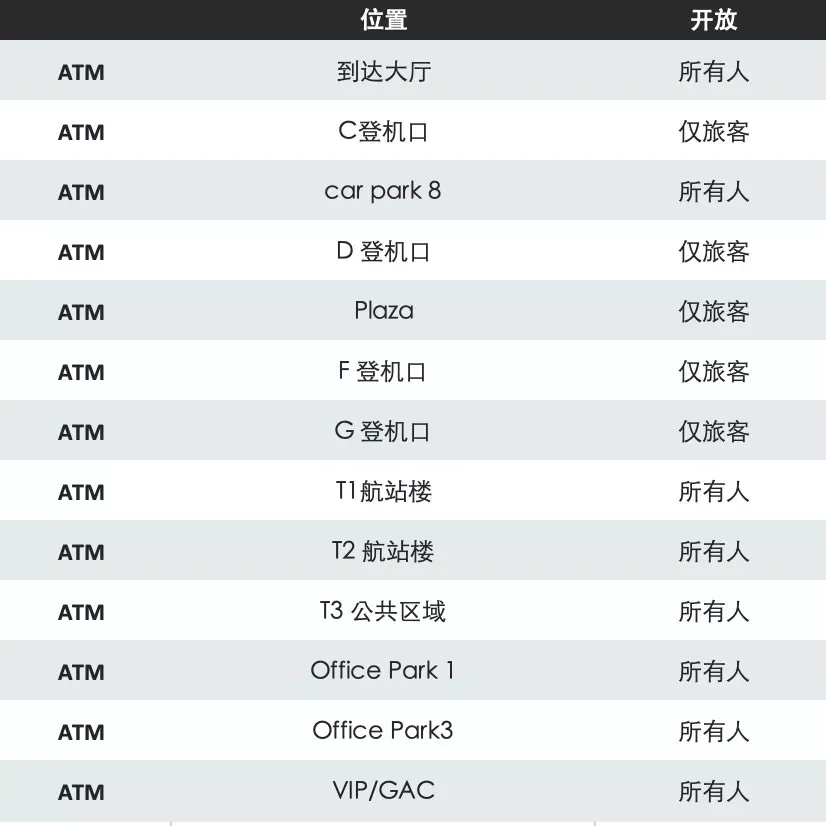

Viyana Uluslararası Havalimanı (havalimanı kodu **VIE**) şehir merkezinden yaklaşık 18 km uzakta ve Avusturya'nın en büyük uluslararası merkezi — aynı zamanda Orta ve Doğu Avrupa arasındaki en önemli aktarma noktalarından biri. Havalimanı şehirden yalnızca 16–25 dakika uzakta, ancak ekspres tren, S-Bahn, otobüsler ve taksiler hız ile fiyatı birbirine karşı takas ediyor; check-in salonları ve güvenlik girişleri terminale ve varış noktasına göre ayrılıyor. Hangi binanın ve hangi girişin sizin olduğunu bilmek gerçek zaman kazandırır.

Bu rehber beş bölümde **terminalleri ve kapı alanlarını**, **şehre ulaşımı**, **kalkış sürecini**, **havalimanı olanaklarını** ve **günü uçuşunuza göre planlamayı** ele alıyor.

Havalimanının yerleşimi göründüğünden daha basit: terminaller tek bir çatı altında, kalkışlar üst katta ve varışlar alt katta, güvenlik girişleri ise kapıya göre gruplanmış. Önceden karar verilmesi gereken aslında üç şey var — uçuşunuzun hangi binayı kullandığı, şehirden nasıl gireceğiniz ve check-in ile güvenlik için ne kadar zaman bırakacağınız. Bunları netleştirin; bagaj emaneti, gümrük muafiyetleri ve döviz bozdurma oraya vardığınızda bekleyebilir.

## 1. Terminaller ve kapı alanları

Viyana Havalimanı'nda kullanımda üç terminal var — **Terminal 1, Terminal 1A ve Terminal 3** — tek bir çatı altında sıralanmış, bu yüzden aralarında yürüyebilirsiniz. Terminal 3'ün SKYLINK uzantısı 2012'de açıldı ve Airbus A380 kadar büyük uçakları alabiliyor; uzun mesafe uçuşlarının ana binası.

Havalimanı Flughafen Wien AG tarafından işletiliyor; yolcu hizmetleri, bagaj işleme ve yer hizmetleri Viyana Havalimanı, Swissport, Austrian Airlines ve diğerleri arasında paylaşılıyor. Check-in gişeleri havayoluna göre tahsis edilir, bu yüzden uçuşunuzun **hangi terminali** kullandığını doğrulayın — şu anda Terminal 1, Terminal 1A veya Terminal 3. Eski havalimanı materyalleri bir konum için hâlâ "Terminal 2" adını kullanıyor, ancak artık check-in işlemi yapmıyor.

### Beş kapı alanı: B, C, D, F ve G

Kapılar beş iskeleye gruplanmış ve grup hangi güvenlik girişini kullanacağınızı ve pasaport kontrolünden geçip geçmeyeceğinizi belirliyor. D iskelesi eskiden A Salonu olarak adlandırılıyordu ve doğu iskelesi olarak bilinir; C iskelesi batı iskelesidir.

| İskele | Kapılar | Ana binaya bağlantı | Uçuşlar |
| --- | --- | --- | --- |
| B (Terminal 1 tarafı) | B22–B43 | Otobüs | Avrupa Schengen uçuşları |
| C (batı iskelesi, Terminal 1 tarafı) | C31–C42, bunlardan C35–C41 aktarma kapıları | Yolcu köprüsü | Çoğunlukla Schengen, bazı uluslararası |
| C (batı iskelesi, Terminal 1 tarafı) | C71–C75 | Otobüs, C31 kapısı üzerinden ulaşılır | Yalnızca Schengen |
| D (doğu iskelesi, eski A Salonu) | D21–D29 | Yolcu köprüsü | Uluslararası uçuşlar |
| D (doğu iskelesi, eski A Salonu) | D31–D37, D61–D70 | Otobüs | Uluslararası uçuşlar |
| F, G (Terminal 3) | F ve G kapıları | Yolcu köprüsü | Schengen (F) ve Schengen dışı (G) |

Yolcu köprüsü olan kapılardan doğrudan uçağa yürünür; otobüs kapısı olarak işaretlenen kapılar alt kata inmeyi ve servis otobüsüne binmeyi gerektirir, bunu biniş sürenize ekleyin. C71–C75, C31 kapısından ulaşılan ayrı bir otobüs kapısı grubudur, bu yüzden oradan kalkıyorsanız ekstra yürüme ve bekleme süresi bırakın.

### Uluslararası aktarmalar: Avusturya'ya girmeden uçak değiştirme

Viyana yalnızca bir durak ise, **uluslararası aktarmalar Avusturya'ya giriş gerektirmez**. Uluslararası bir uçuşla C iskelesine varırsanız, zemin kattaki **Transitzone**'a inmek için tabelaları izleyin ve devam uçuşunuz için D iskelesine servis otobüsüne binin. D iskelesine varıp başka bir uluslararası uçuşla devam ediyorsanız, aynı aktarmayı D iskelesi içinde Transitzone ve servis otobüsünü kullanarak yaparsınız. D iskelesinde transit alanı ve pasaport kontrol alanı salonların girişlerinde, yolcu köprüsü ve otobüs kapılarında bulunur — "Transfer" tabelalarını izleyin.

## 2. Şehre gidiş ve dönüş

Havalimanından Viyana'ya beş yol var: **City Airport Train** en hızlısı, **havalimanı otobüsleri** şehir merkezini ve batı istasyonunu kapsıyor, **S7 S-Bahn ve Railjet trenleri** en iyi değeri sunuyor, **taksiler** geç varışlara ve ağır bagajlara uygun, **araç kiralama** ise Viyana'da başlayan bir yol gezisine uygun. Aşağıdaki güzergâhlar, süreler ve ücretler havalimanı ve işletmecilerin yayımladığı şekildedir; seyahat ettiğiniz gün işletmecilerin sitelerine bakın.

Yalnızca sonucu istiyorsanız: zaman önemliyse ve aktarma hesaplamak istemiyorsanız **CAT**'e binin; bütçe önce geliyorsa ve on dakika fazla sorun değilse **S7**'ye binin; sonraki bacak bir iç hat uzun mesafe treniyse **Railjet**'e binin; Westbahnhof veya Donauzentrum yönünde kalıyorsanız **otobüse** binin; geç bir inişten sonra ağır bagajla **taksiye** binin. Tablo bunları karşılaştırıyor; aşağıdaki bölümler her birini sırayla ele alıyor.

| Seçenek | Merkeze | Tek yön ücret | En uygun olduğu durum |
| --- | --- | --- | --- |
| City Airport Train (CAT) | Wien Mitte'ye 16 dk | 14,90 € | Zaman baskısı, aktarma yok |
| S7 S-Bahn | Wien Mitte'ye yaklaşık 25 dk | yaklaşık 5 € | Önce bütçe, yavaş olması sorun değil |
| Railjet | Wien Hauptbahnhof'a 15 dk | Günün ÖBB ücreti | İç hat uzun mesafe trenine aktarma |
| Havalimanı otobüsü | Durağa göre 20–40 dk | yaklaşık 8 € | Westbahnhof veya Donauzentrum yönünde konaklama |
| Taksi | yaklaşık 20–30 dk | taksimetreli | Geç varışlar, gruplar, ağır bagajlar |

### 1. City Airport Train (CAT) — en hızlısı

City Airport Train, havalimanından şehir merkezindeki **Wien Mitte (Landstraße)**'a **16 dakikada** durmadan gider; bu da onu içeri girmenin en az stresli yolu yapıyor — karayolu trafiği basitçe bir etken değil.

- **Çalışma saatleri:** 05:37–23:29 (şehir merkezi → havalimanı); 06:09–23:39 (havalimanı → şehir merkezi), yaklaşık her 30 dakikada bir.
- **Duraklar:** havalimanı ↔ Wien Mitte, Aziz Stefan Katedrali'nden yaklaşık **10 dakikalık** yürüyüş.
- **Ücret:** tek yön 14,90 €, daha ucuz gidiş-dönüş biletleri var. Viyana'nın şehir içi ulaşım biletleri ve Vienna City Card CAT'te **geçerli değildir**; ayrı bilet almanız gerekir.
- **Biletler:** varış salonunda bilet alabileceğiniz ve CAT hizmetleri hakkında bilgi sorabileceğiniz özel bir CAT gişesi var.
- **Şehirde bagaj check-in'i:** şehir merkezindeki CAT terminalinde, kalkıştan 24 saat ile 75 dakika öncesi arasında personelli gişelerde veya self-servis kiosklarda check-in yapıp biniş kartı alabilirsiniz.

### 2. Havalimanı otobüsleri — en geniş kapsama

Havalimanı otobüsleri (Vienna Airport Lines / Postbus) havalimanını Viyana'nın ana ulaşım merkezlerine bağlar ve üç şehir içi güzergâh birlikte her metro hattını kapsar. Wien Westbahnhof ve Wien Hauptbahnhof yönündeki seferler **her 30 dakikada bir** çalışır; havalimanı ↔ Morzinplatz/Schwedenplatz güzergâhı **günün her saati** çalışır ve yalnızca **20 dakika** sürer.

- **Ücret:** tek yön yaklaşık 8 €, araçta veya gişede alınır.
- **Güzergâhlar ve duraklar:** aşağıdaki tabloya bakın.

| Varış noktası | Otobüs hattı | Yolculuk süresi |
| --- | --- | --- |
| Wien Morzinplatz/Schwedenplatz | Vienna Airport Lines | 20 dk |
| Wien Donauzentrum (VIC üzerinden) | Vienna Airport Lines | 40 dk |
| Wien Westbahnhof (Hauptbahnhof üzerinden) | Vienna Airport Lines | 40 dk |
| Wien Erdberg (VIB) | AirLiner | 15 dk |
| Graz (Pinggau üzerinden) | Dr. Richard / FlixBus | 2 sa 40 dk |
| Münchendorf (Fischamend üzerinden) | Postbus | 50 dk |
| Ebreichsdorf (Gramatneusiedl üzerinden) | Postbus | 73 dk |
| Neusiedl a. See (Bruck/Leitha üzerinden) | Postbus | 70 dk |

### 3. Uzun mesafe otobüsleri — komşu başkentlere devam

Bratislava, Budapeşte, Prag veya Brno için havalimanından kalkan otobüsler genellikle trenden daha doğrudandır ve çoğu havalimanından başlar — Viyana başka bir yere giderken bir durak ise bu kullanışlıdır.

| Ülke | Varış noktası | İşletmeci |
| --- | --- | --- |
| Bulgaristan | Sofya | Flixbus |
| Çekya | Brno, Praha | RegioJet |
| Macaristan | Budapeşte, Győr | FlixBus |
| Macaristan | Budapeşte | RegioJet |
| Polonya | Przemyśl | FlixBus |
| Polonya | Varşova | LeoExpress |
| Polonya | Wrocław | FlixBus |
| Romanya | Sibiu | FlixBus |
| Slovakya | Bratislava | Slovak Lines / FlixBus / RegioJet |
| Slovakya | Prešov, Košice | Eurobus |
| Slovenya | Ljubljana | FlixBus |

### 4. S-Bahn ve ÖBB trenleri — en iyi değer

Şehir bileti fiyatına seyahat etmek için cevap **S7** S-Bahn: havalimanından Wien Mitte'ye yaklaşık **25 dakika**, CAT ücretinin yaklaşık üçte biri ve bilet şehirdeki metro ve tramvayları da kapsıyor.

ÖBB'nin Railjet trenleri havalimanını çok daha uzak yerlere bağlar: doğrudan Wien Hauptbahnhof (15 dakika), St. Pölten, Linz, Salzburg, Innsbruck, Graz ve Klagenfurt ile Brno, Praha, Győr ve Budapeşte'ye sınır ötesi seferler. Wien Hauptbahnhof'ta (Viyana Merkez İstasyonu) çok daha fazla varış noktası için aktarma yapabilirsiniz.

- **Ücret:** S7'de tek yön yaklaşık 5 € (VOR ulaşım birliği bölgeye göre fiyatlandırır ve havalimanı Viyana'nın çekirdek bölgesinin dışındadır — elinizde zaten şehir bileti varsa yalnızca havalimanı bölümü ek ücretini ödersiniz).
- **Biletler:** ÖBB gişesi havalimanı varış salonunda, kısa bir yürüyüş mesafesinde; biletler ÖBB makinelerinde ve ÖBB uygulamasında da satılır.
- **Tarife:** aşağıdaki tabloya bakın; o güne ait ÖBB ve VOR duyuruları belirleyicidir.

| Varış noktası | Hat | Yolculuk süresi |
| --- | --- | --- |
| Wien Mitte | Schnellbahn S7 | 25 dk |
| Wien Hauptbahnhof | Railjet | 15 dk |
| St. Pölten Hbf | Railjet | 55 dk |
| Linz Hbf | Railjet | 1 sa 41 dk |
| Salzburg Hbf | Railjet | 2 sa 49 dk |
| Innsbruck Hbf | Railjet | 4 sa 40 dk |
| Graz Hbf | Railjet * | 3 sa 00 dk |
| Klagenfurt Hbf | Railjet ** | 4 sa 17 dk |
| Brno | Railjet ** | 2 sa 03 dk |
| Praha | Railjet ** | 4 sa 34 dk |
| Győr | Railjet ** | 1 sa 50 dk |
| Budapeşte | Railjet ** | 2 sa 59 dk |

\* ve \*\* ile işaretli seferler genellikle Wien Hauptbahnhof'ta tren değişikliği gerektirir; o günün ÖBB tarifesine bakın.

### 5. Taksiler

Varış salonunun dışındaki taksi durağından taksiye binin veya "City Transfer" masasının yönlendirdiği bir aracı kullanın; telefonla önceden de rezervasyon yapabilirsiniz.

| Taksi şirketi | Telefon |
| --- | --- |
| Airport Driver | +43-1-22822 |
| Airport Services | +43-1-7007-33151 |
| ATS Airport Transfer Service | +43-1-7007-35905 |
| Flughafentaxi ttc | +43-1-7007-33141 |
| 40100 | +43-1-40100 |

### 6. Araç kiralama

Kiralama gişeleri **P4 katlı otoparkının 0. katında** bir aradadır; Hertz, Sixt, Europcar, Avis, Budget, Enterprise, Alamo ve National'ın gişeleri burada — doğrudan otoyol ağına çıkarsınız.

| Kiralama şirketi | Rezervasyon |
| --- | --- |
| Alamo | +43-1-7007-33432 |
| Avis | +43-1-7007-32700 |
| Buchbinder | +43-1-7007-33316 |
| Budget | +43-1-7007-32700 |
| Enterprise | +43-1-7007-33432 |
| Europcar | +43-1-7007-32812 |
| Flizzr | +43-1-7007-36517 |
| Hertz | +43-1-7007-32661 |
| Megadrive | +43-1-7007-33316 |
| National | +43-1-7007-33432 |
| Payless | +43-1-7007-32700 |
| Sixt | +43-1-7007-36517 |
| Thrifty | +43-1-7007-32661 |

## 3. Kalkış: check-in, bagaj teslimi, güvenlik

Standart sıra **check-in → bagajı teslim et → güvenlik → (Schengen dışı uçuşlarda) pasaport kontrolü → bin**. Schengen kalkışı için 2 saat, Schengen dışı veya uzun mesafe uçuş için 3 saat önce gelin; yoğun sezonda ve resmi tatiller civarında yarım saat ekleyin.

Uzun mesafe uçuş için ayrılan ek saat dolgu değil. Viyana **Schengen ve Schengen dışı akışları** tamamen ayırıyor: Schengen uçuşu güvenlikten geçip kapıya yürürken Schengen dışı uçuş, güvenlikten sonra binanın farklı bir bölümünde pasaport kontrolü için yeniden kuyruğa girer. Check-in, bagaj teslimi, güvenlik, pasaport kontrolü ve kapıya yürüme toplanır; pasaport, vize, biniş kartı ve bagaj fişini tek cepte tutmak her kontrol noktasında arama yapmaktan kurtarır.

### 1. Check-in

- **Self-servis check-in:** kredi kartı veya Miles & More kartı, adınız, rezervasyon referansınızla ya da sadece pasaportunuzu okutarak self-servis makinelerden biniş kartı alın. Teslim edecek bagajınız varsa makine hangi bagaj teslim gişesini kullanacağınızı söyler.
- **Gişede:** uçuşunuza bağlı olarak Terminal 1, Terminal 1A veya Terminal 3'te check-in yapıp biniş kartınızı alın.
- **Online check-in:** çoğu havayolu bunu web sitesinde veya uygulamasında sunar, havalimanında kuyruk beklemenin önüne geçer; biniş kartınızı orada yazdırın. Teslim edecek bagajınızla seyahat ediyorsanız önce ilgili gişeye sorun.
- **Wien Mitte'de check-in:** bazı havayolları Wien Mitte'deki City Airport Train terminalinde check-in sunar; pasaportunuzu gösterip biniş kartınızı alırsınız. Güncel havayolu listesi için cityairporttrain.com'a bakın veya +43 1 25250'yi arayın.

### 2. Self servis bagaj teslimi

Viyana Havalimanı'nın self servis bagaj teslimi, bagajın devrini dört adıma sıkıştırır: **biniş kartını okut → etiketi bagaja tak → teslim fişini sakla → güvenliğe devam et.**

Check-in adalarının yanındaki self-servis bantlarda biniş kartınızı okutarak uçuşu doğrulayın, yazdırılan etiketi bavul sapına takın, bagajı banda koyun ve teslim fişini saklayın — bagaj kaybolursa elinizdeki tek kayıt odur.

### 3. Bagaj notları

- **Aşırı ağırlıklı bagaj veya evcil hayvanlar** için **Terminal 1 veya Terminal 3'teki büyük bagaj gişelerini** kullanın.
- Bagajın üzerine adınızı ve adresinizi yazın ve eski etiketleri çıkarın — eski barkodlar sıralama sistemini karıştırır ve bagajın yanlış yönlendirilme olasılığını artırır.
- Değerli eşyaları, önemli belgeleri ve ilaçları teslim etmek yerine yanınızda taşıyın.
- Gerekirse bagajı bir kayış veya asma kilitle sabitleyin ya da havalimanının bagaj sarma hizmetini kullanın (aşağıdaki olanaklar bölümüne bakın).

### 4. Güvenlik ve pasaport kontrolü

Güvenlik girişleri kapı grubuna göre ayrılır ve yanlış olanı size uzun bir yürüyüşe mal olur:

- **Güvenlik girişi 2:** B, C ve D kapılarından kalkışlar için.
- **Güvenlik girişi 3:** F ve G kapılarından kalkışlar için.

Güvenliğin ötesinde kalkış alanında mağazalar ve restoranlar var; sizi uğurlayan arkadaşlar ve aile sizinle geçemez.

- **Schengen ülkeleri** için **B, C ve F** kapılarını kullanın.
- **Schengen dışı ülkeler** için **D ve G** kapılarını kullanın ve kapıya devam etmeden önce **pasaport kontrolünden** geçmeniz gerekir.

AB dışı pasaportlu yolcular genellikle pasaport kontrolünden önce self-servis bir kioskta **EES kaydı** (parmak izleri ve yüz görüntüsü) yapmak zorunda kalacak. İlk girişte bu birkaç dakika daha alır — sıkı bir aktarmaya bunu ekleyin.

## 4. Havalimanı olanakları ve pratik bilgiler

Viyana'nın olanakları basit bir kurala uyar: **kalkış katı check-in ve güvenliği, varış katı bagajları, bilgiyi ve kara ulaşımını yönetir**; restoranlar, mağazalar ve oturma alanları hava tarafında yoğunlaşır. Bagaj emaneti, gümrük damgası ve kayıp eşya varış 0. katında ve Terminal 1 çevresindedir; güvenlikten geçtikten sonra yalnızca hava tarafı hizmetlerine ulaşabilirsiniz. Aşağıdaki bölümler en çok kullanılandan en aza doğru ilerliyor.

### Danışma ve bagaj hizmetleri

**Üç bilgi masası** var: ikisi Terminal 1 ve 3'ün kalkış katlarında, biri Terminal 3 varış salonunda. Bagaj ve tesis sorularının hepsi burada yanıtlanabilir.

Terminal 1 ve 3'ün check-in alanlarındaki **bagaj hizmet merkezleri** **00:00–24:00** açıktır ve şunları sunar:

| Hizmet | Fiyat | Notlar |
| --- | --- | --- |
| Bagaj emaneti | ürün başına günlük 4 €; büyük ürünler ürün başına günlük 8 € | Eşyalar 6 aya kadar saklanabilir |
| Bagaj sarma | ürün başına 12 € | Bagajınız hasar, nem ve hırsızlığa karşı koruyucu filmle kapatılır; Terminal 1 ve 3'ün bagaj alanlarında mevcut |
| Bagaj teslimatı | 5 ürüne kadar 15 €'dan başlar, her ek ürün için 3 € | En az 72 saat önce service@viennaairport.com adresine e-posta göndererek veya doğrudan havalimanının online mağazasından rezervasyon yapın |
| Kiralık kasalar | günlük 6 € | Belgeler, anahtarlar ve benzerleri için; silah, patlayıcı, yanıcı veya diğer tehlikeli maddeler ile bozulabilir veya ağır kokulu eşyalar saklanamaz |
| Vestiyer | set başına günlük 2 € | Bir set ceket veya palto, ayakkabı, takı, eldiven ve atkıdır |

### Sağlık merkezi, mescit ve kayıp eşya

- **Sağlık merkezi:** Terminal 1, 1. kat koridoru, eczanenin karşısında, **07:00–19:00** açık. Aşılar arasında sarı humma, tifo, kuduz, hepatit A ve B (çocuklar için de), sıtma, kene kaynaklı ensefalit, grip, difteri/polio/tetanos/boğmaca kombine aşısı, meningokok hastalığı ve Japon ensefaliti var — stok durumunu önceden arayarak kontrol edin.
- **Mescit:** terminalde bir mescit var; yerini bilgi masasına sorun.
- **Kayıp eşya:** Terminal 1'in 0. katındaki kayıp eşya ofisi veya Terminal 3 varış salonundaki bilgi masası.
- **Kayıp eşyaların postayla iadesi:** A-2320 Schwechat'teki Mail Boxes Etc.'nin teslimat ve paketleme hizmetini veya tercih ettiğiniz herhangi bir kuryeyi kullanın; iletişim adresi mbe0045@mbe.at. Eşyalar 8 günden uzun süre tutulursa depolama ücreti alınır ve **eşya gönderilmeden önce ödemenin tamamlanması gerekir**: kart ödemelerinde fatura ve ödeme bağlantısı e-postayla gelir; banka havalelerinde fatura numarasını ödeme referansı alanına yazın, aksi halde ödemeniz tanımlanamaz.

### Gümrük ve gümrüksüz muafiyetler

AB dışından Avusturya'ya giren yolcular gümrüksüz muafiyetler dahilinde şunları getirebilir. **Aynı seyahatteki yolcular muafiyetlerini birleştiremez** — sık gözden kaçan bir kural:

| Kategori | Gümrüksüz muafiyet |
| --- | --- |
| Toplam eşya değeri | **430 €**'ya kadar (yalnızca hava yoluyla gelenler; kara yoluyla gelenler için 300 €) |
| Sigara | 200 |
| veya puro | 50 |
| veya cigarillo | 100 |
| veya tütün | 250 g |
| veya yukarıdakilerin bir kombinasyonu | — |
| ayrıca şarap | 4 L |
| ayrıca hacimce %22'den fazla alkollü içki | 1 L |
| veya hacimce %22'nin altında alkollü içki veya aperitif | 2 L |
| veya köpüklü şarap veya likör | 2 L |
| veya yukarıdakilerin bir kombinasyonu | — |

- **Yaş sınırları:** 15 yaş altı yolcuların muafiyeti 150 €'dur; alkol ve tütün muafiyetleri 17 yaşından itibaren geçerlidir.
- **Nakit beyanı:** AB'ye girerken veya çıkarken **10.000 €**'dan fazla nakit veya diğer ödeme araçlarını (seyahat çekleri, külçe altın, altın sikkeler ve benzerleri) gümrüğe beyan etmek zorunludur; formlar gümrük gişesinde veya bir gümrük ofisinde bulunur.
- **İhracat iadesi damgaları:** ihracat için gümrük ofisi varış 0. katındadır.

### Döviz bozdurma ve ATM'ler

Havalimanının döviz gişeleri **Interchange** tarafından işletiliyor; kapılarda, varış salonunda ve terminallerde şubeleri var ve genellikle sabah 5'ten akşam geç saatlere kadar açık; ATM'ler daha da yaygın, varış salonundan kapı iskelelerine kadar.

| Konum | Saatler | Erişim |
| --- | --- | --- |
| D kapısı | 05:00–00:00 | Yalnızca yolcular |
| F kapısı | 05:00–22:00 | Yalnızca yolcular |
| G kapısı | 05:00–23:00 | Yalnızca yolcular |
| Plaza | 06:00–23:00 | Yalnızca yolcular |
| Terminal 3 | 05:00–22:00 | Yalnızca yolcular |
| Varış salonu (3 gişe) | 05:00–22:00, biri 23:00'e kadar | Herkes |
| Terminal 2 | 06:00–20:00 | Herkes |
| Office Park 1 | 05:00–22:00 | Herkes |

Gişeler döviz bozdurma, vergi iadesi ve uluslararası transferler sunar; varış salonu ile Terminal 2 ve 3'teki bazı gişeler telefon kartı da satar.

ATM'ler varış salonunda, C/D/F/G kapılarında, Plaza'da, 8 numaralı otoparkta, Terminal 1, 2 ve 3'ün ortak alanlarında, Office Park 1, Office Park 3 ve VIP/GAC alanındadır. Varış salonu, otoparklar, terminaller ve ofis binalarındaki ATM'ler herkese açıktır; kapılardakiler ve Plaza'daki ATM'ler yalnızca yolcular içindir.

### Wi-Fi, güç ve SIM kartlar

- **Wi-Fi:** tüm terminali kapsar, böylece beklerken uçuşları kontrol edip eve mesaj gönderebilirsiniz.
- **Güç ve çalışma:** F ve G kapılarında priz takıp dizüstü bilgisayar kullanabileceğiniz ayrı çalışma alanları var.
- **SIM kartlar ve onarımlar:** Mr. Mobile telefon, tablet ve dizüstü bilgisayar onarımı, ödünç cihaz ve ön ödemeli SIM kart sunar.

## 5. Günü uçuşunuza göre planlama

Yukarıdakilerin hepsi üç yolculuğa indirgeniyor. Her birinin zaman bütçesi farklı, ancak tek bir kuralı paylaşıyorlar: **önce terminali ve kapıyı doğrulayın, sonra ulaşımı seçin.**

### Varış ve doğrudan şehre gitme

Hafif bagajla gündüz inişi için S7 içeri girmenin en kolay yolu: S-Bahn tabelalarını izleyerek perona inin, Wien Mitte'ye bilet alın ve yaklaşık yirmi beş dakika sonra metroya binmiş olursunuz. Zamanınız kısıtlıysa veya çocuklarla seyahat ediyorsanız CAT'e binin; geç bir inişten sonra birkaç euro tasarruf etmek için son trene yetişmeye çalışmak yerine varışın dışında taksi kuyruğuna girin.

### Şehirden uçağa yetişme

Hem CAT hem S7 Wien Mitte'den kalkar; CAT yaklaşık on dakika daha hızlı ve iki katından fazla pahalı. Gerçekte önemli olan zaman **havalimanında**: kapıdan geriye doğru güvenlik, bagaj teslimi ve check-in üzerinden hesaplayın — Schengen uçuşu için 2 saat, Schengen dışı için 3. Şehirde yarım saat eklemek, havalimanında eklemekten çok daha az işe yarar. Yoğun sezon, resmi tatiller ve sabahın erken saatlerindeki yoğunluk ayrıca yarım saat hak ediyor.

### Viyana'da aktarma

Uluslararasından uluslararasıya aktarma Avusturya'ya giriş gerektirmez: Transfer tabelalarını izleyerek transit bölgesinden geçin. Ancak devam uçuşu Schengen ise ülkeye girip güvenlikten yeniden geçersiniz, bu yüzden aktarmayı bir varış gibi bütçeleyin. Uçuşlar arasında iki saat rahattır; terminal değiştiriyorsanız veya bir bagajı alıp yeniden teslim etmeniz gerekiyorsa üç saat bırakın.

## İlgili bağlantılar

- **Bu sitede**: [Viyana Uluslararası Havalimanı (VIE)](/airport/VIE), [Avusturya (AT)](/country/AT)
- **Wikipedia**: [Viyana Uluslararası Havalimanı](https://en.wikipedia.org/wiki/Vienna_International_Airport)
- **Baidu Baike**: [Viyana Uluslararası Havalimanı](https://baike.baidu.com/item/%E7%BB%B4%E4%B9%9F%E7%BA%B3%E5%9B%BD%E9%99%85%E6%9C%BA%E5%9C%BA)

Görsel kaynağı: Viyana Havalimanı. Ücretler, açılış saatleri ve gişe konumları havalimanı ve işletmecilerin yayımladığı şekildedir; seyahat ettiğiniz gün web sitelerine bakın.
