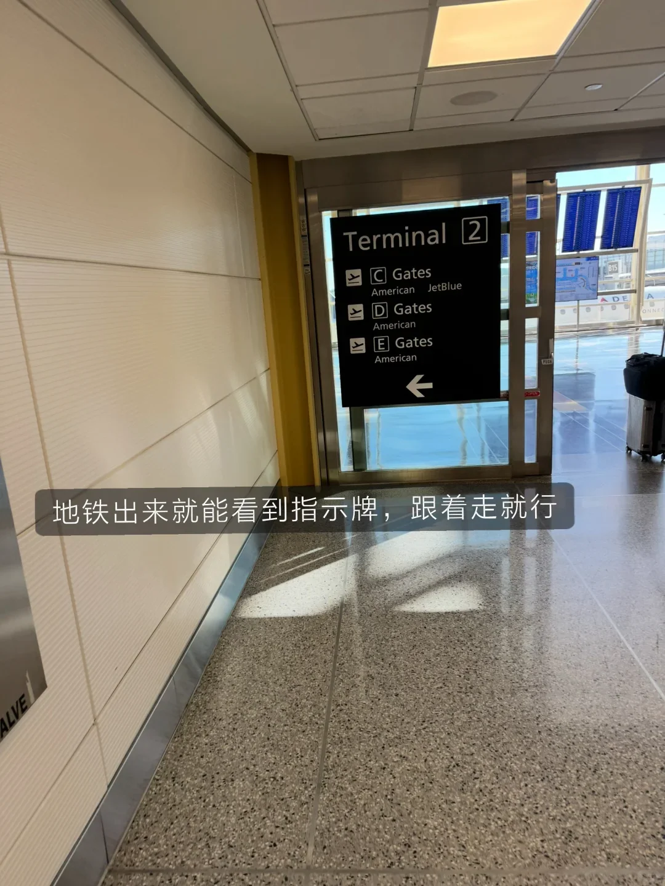
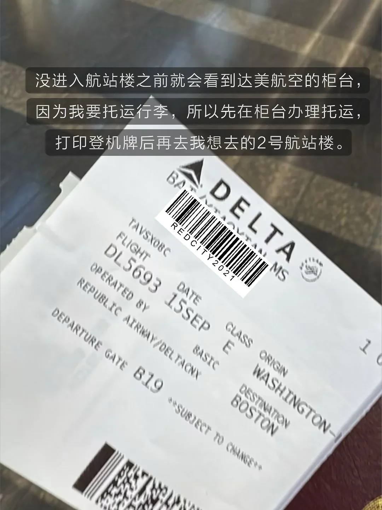
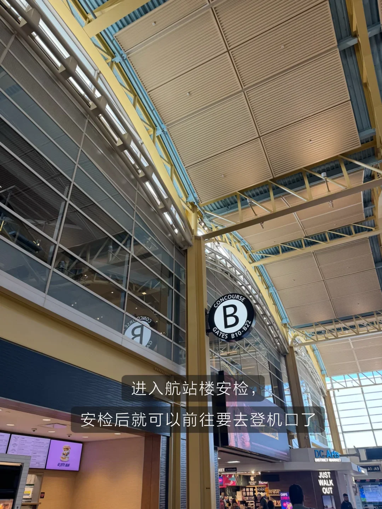
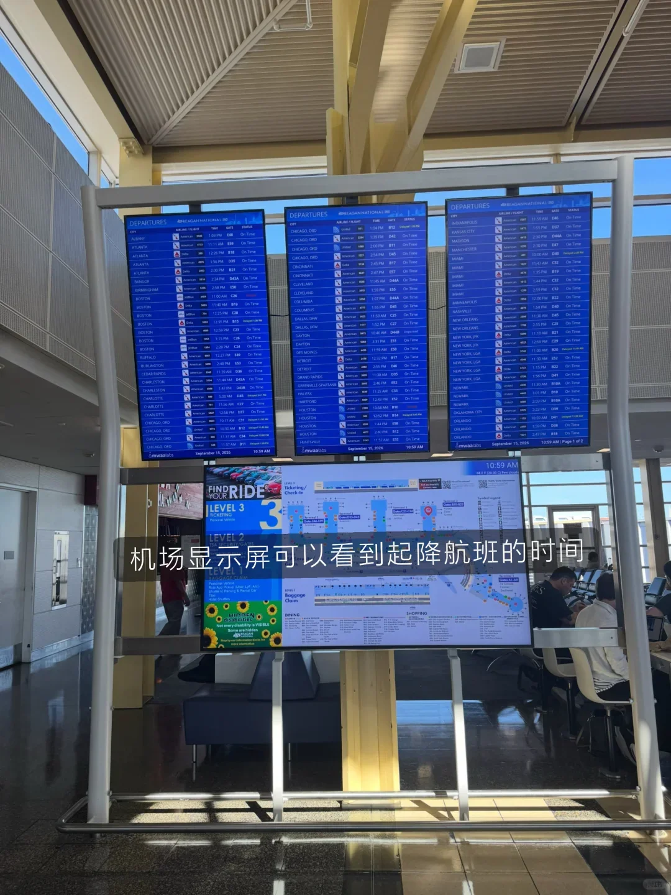
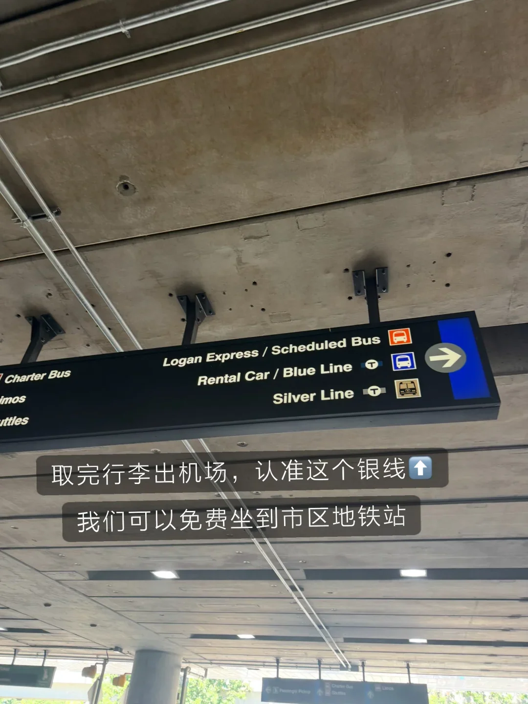
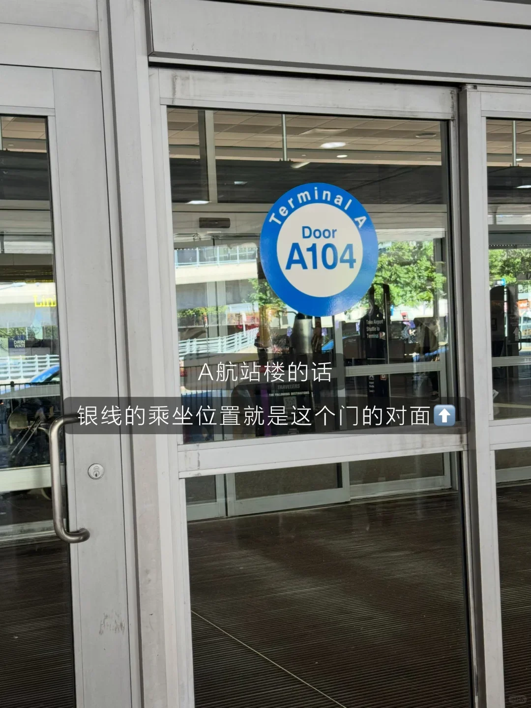

华盛顿到波士顿这条线，飞机是最省时间的一种走法：从市区坐地铁到里根机场，一小时二十分钟落地洛根，再换免费银线进城。全程不需要打车，值机和安检的节奏也比国际航班简单。

这条航线由多家航司执飞，班次密，票价浮动也大。下面按航站楼、值机与行李、安检与登机、波士顿落地的顺序整理；票价、行李费和时刻以航司官网为准。

## 一、里根机场：两个航站楼，地铁直达

里根国家机场（DCA）不大，只有两个航站楼。1 号航站楼走 A 登机口，主要是西南、边疆和加拿大航空；2 号航站楼走 B 到 E 登机口，达美、美航、捷蓝、联合、阿拉斯加都在这里。两个航站楼是分开的建筑，走错要留出十分钟步行。机场紧贴波托马克河西岸，离市中心只有几公里。

坐地铁最方便。蓝线或黄线到里根机场站，站厅有连廊直通 2 号航站楼；去 1 号航站楼要沿指示牌再走几分钟。用 SmarTrip 卡或手机钱包进站，票价按里程和时间计算，从市区过来参考 2–6 美元，车程约 15–20 分钟，比打车稳。

## 二、值机与行李：经济舱通常只含随身额度

不托运行李的话，自助值机拿电子登机牌就能直接过安检；有行李就必须去人工柜台。美国国内航班的经济舱票价大多不含托运行李，免费额度是一个登机箱加一件个人物品，箱子的尺寸和重量按航司规定。

托运行李要单独购买行李额，第一件参考 35–40 美元，提前在网上加购通常比机场柜台便宜；通过第三方平台出票时，加购入口有时要到起飞前一天才出现，别等到机场才发现。登机箱的尺寸上限通常是 22×14×9 英寸，超一点可能被要求托运，在登机口托运往往更贵。里根机场有个方便之处：从地铁站出来、还没进航站楼的地方就有达美柜台，可以先托运行李、打印登机牌，再去对应的登机区。

## 三、安检、候机与登机

安检是 TSA 的标准流程：证件加登机牌，外套、腰带、口袋里的东西放进托盘，液体每瓶不超过 100 毫升。办了 TSA PreCheck 的话可以走专用通道，不用脱鞋、不用取出电脑，队伍通常短很多。2 号航站楼有多个安检口，选通往自己登机区的那个，能少走不少路；早高峰队伍会长，提前两小时到比较稳妥。

过了安检，候机区有卖咖啡和简餐的店，也有带插座和无线充电的工作台，WiFi 速度够用。登机按 Zone 分区进行，登机口屏幕上会显示当前开放到哪个区，留意广播就行；登机一般提前 30 分钟左右开始，别在商店里逛过头。这一段航程大约一小时二十分钟，机型多为支线客机，客舱空调偏冷，带一件外套。

## 四、落地波士顿：银线免费进城

洛根机场（BOS）有 A 到 E 五个航站楼，达美在 A 航站楼。下飞机后先到楼下取行李，再跟着 Silver Line 的指示牌走。银线是波士顿地铁的快速公交线，从机场上车不收费，一路开到市区的南站（South Station）。

在 A 航站楼，银线的上车点就在 A104 门对面，出门就能看到站牌。到南站后可以直接换红线地铁，也可以换通勤铁路和长途火车；从机场到南站大约 20–30 分钟，视路况而定。另一条路是坐免费接驳巴士到蓝线机场站，再坐蓝线进城，班次也密，但银线直接把你送进地铁站，拖箱子更省事。

几个航站楼之间有免费接驳巴士，走错了不用重新出机场。除了银线，还有 Logan Express 巴士开往 Back Bay 等地，出租车和网约车到市中心参考 25–35 美元；一个人拖箱子的话，银线仍然最划算。

## 五、几个提前知道的细节

第一，两个机场都不大，但安检和行李环节最花时间，国内航班提前两小时到是稳妥的算法。第二，机票价格波动明显，工作日早班和红眼班通常更便宜，行李费要算进总价再比较。第三，登机牌上的登机口可能临时变更，进安检前看一眼大屏。第四，波士顿地铁按次计价，用 CharlieCard 比纸质票略便宜，从南站到市中心只要几站。第五，如果当天还要转火车或长途巴士，南站是最近的枢纽，银线到站后在同一个建筑里换乘。

## 相关链接

- **本站页面**：[美国（US）](/zh/country/US)
- **维基百科**：[罗纳德·里根华盛顿国家机场](https://zh.wikipedia.org/wiki/%E7%BD%97%E7%BA%B3%E5%BE%B7%C2%B7%E9%87%8C%E6%A0%B9%E5%8D%8E%E7%9B%9B%E9%A1%BF%E5%9B%BD%E5%AE%B6%E6%9C%BA%E5%9C%BA)、[波士顿洛根国际机场](https://zh.wikipedia.org/wiki/%E6%B3%A2%E5%A3%AB%E9%A1%BF%E6%B4%9B%E6%A0%B9%E5%9B%BD%E9%99%85%E6%9C%BA%E5%9C%BA)
- **百度百科**：[罗纳德·里根华盛顿国家机场](https://baike.baidu.com/item/%E7%BD%97%E7%BA%B3%E5%BE%B7%C2%B7%E9%87%8C%E6%A0%B9%E5%8D%8E%E7%9B%9B%E9%A1%BF%E5%9B%BD%E5%AE%B6%E6%9C%BA%E5%9C%BA)、[波士顿洛根国际机场](https://baike.baidu.com/item/%E6%B3%A2%E5%A3%AB%E9%A1%BF%E6%B4%9B%E6%A0%B9%E5%9B%BD%E9%99%85%E6%9C%BA%E5%9C%BA)

地铁票价、行李费、安检与登机时间均以华盛顿地铁、波士顿地铁和各航司的当前公告为准，航班时刻可能调整。图片来源：微信旅行攻略。
