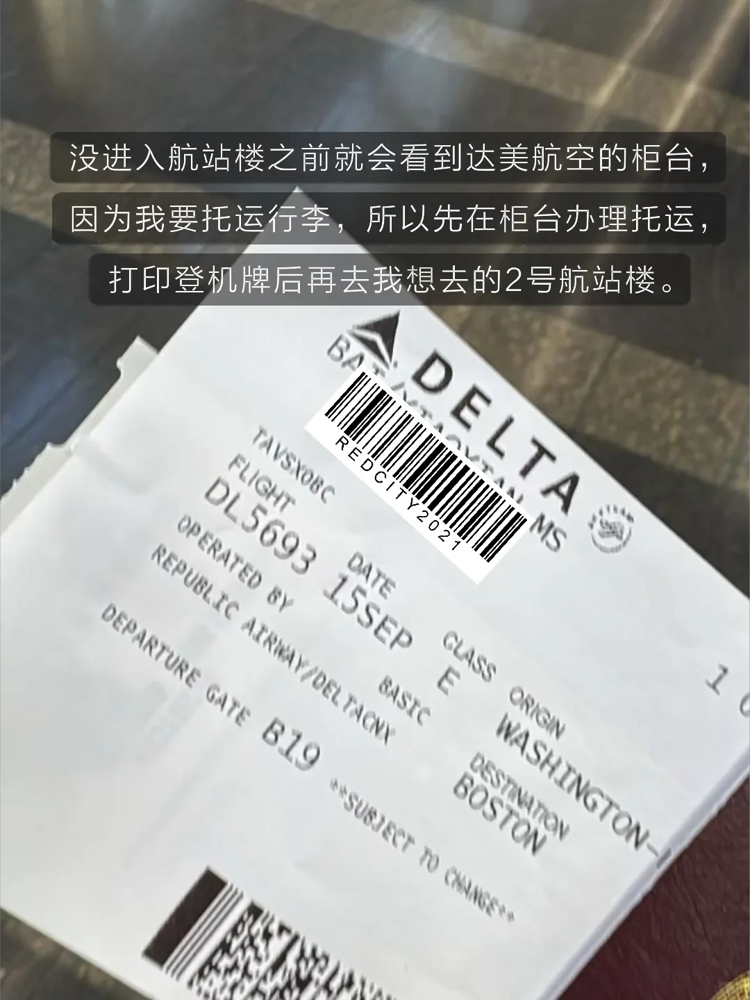

Washington–Boston é uma rota em que voar é a opção rápida: metrô do centro até o Reagan National, uma hora e vinte minutos no ar e, depois, a Silver Line gratuita até Boston. Não é preciso táxi em nenhuma das pontas, e check-in e segurança são mais simples do que em um voo internacional.

Várias companhias operam a rota, as frequências são altas e as tarifas variam muito. O que segue cobre terminais, check-in e bagagem, segurança e embarque, e depois a chegada a Logan. Tarifas, taxas de bagagem e horários seguem as páginas das próprias companhias.

## 1. Reagan National: dois terminais e o metrô na porta

O Reagan National (DCA) é pequeno, com apenas dois terminais. O Terminal 1 atende os portões A — principalmente Southwest, Frontier e Air Canada. O Terminal 2 atende os portões B a E, onde ficam Delta, American, JetBlue, United e Alaska. Os dois são prédios separados, e escolher o errado custa cerca de dez minutos a pé. O aeroporto fica às margens do Potomac, a poucos quilômetros do centro.

O metrô é a forma fácil de chegar. Pegue a linha Azul ou Amarela até a estação Ronald Reagan Washington National Airport; uma passarela coberta leva ao Terminal 2, enquanto o Terminal 1 fica alguns minutos mais adiante a pé. Passe na catraca com um cartão SmarTrip ou uma carteira digital no celular. As tarifas são cobradas por distância e horário, cerca de US$ 2–6 desde o centro, e a viagem leva cerca de 15–20 minutos — mais previsível do que um táxi.

## 2. Check-in e bagagem: na econômica, geralmente só bagagem de mão

Sem mala despachada, o check-in de autoatendimento e o cartão de embarque no celular levam você direto à segurança; com mala, você precisa do balcão com atendente. A maioria das tarifas econômicas domésticas nos Estados Unidos não inclui bagagem despachada: a franquia gratuita é uma bagagem de mão mais um item pessoal, com limites de tamanho e peso definidos pela companhia.

As malas despachadas são compradas à parte, cerca de US$ 35–40 pela primeira, e adicioná-la online com antecedência costuma sair mais barato do que no balcão do aeroporto. Quando o bilhete é emitido por um site de terceiros, o adicional às vezes só aparece no dia anterior à partida, então não deixe para o aeroporto. O Reagan tem uma conveniência que vale conhecer: o balcão da Delta fica entre a saída do metrô e a entrada do terminal, então você pode despachar as malas e imprimir o cartão de embarque antes de caminhar até a área certa.

## 3. Segurança, a área e o embarque

A segurança é a TSA padrão: documento de identidade e cartão de embarque, jaqueta e cinto fora, bolsos vazios, líquidos em recipientes de 100 ml ou menos. Com o TSA PreCheck, você usa uma fila dedicada e mantém sapatos e notebook no lugar, e a fila costuma ser bem menor. O Terminal 2 tem vários pontos de controle, então escolha o que dá acesso à sua área; as filas crescem de manhã, e é por isso que duas horas antes da partida é a regra segura.

Depois da segurança há balcões de café e lanches e estações de trabalho com tomadas e carregamento sem fio, e o Wi-Fi funciona bem. O embarque é por zonas, com a tela do portão mostrando qual zona está aberta, então fique de olho na tela e nos anúncios; o embarque costuma começar cerca de 30 minutos antes da partida, então não se afaste demais. O voo dura cerca de uma hora e vinte minutos, geralmente em um jato regional, e o ar-condicionado da cabine é frio — leve um casaco.

## 4. Pousando em Logan: a Silver Line gratuita até a cidade

O Logan (BOS) tem cinco terminais, de A a E, e a Delta usa o Terminal A. Depois do pouso, retire as malas no andar de baixo e siga as placas da Silver Line. A Silver Line é a linha de ônibus rápido de Boston, gratuita a partir do aeroporto, e vai até a South Station, na cidade.

No Terminal A, a parada fica bem em frente à porta A104, então a placa é visível quando você sai. Na South Station, você pode trocar para a Linha Vermelha, para o trem urbano ou para trens de longa distância; o trajeto desde o aeroporto leva cerca de 20–30 minutos, dependendo do trânsito. A alternativa é o shuttle gratuito até a estação Airport da Linha Azul e a Linha Azul até a cidade, que também é frequente, mas a Silver Line deixa você dentro da estação de metrô e é mais fácil com mala.

Os terminais são ligados por ônibus shuttle gratuitos, então uma curva errada não significa sair do aeroporto. Além da Silver Line, os ônibus do Logan Express vão para Back Bay e outros pontos, e um táxi ou carro de aplicativo até o centro custa cerca de US$ 25–35; para uma pessoa com bagagem, a Silver Line ainda ganha.

## 5. Detalhes que vale saber com antecedência

Nenhum dos dois aeroportos é grande, mas é na segurança e na bagagem que o tempo se vai, então duas horas antes de um voo doméstico é o cálculo seguro. As tarifas oscilam muito — voos de manhã cedo em dias úteis e voos da madrugada costumam ser mais baratos — e as taxas de bagagem entram na comparação. Os números de portão no cartão de embarque podem mudar, então confira os painéis antes da segurança. O metrô de Boston cobra uma tarifa fixa por viagem, com o CharlieCard um pouco mais barato do que o bilhete de papel, e a South Station fica a poucas paradas do centro. Se um trem ou ônibus segue depois do voo, a South Station é o hub mais próximo, com a troca dentro do mesmo prédio.

## Links relacionados

- **Neste site**: [Estados Unidos (US)](/country/US)
- **Wikipédia**: [Aeroporto Nacional Ronald Reagan de Washington](https://en.wikipedia.org/wiki/Ronald_Reagan_Washington_National_Airport), [Aeroporto Internacional Logan](https://en.wikipedia.org/wiki/Logan_International_Airport)
- **Baidu Baike**: [Aeroporto Nacional Ronald Reagan de Washington](https://baike.baidu.com/item/%E7%BD%97%E7%BA%B3%E5%BE%B7%C2%B7%E9%87%8C%E6%A0%B9%E5%8D%8E%E7%9B%9B%E9%A1%BF%E5%9B%BD%E5%AE%B6%E6%9C%BA%E5%9C%BA), [Aeroporto Internacional Logan](https://baike.baidu.com/item/%E6%B3%A2%E5%A3%AB%E9%A1%BF%E6%B4%9B%E6%A0%B9%E5%9B%BD%E9%99%85%E6%9C%BA%E5%9C%BA)

Tarifas de metrô, taxas de bagagem e tempos de segurança e embarque seguem os avisos atuais das agências de transporte de Washington e Boston e das companhias aéreas, e os horários mudam. Crédito da imagem: guia de viagem do WeChat.
