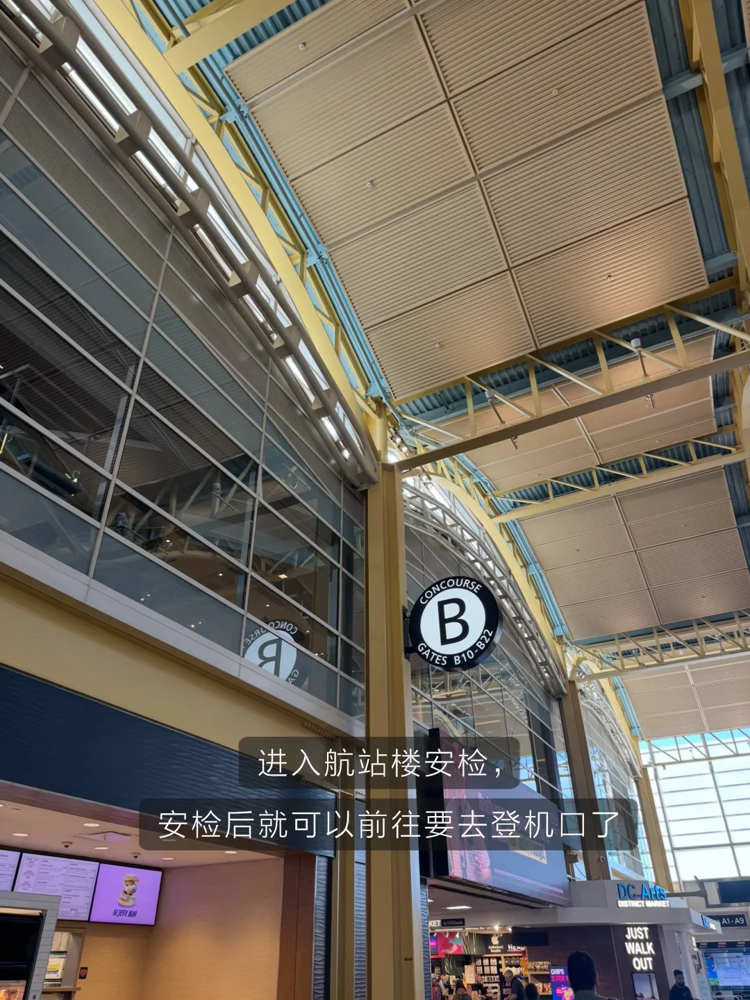

Вашингтон – Бостон — маршрут, где самолёт — быстрый вариант: метро из центра до национального аэропорта Рейгана, час двадцать в воздухе, затем бесплатная Silver Line в Бостон. Такси не нужно ни там, ни там, а регистрация и досмотр проще, чем на международном рейсе.

По этому маршруту летают несколько авиакомпаний, частота высокая, а тарифы сильно меняются. Далее — терминалы, регистрация и багаж, досмотр и посадка, затем прибытие в Логан. Тарифы, плата за багаж и расписания — по страницам самих авиакомпаний.

## 1. Национальный аэропорт Рейгана: два терминала, метро у двери

Национальный аэропорт Рейгана (DCA) небольшой, всего два терминала. Терминал 1 обслуживает выходы A — в основном Southwest, Frontier и Air Canada. Терминал 2 обслуживает выходы B–E, где находятся Delta, American, JetBlue, United и Alaska. Это отдельные здания, и ошибка с выбором обойдётся примерно в десять минут пешком. Аэропорт стоит на Потомаке в нескольких километрах от центра.

Метро — простой способ добраться. Садитесь на синюю или жёлтую линию до станции Ronald Reagan Washington National Airport; крытый переход ведёт к терминалу 2, а терминал 1 — в нескольких минутах пешком дальше. Прикладывайте карту SmarTrip или кошелёк телефона. Тариф зависит от расстояния и времени, примерно $2–6 из центра, а поездка занимает около 15–20 минут — предсказуемее такси.

## 2. Регистрация и багаж: в экономклассе обычно только ручная кладь

Без сдаваемого багажа самостоятельная регистрация и мобильный посадочный талон ведут прямо к досмотру; с багажом нужна стойка с сотрудником. Большинство тарифов экономкласса на внутренних рейсах США не включают сдаваемый багаж: бесплатная норма — одна ручная кладь плюс одна личная вещь, размеры и вес устанавливает авиакомпания.

Сдаваемый багаж покупается отдельно, около $35–40 за первый, и добавление онлайн заранее обычно дешевле, чем у стойки в аэропорту. Когда билет оформлен через сторонний сайт, доплата иногда появляется только за день до вылета, поэтому не откладывайте до аэропорта. В Рейгане есть удобство, о котором стоит знать: стойка Delta находится между выходом из метро и входом в терминал, так что можно сдать багаж и распечатать посадочный талон до того, как идти к нужной галерее.

## 3. Досмотр, галерея и посадка

Досмотр стандартный TSA: удостоверение и посадочный талон, снять куртку и ремень, выложить содержимое карманов, жидкости в ёмкостях до 100 мл. С TSA PreCheck вы пользуетесь отдельной полосой, обувь и ноутбук остаются на месте, и очередь обычно гораздо короче. В терминале 2 несколько пунктов досмотра, поэтому выбирайте тот, что ведёт к вашей галерее; утром очереди растут — вот почему два часа до вылета остаются безопасным правилом.

После досмотра есть кофейни и закусочные, рабочие места с розетками и беспроводной зарядкой, и Wi-Fi держит нагрузку. Посадка идёт по зонам, и экран у выхода показывает, какая зона открыта, поэтому следите за экраном и объявлениями; посадка обычно начинается примерно за 30 минут до вылета, так что далеко не уходите. Полёт занимает около часа двадцати, обычно на региональном реактивном самолёте, а кондиционер в салоне работает холодно — возьмите куртку.

## 4. Прилёт в Логан: бесплатная Silver Line в город

В Логане (BOS) пять терминалов, A–E, и Delta использует терминал A. После посадки заберите багаж внизу и следуйте указателям Silver Line. Silver Line — маршрут скоростного автобуса Бостона, бесплатный из аэропорта, и он идёт до South Station в центре города.

В терминале A остановка находится прямо напротив двери A104, так что указатель виден, как только вы выходите. На South Station можно пересесть на красную линию, на пригородные или дальние поезда; поездка из аэропорта занимает около 20–30 минут в зависимости от трафика. Альтернатива — бесплатный шаттл до станции Airport синей линии и синяя линия в город, которая тоже ходит часто, но Silver Line высаживает вас внутри станции метро и удобнее с чемоданом.

Терминалы связаны бесплатными шаттлами, поэтому неверный поворот не означает выезд из аэропорта. Кроме Silver Line, автобусы Logan Express идут до Back Bay и других мест, а такси или машина райд-хейлинга до центра стоит около $25–35; для одного человека с багажом Silver Line всё равно выигрывает.

## 5. Детали, которые стоит знать заранее

Ни один из аэропортов не велик, но время уходит на досмотр и багаж, поэтому два часа до внутреннего рейса — безопасный расчёт. Тарифы сильно колеблются — рейсы ранним утром по будням и ночные обычно дешевле — и плату за багаж нужно включать в сравнение. Номера выходов в посадочном талоне могут измениться, поэтому проверяйте табло до досмотра. Метро Бостона берёт фиксированную плату за поездку, с CharlieCard чуть дешевле, чем с бумажным билетом, а South Station всего в нескольких остановках от центра. Если после самолёта предстоит поезд или автобус, South Station — ближайший узел с пересадкой в том же здании.

## Связанные ссылки

- **На этом сайте**: [США (US)](/country/US)
- **Википедия**: [Национальный аэропорт Рейгана](https://en.wikipedia.org/wiki/Ronald_Reagan_Washington_National_Airport), [Международный аэропорт Логан](https://en.wikipedia.org/wiki/Logan_International_Airport)
- **Baidu Baike**: [Национальный аэропорт Рейгана](https://baike.baidu.com/item/%E7%BD%97%E7%BA%B3%E5%BE%B7%C2%B7%E9%87%8C%E6%A0%B9%E5%8D%8E%E7%9B%9B%E9%A1%BF%E5%9B%BD%E5%AE%B6%E6%9C%BA%E5%9C%BA), [Международный аэропорт Логан](https://baike.baidu.com/item/%E6%B3%A2%E5%A3%AB%E9%A1%BF%E6%B4%9B%E6%A0%B9%E5%9B%BD%E9%99%85%E6%9C%BA%E5%9C%BA)

Тарифы метро, плата за багаж, время досмотра и посадки — по текущим объявлениям транспортных агентств Вашингтона и Бостона и авиакомпаний, расписания меняются. Изображение: путеводитель из WeChat.
