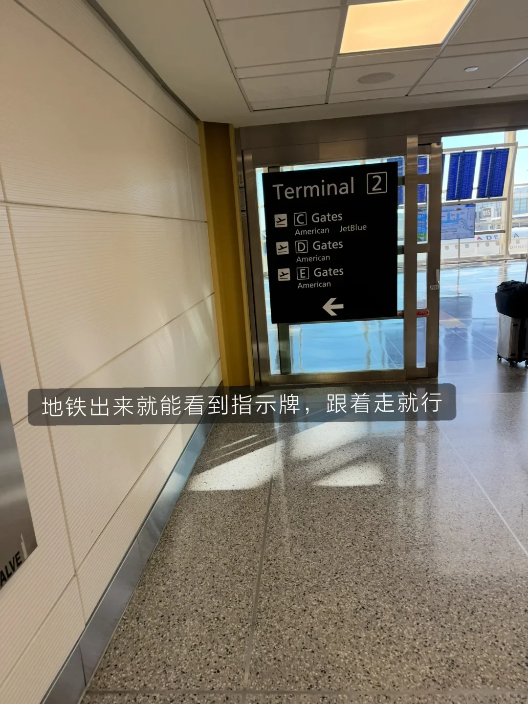

Washington till Boston är en sträcka där flyget är det snabba valet: tunnelbana från centrum till Reagan National, en timme och tjugo minuter i luften och sedan den kostnadsfria Silver Line in till Boston. Ingen taxi behövs i någon ände, och incheckning och säkerhetskontroll är enklare än på ett internationellt flyg.

Flera flygbolag flyger sträckan, turtätheten är hög och biljettpriserna rör sig mycket. Det följande tar upp terminaler, incheckning och bagage, säkerhetskontroll och boarding samt ankomsten till Logan. Biljettpriser, bagageavgifter och tidtabeller följer flygbolagens egna sidor.

## 1. Reagan National: två terminaler och tunnelbanan vid dörren

Reagan National (DCA) är litet med bara två terminaler. Terminal 1 hanterar gate A – mest Southwest, Frontier och Air Canada. Terminal 2 hanterar gate B till E, där Delta, American, JetBlue, United och Alaska håller till. De två är separata byggnader, och att välja fel kostar cirka tio minuters promenad. Flygplatsen ligger vid Potomacfloden några kilometer från centrum.

Metro är det enkla sättet in. Ta Blue eller Yellow Line till stationen Ronald Reagan Washington National Airport; en täckt gångväg leder till Terminal 2, medan Terminal 1 ligger några minuter längre bort till fots. Blippa in med ett SmarTrip-kort eller en plånbok i telefonen. Priset beräknas efter avstånd och tid, ungefär 2–6 dollar från centrum, och resan tar cirka 15–20 minuter – mer förutsägbart än en taxi.

## 2. Incheckning och bagage: ekonomiklass innebär oftast bara handbagage

Utan incheckat bagage tar självbetjäningsincheckning och ett boardingkort i mobilen dig direkt till säkerhetskontrollen; med bagage behöver du den bemannade disken. De flesta inrikes ekonomibiljetter i USA inkluderar inte incheckat bagage: den kostnadsfria kvoten är ett handbagage plus ett personligt föremål, med storleks- och viktgränser som flygbolaget bestämmer.

Incheckat bagage köps separat, cirka 35–40 dollar för det första, och att lägga till det online i förväg är vanligtvis billigare än vid flygplatsdisken. När en biljett utfärdas via en tredjepartssajt dyker tillägget ibland bara upp dagen före avgång, så lämna det inte till flygplatsen. Reagan har en praktisk detalj värd att känna till: Delta-disken ligger mellan tunnelbaneutgången och terminalens entré, så du kan lämna bagage och skriva ut ett boardingkort innan du går till rätt avgångshall.

## 3. Säkerhetskontroll, avgångshall och boarding

Säkerhetskontrollen är standard TSA: legitimation och boardingkort, jacka och bälte av, fickorna tömda, vätskor i behållare på högst 100 ml. Med TSA PreCheck använder du en egen fil och behåller skor och bärbar dator på plats, och kön är vanligtvis mycket kortare. Terminal 2 har flera säkerhetskontroller, så välj den som leder till din avgångshall; kön växer på morgonen, vilket är anledningen till att två timmar före avgång är den säkra regeln.

Efter säkerhetskontrollen finns kaffe- och snackdiskar samt arbetsplatser med eluttag och trådlös laddning, och Wi-Fi:t håller. Boardingen sker zonvis, och gateskärmen visar vilken zon som är öppen, så håll koll på skärmen och utropen; boardingen börjar vanligtvis cirka 30 minuter före avgång, så gå inte för långt bort. Flygresan tar cirka en timme och tjugo minuter, oftast med ett regionaljetplan, och kabinens luftkonditionering är kall – ta med en jacka.

## 4. Landning på Logan: den kostnadsfria Silver Line in till stan

Logan (BOS) har fem terminaler, A till E, och Delta använder Terminal A. Efter landningen hämtar du bagaget på nedervåningen och följer skyltarna till Silver Line. Silver Line är Bostons snabbusslinje, kostnadsfri från flygplatsen, och den går in till South Station i staden.

I Terminal A ligger hållplatsen direkt mittemot dörr A104, så skylten syns när du kommer ut. Från South Station kan du byta till Red Line, till pendeltåg eller till fjärrtåg; resan från flygplatsen tar cirka 20–30 minuter beroende på trafiken. Alternativet är den kostnadsfria shuttlebussen till Blue Lines station Airport och Blue Line in till stan, som också går ofta, men Silver Line släpper av dig inne på tunnelbanestationen och är enklare med en resväska.

Terminalerna förbinds av kostnadsfria shuttlebussar, så ett felsteg innebär inte att du lämnar flygplatsen. Förutom Silver Line går Logan Express-bussar till Back Bay och andra platser, och en taxi eller en bil från en apptjänst till centrum kostar omkring 25–35 dollar; för en person med bagage vinner Silver Line fortfarande.

## 5. Detaljer värda att känna till i förväg

Ingen av flygplatserna är stor, men det är vid säkerhetskontrollen och bagaget som tiden går, så två timmar före ett inrikesflyg är den säkra beräkningen. Biljettpriserna svänger kraftigt – tidiga vardagsflyg och nattflyg är vanligtvis billigare – och bagageavgifterna hör till jämförelsen. Gate-numren på boardingkortet kan ändras, så kontrollera tavlorna före säkerhetskontrollen. Bostons tunnelbana har en fast avgift per resa, där ett CharlieCard är något billigare än en pappersbiljett, och South Station ligger bara några hållplatser från centrum. Om ett tåg eller en buss följer på flygresan är South Station den närmaste knutpunkten, med bytet inne i samma byggnad.

## Relaterade länkar

- **På den här webbplatsen**: [USA (US)](/country/US)
- **Wikipedia**: [Ronald Reagan Washington National Airport](https://en.wikipedia.org/wiki/Ronald_Reagan_Washington_National_Airport), [Logan International Airport](https://en.wikipedia.org/wiki/Logan_International_Airport)
- **Baidu Baike**: [Ronald Reagan Washington National Airport](https://baike.baidu.com/item/%E7%BD%97%E7%BA%B3%E5%BE%B7%C2%B7%E9%87%8C%E6%A0%B9%E5%8D%8E%E7%9B%9B%E9%A1%BF%E5%9B%BD%E5%AE%B6%E6%9C%BA%E5%9C%BA), [Logan International Airport](https://baike.baidu.com/item/%E6%B3%A2%E5%A3%AB%E9%A1%BF%E6%B4%9B%E6%A0%B9%E5%9B%BD%E9%99%85%E6%9C%BA%E5%9C%BA)

Metropriser, bagageavgifter samt tider för säkerhetskontroll och boarding följer de aktuella uppgifterna från Washingtons och Bostons trafikmyndigheter och flygbolagen, och tidtabellerna ändras. Bildkredit: WeChat reseguide.
