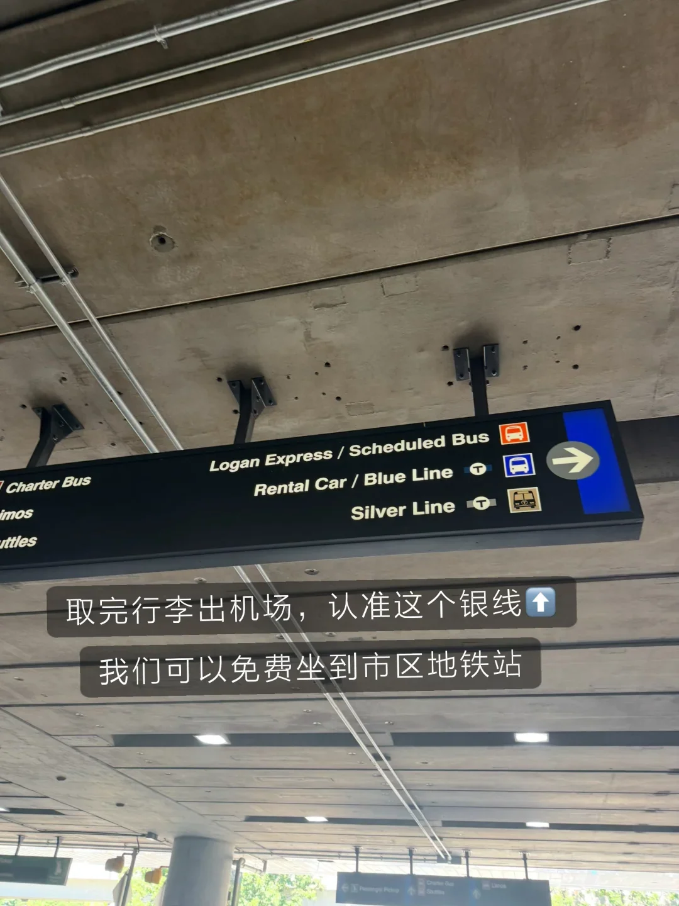
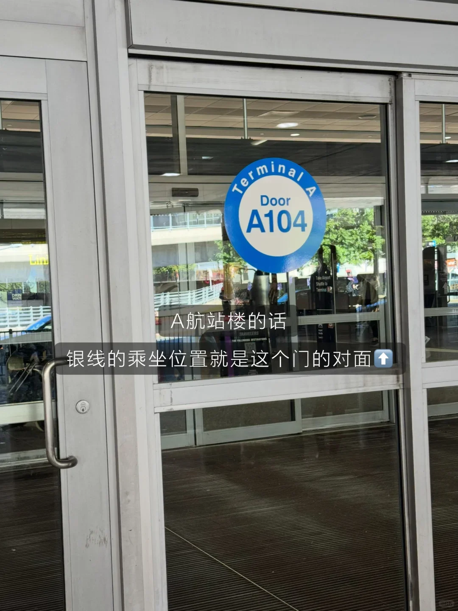

Washington'dan Boston'a uçmak, uçağın hızlı seçenek olduğu bir rota: şehir merkezinden Reagan National'a metro, havada bir saat yirmi dakika, ardından Boston'a ücretsiz Silver Line. İki uçta da taksi gerekmiyor ve check-in ile güvenlik uluslararası bir uçuşa göre daha basit.

Bu rotada birkaç havayolu uçuyor, sefer sıklığı yüksek ve ücretler çok değişiyor. Aşağıda terminaller, check-in ve bagaj, güvenlik ve biniş, ardından Logan'a varış ele alınıyor. Ücretler, bagaj ücretleri ve tarifeler havayollarının kendi sayfalarına göredir.

## 1. Reagan National: iki terminal, kapıda metro

Reagan National (DCA) küçük; yalnızca iki terminali var. Terminal 1, A kapılarını işler — çoğunlukla Southwest, Frontier ve Air Canada. Terminal 2, B'den E'ye kapıları işler; Delta, American, JetBlue, United ve Alaska buradadır. İkisi ayrı binalardır ve yanlış olanı seçmek yürüyerek yaklaşık on dakikaya mal olur. Havalimanı, şehir merkezinden birkaç kilometre uzakta Potomac kıyısında.

Metro içeri girmenin kolay yolu. Mavi veya Sarı Hattı Ronald Reagan Washington National Airport istasyonuna kadar kullanın; Terminal 2'ye üstü kapalı bir yürüyüş yolu gider, Terminal 1 ise yürüyerek birkaç dakika daha uzaktadır. SmarTrip kartı veya telefon cüzdanıyla giriş yapın. Ücretler mesafe ve zamana göre alınır, şehir merkezinden yaklaşık 2–6 $ ve yolculuk 15–20 dakika sürer — taksiye göre daha öngörülebilir.

## 2. Check-in ve bagaj: ekonomi genellikle yalnızca kabin bagajı demektir

Kayıtlı bagajınız yoksa self-servis check-in ve mobil biniş kartı sizi doğrudan güvenliğe götürür; bagajınız varsa personelli gişeye gitmeniz gerekir. ABD iç hat ekonomi ücretlerinin çoğu kayıtlı bagaj içermez: ücretsiz hak bir kabin bagajı ve bir kişisel eşyadır; boyut ve ağırlık sınırlarını havayolu belirler.

Kayıtlı bagajlar ayrıca satın alınır, ilki için yaklaşık 35–40 $ ve online olarak önceden eklemek genellikle havalimanı gişesinden daha ucuzdur. Bilet üçüncü taraf bir siteden düzenlendiğinde ek bazen yalnızca kalkıştan bir gün önce görünür, bu yüzden bunu havalimanına bırakmayın. Reagan'ın bilinmeye değer bir kolaylığı var: Delta gişesi metro çıkışı ile terminal girişi arasındadır, böylece doğru koridora yürümeden önce bagajı bırakıp biniş kartı yazdırabilirsiniz.

## 3. Güvenlik, koridor ve biniş

Güvenlik standart TSA: kimlik ve biniş kartı, ceket ve kemer çıkar, cepler boşaltılır, sıvılar 100 ml veya daha küçük kaplarda. TSA PreCheck'iniz varsa ayrı bir şerit kullanır, ayakkabılarınızı ve dizüstü bilgisayarınızı yerinde bırakırsınız ve kuyruk genellikle çok daha kısadır. Terminal 2'de birkaç kontrol noktası var, bu yüzden koridorunuza giden kontrol noktasını seçin; sabah kuyrukları oluşur, bu yüzden kalkıştan iki saat önce gelmek güvenli kuraldır.

Güvenliğin ötesinde kahve ve atıştırmalık tezgâhları ile prizli ve kablosuz şarjlı çalışma istasyonları var ve Wi-Fi iyi çekiyor. Biniş bölge esasına göre yürür; kapı ekranı hangi bölgenin açık olduğunu gösterir, bu yüzden ekranı ve anonsları izleyin; biniş genellikle kalkıştan yaklaşık 30 dakika önce başlar, bu yüzden çok uzağa gitmeyin. Uçuş yaklaşık bir saat yirmi dakika sürer, genellikle bölgesel bir jetle yapılır ve kabin kliması soğuk çalışır — yanınıza bir ceket alın.

## 4. Logan'a iniş: şehre ücretsiz Silver Line

Logan'da (BOS) A'dan E'ye beş terminal var ve Delta Terminal A'yı kullanıyor. İndikten sonra bagajınızı alt kattan alın ve Silver Line tabelalarını izleyin. Silver Line Boston'ın hızlı otobüs hattıdır, havalimanından ücretsizdir ve şehirdeki South Station'a gider.

Terminal A'da durak doğrudan A104 kapısının karşısındadır, böylece dışarı çıktığınızda tabelayı görürsünüz. South Station'dan Kırmızı Hat'a, banliyö trenlerine veya uzun mesafe trenlerine aktarma yapabilirsiniz; havalimanından yolculuk trafiğe göre yaklaşık 20–30 dakika sürer. Alternatif, Mavi Hat'ın Airport istasyonuna ücretsiz servis ve ardından şehre Mavi Hat; bu da sık çalışır, ancak Silver Line sizi metro istasyonunun içinde bırakır ve bavulla daha kolaydır.

Terminaller ücretsiz servis otobüsleriyle birbirine bağlıdır, bu yüzden yanlış bir dönüş havalimanından çıkmak anlamına gelmez. Silver Line'ın yanı sıra Logan Express otobüsleri Back Bay'e ve başka yerlere gider; şehir merkezine taksi veya uygulama çağrılı araç yaklaşık 25–35 $. Bagajıyla tek başına seyahat eden biri için Silver Line hâlâ kazanır.

## 5. Önceden bilinmeye değer ayrıntılar

İki havalimanı da büyük değil, ancak zamanı güvenlik ve bagaj alır, bu yüzden iç hat uçuşundan iki saat önce gelmek güvenli hesaplamadır. Ücretler geniş aralıkta dalgalanır — hafta içi sabah erken uçuşlar ve gece uçuşları genellikle daha ucuzdur — ve bagaj ücretleri karşılaştırmaya dahil edilmelidir. Biniş kartındaki kapı numaraları değişebilir, bu yüzden güvenlikten önce panolara bakın. Boston metrosu yolculuk başına sabit ücret alır; CharlieCard kâğıt biletten biraz daha ucuzdur ve South Station şehir merkezine yalnızca birkaç durak uzaktadır. Uçuşun ardından bir tren veya otobüs varsa en yakın merkez South Station'dır ve aktarma aynı binanın içindedir.

## İlgili bağlantılar

- **Bu sitede**: [Amerika Birleşik Devletleri (US)](/country/US)
- **Wikipedia**: [Ronald Reagan Washington National Havalimanı](https://en.wikipedia.org/wiki/Ronald_Reagan_Washington_National_Airport), [Logan Uluslararası Havalimanı](https://en.wikipedia.org/wiki/Logan_International_Airport)
- **Baidu Baike**: [Ronald Reagan Washington National Havalimanı](https://baike.baidu.com/item/%E7%BD%97%E7%BA%B3%E5%BE%B7%C2%B7%E9%87%8C%E6%A0%B9%E5%8D%8E%E7%9B%9B%E9%A1%BF%E5%9B%BD%E5%AE%B6%E6%9C%BA%E5%9C%BA), [Logan Uluslararası Havalimanı](https://baike.baidu.com/item/%E6%B3%A2%E5%A3%AB%E9%A1%BF%E6%B4%9B%E6%A0%B9%E5%9B%BD%E9%99%85%E6%9C%BA%E5%9C%BA)

Metro ücretleri, bagaj ücretleri ile güvenlik ve biniş süreleri Washington ve Boston ulaşım kurumlarının ve havayollarının güncel duyurularına göredir ve tarifeler değişir. Görsel kaynağı: WeChat seyahat rehberi.
