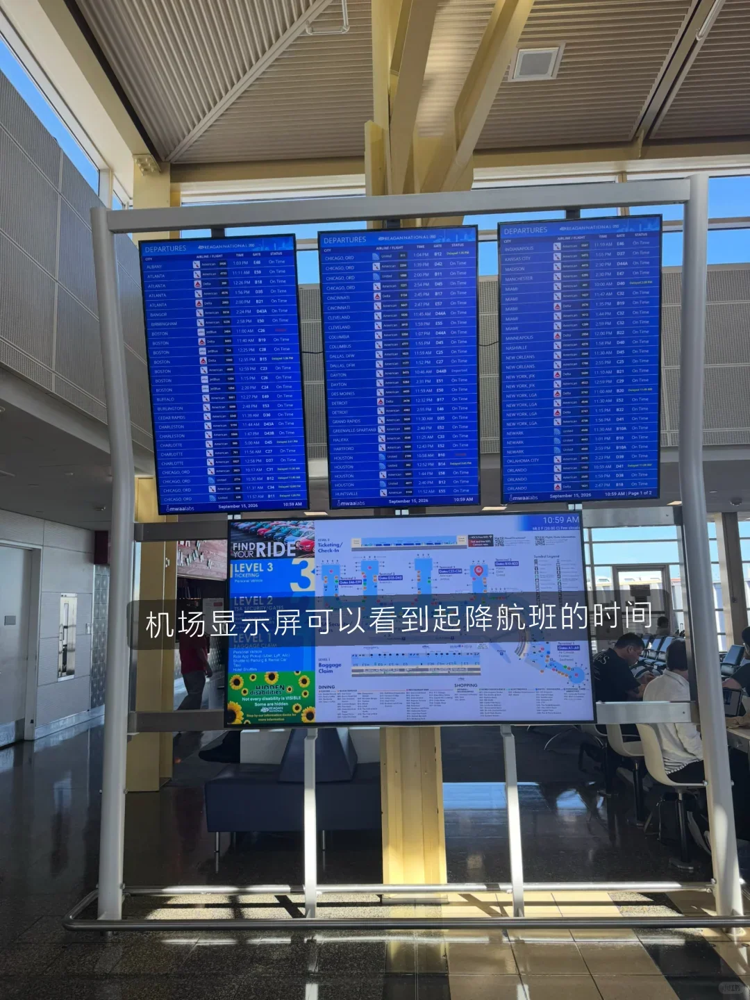

Washington đến Boston là tuyến mà đi máy bay là lựa chọn nhanh: Metro từ trung tâm đến Reagan National, một giờ hai mươi phút trên không, rồi tuyến Silver Line miễn phí vào Boston. Không cần taxi ở cả hai đầu, và làm thủ tục cùng kiểm tra an ninh đơn giản hơn chuyến bay quốc tế.

Nhiều hãng bay tuyến này, tần suất cao, và giá vé biến động mạnh. Phần dưới đây bao gồm nhà ga, làm thủ tục và hành lý, an ninh và lên máy bay, rồi đến khi hạ cánh tại Logan. Giá vé, phí hành lý và lịch bay theo trang của các hãng.

## 1. Reagan National: hai nhà ga, Metro ngay cửa

Reagan National (DCA) nhỏ, chỉ có hai nhà ga. Nhà ga 1 phục vụ các cổng A — chủ yếu Southwest, Frontier và Air Canada. Nhà ga 2 phục vụ các cổng B đến E, nơi có Delta, American, JetBlue, United và Alaska. Hai nhà ga là hai tòa nhà riêng, và chọn nhầm sẽ mất khoảng mười phút đi bộ. Sân bay nằm bên sông Potomac, cách trung tâm vài km.

Metro là cách vào dễ dàng. Đi tuyến Blue hoặc Yellow đến ga Ronald Reagan Washington National Airport; một lối đi có mái che dẫn đến Nhà ga 2, còn Nhà ga 1 cách thêm vài phút đi bộ. Quẹt thẻ SmarTrip hoặc ví trên điện thoại. Giá vé tính theo khoảng cách và thời gian, khoảng 2–6 USD từ trung tâm, và chuyến đi mất khoảng 15–20 phút — dễ đoán hơn taxi.

## 2. Làm thủ tục và hành lý: hạng phổ thông thường chỉ có hành lý xách tay

Không có hành lý ký gửi, làm thủ tục tự phục vụ và thẻ lên máy bay trên điện thoại đưa bạn thẳng đến an ninh; có hành lý thì cần quầy có nhân viên. Hầu hết vé phổ thông nội địa Mỹ không bao gồm hành lý ký gửi: hạn mức miễn phí là một kiện xách tay cộng một vật dụng cá nhân, với giới hạn kích thước và trọng lượng do hãng quy định.

Hành lý ký gửi mua riêng, khoảng 35–40 USD cho kiện đầu tiên, và mua trước trực tuyến thường rẻ hơn tại quầy sân bay. Khi vé được phát hành qua trang bên thứ ba, gói mua thêm đôi khi chỉ hiện vào ngày trước khởi hành, nên đừng để đến sân bay. Reagan có một điểm tiện đáng biết: quầy Delta nằm giữa lối ra Metro và cửa vào nhà ga, nên bạn có thể gửi hành lý và in thẻ lên máy bay trước khi đi bộ đến đúng khu.

## 3. An ninh, khu cổng và lên máy bay

An ninh theo tiêu chuẩn TSA: giấy tờ tùy thân và thẻ lên máy bay, cởi áo khoác và thắt lưng, làm trống túi, chất lỏng trong chai 100 ml trở xuống. Có TSA PreCheck, bạn dùng làn riêng và giữ giày, máy tính xách tay tại chỗ, hàng đợi thường ngắn hơn nhiều. Nhà ga 2 có nhiều điểm kiểm tra, nên chọn điểm dẫn vào khu của bạn; hàng đợi buổi sáng tăng, vì thế quy tắc an toàn là có mặt hai giờ trước khởi hành.

Sau an ninh có quầy cà phê, đồ ăn nhẹ và bàn làm việc có ổ cắm điện cùng sạc không dây, và Wi-Fi ổn. Lên máy bay theo khu, màn hình cổng hiển thị khu nào đang mở, nên hãy theo dõi màn hình và thông báo; việc lên máy bay thường bắt đầu khoảng 30 phút trước khởi hành, vì vậy đừng đi xa quá. Chuyến bay mất khoảng một giờ hai mươi phút, thường bằng máy bay phản lực khu vực, và điều hòa trong khoang lạnh — hãy mang áo khoác.

## 4. Hạ cánh tại Logan: tuyến Silver Line miễn phí vào trung tâm

Logan (BOS) có năm nhà ga, A đến E, và Delta dùng Nhà ga A. Sau khi hạ cánh, nhận hành lý ở tầng dưới và đi theo biển Silver Line. Silver Line là tuyến xe buýt nhanh của Boston, miễn phí từ sân bay, chạy vào South Station trong thành phố.

Tại Nhà ga A, điểm dừng nằm ngay đối diện cửa A104, nên biển hiệu nhìn thấy được khi bạn bước ra. Từ South Station, bạn có thể đổi sang Red Line, tàu ngoại ô hoặc tàu đường dài; chuyến đi từ sân bay mất khoảng 20–30 phút tùy giao thông. Lựa chọn khác là xe buýt đưa đón miễn phí đến ga Airport của Blue Line rồi vào trung tâm, cũng thường xuyên, nhưng Silver Line thả bạn ngay trong ga tàu điện ngầm và dễ hơn khi có vali.

Các nhà ga được nối bằng xe buýt đưa đón miễn phí, nên đi nhầm cũng không phải rời sân bay. Ngoài Silver Line, xe khách Logan Express chạy đến Back Bay và nhiều nơi khác, còn taxi hoặc xe công nghệ vào trung tâm khoảng 25–35 USD; với một người có hành lý, Silver Line vẫn thắng.

## 5. Những chi tiết nên biết trước

Cả hai sân bay đều không lớn, nhưng an ninh và hành lý là nơi mất thời gian, nên hai giờ trước chuyến nội địa là phép tính an toàn. Giá vé dao động mạnh — chuyến sáng ngày thường và chuyến đêm thường rẻ hơn — và phí hành lý cần được tính vào so sánh. Số cổng trên thẻ lên máy bay có thể thay đổi, nên kiểm tra bảng trước khi qua an ninh. Tàu điện ngầm Boston tính giá cố định mỗi lượt, thẻ CharlieCard rẻ hơn một chút so với vé giấy, và South Station chỉ cách trung tâm vài ga. Nếu sau chuyến bay có tàu hoặc xe khách, South Station là đầu mối gần nhất, với việc chuyển tuyến ngay trong cùng tòa nhà.

## Liên kết liên quan

- **Trên trang này**: [Hoa Kỳ (US)](/country/US)
- **Wikipedia**: [Ronald Reagan Washington National Airport](https://en.wikipedia.org/wiki/Ronald_Reagan_Washington_National_Airport), [Logan International Airport](https://en.wikipedia.org/wiki/Logan_International_Airport)
- **Baidu Baike**: [Ronald Reagan Washington National Airport](https://baike.baidu.com/item/%E7%BD%97%E7%BA%B3%E5%BE%B7%C2%B7%E9%87%8C%E6%A0%B9%E5%8D%8E%E7%9B%9B%E9%A1%BF%E5%9B%BD%E5%AE%B6%E6%9C%BA%E5%9C%BA), [Logan International Airport](https://baike.baidu.com/item/%E6%B3%A2%E5%A3%AB%E9%A1%BF%E6%B4%9B%E6%A0%B9%E5%9B%BD%E9%99%85%E6%9C%BA%E5%9C%BA)

Giá vé Metro, phí hành lý và thời gian an ninh, lên máy bay theo thông báo hiện hành của cơ quan giao thông Washington, Boston và các hãng hàng không, và lịch trình có thể thay đổi. Nguồn ảnh: hướng dẫn du lịch trên WeChat.
