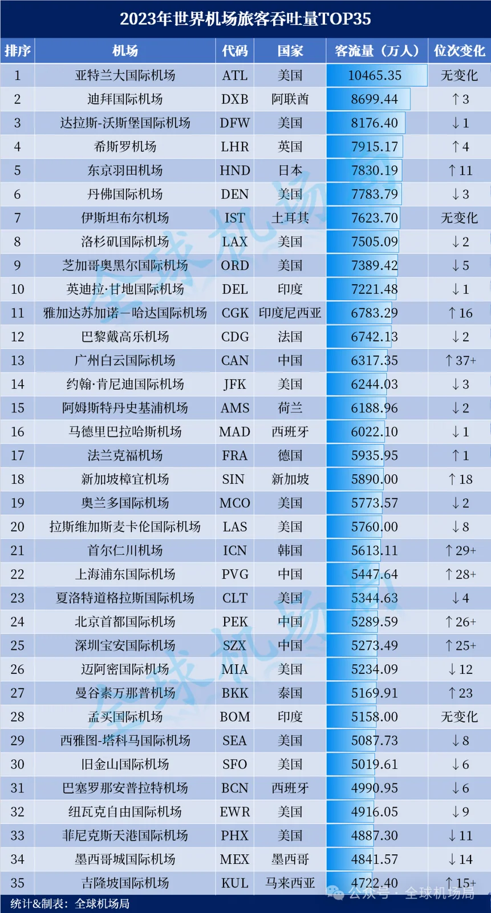

मार्च 2024 में एयरपोर्ट्स काउंसिल इंटरनेशनल (ACI) ने 2023 के यात्री यातायात के आधार पर दुनिया के सबसे व्यस्त हवाई अड्डों की रैंकिंग प्रकाशित की। महामारी के बाद यह पहला पूरा साल था जब यात्रा पर लगभग कोई प्रतिबंध नहीं था, जिससे यह तालिका 2019 से पहले के क्रम के साथ पहली सच्ची तुलना बन जाती है: अटलांटा हार्ट्सफ़ील्ड-जैक्सन 104.65 मिलियन यात्रियों के साथ लगातार तीसरे साल पहले स्थान पर रहा, दुबई इंटरनेशनल अपनी अब तक की सर्वश्रेष्ठ रैंकिंग के साथ दूसरे स्थान पर पहुँचा, लंदन हीथ्रो फिर यूरोप का नंबर एक बना, और टोक्यो हानेदा टॉप पाँच में लौटा।

क्रम से आगे, सूची यह भी दर्ज करती है कि माँग कहाँ लौटी। मध्य पूर्व और एशिया के हब यूरोप के हबों से तेज़ी से उबरे: सियोल इंचियोन 29 से ज़्यादा स्थान चढ़ा और जकार्ता सुकर्णो-हत्ता 16 स्थान। चीनी हवाई अड्डे 2022 के निचले स्तर से उछले, और ग्वांगझोउ बैयुन, शंघाई पुडोंग, शेनझेन बाओआन तथा बीजिंग कैपिटल सभी टॉप 30 में आए — ग्वांगझोउ तो सिर्फ़ एक साल पहले टॉप 50 से बाहर था।

## 1. टॉप दस: अटलांटा लगातार तीसरे साल पहले, दुबई रिकॉर्ड ऊँचाई पर

रैंकिंग 2023 के यात्री यातायात के अनुसार दस हज़ार के गुणकों में है; आखिरी स्तंभ 2022 के मुकाबले रैंक में बदलाव दिखाता है।

| रैंक | हवाई अड्डा | कोड | देश | यात्री (10,000 में) | 2022 के मुकाबले रैंक बदलाव |
| --- | --- | --- | --- | --- | --- |
| 1 | अटलांटा इंटरनेशनल | ATL | संयुक्त राज्य अमेरिका | 10465.35 | कोई बदलाव नहीं |
| 2 | दुबई इंटरनेशनल | DXB | संयुक्त अरब अमीरात | 8699.44 | 3 स्थान ऊपर |
| 3 | डलास-फ़ोर्ट वर्थ इंटरनेशनल | DFW | संयुक्त राज्य अमेरिका | 8176.40 | 1 स्थान नीचे |
| 4 | हीथ्रो | LHR | यूनाइटेड किंगडम | 7915.17 | 4 स्थान ऊपर |
| 5 | टोक्यो हानेदा | HND | जापान | 7830.19 | 11 स्थान ऊपर |
| 6 | डेनवर इंटरनेशनल | DEN | संयुक्त राज्य अमेरिका | 7783.79 | 3 स्थान नीचे |
| 7 | इस्तांबुल हवाई अड्डा | IST | तुर्की | 7623.70 | कोई बदलाव नहीं |
| 8 | लॉस एंजिलिस इंटरनेशनल | LAX | संयुक्त राज्य अमेरिका | 7505.09 | 2 स्थान नीचे |
| 9 | शिकागो ओ'हारे इंटरनेशनल | ORD | संयुक्त राज्य अमेरिका | 7389.42 | 5 स्थान नीचे |
| 10 | इंदिरा गांधी इंटरनेशनल | DEL | भारत | 7221.48 | 1 स्थान नीचे |

टॉप दस की कट-ऑफ़ 72.21 मिलियन पर है, जो दिल्ली के इंदिरा गांधी के पास है। अटलांटा 100 मिलियन से ऊपर का इकलौता हवाई अड्डा है और बिना हिले पहला स्थान बनाए रखा; इसका यातायात लंबे समय से अंतरराष्ट्रीय मार्गों की ऊँची हिस्सेदारी की बजाय एक विशाल घरेलू नेटवर्क पर टिका है।

दुबई के 86.99 मिलियन और तीन स्थान का फ़ायदा तालिका की सबसे बड़ी बात है। इसने डलास-फ़ोर्ट वर्थ को तीसरे स्थान पर धकेला और अपने इतिहास का सबसे ऊँचा स्थान लिया। ऐसे हवाई अड्डे के लिए जिसका कारोबार लंबी दूरी के कनेक्शनों पर खड़ा है, यह बताता है कि 2023 में दूर की यात्रा की वापसी असामान्य रूप से पूरी थी।

## 2. यूरोप में हीथ्रो फिर शीर्ष पर, हानेदा फिर टॉप पाँच में

हीथ्रो 79.15 मिलियन के साथ चार स्थान चढ़कर चौथे पर आया और यूरोप का नंबर एक स्थान वापस लिया — 2022 में दूसरे यूरोपीय हबों के आगे निकल जाने के बाद उसने 2023 में यह स्थान फिर हासिल किया। सिर्फ़ दो रनवे और सख़्त स्लॉट सीमाओं के साथ हीथ्रो का फ़ायदा उड़ानें बढ़ाने से ज़्यादा लोड फ़ैक्टर और विमान मिश्रण से आया।

टोक्यो हानेदा ग्यारह स्थान चढ़कर 78.30 मिलियन के साथ पाँचवें पर पहुँचा, जो टॉप दस के अंदर सबसे बड़ी छलांग है। हानेदा बेहद घनी घरेलू उड़ानों के साथ-साथ टोक्यो की ज़्यादातर व्यावसायिक और छोटी दूरी की अंतरराष्ट्रीय उड़ानें संभालता है, और 2023 में जापान के दोबारा खुलने के बाद वह नारिता से साफ़ तौर पर तेज़ी से उबरा।

इस्तांबुल टॉप दस का दूसरा हवाई अड्डा है जिसकी रैंक नहीं बदली; वह 76.24 मिलियन के साथ सातवें स्थान पर रहा। डेनवर तीन स्थान गिरकर छठे, लॉस एंजिलिस दो गिरकर आठवें और शिकागो ओ'हारे पाँच गिरकर नौवें पर आए — ये गिरावटें बताती हैं कि तेज़ी से उबरते हब उनसे आगे निकल गए, और उनके अपने यातायात में भी कुछ कमी हुई।

बाक़ी यूरोपीय समूह टॉप 20 के अंदर है — उनमें फ़्रैंकफ़र्ट, एम्स्टर्डम, पेरिस CDG और मैड्रिड — जो याद दिलाता है कि यूरोप की वापसी एक ही हब में केंद्रित होने की बजाय व्यापक थी।

## 3. एशिया की वापसी: इंचियोन 29 स्थान ऊपर, जकार्ता 16 ऊपर

नज़र को टॉप 35 तक फैलाएँ तो एशियाई हवाई अड्डों की चढ़ाई और तेज़ दिखती है। सियोल इंचियोन 56.13 मिलियन के साथ 21वें पर रहा, जो 2022 से 29 से ज़्यादा स्थान ऊपर है। जकार्ता सुकर्णो-हत्ता 67.83 मिलियन के साथ 11वें पर रहा, 16 स्थान ऊपर और टॉप दस से एक क़दम बाहर। एशियाई हवाई अड्डे साफ़ तौर पर तेज़ी से उबरे, और टॉप दस के अंदर दुबई व हानेदा के बाद इंचियोन तथा जकार्ता इसके सबसे स्पष्ट उदाहरण हैं।

दोनों की वापसी के कारण अलग थे। इंचियोन मध्यम और लंबी दूरी के कनेक्शनों तथा ड्यूटी-फ़्री खर्च पर टिका है; जकार्ता अपने घरेलू बाज़ार के विशाल आकार पर। इंडोनेशिया दुनिया का सबसे बड़ा द्वीपसमूह देश है, और अकेला घरेलू यातायात ही एक हवाई अड्डे को वैश्विक टॉप दस के करीब पहुँचा देता है। दोनों की चढ़ाई यह भी दिखाती है कि एक ही वैश्विक रैंकिंग कितनी अलग चीज़ों को मिला देती है: एक हवाई अड्डा जो कनेक्शन बेचता है और एक जो एक देश के अंदर पहुँच बेचता है।

## 4. टॉप 30 में चार चीनी हवाई अड्डे

चीनी हवाई अड्डे तालिका में सबसे ज़्यादा हिलने वाले हैं। ग्वांगझोउ बैयुन 63.17 मिलियन के साथ 13वें पर रहा, 2022 से 37 से ज़्यादा स्थान ऊपर। शंघाई पुडोंग 54.48 मिलियन के साथ 22वें पर रहा, 28 से ज़्यादा स्थान ऊपर। बीजिंग कैपिटल 52.90 मिलियन के साथ 24वें पर रहा, 26 से ज़्यादा स्थान ऊपर, और शेनझेन बाओआन 52.73 मिलियन के साथ 25वें पर, 25 से ज़्यादा स्थान ऊपर।

ग्वांगझोउ की स्थिति पर ज़ोर देना बनता है। 2022 में वह दुनिया के टॉप 50 से बाहर था और एक साल के भीतर 13वें पर लौट आया, जो टॉप 35 में कहीं भी सबसे बड़ा फ़ायदा है। बीजिंग कैपिटल और शेनझेन बाओआन करीब 1,60,000 यात्रियों के अंतर पर, बगल के स्थानों पर रहे, जो बताता है कि 2023 में उनकी वापसी लगभग एक ही रफ़्तार से चली। संकलनकर्ताओं को उम्मीद है कि 2024 की रैंकिंग में और चीनी हवाई अड्डे ऊपर चढ़ेंगे।

## 5. तालिका क्या बताती है और क्या नहीं

पहली बात, आँकड़े यात्री आवागमन के हैं, लोगों के नहीं। हवाई अड्डा हर आगमन और हर प्रस्थान गिनता है, और कनेक्टिंग यात्रियों को हर हवाई अड्डा अलग तरह से गिनता है, इसलिए रैंक बताती है कि मैदान ने कितने आवागमन संभाले, यह नहीं कि कितने यात्रियों ने उसे गंतव्य के रूप में चुना। इसी वजह से घरेलू मुख्य मार्गों पर बना अटलांटा दुबई और हीथ्रो से आगे बना रह सकता है।

दूसरी बात, 2023 वापसी का साल था, और बड़े रैंक फ़ायदे काफ़ी हद तक 2022 के कमज़ोर आधार पर टिके हैं। तालिका 2019 से कोई तुलना नहीं देती, इसलिए “37 स्थान ऊपर” या “29 स्थान ऊपर” को 2022 के मुकाबले वापसी की रफ़्तार के रूप में पढ़ें, महामारी-पूर्व स्तरों को पीछे छोड़ने के रूप में नहीं। कोई हब सचमुच लौटा है या नहीं, यह जानने के लिए उसके मार्ग-स्तर के आँकड़े अलग से देखने पड़ेंगे।

तीसरी बात, यात्री रैंकिंग पैमाना नापती है, अनुभव नहीं। समय-पालन, न्यूनतम कनेक्शन समय, सामान के गुम होने की दर और अंतरराष्ट्रीय पहुँच — ये सब इसमें नहीं हैं। टॉप दस का हवाई अड्डा भी गेटों के बीच बीस मिनट पैदल ले सकता है, और तीस के बाहर रैंक वाला हवाई अड्डा चालीस मिनट में कनेक्शन पूरा करा सकता है। यह तालिका उद्योग के आकार का थर्मामीटर है, यात्रा सलाह नहीं। अगला संस्करण यही दिखाएगा कि आधार-प्रभाव खत्म होने पर 2023 की बढ़त टिकती है या नहीं।

## 6. 2025 का अपडेट: तीन साल बाद

मार्च 2026 में प्रकाशित 2025 की पूरे साल की रैंकिंग दिखाती है कि तालिका कितनी हिली। अटलांटा 106.30 मिलियन के साथ पहले स्थान पर रहा, शीर्ष पर पाँचवाँ साल, लेकिन 1.6% की गिरावट के साथ। उसके बाद दुबई (95.20 मिलियन) और हानेदा (91.43 मिलियन) रहे। शंघाई पुडोंग पहली बार वैश्विक टॉप पाँच में 84.99 मिलियन के साथ पहुँचा, और ग्वांगझोउ बैयुन 83.58 मिलियन के साथ नौवें पर चढ़ा। तेरह चीनी हवाई अड्डे टॉप 50 में, चार टॉप 20 में और छह टॉप 30 में रहे; हांगकांग आठ स्थान चढ़कर 61.05 मिलियन के साथ 24वें पर आया।

2023 के बाद से सबसे बड़ा बदलाव चैंपियन नहीं, बल्कि चीनी क्षेत्र की गहराई है: 2023 में टॉप 30 में चार हवाई अड्डे थे, 2025 में टॉप 50 में 13 और टॉप 30 में छह। 2023 की तालिका को वापसी की एक तस्वीर के रूप में पढ़ना सबसे ठीक है, जबकि 2025 का डेटा मौजूदा आकार बताता है। पूरी नई रैंकिंग [विश्व हवाई अड्डा यात्री यातायात](/blog/world-airport-passenger-traffic-top-50) में है।

## संबंधित लिंक

- **इस साइट पर**: [अटलांटा हार्ट्सफ़ील्ड-जैक्सन (ATL)](/airport/ATL), [दुबई इंटरनेशनल (DXB)](/airport/DXB), [लंदन हीथ्रो (LHR)](/airport/LHR), [टोक्यो हानेदा (HND)](/airport/HND), [ग्वांगझोउ बैयुन (CAN)](/airport/CAN), [शंघाई पुडोंग (PVG)](/airport/PVG), [सियोल इंचियोन (ICN)](/airport/ICN), [बीजिंग कैपिटल (PEK)](/airport/PEK)
- **देश पृष्ठ**: [संयुक्त राज्य अमेरिका (US)](/country/US), [चीन (CN)](/country/CN)
- **विकिपीडिया**: [हार्ट्सफ़ील्ड–जैक्सन अटलांटा अंतर्राष्ट्रीय हवाई अड्डा](https://en.wikipedia.org/wiki/Hartsfield%E2%80%93Jackson_Atlanta_International_Airport), [दुबई अंतर्राष्ट्रीय हवाई अड्डा](https://en.wikipedia.org/wiki/Dubai_International_Airport), [हीथ्रो हवाई अड्डा](https://en.wikipedia.org/wiki/Heathrow_Airport), [ग्वांगझोउ बैयुन अंतर्राष्ट्रीय हवाई अड्डा](https://en.wikipedia.org/wiki/Guangzhou_Baiyun_International_Airport)
- **बाइडू बाइके**: [हार्ट्सफ़ील्ड–जैक्सन अटलांटा अंतर्राष्ट्रीय हवाई अड्डा](https://baike.baidu.com/item/%E5%93%88%E5%85%B9%E8%8F%B2%E5%B0%94%E5%BE%B7-%E6%9D%B0%E5%85%8B%E9%80%8A%E4%BA%9A%E7%89%B9%E5%85%B0%E5%A4%A7%E5%9B%BD%E9%99%85%E6%9C%BA%E5%9C%BA), [दुबई अंतर्राष्ट्रीय हवाई अड्डा](https://baike.baidu.com/item/%E8%BF%AA%E6%8B%9C%E5%9B%BD%E9%99%85%E6%9C%BA%E5%9C%BA)

छवि स्रोत: ACI डेटा, Global Airport Bureau द्वारा सारणीबद्ध और Xiaohu Aviation Analysis द्वारा संकलित। रैंकिंग और यातायात के आँकड़े ACI के प्रकाशित आधार के अनुसार हैं; हवाई अड्डे-स्तर की परिभाषाएँ (कनेक्टिंग यात्रियों की गिनती सहित) अलग हो सकती हैं, इसलिए उद्धृत करने से पहले ACI के प्रकाशित आँकड़े देखें।
