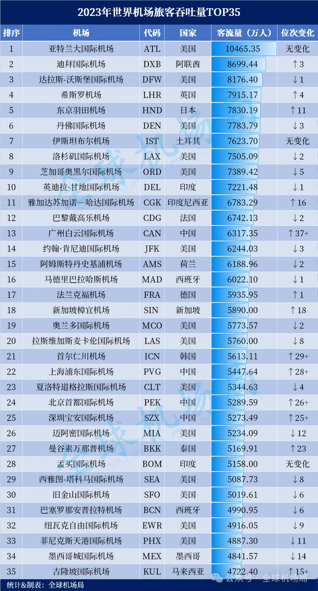

Nel marzo 2024 Airports Council International (ACI) ha pubblicato la classifica degli aeroporti più trafficati del mondo per passeggeri nel 2023. È stato il primo anno intero dopo la pandemia quasi senza restrizioni di viaggio, il che rende la tabella il primo confronto onesto con l'ordine pre-2019: Atlanta Hartsfield-Jackson è rimasta prima per il terzo anno con 104.65 milioni di passeggeri, Dubai International è salita al secondo posto con la sua migliore posizione di sempre, Londra Heathrow è tornata prima in Europa e Tokyo Haneda è rientrata nella top five.

Oltre all'ordine, la lista registra dove è tornata la domanda. Gli hub del Medio Oriente e dell'Asia si sono ripresi più in fretta di quelli europei: Seul Incheon è salita di oltre 29 posizioni e Giacarta Soekarno-Hatta di 16. Gli aeroporti cinesi sono rimbalzati dal minimo del 2022, con Guangzhou Baiyun, Shanghai Pudong, Shenzhen Bao'an e Pechino Capital tutte nella top 30 — Guangzhou era fuori dalla top 50 appena un anno prima.

## 1. La top ten: Atlanta prima per il terzo anno, Dubai a un record

La classifica è ordinata per traffico passeggeri 2023 in decine di migliaia; l'ultima colonna è la variazione di posizione rispetto al 2022.

| Posizione | Aeroporto | Codice | Paese | Passeggeri (decine di migliaia) | Variazione rispetto al 2022 |
| --- | --- | --- | --- | --- | --- |
| 1 | Atlanta International | ATL | Stati Uniti | 10465.35 | invariato |
| 2 | Dubai International | DXB | Emirati Arabi Uniti | 8699.44 | +3 |
| 3 | Dallas-Fort Worth International | DFW | Stati Uniti | 8176.40 | −1 |
| 4 | Heathrow | LHR | Regno Unito | 7915.17 | +4 |
| 5 | Tokyo Haneda | HND | Giappone | 7830.19 | +11 |
| 6 | Denver International | DEN | Stati Uniti | 7783.79 | −3 |
| 7 | Istanbul Airport | IST | Turchia | 7623.70 | invariato |
| 8 | Los Angeles International | LAX | Stati Uniti | 7505.09 | −2 |
| 9 | Chicago O'Hare International | ORD | Stati Uniti | 7389.42 | −5 |
| 10 | Indira Gandhi International | DEL | India | 7221.48 | −1 |

La soglia della top ten è a 72.21 milioni, tenuta dall'Indira Gandhi di Delhi. Atlanta è l'unico aeroporto sopra i 100 milioni e ha mantenuto il primo posto senza muoversi; il suo traffico si è sempre retto su una vasta rete domestica più che su una quota elevata di rotte internazionali.

Gli 86.99 milioni di Dubai e il guadagno di tre posizioni sono la riga più significativa della tabella. Ha spinto Dallas-Fort Worth al terzo posto e ha raggiunto la posizione più alta della sua storia. Per un aeroporto il cui business è costruito sulle coincidenze a lungo raggio, significa che la ripresa 2023 dei viaggi lontani è stata insolitamente completa.

## 2. Heathrow torna in testa in Europa, Haneda rientra nella top five

Heathrow è salita di quattro posizioni al quarto posto con 79.15 milioni, riprendendosi il primo posto in Europa: dopo essere stata superata da altri hub europei nel 2022, nel 2023 ha recuperato la posizione. Con solo due piste e slot strettissimi, il guadagno di Heathrow è venuto più dai fattori di riempimento e dal mix di aeromobili che dall'aggiunta di voli.

Tokyo Haneda è salita di undici posizioni al quinto posto con 78.30 milioni, il balzo più grande dentro la top ten. Haneda porta una rete domestica estremamente densa insieme alla maggior parte dei voli business e internazionali di corto raggio di Tokyo, e quando il Giappone ha riaperto nel 2023 si è ripresa visibilmente più in fretta di Narita.

Istanbul è l'altro aeroporto della top ten la cui posizione non è cambiata, settimo con 76.24 milioni. Denver è scivolato di tre posizioni al sesto posto, Los Angeles di due all'ottavo e Chicago O'Hare di cinque al nono: cali che riflettono tanto il sorpasso di hub a ripresa più rapida quanto un'effettiva flessione del loro traffico.

Il resto del gruppo europeo si colloca dentro la top 20 — tra gli altri Francoforte, Amsterdam, Parigi CDG e Madrid — a ricordare che la ripresa europea è stata ampia, non concentrata in un solo hub.

## 3. Il rimbalzo dell'Asia: Incheon +29, Giacarta +16

Allargando lo sguardo alla top 35, le risalite asiatiche sono più ripide. Seul Incheon è 21ª con 56.13 milioni, oltre 29 posizioni in più rispetto al 2022. Giacarta Soekarno-Hatta è 11ª con 67.83 milioni, 16 posizioni in più e a un passo dalla top ten. Gli aeroporti asiatici si sono chiaramente ripresi con più forza, con Incheon e Giacarta esempi lampanti dopo Dubai e Haneda dentro la top ten.

I due sono rimbalzati per ragioni diverse. Incheon si appoggia alle coincidenze di medio e lungo raggio e alla spesa duty-free; Giacarta alla sola dimensione del mercato domestico. L'Indonesia è il più grande Stato arcipelagico del mondo, e il traffico interno basta da solo a spingere un aeroporto quasi nella top ten globale. Entrambe le risalite mostrano anche cosa mescola una singola classifica mondiale: un aeroporto che vende coincidenze e un aeroporto che vende la copertura di un Paese.

## 4. Quattro aeroporti cinesi nella top 30

Gli aeroporti cinesi sono quelli che si muovono di più nella tabella. Guangzhou Baiyun è 13ª con 63.17 milioni, oltre 37 posizioni in più rispetto al 2022. Shanghai Pudong è 22ª con 54.48 milioni, oltre 28 in più. Pechino Capital è 24ª con 52.90 milioni, oltre 26 in più, e Shenzhen Bao'an 25ª con 52.73 milioni, oltre 25 in più.

La posizione di Guangzhou merita attenzione. Nel 2022 era fuori dalla top 50 mondiale e in un anno è tornata alla 13ª, il guadagno più grande di tutta la top 35. Pechino Capital e Shenzhen Bao'an hanno chiuso a circa 160.000 passeggeri di distanza, in posizioni adiacenti, il che suggerisce che la loro ripresa ha proceduto quasi allo stesso ritmo nel 2023. Gli estensori si aspettano che altri aeroporti cinesi salgano ancora nella classifica 2024.

## 5. Che cosa dice e che cosa non dice la tabella

Primo, i numeri sono movimenti di passeggeri, non persone. Un aeroporto conta ogni arrivo e ogni partenza, e i passeggeri in coincidenza sono trattati in modo diverso da aeroporto a aeroporto, quindi la posizione riflette quanti movimenti ha gestito uno scalo, non quanti viaggiatori lo hanno scelto come destinazione. È in parte per questo che Atlanta, costruita sulle rotte domestiche principali, può restare davanti a Dubai e Heathrow.

Secondo, il 2023 è stato un anno di ripresa, e i grandi guadagni di posizioni si appoggiano molto su una base 2022 debole. La tabella non offre confronti con il 2019, quindi "su di 37 posizioni" o "su di 29 posizioni" vanno letti come velocità di ripresa rispetto al 2022, non come superamento dei livelli pre-pandemia. Per giudicare se un hub è davvero tornato servono i suoi dati per rotta.

Terzo, una classifica passeggeri misura la scala, non l'esperienza. Puntualità, tempi minimi di coincidenza, tassi di bagagli smarriti e copertura internazionale sono tutti assenti. Un aeroporto della top ten può ancora richiedere venti minuti a piedi tra un gate e l'altro, e un aeroporto fuori dalla trentesima posizione può far chiudere una coincidenza in quaranta. La tabella è un termometro della forma del settore, non un consiglio di viaggio. La prossima edizione dirà se i guadagni del 2023 tengono quando l'effetto base si attenua.

## 6. L'aggiornamento 2025: tre anni dopo

La classifica dell'anno intero 2025, pubblicata a marzo 2026, mostra quanto si sia mossa la tabella. Atlanta è rimasta prima con 106.30 milioni, un quinto anno in vetta ma in calo dell'1.6%. Seguono Dubai (95.20 milioni) e Haneda (91.43 milioni). Shanghai Pudong è entrata per la prima volta nella top five mondiale con 84.99 milioni, e Guangzhou Baiyun è salita al nono posto con 83.58 milioni. Tredici aeroporti cinesi sono nella top 50, quattro nella top 20 e sei nella top 30; Hong Kong è salita di otto posizioni al 24° posto con 61.05 milioni.

Il cambiamento più grande rispetto al 2023 non è il campione ma la profondità del gruppo cinese: quattro aeroporti nella top 30 nel 2023, 13 nella top 50 e sei nella top 30 nel 2025. La tabella 2023 si legge meglio come istantanea della ripresa, mentre i dati 2025 descrivono la forma attuale. La classifica aggiornata completa è in [Traffico passeggeri degli aeroporti mondiali](/blog/world-airport-passenger-traffic-top-50).

## Link utili

- **Su questo sito**: [Atlanta Hartsfield-Jackson (ATL)](/airport/ATL), [Dubai International (DXB)](/airport/DXB), [Londra Heathrow (LHR)](/airport/LHR), [Tokyo Haneda (HND)](/airport/HND), [Guangzhou Baiyun (CAN)](/airport/CAN), [Shanghai Pudong (PVG)](/airport/PVG), [Seul Incheon (ICN)](/airport/ICN), [Pechino Capital (PEK)](/airport/PEK)
- **Pagine dei Paesi**: [Stati Uniti (US)](/country/US), [Cina (CN)](/country/CN)
- **Wikipedia**: [Hartsfield–Jackson Atlanta International Airport](https://en.wikipedia.org/wiki/Hartsfield%E2%80%93Jackson_Atlanta_International_Airport), [Dubai International Airport](https://en.wikipedia.org/wiki/Dubai_International_Airport), [Heathrow Airport](https://en.wikipedia.org/wiki/Heathrow_Airport), [Guangzhou Baiyun International Airport](https://en.wikipedia.org/wiki/Guangzhou_Baiyun_International_Airport)
- **Baidu Baike**: [Hartsfield–Jackson Atlanta International Airport](https://baike.baidu.com/item/%E5%93%88%E5%85%B9%E8%8F%B2%E5%B0%94%E5%BE%B7-%E6%9D%B0%E5%85%8B%E9%80%8A%E4%BA%9A%E7%89%B9%E5%85%B0%E5%A4%A7%E5%9B%BD%E9%99%85%E6%9C%BA%E5%9C%BA), [Dubai International Airport](https://baike.baidu.com/item/%E8%BF%AA%E6%8B%9C%E5%9B%BD%E9%99%85%E6%9C%BA%E5%9C%BA)

Fonte delle immagini: dati ACI, tabulati da Global Airport Bureau e compilati da Xiaohu Aviation Analysis. Classifiche e cifre di traffico seguono la base pubblicata da ACI; le definizioni a livello di aeroporto (compreso il modo di conteggiare i passeggeri in coincidenza) possono differire, quindi verificate le cifre pubblicate da ACI prima di citarle.
