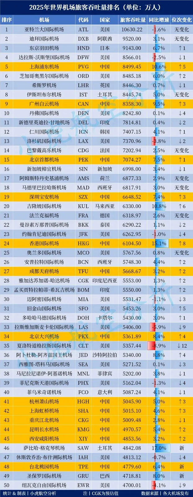

Im März 2026 veröffentlichte Xiaohu Aviation Analysis seine Rangliste des weltweiten Passagierverkehrs an Flughäfen für 2025. An der Spitze der Tabelle hat sich kaum etwas bewegt, doch drei Dinge sollte man sich merken: Atlanta führte zum fünften Mal in Folge, verzeichnete dabei aber erstmals einen Rückgang; Shanghai Pudong erreichte mit 84,99 Millionen Passagieren die globalen Top fünf; und Guangzhou Baiyun kehrte auf Platz neun zurück.

Der Passagierverkehr zählt alle, die im Laufe des Jahres an einem Flughafen einsteigen oder landen, wobei ein Umsteigepassagier normalerweise an beiden Enden gezählt wird – deshalb dominieren Drehkreuzflughäfen in der Regel diese Art von Tabelle. Sie sagt, wie viele Menschen ein Flughafen in zwölf Monaten bewegt hat. Sie sagt nicht, woher sie kamen oder wie lange sie im Terminal gewartet haben.

## 1. Der fünfte Sieg für Atlanta – und der erste Rückgang seit vier Jahren

Der Hartsfield–Jackson Atlanta International Airport (ATL) fertigte 106,3 Millionen Passagiere ab und belegte zum fünften Mal in Folge den ersten Platz. Im Jahresvergleich sank der Verkehr um 1,6 Prozent – der erste Rückgang nach vier Wachstumsjahren in Folge. Atlanta war 2025 außerdem der einzige Flughafen der Welt mit mehr als 100 Millionen Passagieren, und diese eine Hundert-Millionen-Zahl schrumpfte.

Dubai (DXB) folgte mit 95,2 Millionen, ein Plus von 3,1 Prozent, und Tokio Haneda (HND) mit 91,43 Millionen, ein Plus von 6,7 Prozent. Darunter rückte das Feld zusammen: Von Dallas/Fort Worth mit 85,66 Millionen bis Denver mit 82,43 Millionen trennten sieben Flughäfen nur 3,2 Millionen Passagiere. Heathrow (84,46 Millionen) und Istanbul (84,46 Millionen) lagen 5.600 Passagiere auseinander – bei dieser Größenordnung etwa ein halber Tagesverkehr und kaum ein Beleg für einen Unterschied in der Stärke.

Die Top zehn von 2025, wie sie in der Ranglistentabelle aufgeführt sind (Passagiere in Millionen):

| Rang | Flughafen | Code | Land | Passagiere (Millionen) | Veränderung | Platzveränderung |
| --- | --- | --- | --- | --- | --- | --- |
| 1 | Atlanta | ATL | Vereinigte Staaten | 106.30 | −1.6% | unverändert |
| 2 | Dubai | DXB | Vereinigte Arabische Emirate | 95.20 | +3.1% | unverändert |
| 3 | Tokio Haneda | HND | Japan | 91.43 | +6.7% | 1 Platz nach oben |
| 4 | Dallas/Fort Worth | DFW | Vereinigte Staaten | 85.66 | +2.5% | 1 Platz nach unten |
| 5 | Shanghai Pudong | PVG | China | 84.99 | +10.6% | 5 Plätze nach oben |
| 6 | Chicago O'Hare | ORD | Vereinigte Staaten | 84.85 | +6.0% | 2 Plätze nach oben |
| 7 | London Heathrow | LHR | Vereinigtes Königreich | 84.46 | +0.7% | 1 Platz nach unten |
| 8 | Istanbul | IST | Türkei | 84.46 | +5.0% | unverändert |
| 9 | Guangzhou Baiyun | CAN | China | 83.58 | +9.5% | 3 Plätze nach oben |
| 10 | Denver | DEN | Vereinigte Staaten | 82.43 | +0.1% | 4 Plätze nach unten |

## 2. Pudong stößt in die Top fünf vor, Baiyun kehrt auf Platz neun zurück

Der Shanghai Pudong International Airport (PVG) kletterte vom zehnten Platz des Jahres 2024 auf den fünften, übersprang damit in einem Jahr fünf Plätze und erreichte seine höchste Platzierung überhaupt. Der Guangzhou Baiyun International Airport (CAN) kehrte mit 83,58 Millionen Passagieren auf Platz neun zurück, drei Plätze und 9,5 Prozent besser. Die beiden sind unterschiedlich gebaut: Baiyun trägt einen höheren Anteil an innerchinesischen Hauptstrecken mit dichten Wellen und schnellen Anschlüssen, während Pudong stärker auf internationale und regionale Verbindungen setzt und seine Erholung mit der Wiedereröffnung dieser Strecken verlief. Für Reisende ist der Unterschied praktisch: Für einen innerchinesischen Anschluss ist Baiyun meist der reibungslosere der beiden, für einen Langstreckenabflug ist Pudong die reichere Wahl.

## 3. Dreizehn chinesische Flughäfen in den Top 50, zwölf davon steigen auf

Weitet man den Blick auf die Top 50, erscheinen 13 chinesische Flughäfen: Pudong (5), Baiyun (9), Peking Capital (15), Shenzhen Bao'an (19), Hongkong (24), Chengdu Tianfu (27), Peking Daxing (34), Hangzhou Xiaoshan (41), Shanghai Hongqiao (42), Chongqing Jiangbei (43), Kunming Changshui (44), Xi'an Xianyang (45) und Taipeh Taoyuan (48). Vier liegen unter den ersten 20, sechs unter den ersten 30.

Zwölf der 13 verbesserten sich gegenüber 2024; die Ausnahme war Chongqing Jiangbei, das einen Platz verlor. Der Hong Kong International Airport (HKG) ragte heraus: acht Plätze nach oben auf Rang 24 mit 61,05 Millionen Passagieren und die Rückkehr in die Top 30.

Zwischen Platz 41 und 45 liegt der dichteste Cluster von allen: Hangzhou 50,46 Millionen, Shanghai Hongqiao 50,15 Millionen, Chongqing Jiangbei 50,09 Millionen, Kunming Changshui 49,71 Millionen und Xi'an Xianyang 48,54 Millionen – fünf Flughäfen innerhalb von zwei Millionen Passagieren. Jeder von ihnen kann binnen weniger Monate von einem Nachbarn überholt werden.

Beim Wachstum war der schnellste Aufsteiger in den Top 50 Istanbul Sabiha Gökçen (SAW) mit 17,0 Prozent und 48,42 Millionen Passagieren auf Platz 46 – in diesem Jahr neu in der Tabelle. Hongkong folgte mit 15,1 Prozent, Kuala Lumpur (KUL) mit 10,8 Prozent und Shanghai Pudong mit 10,6 Prozent, vier Flughäfen im zweistelligen Bereich. Unter den zehn am schnellsten wachsenden Flughäfen der Tabelle sind sechs chinesisch: Hongkong, Pudong, Baiyun (9,5), Daxing (8,4), Peking Capital (7,5) und Shenzhen Bao'an (7,4).

## 4. Asien gewinnt, Nordamerika verliert, der Nahe Osten ist die Unbekannte

Das Wachstum konzentrierte sich 2025 eindeutig auf Asien. In Nordamerika fertigten die meisten Flughäfen weniger Verkehr ab als im Vorjahr, wobei Chicago O'Hare (plus 6,0 Prozent) eine seltene Ausnahme war. Delhis Indira Gandhi International Airport (DEL) kam auf 78,15 Millionen Passagiere, nur 0,4 Prozent mehr, und fiel aus den Top zehn auf Platz 11 – die Gruppe blieb damit ohne südasiatischen Vertreter.

Der Nahe Osten ist die größte Variable in der Tabelle. Dubai hielt Platz zwei mit 95,2 Millionen; seine Lage als Kreuzung zwischen Asien, Afrika und Europa wirkt weiter stark. Doch die häufigen Umbrüche in der Region können ein Drehkreuz, das vom Umsteigeverkehr lebt, sehr schnell treffen.

## 5. Wie man die Tabelle liest

Passagierverkehr misst Größe, nicht Erlebnis. Atlanta bleibt oben, weil Delta den Flughafen als sein größtes Umsteigedrehkreuz behandelt und mehrmals täglich Passagierwellen hinein- und hinausschickt; Pudong, Baiyun und Hongkong hängen stärker von der Dichte der internationalen Strecken und der Nachfrage ihres Hinterlands ab. Die Tabelle ist nützlich, um einen Trend zu lesen – Hongkong acht Plätze nach oben in einem Jahr, Pudong in die Top fünf –, weil sie zeigt, wo Flüge sich vermehren und Anschlüsse breiter werden. Was darüber entscheidet, ob eine Reise reibungslos verläuft, sind weiterhin der Flugplan, die Umsteigezeit und der Tarif.

Bis 2026 werden sich einige dieser Linien weiter bewegen. Pudong muss Platz fünf gegen die weitere Erholung der internationalen Strecken verteidigen. Hongkongs nächster Schritt hängt von der Umsteigenachfrage aus der Greater Bay Area ab. Dubai wird in der Nähe der Spitze bleiben, ist aber stärker von regionaler Politik abhängig als jeder andere Flughafen hier. Atlanta wiederum deutet darauf hin, dass der US-Inlandsmarkt kaum noch etwas hergibt: Es hält Platz eins nicht, weil es wächst, sondern weil niemand sonst gewachsen ist.

## 6. August 2026: Incheon übernimmt die internationale Krone

Im August 2026 berichtete [China Daily](https://global.chinadaily.com.cn/a/202608/25/WS6a8cee39e4b057c97e2098a8.html), Incheon habe Heathrow nach dem internationalen Passagieraufkommen überholt und sei damit der verkehrsreichste internationale Flughafen der Welt. Das widerspricht dieser Jahrestabelle nicht: Der Gesamtverkehr umfasst riesige Inlandsnetze, weshalb Atlanta Erster bleibt; zählt man nur internationale Passagiere, sind Incheon, Dubai und Heathrow die eigentlichen Anwärter.

Für Reisende ist die praktische Lesart einfach: Wenn es Ihnen auf internationale Anschlüsse ankommt, gehören Inchens Wellenstruktur und Transferanlagen bereits zur globalen Spitze; wenn es Ihnen auf den Gesamtverkehr ankommt, bleibt Atlantas Inlandsnetz eine Kategorie für sich.

## Weiterführende Links

- **Auf dieser Website**: [Atlanta (ATL)](/airport/ATL), [Shanghai Pudong (PVG)](/airport/PVG), [Guangzhou Baiyun (CAN)](/airport/CAN), [Hongkong (HKG)](/airport/HKG), [Dubai (DXB)](/airport/DXB), [Tokio Haneda (HND)](/airport/HND), [Kuala Lumpur (KUL)](/airport/KUL), [China (CN)](/country/CN)
- **Wikipedia**: [Shanghai Pudong International Airport](https://en.wikipedia.org/wiki/Shanghai_Pudong_International_Airport), [Guangzhou Baiyun International Airport](https://en.wikipedia.org/wiki/Guangzhou_Baiyun_International_Airport), [Hong Kong International Airport](https://en.wikipedia.org/wiki/Hong_Kong_International_Airport), [Hartsfield–Jackson Atlanta International Airport](https://en.wikipedia.org/wiki/Hartsfield%E2%80%93Jackson_Atlanta_International_Airport)
- **Baidu Baike**: [Shanghai Pudong International Airport](https://baike.baidu.com/item/%E4%B8%8A%E6%B5%B7%E6%B5%A6%E4%B8%9C%E5%9B%BD%E9%99%85%E6%9C%BA%E5%9C%BA), [Guangzhou Baiyun International Airport](https://baike.baidu.com/item/%E5%B9%BF%E5%B7%9E%E7%99%BD%E4%BA%91%E5%9B%BD%E9%99%85%E6%9C%BA%E5%9C%BA), [Hong Kong International Airport](https://baike.baidu.com/item/%E9%A6%99%E6%B8%AF%E5%9B%BD%E9%99%85%E6%9C%BA%E5%9C%BA)

Bild- und Datenquelle: Xiaohu Aviation Analysis, „Rangliste des weltweiten Passagierverkehrs an Flughäfen 2025“. Die Zahlen folgen dieser Tabelle und können von den Zählregeln anderer Stellen leicht abweichen; der Verkehr verschiebt sich mit der Saison, prüfen Sie daher vor der Reise die eigenen Websites des Flughafens und der Fluggesellschaft.
