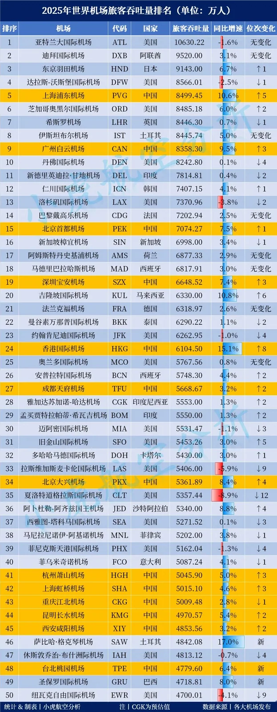

Pada Maret 2026, Xiaohu Aviation Analysis menerbitkan peringkat lalu lintas penumpang bandara dunia untuk 2025. Bagian atas tabel hampir tidak bergerak, tetapi tiga hal perlu diingat: Atlanta memimpin untuk tahun kelima berturut-turut sekaligus turun untuk pertama kalinya; Shanghai Pudong masuk lima besar global dengan 84,99 juta penumpang; dan Guangzhou Baiyun kembali ke peringkat kesembilan.

Lalu lintas penumpang menghitung setiap orang yang naik atau mendarat di bandara sepanjang tahun, dan penumpang transit biasanya dihitung di kedua ujung, itulah sebabnya bandara hub cenderung mendominasi tabel semacam ini. Angka ini memberi tahu berapa banyak orang yang dipindahkan bandara dalam dua belas bulan. Angka ini tidak memberi tahu dari mana mereka datang atau berapa lama mereka menunggu di terminal.

## 1. Kemenangan kelima Atlanta, dan penurunan pertamanya dalam empat tahun

Bandara Internasional Hartsfield–Jackson Atlanta (ATL) menangani 106,3 juta penumpang dan finis pertama untuk tahun kelima berturut-turut. Secara tahunan, lalu lintas turun 1,6 persen — penurunan pertama setelah empat tahun pertumbuhan berturut-turut. Atlanta juga merupakan satu-satunya bandara di dunia yang melampaui 100 juta penumpang pada 2025, dan satu-satunya angka seratus juta itu sedang menyusut.

Dubai (DXB) menyusul dengan 95,2 juta penumpang, naik 3,1 persen, dan Tokyo Haneda (HND) dengan 91,43 juta penumpang, naik 6,7 persen. Di bawah mereka, persaingan merapat: dari Dallas/Fort Worth dengan 85,66 juta hingga Denver dengan 82,43 juta, tujuh bandara hanya terpaut 3,2 juta penumpang. Heathrow (84,46 juta) dan Istanbul (84,46 juta) terpaut 5.600 penumpang — sekitar setengah hari lalu lintas pada skala itu, dan hampir bukan bukti perbedaan kekuatan.

Sepuluh besar 2025, sesuai yang tercantum dalam tabel peringkat (penumpang dalam juta):

| Peringkat | Bandara | Kode | Negara | Penumpang (juta) | Perubahan | Pergerakan peringkat |
| --- | --- | --- | --- | --- | --- | --- |
| 1 | Atlanta | ATL | Amerika Serikat | 106,30 | −1,6% | tetap |
| 2 | Dubai | DXB | Uni Emirat Arab | 95,20 | +3,1% | tetap |
| 3 | Tokyo Haneda | HND | Jepang | 91,43 | +6,7% | naik 1 |
| 4 | Dallas/Fort Worth | DFW | Amerika Serikat | 85,66 | +2,5% | turun 1 |
| 5 | Shanghai Pudong | PVG | Tiongkok | 84,99 | +10,6% | naik 5 |
| 6 | Chicago O'Hare | ORD | Amerika Serikat | 84,85 | +6,0% | naik 2 |
| 7 | London Heathrow | LHR | Inggris | 84,46 | +0,7% | turun 1 |
| 8 | Istanbul | IST | Turki | 84,46 | +5,0% | tetap |
| 9 | Guangzhou Baiyun | CAN | Tiongkok | 83,58 | +9,5% | naik 3 |
| 10 | Denver | DEN | Amerika Serikat | 82,43 | +0,1% | turun 4 |

## 2. Pudong masuk lima besar, Baiyun kembali ke peringkat kesembilan

Bandara Internasional Shanghai Pudong (PVG) naik dari peringkat kesepuluh pada 2024 ke kelima, melewati lima peringkat dalam setahun dan mencatat peringkat tertingginya. Bandara Internasional Guangzhou Baiyun (CAN) kembali ke peringkat kesembilan dengan 83,58 juta penumpang, naik tiga peringkat dan 9,5 persen. Keduanya dibangun dengan cara berbeda: Baiyun membawa porsi lebih besar rute utama domestik, dengan gelombang padat dan koneksi cepat, sedangkan Pudong lebih bertumpu pada layanan internasional dan regional, dan pemulihannya mengikuti pembukaan kembali rute-rute tersebut. Bagi pelancong, perbedaannya praktis — Baiyun biasanya lebih lancar untuk koneksi domestik, Pudong pilihan yang lebih kaya untuk keberangkatan jarak jauh.

## 3. Tiga belas bandara Tiongkok di 50 besar, dua belas di antaranya naik

Perluas pandangan ke 50 besar dan muncul 13 bandara Tiongkok: Pudong (5), Baiyun (9), Beijing Capital (15), Shenzhen Bao'an (19), Hong Kong (24), Chengdu Tianfu (27), Beijing Daxing (34), Hangzhou Xiaoshan (41), Shanghai Hongqiao (42), Chongqing Jiangbei (43), Kunming Changshui (44), Xi'an Xianyang (45), dan Taipei Taoyuan (48). Empat berada di 20 besar dan enam di 30 besar.

Dua belas dari 13 bandara meningkat dibandingkan 2024; pengecualiannya adalah Chongqing Jiangbei, yang turun satu peringkat. Bandara Internasional Hong Kong (HKG) menjadi yang paling menonjol, naik delapan peringkat ke posisi 24 dengan 61,05 juta penumpang dan kembali ke 30 besar.

Di antara peringkat 41 dan 45 terletak kelompok terpadat dari semuanya: Hangzhou 50,46 juta, Shanghai Hongqiao 50,15 juta, Chongqing Jiangbei 50,09 juta, Kunming Changshui 49,71 juta, dan Xi'an Xianyang 48,54 juta, lima bandara yang saling terpaut dalam dua juta penumpang. Salah satu dari mereka dapat disalip tetangganya dalam beberapa bulan.

Dalam hal pertumbuhan, pendaki tercepat di 50 besar adalah Istanbul Sabiha Gökçen (SAW) dengan 17,0 persen, membawa 48,42 juta penumpang di peringkat 46 — pendatang baru tahun ini. Hong Kong menyusul dengan 15,1 persen, Kuala Lumpur (KUL) 10,8 persen, dan Shanghai Pudong 10,6 persen, empat bandara dengan pertumbuhan dua digit. Di antara sepuluh bandara dengan pertumbuhan tercepat dalam tabel, enam berasal dari Tiongkok: Hong Kong, Pudong, Baiyun (9,5), Daxing (8,4), Beijing Capital (7,5), dan Shenzhen Bao'an (7,4).

## 4. Asia naik, Amerika Utara melambat, Timur Tengah menjadi faktor tak terduga

Pertumbuhan pada 2025 jelas terkonsentrasi di Asia. Di Amerika Utara, sebagian besar bandara menangani lalu lintas lebih sedikit daripada tahun sebelumnya, dengan Chicago O'Hare (naik 6,0 persen) sebagai pengecualian langka. Bandara Internasional Indira Gandhi Delhi (DEL) menangani 78,15 juta penumpang, hanya naik 0,4 persen, dan keluar dari sepuluh besar ke peringkat 11, sehingga kelompok itu tidak lagi memiliki perwakilan Asia Selatan.

Timur Tengah adalah variabel terbesar dalam tabel. Dubai mempertahankan posisi kedua dengan 95,2 juta penumpang, posisinya sebagai persimpangan antara Asia, Afrika, dan Eropa masih bekerja kuat; tetapi gejolak yang sering terjadi di kawasan itu dapat menghantam hub yang hidup dari lalu lintas transit dengan sangat cepat.

## 5. Cara membaca tabel

Lalu lintas penumpang mengukur skala, bukan pengalaman. Atlanta tetap di puncak karena Delta memperlakukannya sebagai hub koneksi terbesarnya, mendorong gelombang penumpang masuk dan keluar beberapa kali sehari; Pudong, Baiyun, dan Hong Kong lebih bergantung pada kepadatan rute internasional dan permintaan daerah belakangnya. Tabel ini berguna untuk membaca tren — Hong Kong naik delapan peringkat dalam setahun, Pudong masuk lima besar — karena menunjukkan di mana penerbangan bertambah dan koneksi melebar. Yang menentukan lancar tidaknya perjalanan tetap jadwal, waktu koneksi, dan tarif.

Memasuki 2026, beberapa garis itu akan terus bergerak. Pudong harus mempertahankan posisi kelima dengan pemulihan lebih lanjut di rute internasional. Langkah Hong Kong berikutnya bergantung pada permintaan transit dari Greater Bay Area. Dubai akan tetap dekat puncak tetapi lebih terpapar politik regional daripada bandara mana pun di sini. Atlanta, sementara itu, menunjukkan pasar domestik AS hampir tidak punya ruang tersisa: bandara ini mempertahankan posisi pertama bukan karena tumbuh, melainkan karena yang lain juga tidak tumbuh.

## 6. Agustus 2026: Incheon merebut mahkota internasional

Pada Agustus 2026, [China Daily](https://global.chinadaily.com.cn/a/202608/25/WS6a8cee39e4b057c97e2098a8.html) melaporkan bahwa Incheon telah menyalip Heathrow berdasarkan volume penumpang internasional dan menjadi bandara internasional tersibuk di dunia. Itu tidak bertentangan dengan tabel tahunan ini: total lalu lintas mencakup jaringan domestik yang sangat besar, itulah sebabnya Atlanta tetap pertama; jika hanya menghitung penumpang internasional, Incheon, Dubai, dan Heathrow adalah pesaing sesungguhnya.

Bagi pelancong, bacaan praktisnya sederhana: jika Anda mementingkan koneksi internasional, struktur gelombang dan fasilitas transit Incheon sudah berada di jajaran teratas global; jika Anda mementingkan total lalu lintas, jaringan domestik Atlanta tetap berada di kelasnya sendiri.

## Tautan terkait

- **Di situs ini**: [Atlanta (ATL)](/airport/ATL), [Shanghai Pudong (PVG)](/airport/PVG), [Guangzhou Baiyun (CAN)](/airport/CAN), [Hong Kong (HKG)](/airport/HKG), [Dubai (DXB)](/airport/DXB), [Tokyo Haneda (HND)](/airport/HND), [Kuala Lumpur (KUL)](/airport/KUL), [Tiongkok (CN)](/country/CN)
- **Wikipedia**: [Bandara Internasional Shanghai Pudong](https://en.wikipedia.org/wiki/Shanghai_Pudong_International_Airport), [Bandara Internasional Guangzhou Baiyun](https://en.wikipedia.org/wiki/Guangzhou_Baiyun_International_Airport), [Bandara Internasional Hong Kong](https://en.wikipedia.org/wiki/Hong_Kong_International_Airport), [Bandara Internasional Hartsfield–Jackson Atlanta](https://en.wikipedia.org/wiki/Hartsfield%E2%80%93Jackson_Atlanta_International_Airport)
- **Baidu Baike**: [Bandara Internasional Shanghai Pudong](https://baike.baidu.com/item/%E4%B8%8A%E6%B5%B7%E6%B5%A6%E4%B8%9C%E5%9B%BD%E9%99%85%E6%9C%BA%E5%9C%BA), [Bandara Internasional Guangzhou Baiyun](https://baike.baidu.com/item/%E5%B9%BF%E5%B7%9E%E7%99%BD%E4%BA%91%E5%9B%BD%E9%99%85%E6%9C%BA%E5%9C%BA), [Bandara Internasional Hong Kong](https://baike.baidu.com/item/%E9%A6%99%E6%B8%AF%E5%9B%BD%E9%99%85%E6%9C%BA%E5%9C%BA)

Sumber gambar dan data: Xiaohu Aviation Analysis, “Peringkat lalu lintas penumpang bandara dunia 2025”. Angka mengikuti tabel tersebut dan dapat sedikit berbeda dari aturan penghitungan lembaga lain; lalu lintas berubah mengikuti musim, jadi periksa situs resmi bandara dan maskapai sebelum Anda bepergian.
