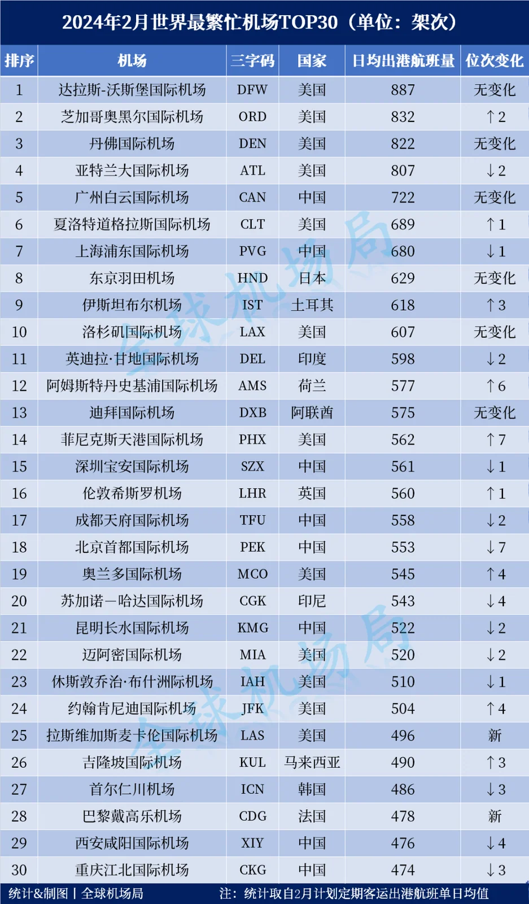

The top 30 busiest airports for February 2024 are out. The ranking counts planned average daily scheduled passenger departures for the month — scheduled passenger flights only, with cargo and charters excluded. Dallas/Fort Worth held first place for a second month, Chicago O'Hare climbed to second, Atlanta dropped two places, Istanbul returned to the top ten, and Paris Charles de Gaulle entered the top 30 for the first time in months.

A word on method first. This is a table of plans: it counts the February schedule airlines filed, expressed as an average day's departures, not the flights that actually operated. Weather, technical problems and flow control all push the two apart, so the table is closer to capacity intent than to operating results. February 2024 had 29 days because of the leap year, but an average daily figure is unaffected by the extra day.

## 1. The top ten: Dallas holds on, O'Hare moves up

The top ten as listed in the ranking table (average daily departures):

| Rank | Airport | Code | Country | Daily departures | Rank move |
| --- | --- | --- | --- | --- | --- |
| 1 | Dallas/Fort Worth | DFW | United States | 887 | no change |
| 2 | Chicago O'Hare | ORD | United States | 832 | up 2 |
| 3 | Denver | DEN | United States | 822 | no change |
| 4 | Atlanta | ATL | United States | 807 | down 2 |
| 5 | Guangzhou Baiyun | CAN | China | 722 | no change |
| 6 | Charlotte Douglas | CLT | United States | 689 | up 1 |
| 7 | Shanghai Pudong | PVG | China | 680 | down 1 |
| 8 | Tokyo Haneda | HND | Japan | 629 | no change |
| 9 | Istanbul | IST | Türkiye | 618 | up 3 |
| 10 | Los Angeles | LAX | United States | 607 | no change |

Dallas/Fort Worth (DFW) shows 887 daily departures in the table and leads for a second consecutive month. The position is not surprising: DFW is American Airlines' largest hub, its domestic trunk routes run in dense waves, and widebodies and narrowbodies are mixed on the same operation, so departures stay high year round. Denver (DEN) is third on 822, unchanged from January, and is United's other base in the Mountain West.

Chicago O'Hare (ORD) climbs to second on 832, up two places. ORD is a hub for both United and American, and the two networks stack on top of each other, which has long kept its departure count high. Atlanta (ATL) slips to fourth on 807, down two places from January; a fall in rank does not necessarily mean fewer departures, only that its neighbours grew faster.

Three of the top four anchor the networks of American or United, and Atlanta is Delta's largest hub, so the head of this table maps US hub structure as much as demand.

Dallas's second month at the top also shows that the busiest departure count is not the busiest passenger count: Atlanta handles far more passengers, but concentrates its flying into fewer waves.

By country the top 30 splits cleanly: 12 in the United States (Dallas, O'Hare, Denver, Atlanta, Charlotte, Los Angeles, Phoenix, Orlando, Miami, Houston, Kennedy and Las Vegas), eight in China (Baiyun, Pudong, Bao'an, Tianfu, Capital, Changshui, Xianyang and Jiangbei), three in Europe (Amsterdam, Heathrow, Charles de Gaulle) and seven elsewhere. One country holding 40 per cent of the places is a function of domestic frequency, not of passenger numbers.

## 2. Charlotte edges past Pudong

Charlotte Douglas (CLT) is sixth on 689, up one place, and Shanghai Pudong (PVG) is seventh on 680, down one. Nine departures a day separate them — at roughly 700 a day, that is the same horizontal line, and a few extra morning departures would flip the order back. CLT is another American Airlines domestic hub whose strength is the density of its domestic network; Pudong draws its departures from both domestic trunk routes and long-haul international services.

Guangzhou Baiyun (CAN) is fifth on 722, unchanged from January and the highest-placed Chinese airport in the top ten. Tokyo Haneda (HND) is eighth on 629 and Los Angeles (LAX) tenth on 607, both unchanged.

## 3. Istanbul returns to the top ten, Phoenix jumps seven

Istanbul (IST) rises to ninth on 618, up three places, pushing Delhi's Indira Gandhi airport (598) down to 11th. IST's departures are carried by Turkish Airlines' connecting network, and its position as a gateway between Europe and Asia keeps it relevant in long-haul transfer markets.

Phoenix Sky Harbor (PHX) is 14th on 562, up seven places from January and the month's biggest climber. Jumps like this usually reflect a base carrier's scheduling, not a surge in local demand. The two climbers pull on different forces: Istanbul through its connecting network, Phoenix through the redistribution of US domestic capacity.

## 4. At the edge of the top 30

The bottom of the table moved more. Las Vegas McCarran (LAS) is 25th on 496, back in the top 30 after a month away; Paris Charles de Gaulle (CDG) is 28th on 478, its first appearance in the top 30 for several months and just two departures behind Xi'an Xianyang (476), which leaves the two almost level. Kuala Lumpur (KUL) is 26th on 490, up three, while Beijing Capital (PEK) falls to 18th on 553, down seven.

Charles de Gaulle's arrival says something too: European departure counts run low in winter, so making the top 30 means concentrating widebody long-haul flying into the month. Chinese airports, meanwhile, were at their Spring Festival peak, with eight on the list at once.

## 5. What the table can and cannot say

Planned daily departures measure frequency, which is not the same thing as passenger traffic: a 180-seat narrowbody and a 400-seat widebody count equally in departures and differ by more than double in passengers. That is why the table favours airports with dense domestic networks flown by narrowbodies — 12 of the 30 are in the United States, the largest single block, and this is the reason. It also explains why Guangzhou and Pudong sit lower here than in a passenger ranking: their long-haul widebody flying moves far more people per departure than a domestic hop does.

One distinction matters: this is a plan, not an outcome. Snowstorms, de-icing and runway works chip away at what actually flies, so month-to-month movements are a direction of capacity rather than a ranking of performance.

For a traveller, frequency is one of the most practical measures there is. The denser the schedule, the more choice of timings and the more room to rebook after a delay on an earlier flight. It says nothing about fares or punctuality, though, so the choice still comes down to a specific flight.

> Note: this is a 2024 monthly snapshot. For a later view, see [World's Ten Busiest Airports](/blog/worlds-top-10-airports-by-seats) (February 2026, by seats) and [World Airport Passenger Traffic](/blog/world-airport-passenger-traffic-top-50) (full-year 2025).

## Related links

- **On this site**: [Chicago O'Hare (ORD)](/airport/ORD), [Atlanta (ATL)](/airport/ATL), [Guangzhou Baiyun (CAN)](/airport/CAN), [Shanghai Pudong (PVG)](/airport/PVG), [Tokyo Haneda (HND)](/airport/HND), [Istanbul (IST)](/airport/IST), [Los Angeles (LAX)](/airport/LAX), [United States (US)](/country/US)
- **Wikipedia**: [O'Hare International Airport](https://en.wikipedia.org/wiki/O%27Hare_International_Airport), [Dallas/Fort Worth International Airport](https://en.wikipedia.org/wiki/Dallas/Fort_Worth_International_Airport)
- **Baidu Baike**: [Dallas/Fort Worth International Airport](https://baike.baidu.com/item/%E8%BE%BE%E6%8B%89%E6%96%AF-%E6%B2%83%E6%96%AF%E5%A0%A1%E5%9B%BD%E9%99%85%E6%9C%BA%E5%9C%BA), [O'Hare International Airport](https://baike.baidu.com/item/%E8%8A%9D%E5%8A%A0%E5%93%A5%E5%A5%A5%E9%BB%91%E5%B0%94%E5%9B%BD%E9%99%85%E6%9C%BA%E5%9C%BA)

Image and data source: Xiaohu Aviation Analysis, "February 2024: the world's busiest airports". Departure counts are planned daily averages and differ from what was flown; schedules change with the season, so check the airport's and the airline's own sites before you travel.
