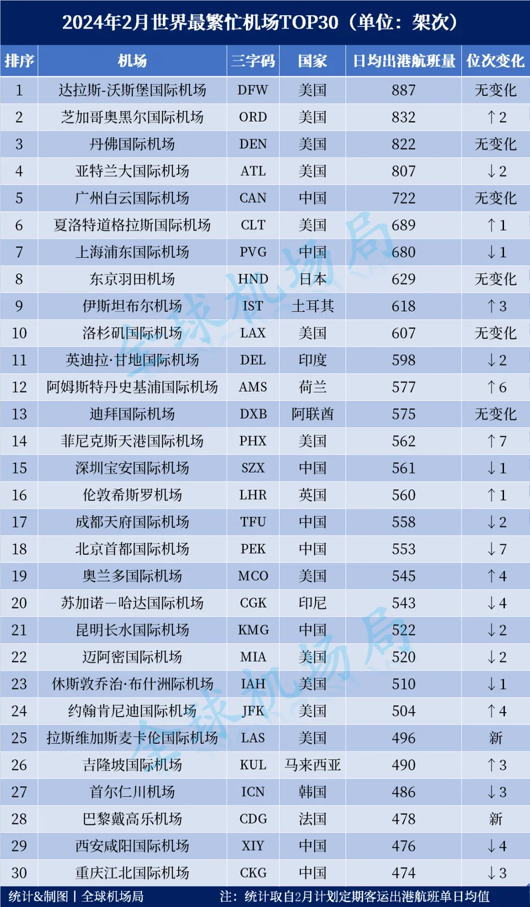

Au apărut topurile celor mai aglomerate 30 de aeroporturi pentru februarie 2024. Clasamentul numără plecările medii zilnice planificate de pasageri pentru luna respectivă — doar zboruri regulate de pasageri, cu marfa și charterele excluse. Dallas/Fort Worth a păstrat primul loc pentru a doua lună, Chicago O'Hare a urcat pe locul doi, Atlanta a coborât două poziții, Istanbul a revenit în top zece, iar Paris Charles de Gaulle a intrat în top 30 pentru prima dată în câteva luni.

Mai întâi, o precizare despre metodă. Acesta este un tabel al planurilor: numără orarul de februarie depus de companiile aeriene, exprimat ca media plecărilor dintr-o zi, nu zborurile care au operat efectiv. Vremea, problemele tehnice și controlul traficului le despart pe cele două, așa că tabelul este mai aproape de intenția de capacitate decât de rezultatele operaționale. Februarie 2024 a avut 29 de zile din cauza anului bisect, dar o medie zilnică nu este afectată de ziua suplimentară.

## 1. Top zece: Dallas rezistă, O'Hare urcă

Cele zece poziții de top, așa cum apar în tabelul clasamentului (plecări medii zilnice):

| Loc | Aeroport | Cod | Țară | Plecări zilnice | Mișcare în clasament |
| --- | --- | --- | --- | --- | --- |
| 1 | Dallas/Fort Worth | DFW | Statele Unite | 887 | fără schimbare |
| 2 | Chicago O'Hare | ORD | Statele Unite | 832 | urcă 2 |
| 3 | Denver | DEN | Statele Unite | 822 | fără schimbare |
| 4 | Atlanta | ATL | Statele Unite | 807 | coboară 2 |
| 5 | Guangzhou Baiyun | CAN | China | 722 | fără schimbare |
| 6 | Charlotte Douglas | CLT | Statele Unite | 689 | urcă 1 |
| 7 | Shanghai Pudong | PVG | China | 680 | coboară 1 |
| 8 | Tokyo Haneda | HND | Japonia | 629 | fără schimbare |
| 9 | Istanbul | IST | Türkiye | 618 | urcă 3 |
| 10 | Los Angeles | LAX | Statele Unite | 607 | fără schimbare |

Dallas/Fort Worth (DFW) apare cu 887 de plecări zilnice în tabel și conduce pentru a doua lună consecutiv. Poziția nu este surprinzătoare: DFW este cel mai mare hub al American Airlines, rutele sale interne principale rulează în valuri dense, iar widebody-urile și narrowbody-urile sunt amestecate în aceeași operațiune, așa că plecările rămân ridicate tot anul. Denver (DEN) este pe locul trei cu 822, neschimbat față de ianuarie, și este cealaltă bază a United în vestul muntos.

Chicago O'Hare (ORD) urcă pe locul doi cu 832, cu două poziții mai sus. ORD este un hub atât pentru United, cât și pentru American, iar cele două rețele se suprapun, ceea ce i-a menținut mult timp numărul de plecări ridicat. Atlanta (ATL) coboară pe locul patru cu 807, cu două poziții mai jos decât în ianuarie; o scădere în clasament nu înseamnă neapărat mai puține plecări, ci doar că vecinii săi au crescut mai repede.

Trei dintre primele patru ancorează rețelele American sau United, iar Atlanta este cel mai mare hub al Delta, așa că vârful acestui tabel oglindește structura huburilor americane la fel de mult ca cererea.

A doua lună a Dallasului pe primul loc arată și că cel mai mare număr de plecări nu este cel mai mare număr de pasageri: Atlanta deserveste mult mai mulți pasageri, dar își concentrează zborurile în mai puține valuri.

Pe țări, top 30 se împarte curat: 12 în Statele Unite (Dallas, O'Hare, Denver, Atlanta, Charlotte, Los Angeles, Phoenix, Orlando, Miami, Houston, Kennedy și Las Vegas), opt în China (Baiyun, Pudong, Bao'an, Tianfu, Capital, Changshui, Xianyang și Jiangbei), trei în Europa (Amsterdam, Heathrow, Charles de Gaulle) și șapte în altă parte. Faptul că o singură țară deține 40 la sută din locuri este o consecință a frecvenței interne, nu a numărului de pasageri.

## 2. Charlotte trece în fața Pudong

Charlotte Douglas (CLT) este pe locul șase cu 689, cu o poziție mai sus, iar Shanghai Pudong (PVG) pe locul șapte cu 680, cu una mai jos. Nouă plecări pe zi le despart — la aproximativ 700 pe zi, aceasta este aceeași linie orizontală, iar câteva plecări de dimineață în plus ar inversa ordinea. CLT este un alt hub intern al American Airlines a cărui forță este densitatea rețelei interne; Pudong își trage plecările atât din rutele interne principale, cât și din serviciile internaționale pe distanță lungă.

Guangzhou Baiyun (CAN) este pe locul cinci cu 722, neschimbat față de ianuarie și cel mai bine plasat aeroport chinezesc din top zece. Tokyo Haneda (HND) este pe locul opt cu 629, iar Los Angeles (LAX) pe locul zece cu 607, ambele neschimbate.

## 3. Istanbul revine în top zece, Phoenix urcă șapte poziții

Istanbul (IST) urcă pe locul nouă cu 618, cu trei poziții mai sus, împingând aeroportul Indira Gandhi din Delhi (598) pe locul 11. Plecările IST sunt susținute de rețeaua de legături a Turkish Airlines, iar poziția sa de poartă între Europa și Asia îl menține relevant pe piețele de transfer pe distanță lungă.

Phoenix Sky Harbor (PHX) este pe locul 14 cu 562, cu șapte poziții mai sus decât în ianuarie și cel mai mare urcător al lunii. Salturi ca acesta reflectă de obicei programarea companiei de bază, nu o explozie a cererii locale. Cei doi urcători sunt trași de forțe diferite: Istanbul prin rețeaua sa de legături, Phoenix prin redistribuirea capacității interne americane.

## 4. La marginea topului 30

Partea de jos a tabelului s-a mișcat mai mult. Las Vegas McCarran (LAS) este pe locul 25 cu 496, revenit în top 30 după o lună de absență; Paris Charles de Gaulle (CDG) este pe locul 28 cu 478, prima sa apariție în top 30 după câteva luni și la doar două plecări în spatele Xi'an Xianyang (476), ceea ce lasă cele două aproape la egalitate. Kuala Lumpur (KUL) este pe locul 26 cu 490, cu trei mai sus, în timp ce Beijing Capital (PEK) coboară pe locul 18 cu 553, cu șapte mai jos.

Sosirea Charles de Gaulle spune și ea ceva: numărul de plecări europene este scăzut iarna, așa că intrarea în top 30 înseamnă concentrarea zborurilor widebody pe distanță lungă în acea lună. Aeroporturile chinezești, între timp, erau în vârful Festivalului Primăverii, cu opt pe listă simultan.

## 5. Ce poate și ce nu poate spune tabelul

Plecările zilnice planificate măsoară frecvența, care nu este același lucru cu traficul de pasageri: un narrowbody de 180 de locuri și un widebody de 400 de locuri contează la fel în plecări și diferă de mai mult de două ori la pasageri. De aceea tabelul favorizează aeroporturile cu rețele interne dense operate cu narrowbody-uri — 12 din 30 sunt în Statele Unite, cel mai mare bloc, și acesta este motivul. Explică și de ce Guangzhou și Pudong stau mai jos aici decât într-un clasament de pasageri: zborurile lor widebody pe distanță lungă mută mult mai mulți oameni pe plecare decât o legătură internă.

O distincție contează: acesta este un plan, nu un rezultat. Viscolele, degivrarea și lucrările pe pistă erodează din ce zboară efectiv, așa că mișcările de la o lună la alta indică o direcție a capacității, nu un clasament al performanței.

Pentru un călător, frecvența este una dintre cele mai practice măsuri. Cu cât orarul este mai dens, cu atât ai mai multe opțiuni de ore și mai mult spațiu de rerutare după o întârziere la un zbor anterior. Nu spune nimic despre tarife sau punctualitate, așa că alegerea se reduce tot la un zbor anume.

> Notă: acesta este un instantaneu lunar din 2024. Pentru o perspectivă mai recentă, vedeți [Cele mai aglomerate zece aeroporturi din lume](/blog/worlds-top-10-airports-by-seats) (februarie 2026, după locuri) și [Traficul de pasageri al aeroporturilor din lume](/blog/world-airport-passenger-traffic-top-50) (anul întreg 2025).

## Legături conexe

- **Pe acest site**: [Chicago O'Hare (ORD)](/airport/ORD), [Atlanta (ATL)](/airport/ATL), [Guangzhou Baiyun (CAN)](/airport/CAN), [Shanghai Pudong (PVG)](/airport/PVG), [Tokyo Haneda (HND)](/airport/HND), [Istanbul (IST)](/airport/IST), [Los Angeles (LAX)](/airport/LAX), [Statele Unite (US)](/country/US)
- **Wikipedia**: [Aeroportul Internațional O'Hare](https://en.wikipedia.org/wiki/O%27Hare_International_Airport), [Aeroportul Internațional Dallas/Fort Worth](https://en.wikipedia.org/wiki/Dallas/Fort_Worth_International_Airport)
- **Baidu Baike**: [Aeroportul Internațional Dallas/Fort Worth](https://baike.baidu.com/item/%E8%BE%BE%E6%8B%89%E6%96%AF-%E6%B2%83%E6%96%AF%E5%A0%A1%E5%9B%BD%E9%99%85%E6%9C%BA%E5%9C%BA), [Aeroportul Internațional O'Hare](https://baike.baidu.com/item/%E8%8A%9D%E5%8A%A0%E5%93%A5%E5%A5%A5%E9%BB%91%E5%B0%94%E5%9B%BD%E9%99%85%E6%9C%BA%E5%9C%BA)

Sursa imaginilor și a datelor: Xiaohu Aviation Analysis, „Februarie 2024: cele mai aglomerate aeroporturi din lume”. Numărul de plecări reprezintă medii zilnice planificate și diferă de ce s-a zburat efectiv; orarele se schimbă cu sezonul, așa că verificați site-urile aeroportului și ale companiei aeriene înainte de a călători.
