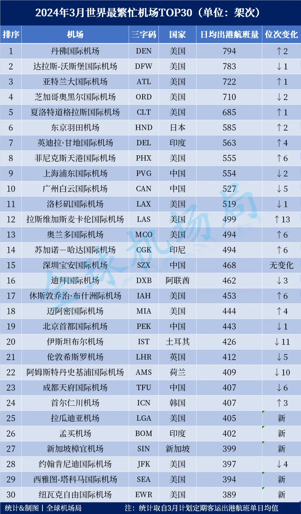

Sono usciti i 30 aeroporti più trafficati di marzo 2024, con la stessa misura dei due mesi precedenti: partenze medie giornaliere programmate di passeggeri, contando solo i voli passeggeri di linea ed escludendo cargo e charter. Denver ha preso il primo posto con 794 partenze, chiudendo i due mesi di Dallas/Fort Worth in vetta. Delhi è tornata nella top ten, Las Vegas ha guadagnato 13 posizioni e LaGuardia, Mumbai, Changi, Seattle e Newark sono tutte entrate nella top 30.

Il rimescolamento è stato il più forte dell'anno finora. La tabella misura il programma, non il risultato: ciò che le compagnie avevano in programma di volare a marzo, non ciò che è stato operato o quante persone sono state trasportate. Meteo, problemi tecnici e controllo del flusso stanno in mezzo, quindi la classifica è una buona guida alle intenzioni e una cattiva guida alle prestazioni.

## 1. Denver primo, e la serie di Dallas finisce

La top ten come elencata nella tabella della classifica (partenze medie giornaliere):

| Posizione | Aeroporto | Codice | Paese | Partenze giornaliere | Posizione |
| --- | --- | --- | --- | --- | --- |
| 1 | Denver | DEN | Stati Uniti | 794 | +2 |
| 2 | Dallas/Fort Worth | DFW | Stati Uniti | 783 | −1 |
| 3 | Atlanta | ATL | Stati Uniti | 722 | +1 |
| 4 | Chicago O'Hare | ORD | Stati Uniti | 710 | −2 |
| 5 | Charlotte Douglas | CLT | Stati Uniti | 685 | +1 |
| 6 | Tokyo Haneda | HND | Giappone | 585 | +2 |
| 7 | Delhi Indira Gandhi | DEL | India | 563 | +4 |
| 8 | Phoenix Sky Harbor | PHX | Stati Uniti | 555 | +6 |
| 9 | Shanghai Pudong | PVG | Cina | 554 | −2 |
| 10 | Guangzhou Baiyun | CAN | Cina | 527 | −5 |

Denver (DEN) è salita dal terzo al primo posto con 794 partenze, due posizioni in più. È il più importante hub di United negli Stati Uniti occidentali, con una rete domestica che copre il Mountain West e la costa del Pacifico, e marzo coincide con le vacanze di primavera in molte scuole americane, il che gonfia il numero di partenze. Dallas/Fort Worth (DFW) è scivolata seconda con 783, chiudendo due mesi in prima posizione; Atlanta (ATL) è salita terza con 722 e Chicago O'Hare (ORD) quarta con 710.

Per Paese la top 30 è ancora più sbilanciata di febbraio: 15 negli Stati Uniti (Denver, Dallas, Atlanta, O'Hare, Charlotte, Phoenix, Los Angeles, Las Vegas, Orlando, Houston, Miami, LaGuardia, Kennedy, Seattle e Newark), cinque in Cina (Pudong, Baiyun, Bao'an, Capital e Tianfu), due in Europa (Heathrow e Schiphol), due in India (Delhi e Mumbai) e sei altrove. Che metà della tabella sia americana non è un ritratto del traffico aereo mondiale; è ciò che produce questa particolare misura.

## 2. Delhi torna nella top ten, Phoenix sale di sei

L'aeroporto Indira Gandhi di Delhi (DEL) è settimo con 563, quattro posizioni in più. Istanbul lo aveva spinto fuori dalla top ten a febbraio ed è tornato un mese dopo: attraversamenti ripetuti di quella soglia di solito significano che un aeroporto si trova proprio sulla linea.

Tokyo Haneda (HND) è sesta con 585, due in più. Phoenix Sky Harbor (PHX) è ottava con 555, altre sei posizioni in più dopo le sette di febbraio: due mesi consecutivi di rapida risalita.

## 3. Las Vegas salta di tredici, Amsterdam e Istanbul arretrano

Las Vegas McCarran (LAS) è 12ª con 499, 13 posizioni in più rispetto a febbraio e la maggiore risalita del mese; per una città costruita su congressi e turismo, un'oscillazione stagionale così ampia nelle partenze è normale.

I cali sono altrettanto netti. Amsterdam Schiphol (AMS) è scivolata al 22° posto con 409, dieci posizioni in meno, e Istanbul (IST) al 20° con 426, undici in meno. Entrambi sono hub di coincidenza le cui partenze seguono da vicino la pianificazione stagionale delle compagnie, quindi uno scivolone di dieci posizioni in un mese è più probabilmente un cambio di programmazione che un crollo della domanda.

## 4. Cinque nuovi volti: LaGuardia, Mumbai, Changi, Seattle, Newark

Il fondo della tabella è cambiato: LaGuardia (LGA) è 25ª con 405, Mumbai (BOM) 26ª con 402, Singapore Changi (SIN) 27ª con 399, Seattle-Tacoma (SEA) 29ª con 394 e Newark (EWR) 30ª con 389: tutte e cinque erano fuori dalla top 30 un mese prima.

La comparsa di Changi merita una nota. L'aeroporto vive di voli internazionali a lungo raggio, con molti widebody, ma il suo numero di partenze è inferiore a quello di un denso hub domestico americano, ed è per questo che in una tabella come questa di solito sta dietro alla sua posizione passeggeri; è la prima volta da mesi che entra nella top 30 per capacità programmata. New York, intanto, ha tre aeroporti in lista contemporaneamente: LaGuardia 25ª, Kennedy (JFK) 28ª e Newark 30ª.

## 5. Dopo il Capodanno cinese: la curva stagionale della Cina

Gli aeroporti cinesi sono tutti scesi. Guangzhou Baiyun (CAN) è passata da 722 partenze a febbraio a 527, perdendo cinque posizioni fino alla decima; Shanghai Pudong (PVG) da 680 a 554, due in meno fino alla nona; Chengdu Tianfu (TFU) è 23ª con 407, sei in meno, e Pechino Capital (PEK) 19ª con 443, una in meno.

Il calendario combacia. La corsa ai viaggi del Capodanno cinese a febbraio ha portato la capacità domestica al picco annuale, e marzo torna alla normalità, così le partenze calano; gli aeroporti americani, intanto, entrano nelle vacanze di primavera. Questo disallineamento stagionale è una cosa più utile da leggere in una tabella mensile di qualsiasi affermazione su quale aeroporto sia più forte.

Gli stessi numeri producono un controesempio all'altro capo: Parigi Charles de Gaulle, nuova entrata a febbraio, è uscita dalla top 30 a marzo. Gli orari europei oscillano ampiamente al cambio di stagione, quindi essere dentro o fuori dalla lista per un mese conta poco.

## 6. I limiti di una tabella mensile

Una tabella mensile delle partenze mostra come è stata distribuita la capacità in un dato momento, non com'è un aeroporto. L'orario estivo settentrionale inizia a fine marzo, le compagnie ridistribuiscono la capacità — più frequenze transatlantiche, voli a corto raggio più densi intorno al Mediterraneo — e la tabella di aprile di solito appare di nuovo diversa.

È per questo che i confronti mese su mese richiedono cautela. Solo due membri della top ten di febbraio sono usciti a marzo — Istanbul e Los Angeles, sostituiti da Delhi e Phoenix — il che sembra un cambiamento di forza ma è soprattutto il ritmo delle stagioni e delle festività al lavoro.

Per un viaggiatore la classifica resta una misura della frequenza: più denso è l'orario, più orari tra cui scegliere e più spazio per riprogrammare dopo un ritardo. Non dice nulla su tariffe, puntualità o facilità di una coincidenza, quindi la decisione resta su un volo specifico e un tempo di coincidenza specifico.

> Nota: questa è un'istantanea mensile del 2024. Per una visione più recente, vedete [I dieci aeroporti più trafficati del mondo](/blog/worlds-top-10-airports-by-seats) (febbraio 2026, per posti) e [Traffico passeggeri degli aeroporti mondiali](/blog/world-airport-passenger-traffic-top-50) (anno intero 2025).

## Link utili

- **Su questo sito**: [Chicago O'Hare (ORD)](/airport/ORD), [Atlanta (ATL)](/airport/ATL), [Los Angeles (LAX)](/airport/LAX), [Amsterdam Schiphol (AMS)](/airport/AMS), [Singapore Changi (SIN)](/airport/SIN), [Kennedy (JFK)](/airport/JFK), [LaGuardia (LGA)](/airport/LGA), [Newark (EWR)](/airport/EWR), [Stati Uniti (US)](/country/US)
- **Wikipedia**: [Denver International Airport](https://en.wikipedia.org/wiki/Denver_International_Airport), [Dallas/Fort Worth International Airport](https://en.wikipedia.org/wiki/Dallas/Fort_Worth_International_Airport)
- **Baidu Baike**: [Denver International Airport](https://baike.baidu.com/item/%E4%B8%B9%E4%BD%9B%E5%9B%BD%E9%99%85%E6%9C%BA%E5%9C%BA), [Dallas/Fort Worth International Airport](https://baike.baidu.com/item/%E8%BE%BE%E6%8B%89%E6%96%AF-%E6%B2%83%E6%96%AF%E5%A0%A1%E5%9B%BD%E9%99%85%E6%9C%BA%E5%9C%BA)

Fonte delle immagini e dei dati: Xiaohu Aviation Analysis, "March 2024: the world's busiest airports". I conteggi delle partenze sono medie giornaliere programmate e differiscono da ciò che è stato operato; gli orari cambiano con la stagione, quindi controllate i siti dell'aeroporto e della compagnia prima di partire.
