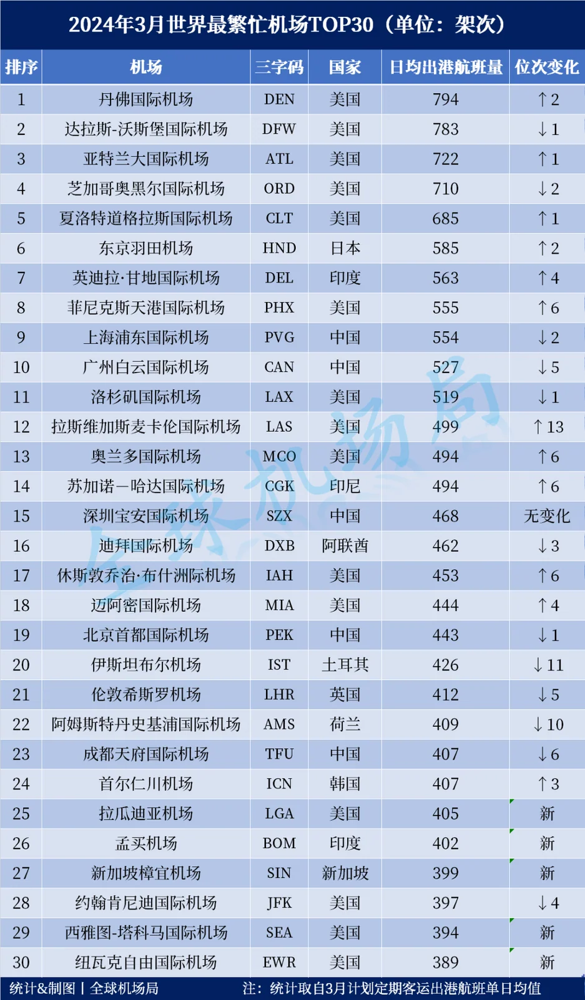

Mart 2024'ün en yoğun 30 havalimanı, önceki iki ayla aynı ölçütle açıklandı: planlanan günlük ortalama tarifeli yolcu kalkışları; yalnızca tarifeli yolcu uçuşları sayılıyor, kargo ve charter hariç. Denver 794 kalkışla birinci oldu ve Dallas/Fort Worth'un zirvedeki iki ayını bitirdi. Delhi ilk ona döndü, Las Vegas 13 sıra tırmandı ve LaGuardia, Mumbai, Changi, Seattle ile Newark ilk 30'a girdi.

Yeniden dağılım yılın şimdiye kadarki en ağırıydı. Tablo sonucu değil planı ölçüyor — havayollarının Mart'ta uçmayı planladığını, fiilen uçulanı ya da kaç kişinin taşındığını değil. Hava koşulları, teknik sorunlar ve akış kontrolü ikisinin arasında durur, bu yüzden sıralama niyet için iyi, performans için zayıf bir rehber.

## 1. Denver birinci oluyor, Dallas'ın serisi bitiyor

Sıralama tablosunda listelendiği şekliyle ilk on (günlük ortalama kalkışlar):

| Sıra | Havalimanı | Kod | Ülke | Günlük kalkış | Sıra hareketi |
| --- | --- | --- | --- | --- | --- |
| 1 | Denver | DEN | ABD | 794 | 2 sıra yukarı |
| 2 | Dallas/Fort Worth | DFW | ABD | 783 | 1 sıra aşağı |
| 3 | Atlanta | ATL | ABD | 722 | 1 sıra yukarı |
| 4 | Chicago O'Hare | ORD | ABD | 710 | 2 sıra aşağı |
| 5 | Charlotte Douglas | CLT | ABD | 685 | 1 sıra yukarı |
| 6 | Tokyo Haneda | HND | Japonya | 585 | 2 sıra yukarı |
| 7 | Delhi Indira Gandhi | DEL | Hindistan | 563 | 4 sıra yukarı |
| 8 | Phoenix Sky Harbor | PHX | ABD | 555 | 6 sıra yukarı |
| 9 | Şanghay Pudong | PVG | Çin | 554 | 2 sıra aşağı |
| 10 | Guangzhou Baiyun | CAN | Çin | 527 | 5 sıra aşağı |

Denver (DEN) 794 kalkışla üçüncüden birinciye yükseldi; iki sıra yukarı. United'ın batı Amerika Birleşik Devletleri'ndeki en önemli merkezi; iç hat ağı Mountain West'i ve Pasifik kıyısını kapsıyor ve Mart birçok Amerikan okulunda bahar tatiline denk geldiği için kalkış sayısını yükseltiyor. Dallas/Fort Worth (DFW) 783 ile ikinciliğe geriledi ve birincilikteki iki ayını bitirdi; Atlanta (ATL) 722 ile üçüncüye, Chicago O'Hare (ORD) 710 ile dördüncüye indi.

Ülkeye göre ilk 30 Şubat'takinden daha da çarpık: ABD'de 15 (Denver, Dallas, Atlanta, O'Hare, Charlotte, Phoenix, Los Angeles, Las Vegas, Orlando, Houston, Miami, LaGuardia, Kennedy, Seattle ve Newark), Çin'de beş (Pudong, Baiyun, Bao'an, Başkent ve Tianfu), Avrupa'da iki (Heathrow ve Schiphol), Hindistan'da iki (Delhi ve Mumbai) ve başka yerlerde altı. Tablonun yarısının Amerikan olması dünya hava trafiğinin resmi değil; bu ölçütün ürettiği sonuç.

## 2. Delhi ilk ona dönüyor, Phoenix altı sıra tırmanıyor

Delhi'nin Indira Gandhi havalimanı (DEL) 563 ile dört sıra yükselerek yedinci oldu. İstanbul onu Şubat'ta ilk onun dışına itmişti ve bir ay sonra geri döndü — bu eşiği tekrar tekrar geçmek genellikle bir havalimanının tam çizginin üzerinde oturduğu anlamına gelir.

Tokyo Haneda (HND) 585 ile iki sıra yükselerek altıncı. Phoenix Sky Harbor (PHX) 555 ile sekizinci; Şubat'taki yediden sonra altı sıra daha yukarı: üst üste iki aylık hızlı tırmanış.

## 3. Las Vegas on üç sıra sıçrıyor, Amsterdam ve İstanbul geriliyor

Las Vegas McCarran (LAS) 499 ile 12. oldu; Şubat'a göre 13 sıra yukarı ve ayın en büyük tırmanışı; kongre ve turizm üzerine kurulu bir şehir için kalkışlarda bu kadar mevsimsel salınım normal.

Düşüşler de bir o kadar keskin. Amsterdam Schiphol (AMS) 409 ile on sıra düşerek 22., İstanbul (IST) 426 ile on bir sıra düşerek 20. oldu. İkisi de kalkışları havayollarının mevsimsel planlamasını yakından izleyen aktarma merkezleri, bu yüzden bir ayda on sıralık kayma talebin çökmesinden çok tarife değişikliği olma olasılığı yüksek.

## 4. Beş yeni yüz: LaGuardia, Mumbai, Changi, Seattle, Newark

Tablonun alt kısmı yenilendi: LaGuardia (LGA) 405 ile 25., Mumbai (BOM) 402 ile 26., Singapur Changi (SIN) 399 ile 27., Seattle-Tacoma (SEA) 394 ile 29. ve Newark (EWR) 389 ile 30. — beşi de bir ay önce ilk 30'un dışındaydı.

Changi'nin görünmesi not edilmeye değer. Havalimanı uzun mesafe uluslararası uçuşlarla, bolca geniş gövdeyle yaşıyor, ancak kalkış sayısı yoğun bir Amerikan iç hat merkezinden daha düşük; bu yüzden bu tür bir tabloda genellikle yolcu sıralamasının gerisinde kalıyor. Aylardır ilk kez tarifeli kapasitede ilk 30'a girdi. New York ise listede aynı anda üç havalimanıyla var: LaGuardia 25., Kennedy (JFK) 28. ve Newark 30.

## 5. Bahar Festivali'nden sonra: Çin'in mevsimsel eğrisi

Çin havalimanlarının hepsi aşağı indi. Guangzhou Baiyun (CAN) Şubat'taki 722 kalkıştan 527'ye düştü ve beş sıra gerileyerek onuncu oldu; Şanghay Pudong (PVG) 680'den 554'e indi, iki sıra düşerek dokuzuncu oldu; Chengdu Tianfu (TFU) 407 ile altı sıra düşerek 23. ve Pekin Başkent (PEK) 443 ile bir sıra düşerek 19. oldu.

Zamanlama tatil takvimine uyuyor. Şubat'taki Bahar Festivali yolculuk yoğunluğu iç hat kapasitesini yıllık zirvesine çıkardı ve Mart normale dönüyor, bu yüzden kalkışlar geriliyor; Amerikan havalimanları ise bahar tatiline giriyor. Bu mevsimsel uyumsuzluk, aylık bir tablodan okunabilecek en kullanışlı şey — hangi havalimanının daha güçlü olduğuna dair herhangi bir iddiadan daha fazla.

Aynı sayılar diğer uçta bir karşı örnek üretiyor: Şubat'ta yeni giren Paris Charles de Gaulle Mart'ta ilk 30'dan çıktı. Avrupa tarifeleri mevsim dönümünde geniş salınım yapar, bu yüzden listede bir ay içinde olmak ya da olmamak pek bir şey ifade etmez.

## 6. Aylık tablonun sınırları

Aylık bir kalkış tablosu kapasitenin bir anda nasıl dağıtıldığını gösterir, bir havalimanının nasıl olduğunu değil. Kuzey yarımkürede yaz tarifesi Mart sonunda başlar, havayolları bunun için kapasiteyi yeniden dağıtır — daha fazla transatlantik frekans, Akdeniz çevresinde daha yoğun kısa mesafe uçuşlar — ve Nisan tablosu genellikle yine farklı görünür.

Bu yüzden aydan aya karşılaştırmalar dikkat ister. Şubat ilk onunun Mart'ta yalnızca iki üyesi ayrıldı — İstanbul ve Los Angeles, yerlerine Delhi ve Phoenix geldi — bu güç kayması gibi okunuyor, ama çoğunlukla mevsimlerin ve tatillerin ritmi.

Bir yolcu için sıralama hâlâ bir frekans ölçüsü: tarife ne kadar yoğunsa seçilecek saat o kadar fazla ve gecikme sonrası yeniden rezervasyon imkânı o kadar geniş. Ücretler, dakiklik veya aktarmanın kolaylığı hakkında hiçbir şey söylemez, bu yüzden karar yine belirli bir uçuşa ve belirli bir aktarma süresine kalır.

> Not: Bu, 2024'ten aylık bir anlık görüntüdür. Daha güncel bir görünüm için [Dünyanın En Yoğun On Havalimanı](/blog/worlds-top-10-airports-by-seats) (Şubat 2026, koltuk sayısına göre) ve [Dünya Havalimanı Yolcu Trafiği](/blog/world-airport-passenger-traffic-top-50) (2025 tam yıl) yazılarına bakın.

## İlgili bağlantılar

- **Bu sitede**: [Chicago O'Hare (ORD)](/airport/ORD), [Atlanta (ATL)](/airport/ATL), [Los Angeles (LAX)](/airport/LAX), [Amsterdam Schiphol (AMS)](/airport/AMS), [Singapur Changi (SIN)](/airport/SIN), [Kennedy (JFK)](/airport/JFK), [LaGuardia (LGA)](/airport/LGA), [Newark (EWR)](/airport/EWR), [Amerika Birleşik Devletleri (US)](/country/US)
- **Wikipedia**: [Denver Uluslararası Havalimanı](https://en.wikipedia.org/wiki/Denver_International_Airport), [Dallas/Fort Worth Uluslararası Havalimanı](https://en.wikipedia.org/wiki/Dallas/Fort_Worth_International_Airport)
- **Baidu Baike**: [Denver Uluslararası Havalimanı](https://baike.baidu.com/item/%E4%B8%B9%E4%BD%9B%E5%9B%BD%E9%99%85%E6%9C%BA%E5%9C%BA), [Dallas/Fort Worth Uluslararası Havalimanı](https://baike.baidu.com/item/%E8%BE%BE%E6%8B%89%E6%96%AF-%E6%B2%83%E6%96%AF%E5%A0%A1%E5%9B%BD%E9%99%85%E6%9C%BA%E5%9C%BA)

Görsel ve veri kaynağı: Xiaohu Aviation Analysis, "Mart 2024: dünyanın en yoğun havalimanları". Kalkış sayıları planlanan günlük ortalamalardır ve fiilen uçulandan farklıdır; tarifeler mevsime göre değişir, bu yüzden seyahatten önce havalimanının ve havayolunun kendi sitelerine bakın.
