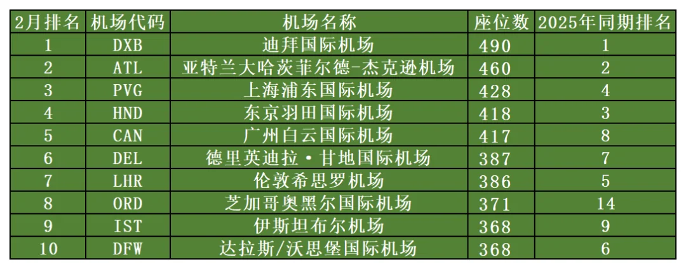
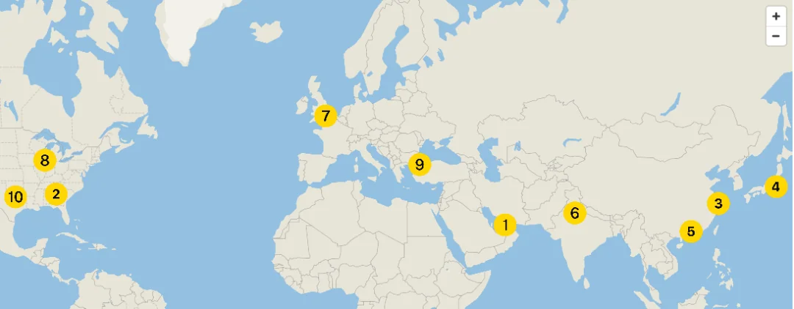

OAG ha pubblicato la sua classifica dei dieci aeroporti più trafficati del mondo per febbraio 2026. La misura non è il numero di passeggeri ma i posti sulle partenze programmate in ciascun aeroporto durante il mese: in altre parole, quanta capacità le compagnie hanno collocato lì. Dubai guida ancora con circa 4.9 milioni di posti, Shanghai Pudong sale terza e Guangzhou Baiyun guadagna tre posizioni fino alla quinta.

Posti e passeggeri sono due cose diverse. Un posto è la capacità che una compagnia mette in vendita in fase di pianificazione; il numero di passeggeri esiste solo dopo che il volo è stato operato, e la differenza tra i due è il fattore di riempimento. Su questa tabella valgono altre due avvertenze: febbraio ha solo 28 giorni, il che abbassa qualsiasi confronto mese su mese, e per l'emisfero nord è uno dei mesi più tranquilli dell'anno.

## 1. La capacità in posti misura l'offerta, non le persone

OAG conta i posti solo sulle partenze passeggeri di linea: arrivi, cargo e charter sono esclusi. Questo inclina la tabella verso due tipi di aeroporto. Gli hub di coincidenza fanno volare widebody con molti posti per partenza, quindi una singola ondata può produrre un numero enorme. Gli aeroporti con rotte domestiche dense fanno volare narrowbody ad alta frequenza e accumulano posti altrettanto efficacemente. La tabella risponde a quanti posti sono partiti da un aeroporto questo mese, non quante persone siano andate davvero, il che la rende un indicatore delle decisioni di capacità delle compagnie più che della popolarità di un aeroporto.

Anche la stagione conta. A febbraio le vacanze europee e americane sono finite e le scuole sono aperte, quindi la domanda transatlantica e intra-europea è al minimo e le compagnie spostano la capacità altrove o tagliano voli. L'emisfero sud è in piena estate, eppure tutti e dieci gli aeroporti della tabella sono a nord dell'equatore: il baricentro della capacità globale è ancora settentrionale, e la bassa stagione è quando questo si vede più chiaramente. Un mese tranquillo è anche il più facile in cui vedere dove le compagnie puntano le loro scommesse: l'Europa si ritira, e Medio Oriente, Asia meridionale e Sud-est asiatico assorbono il margine.

## 2. Dubai guida, e i due aeroporti cinesi salgono

I dieci, come elencati nella tabella della classifica (posti in milioni):

| Posizione a febbraio | Codice | Aeroporto | Posti (milioni) | Posizione a febbraio 2025 |
| --- | --- | --- | --- | --- |
| 1 | DXB | Dubai International | 4.90 | 1 |
| 2 | ATL | Hartsfield–Jackson Atlanta | 4.60 | 2 |
| 3 | PVG | Shanghai Pudong | 4.28 | 4 |
| 4 | HND | Tokyo Haneda | 4.18 | 3 |
| 5 | CAN | Guangzhou Baiyun | 4.17 | 8 |
| 6 | DEL | Delhi Indira Gandhi | 3.87 | 7 |
| 7 | LHR | Londra Heathrow | 3.86 | 5 |
| 8 | ORD | Chicago O'Hare | 3.71 | 14 |
| 9 | IST | Istanbul | 3.68 | 9 |
| 10 | DFW | Dallas/Fort Worth | 3.68 | 6 |

Geograficamente la lista è tutta settentrionale: tre negli Stati Uniti (Atlanta, Chicago O'Hare, Dallas/Fort Worth), due in Cina (Pudong, Baiyun), due in Medio Oriente (Dubai, Istanbul) e uno ciascuno in Regno Unito, Giappone e India. Istanbul, nona, e Dallas, decima, sono pari a 3.68 milioni di posti, separate solo oltre la virgola.

L'unità richiede un momento per tradursi in qualcosa di concreto. Distribuiti su 28 giorni, 4.9 milioni di posti sono circa 175,000 posti in partenza al giorno; il decimo posto, a 3.68 milioni, è circa 131,000. Il divario tra primo e decimo è di circa 44,000 posti al giorno, cioè circa 200 voli narrowbody in più.

## 3. Dubai mantiene il comando, ed è il più facile da riscrivere

L'aeroporto internazionale di Dubai (DXB) mantiene il primo posto con quasi 4.9 milioni di posti. La sua posizione al crocevia tra Asia, Africa ed Europa permette al modello di coincidenza di attirare tre continenti in un solo terminal: i passeggeri che volano dall'Europa al Sud-est asiatico o dall'India al Nord America cambiano spesso aeromobile qui, il che mantiene alti i numeri dei posti anche in un mese tranquillo.

È però anche la voce più fragile della tabella. Il recente conflitto in Medio Oriente ha colpito duramente Dubai, e sugli attuali piani di capacità la sua classifica di marzo rischia di calare bruscamente: uscire dalla top ten non sarebbe una sorpresa. Istanbul (IST) mantiene il nono posto grazie alla geografia e all'espansione di Turkish Airlines — la compagnia ha costruito l'aeroporto fino a una rete che copre più di 300 destinazioni — e sta diventando un nodo chiave nel triangolo Europa–Asia–Africa. Segue un modello di coincidenza simile ma questa volta è stata molto meno esposta.

Ciò che questi hub hanno in comune è che una gran parte dei loro posti è venduta a passeggeri di Paesi terzi. Un widebody che lascia Dubai per Bangkok può trasportare viaggiatori britannici, indiani e sauditi; il numero di posti riflette la portata della rete più che la domanda locale.

## 4. Pudong e Baiyun: il Capodanno cinese solleva febbraio

Shanghai Pudong (PVG) sale dal quarto al terzo posto con 4.28 milioni di posti. Guangzhou Baiyun (CAN) passa dall'ottavo al quinto con 4.17 milioni, un balzo di tre posizioni. Entrambi sono legati alla corsa ai viaggi del Capodanno cinese: il nuovo anno cinese cade a metà febbraio nel 2026, e la sovrapposizione dei viaggi verso casa prima della festa e dei rientri dopo la rende uno dei periodi più pesanti dell'anno per la capacità domestica.

Per la maggior parte degli aeroporti dell'emisfero nord febbraio è bassa stagione; per gli aeroporti cinesi spesso non lo è. Questa differenza di tempi è esattamente il motivo per cui Pudong e Baiyun sono saliti nella stessa tabella.

## 5. Nord America ed Europa: la capacità invernale si rimescola

Atlanta (ATL) mantiene il secondo posto con 4.60 milioni di posti e resta il più grande hub statunitense. Chicago O'Hare (ORD) sale dal 14° all'ottavo posto con 3.71 milioni, cosa che la fonte collega a un inverno più mite e alla concentrazione di capacità delle compagnie lì, e Dallas/Fort Worth (DFW) scivola dal sesto al decimo, forse per aggiustamenti di capacità low-cost. Tokyo Haneda (HND) è quarta con 4.18 milioni e Delhi (DEL) sesta con 3.87 milioni, quindi il mercato Asia-Pacifico non è più dominato da un solo hub.

L'Europa appare più debole. Londra Heathrow (LHR) mantiene il settimo posto con 3.86 milioni ma è due posizioni più in basso rispetto a febbraio 2025, cosa che la fonte attribuisce con cautela a politica dei visti, scioperi o concorrenza ferroviaria a corto raggio. Sono ipotesi. Il punto strutturale è più solido: Heathrow ha due piste e slot cronicamente saturi, quindi il suo numero di posti ha un tetto fisso e poco spazio per salire in una classifica come questa.

## 6. Come usare una tabella mensile

Una classifica mensile dei posti cattura un momento della pianificazione della capacità; il traffico passeggeri annuo cattura il risultato dell'anno. Nessuno dei due sostituisce l'altro. Ciò che la visione mensile dice a un viaggiatore è se questo mese un aeroporto ha molti voli e quanto sono ampie le opzioni di coincidenza; ma più posti non significano tariffe più basse o migliore puntualità.

## Link utili

- **Su questo sito**: [Dubai (DXB)](/airport/DXB), [Shanghai Pudong (PVG)](/airport/PVG), [Guangzhou Baiyun (CAN)](/airport/CAN), [Chicago O'Hare (ORD)](/airport/ORD), [Cina (CN)](/country/CN)
- **Wikipedia**: [Dubai International Airport](https://en.wikipedia.org/wiki/Dubai_International_Airport), [Shanghai Pudong International Airport](https://en.wikipedia.org/wiki/Shanghai_Pudong_International_Airport)
- **Baidu Baike**: [Dubai International Airport](https://baike.baidu.com/item/%E8%BF%AA%E6%8B%9C%E5%9B%BD%E9%99%85%E6%9C%BA%E5%9C%BA), [Shanghai Pudong International Airport](https://baike.baidu.com/item/%E4%B8%8A%E6%B5%B7%E6%B5%A6%E4%B8%9C%E5%9B%BD%E9%99%85%E6%9C%BA%E5%9C%BA)

Fonte delle immagini e dei dati: Aviation Viewpoint, "February 2026: the world's ten busiest airports", con dati OAG. I conteggi dei posti sono capacità programmata e differiscono da ciò che è stato operato e dal numero di passeggeri; controllate i siti dell'aeroporto e della compagnia prima di partire.
