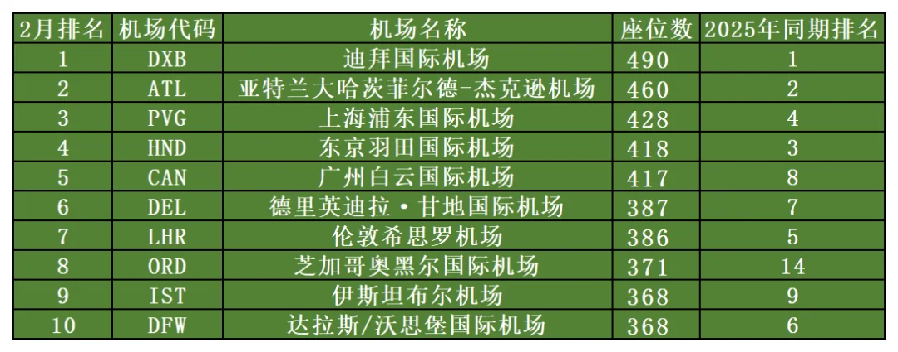
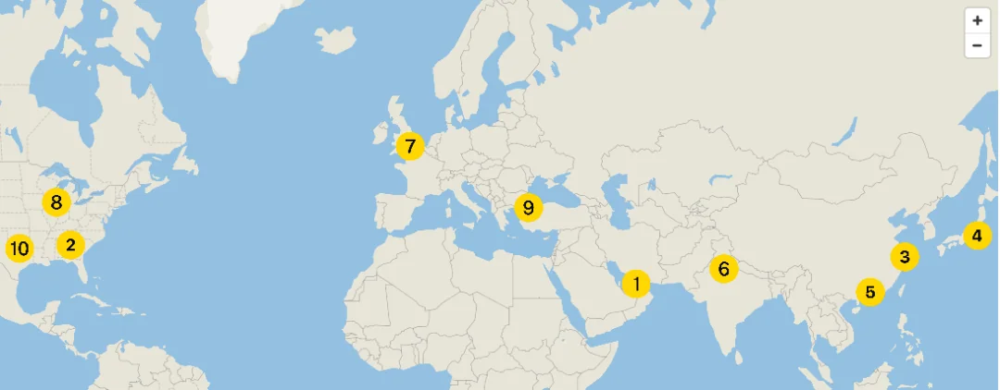

OAG опубликовал рейтинг десяти самых загруженных аэропортов мира за февраль 2026 года. Мера — не число пассажиров, а места на вылетах, запланированных в каждом аэропорту за месяц, иными словами, сколько ёмкости авиакомпании туда поставили. Дубай снова лидирует с примерно 4,9 млн мест, Шанхай Пудун поднимается на третье, а Гуанчжоу Байюнь прыгает на три места до пятого.

Места и пассажиры — разные вещи. Место — это ёмкость, которую авиакомпания выставляет на продажу на этапе планирования; пассажиропоток существует только после выполнения рейса, а разрыв между ними — коэффициент загрузки. К этой таблице применимы ещё две оговорки: в феврале всего 28 дней, что тянет вниз любое месячное сравнение, и для Северного полушария это один из самых тихих месяцев года.

## 1. Провозная ёмкость измеряет предложение, а не людей

OAG считает места только на регулярных пассажирских вылетах — прилёты, грузовые и чартерные рейсы исключены. Это смещает таблицу к двум типам аэропортов. Пересадочные хабы летают широкофюзеляжными самолётами с большим числом мест на вылет, поэтому одна волна может дать огромное число. Аэропорты с плотными внутренними магистралями летают узкофюзеляжными самолётами с высокой частотой и накапливают места столь же эффективно. Таблица отвечает, сколько мест вылетело из аэропорта за месяц, а не сколько людей реально улетело, что делает её индикатором решений авиакомпаний о ёмкости, а не популярности аэропорта.

Сезон тоже важен. К февралю европейские и американские праздники закончились, школы учатся, поэтому трансатлантический и внутриевропейский спрос на минимуме, и авиакомпании перебрасывают ёмкость в другие места или сокращают рейсы. В Южном полушарии разгар лета, но все десять аэропортов таблицы находятся севернее экватора: центр тяжести мировой ёмкости по-прежнему северный, и в низкий сезон это виднее всего. Тихий месяц также проще всего показывает, куда авиакомпании ставят свои ставки — Европа отступает, а Ближний Восток, Южная и Юго-Восточная Азия подхватывают.

## 2. Дубай лидирует, оба китайских аэропорта поднимаются

Десятка по таблице рейтинга (места в млн):

| Место в фев. | Код | Аэропорт | Места (млн) | Место в фев. 2025 |
| --- | --- | --- | --- | --- |
| 1 | DXB | Дубайский международный | 4,90 | 1 |
| 2 | ATL | Хартсфилд–Джексон Атланта | 4,60 | 2 |
| 3 | PVG | Шанхай Пудун | 4,28 | 4 |
| 4 | HND | Токио Ханэда | 4,18 | 3 |
| 5 | CAN | Гуанчжоу Байюнь | 4,17 | 8 |
| 6 | DEL | Дели Индира Ганди | 3,87 | 7 |
| 7 | LHR | Лондонский Хитроу | 3,86 | 5 |
| 8 | ORD | Чикаго О'Хара | 3,71 | 14 |
| 9 | IST | Стамбул | 3,68 | 9 |
| 10 | DFW | Даллас/Форт-Уэрт | 3,68 | 6 |

Географически список полностью северный: три в США (Атланта, Чикаго О'Хара, Даллас/Форт-Уэрт), два в Китае (Пудун, Байюнь), два на Ближнем Востоке (Дубай, Стамбул) и по одному в Великобритании, Японии и Индии. Девятый Стамбул и десятый Даллас равны с 3,68 млн мест и различаются только за пределами десятичной запятой.

Единицу стоит перевести в конкретику. Разложенные на 28 дней, 4,9 млн мест — это примерно 175 000 мест на вылетах в день; десятое место с 3,68 млн — около 131 000. Разрыв между первым и десятым — около 44 000 мест в день, примерно 200 дополнительных узкофюзеляжных рейсов.

## 3. Дубай сохраняет лидерство, и его проще всего переписать

Дубайский международный (DXB) удерживает первое место почти с 4,9 млн мест. Положение на перекрёстке Азии, Африки и Европы позволяет его пересадочной модели стягивать три континента в один терминал: пассажиры, летящие из Европы в Юго-Восточную Азию или из Индии в Северную Америку, часто меняют самолёт здесь, что поддерживает число мест высоким даже в тихий месяц.

Это также самая хрупкая строка таблицы. Недавний конфликт на Ближнем Востоке сильно ударил по Дубаю, и при текущих планах по ёмкости его мартовский рейтинг, вероятно, резко упадёт — выпадение из топ-10 не станет сюрпризом. Стамбул (IST) держит девятое место благодаря географии и экспансии Turkish Airlines — перевозчик построил аэропорт в сеть, охватывающую более 300 направлений — и становится ключевым узлом треугольника Европа–Азия–Африка. Он использует похожую пересадочную модель, но на этот раз подвергся гораздо меньшему риску.

Общее у этих хабов то, что большую долю их мест покупают пассажиры третьих стран. Широкофюзеляжный самолёт из Дубая в Бангкок может везти британцев, индийцев и саудовцев; число мест отражает охват сети, а не местный спрос.

## 4. Пудун и Байюнь: Праздник весны поднимает февраль

Шанхай Пудун (PVG) поднимается с четвёртого на третье с 4,28 млн мест. Гуанчжоу Байюнь (CAN) переходит с восьмого на пятое с 4,17 млн, прыжок на три места. Оба связаны с новогодним пиком: китайский Новый год в 2026 году приходится на середину февраля, и наложение поездок домой до праздника и возвращений после делает этот отрезок одним из самых тяжёлых в году для внутренней ёмкости.

Для большинства аэропортов Северного полушария февраль — низкий сезон; для китайских часто нет. Именно это различие во времени и подняло Пудун и Байюнь в одной и той же таблице.

## 5. Северная Америка и Европа: зимняя перетасовка ёмкости

Атланта (ATL) держит второе место с 4,60 млн мест и остаётся крупнейшим хабом США. Чикаго О'Хара (ORD) поднимается с 14-го на восьмое с 3,71 млн, что источник связывает с более мягкой зимой и концентрацией ёмкости авиакомпаний там, а Даллас/Форт-Уэрт (DFW) соскальзывает с шестого на десятое, возможно, из-за корректировки лоукостеров. Токио Ханэда (HND) четвёртая с 4,18 млн, а Дели (DEL) шестой с 3,87 млн, так что рынок Азиатско-Тихоокеанского региона больше не зависит от одного хаба.

Европа выглядит мягче. Лондонский Хитроу (LHR) держит седьмое место с 3,86 млн, но на два места ниже, чем в феврале 2025 года, что источник осторожно объясняет визовой политикой, забастовками или конкуренцией со стороны железных дорог на коротких расстояниях. Это догадки. Структурный вывод твёрже: у Хитроу две полосы и хронически насыщенные слоты, поэтому число мест имеет фиксированный потолок и мало места для подъёма в такой таблице.

## 6. Как пользоваться месячной таблицей

Месячный рейтинг по местам фиксирует момент планирования ёмкости; годовой пассажиропоток фиксирует итог года. Одно не заменяет другое. Месячный взгляд говорит путешественнику, много ли рейсов в аэропорту в этом месяце и насколько широки пересадочные возможности, — но больше мест не означает дешевле билеты или лучше пунктуальность.

## Связанные ссылки

- **На этом сайте**: [Дубай (DXB)](/airport/DXB), [Шанхай Пудун (PVG)](/airport/PVG), [Гуанчжоу Байюнь (CAN)](/airport/CAN), [Чикаго О'Хара (ORD)](/airport/ORD), [Китай (CN)](/country/CN)
- **Википедия**: [Дубайский международный аэропорт](https://en.wikipedia.org/wiki/Dubai_International_Airport), [Шанхайский международный аэропорт Пудун](https://en.wikipedia.org/wiki/Shanghai_Pudong_International_Airport)
- **Baidu Baike**: [Дубайский международный аэропорт](https://baike.baidu.com/item/%E8%BF%AA%E6%8B%9C%E5%9B%BD%E9%99%85%E6%9C%BA%E5%9C%BA), [Шанхайский международный аэропорт Пудун](https://baike.baidu.com/item/%E4%B8%8A%E6%B5%B7%E6%B5%A6%E4%B8%9C%E5%9B%BD%E9%99%85%E6%9C%BA%E5%9C%BA)

Источник изображений и данных: Aviation Viewpoint, «Февраль 2026: десять самых загруженных аэропортов мира», по данным OAG. Числа мест — плановая ёмкость и отличаются от фактически выполненных и от пассажиропотока; проверяйте сайты аэропорта и авиакомпании перед поездкой.
