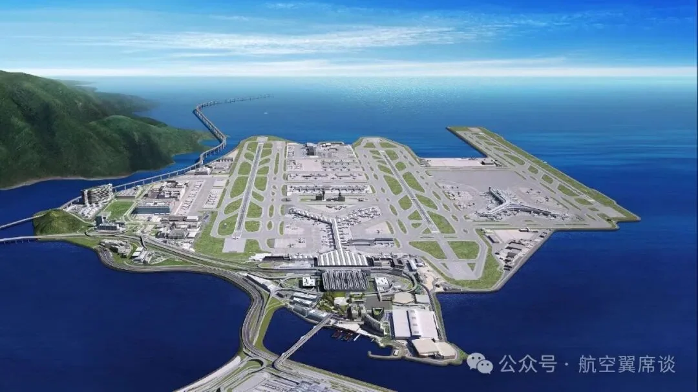

2024 年 4 月，国际机场理事会（ACI）公布 2023 年全球十大货运机场排名，排序依据是各机场 2023 年的货邮吞吐量。香港国际机场以 433 万吨继续排在第一，孟菲斯以 388 万吨位居第二，上海浦东以 344 万吨排在第三，是前十名里唯一实现两位数增长的大型货运枢纽。

这份榜单和客流榜读起来完全不是一回事。2023 年全球航空货运量同比下降 3.1%，仍在从疫情期的运价高峰回落；但前十名的名单几乎没有换人，变化的是顺序——安克雷奇从 2019 年的第六升到第四，迈阿密从第十二升到第七，路易斯维尔从第四退到第六，台北桃园从第九退到第十。货运排名跟着贸易周期走，不跟着游客走。

## 一、榜单：香港第一，前十门槛 211 万吨

| 排名 | 机场 | 代码 | 国家/地区 | 2023 年货邮吞吐量（万吨） | 同比 | 较 2019 年 | 2019 年排名 |
| --- | --- | --- | --- | --- | --- | --- | --- |
| 1 | 香港国际机场 | HKG | 中国香港 | 433 | +3.2% | −9.9% | 1 |
| 2 | 孟菲斯国际机场 | MEM | 美国 | 388 | −4.0% | −10.2% | 2 |
| 3 | 上海浦东国际机场 | PVG | 中国 | 344 | +10.4% | −5.3% | 3 |
| 4 | 安克雷奇国际机场 | ANC | 美国 | 338 | −2.4% | +23.1% | 6 |
| 5 | 首尔仁川国际机场 | ICN | 韩国 | 274 | −6.9% | −0.7% | 5 |
| 6 | 路易斯维尔国际机场 | SDF | 美国 | 273 | −11.1% | −2.2% | 4 |
| 7 | 迈阿密国际机场 | MIA | 美国 | 253 | +1.0% | +20.7% | 12 |
| 8 | 多哈哈马德国际机场 | DOH | 卡塔尔 | 236 | +1.5% | +6.3% | 8 |
| 9 | 洛杉矶国际机场 | LAX | 美国 | 213 | −14.9% | +1.9% | 13 |
| 10 | 台北桃园国际机场 | TPE | 中国台湾 | 211 | −16.8% | −3.2% | 9 |

表列数字来自 ACI，同比为 2023 年相对 2022 年的变化，“较 2019 年”为相对疫情前的恢复程度。前十名的门槛停在 211 万吨，与第一名的 433 万吨相差 222 万吨，差不多是上海浦东一年的吞吐量；头部与第二梯队之间的落差比客运榜更明显。

香港的第一名含金量在于结构：它长期是全球最繁忙的国际货运机场，转口贸易与珠三角的制造业货源支撑了庞大的货机波次。但 433 万吨仍比 2019 年低 9.9%——也就是说，第一名是“在下降中守住的第一名”，而不是恢复到疫情前的第一。

## 二、总量 1.13 亿吨：回到 2019 年的 95.4%

2023 年全球机场航空货运吞吐量为 1.13 亿吨，同比下降 3.1%，相当于 2019 年的 95.4%。这个数字比客运榜的恢复程度更好看：旅客吞吐量在很多市场仍未回到疫情前，而货运已经接近了。

回落的原因不难理解。疫情期间海运受阻、运价飙升，大量货物转向空运，航空货运因此在 2020 至 2022 年吃到了超常的需求；随着海运恢复正常、库存周期走完，这部分“替代性需求”退出，2023 年的 3.1% 降幅更像是一次回归常态，而不是衰退。真正支撑长线增长的是跨境电商包裹，它改变的是货源结构——更多小件、更高时效、更依赖宽体客机的腹舱。

## 三、前十占全球 26%：集中度说明了什么

2023 年，十大货运机场合计吞吐 2960 万吨，占全球市场的 26%。用十座机场承担全球四分之一的航空货运，这个集中度在各行各业里都算高。

集中度来自网络效应。货运航空的枢纽模式要求货物在一点汇集、再分销出去，枢纽越强，航班波次越密，单位成本越低，货源就越向它集中。安克雷奇是这条逻辑最纯粹的样本：它本身不是货源地，却因为处在跨太平洋航线的技术经停位置，以 338 万吨排到第四，且比 2019 年高出 23.1%——前十名里相对疫情前增幅最大的一座。多哈是中东版本的同一个逻辑：本身不是产地，靠宽体货机把南亚、欧洲与非洲之间的货源接起来，236 万吨里很大一部分既不产自卡塔尔，也不运往卡塔尔。

## 四、中美八席：制造业、电商与枢纽竞争

十座机场里，美国五座、中国三座（内地、香港、台湾各一座），合计八席。这一分布的解释很直接：航空货运量与地区经济发展、经济体量息息相关。美国是全球第一大经济体，十强中占一半；中国拥有三座，分别对应内地制造、香港转口与台湾的电子产业链。

把八座机场放在供应链上看，分工其实很清楚。孟菲斯是联邦快递的全球枢纽，路易斯维尔是 UPS 的 Worldport 枢纽，两座城市的货运量来自“把包裹集中起来再送出去”的快递模式，而不是本地工厂的产出；洛杉矶与迈阿密是门户，前者承接跨太平洋货流，后者面向拉美；安克雷奇是加油与换机组的中途站。中国一侧，香港与上海浦东是制造与转口的大门，前者服务珠三角，后者服务长三角，两座机场的货源高度依赖电子、机械与跨境电商件。换句话说，美国这五座更多是靠“组织货流”——把别处生产的货物集中、分拣、再送出去；中国这三座则同时是产地和门户。

这也解释了 2023 年的名次变化为何如此剧烈：当货源从“替代性空运”退回海运，谁的货结构更偏快递和电商，谁就更抗跌。迈阿密 +1.0%、多哈 +1.5% 稳住，而洛杉矶 −14.9%、台北桃园 −16.8% 掉得最狠，差距不在机场能力，而在背后的货种。这种集中度也把一个问题摆在其他枢纽面前：全球四分之一的空运货量过十座机场，剩下的机场只能去分剩下的一块。

## 五、货运榜与客流榜是两套逻辑

同一座机场在两张榜上的位置可以相差很远。上海浦东 2023 年货运排世界第三，客流排第 22；台北桃园货运第十，客流则在 35 强之外。原因是货运衡量的是货物经过的能力，客流衡量的是人经过的能力，两者依赖的设施、航权和货源完全不同。两张榜放在一起看，才能看出一座机场是“人货两旺”还是偏科。

对旅客来说，这张榜的用处不是选机场，而是看趋势。货运量往上走，通常意味着当地制造业订单和出口在回暖，也意味着宽体货机起降更密、腹舱运力更宽松；货运量往下走，则往往先于经济数据反映出来。把它当成一份贸易周期的体检报告，比当成机场排行榜更准确。这张表也看不出服务水平：截单时间、冷链处理、海关放行速度、卡车集疏运网络，才决定货代愿不愿意把货交给某座机场，而这些都不在吨位数字里。

## 六、2025 年更新：1.289 亿吨

2026 年公布的 2025 年数据显示，全球航空货运量达到 1.289 亿吨，同比增长 2.9%，亚太枢纽继续占据榜单前列（[Cargo Newswire](https://cargonewswire.com/global-air-cargo-hits-128-9-million-tonnes-in-2025-as-asia-pacific-hubs-dominate-world-rankings/)）。与 2023 年的 1.13 亿吨相比，行业已经走出疫情后的回落区间，跨境电商包裹仍是主要增量。

本文的 2023 年表仍有价值：它记录了运价高峰回落后的第一年，也解释了为什么香港、上海浦东和安克雷奇的地位难以撼动。2025 年的完整前十名单以 ACI 及各机场公布为准；阅读时把两张表放在一起，比只看一年的排名更能看出趋势。

## 相关链接

- **本站页面**：[香港国际机场（HKG）](/zh/airport/HKG)、[上海浦东国际机场（PVG）](/zh/airport/PVG)、[首尔仁川国际机场（ICN）](/zh/airport/ICN)、[迈阿密国际机场（MIA）](/zh/airport/MIA)、[多哈哈马德国际机场（DOH）](/zh/airport/DOH)、[洛杉矶国际机场（LAX）](/zh/airport/LAX)
- **国家页面**：[中国（CN）](/zh/country/CN)、[美国（US）](/zh/country/US)
- **维基百科**：[香港国际机场](https://zh.wikipedia.org/wiki/%E9%A6%99%E6%B8%AF%E5%9B%BD%E9%99%85%E6%9C%BA%E5%9C%BA)、[上海浦东国际机场](https://zh.wikipedia.org/wiki/%E4%B8%8A%E6%B5%B7%E6%B5%A6%E4%B8%9C%E5%9B%BD%E9%99%85%E6%9C%BA%E5%9C%BA)、[孟菲斯国际机场](https://zh.wikipedia.org/wiki/%E5%AD%9F%E8%8F%B2%E6%96%AF%E5%9B%BD%E9%99%85%E6%9C%BA%E5%9C%BA)、[仁川国际机场](https://zh.wikipedia.org/wiki/%E4%BB%81%E5%B7%9D%E5%9B%BD%E9%99%85%E6%9C%BA%E5%9C%BA)
- **百度百科**：[香港国际机场](https://baike.baidu.com/item/%E9%A6%99%E6%B8%AF%E5%9B%BD%E9%99%85%E6%9C%BA%E5%9C%BA)、[孟菲斯国际机场](https://baike.baidu.com/item/%E5%AD%9F%E8%8F%B2%E6%96%AF%E5%9B%BD%E9%99%85%E6%9C%BA%E5%9C%BA)

图片来源：ACI 数据与航空观点整理。货邮吞吐量的统计口径（是否含中转货物、是否含邮件）各机场可能不同，引用排名时请以 ACI 公布的数据为准。
