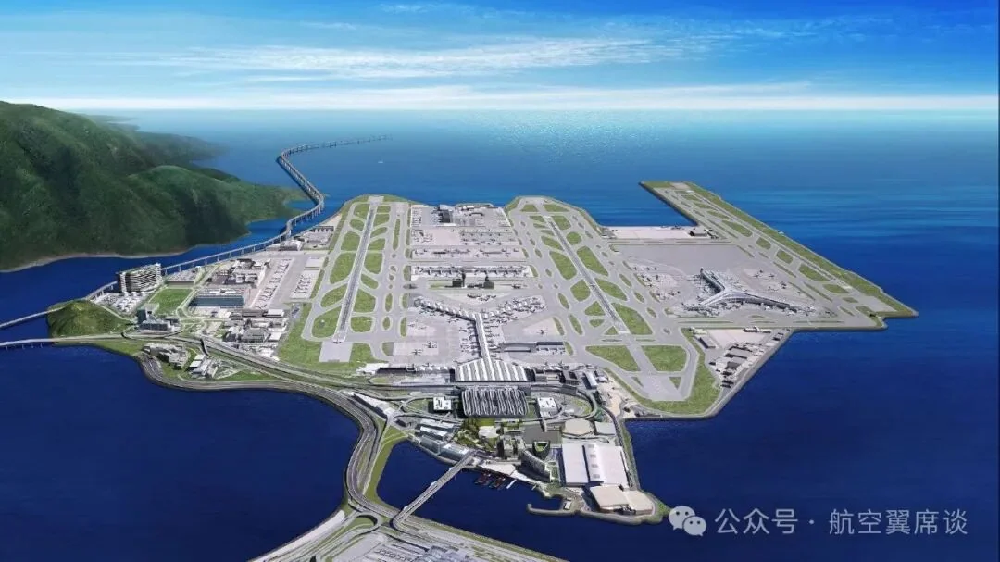

In april 2024 publiceerde Airports Council International (ACI) zijn ranglijst van de tien grootste vrachtluchthavens ter wereld voor 2023, gerangschikt naar vrachtvolume. Hong Kong International bleef eerste met 4,33 miljoen ton, Memphis tweede met 3,88 en Shanghai Pudong derde met 3,44 — de enige grote vrachthub in de top vijf met een groei van dubbele cijfers.

Deze lijst lijkt in niets op de passagiersranking. Het wereldwijde luchtvrachtverkeer daalde in 2023 met 3,1 procent, nog steeds in de nasleep van de tariefpiek uit de pandemiejaren, maar de namen veranderden nauwelijks; wat bewoog, was de volgorde. Anchorage klom van de zesde plaats in 2019 naar de vierde, Miami van de twaalfde naar de zevende, Louisville zakte van de vierde naar de zesde en Taipei Taoyuan van de negende naar de tiende. Vrachtranglijsten volgen handelscycli, niet toeristen.

## 1. De tabel: Hongkong eerste, de tiende plaats op 2,11 miljoen ton

| Rang | Luchthaven | Code | Land/regio | Vracht 2023 (miljoen ton) | Jaar-op-jaar | t.o.v. 2019 | Rang 2019 |
| --- | --- | --- | --- | --- | --- | --- | --- |
| 1 | Hong Kong International | HKG | Hongkong, China | 4,33 | +3,2% | −9,9% | 1 |
| 2 | Memphis International | MEM | Verenigde Staten | 3,88 | −4,0% | −10,2% | 2 |
| 3 | Shanghai Pudong International | PVG | China | 3,44 | +10,4% | −5,3% | 3 |
| 4 | Anchorage International | ANC | Verenigde Staten | 3,38 | −2,4% | +23,1% | 6 |
| 5 | Seoul Incheon International | ICN | Zuid-Korea | 2,74 | −6,9% | −0,7% | 5 |
| 6 | Louisville International | SDF | Verenigde Staten | 2,73 | −11,1% | −2,2% | 4 |
| 7 | Miami International | MIA | Verenigde Staten | 2,53 | +1,0% | +20,7% | 12 |
| 8 | Doha Hamad International | DOH | Qatar | 2,36 | +1,5% | +6,3% | 8 |
| 9 | Los Angeles International | LAX | Verenigde Staten | 2,13 | −14,9% | +1,9% | 13 |
| 10 | Taipei Taoyuan International | TPE | Taiwan, China | 2,11 | −16,8% | −3,2% | 9 |

De cijfers zijn van ACI; de kolom jaar-op-jaar vergelijkt 2023 met 2022 en 't.o.v. 2019' laat zien hoe ver elke luchthaven is hersteld ten opzichte van het jaar vóór de pandemie. De tiende plaats staat op 2,11 miljoen ton, 2,22 miljoen minder dan de eerste — ruwweg de volledige jaarlijkse doorvoer van Pudong — dus de kloof tussen de koplopers en de achtervolgers is groter dan aan de passagierskant.

De eerste plaats van Hongkong draait om structuur. Het is al lang de drukste internationale vrachtluchthaven ter wereld; wederuitvoerhandel en de maakindustrie in de Parelrivierdelta voeden er een dichte reeks vrachtvluchten. Maar 4,33 miljoen ton is nog altijd 9,9 procent onder het niveau van 2019: dit is een eerste plaats die wordt vastgehouden terwijl de luchthaven krimpt, geen terugkeer naar de piek van vóór de pandemie.

## 2. 113 miljoen ton: terug op 95,4 procent van 2019

De wereldwijde vrachtdoorvoer via luchthavens bedroeg in 2023 113 miljoen ton, 3,1 procent minder dan een jaar eerder en gelijk aan 95,4 procent van 2019. Dat herstel ziet er beter uit dan aan de passagierskant, waar veel markten nog onder het niveau van vóór de pandemie liggen.

De daling is niet moeilijk te verklaren. Toen het zeevervoer werd verstoord en de tarieven piekten, verschoof vracht naar de lucht, wat de luchtvrachtsector in 2020–2022 uitzonderlijke vraag opleverde. Naarmate de scheepvaart normaliseerde en de voorraadcyclus zijn beloop had, viel die vervangingsvraag weg; de daling van 3,1 procent in 2023 lijkt daarom meer op een terugkeer naar normaal dan op een instorting. Wat de markt werkelijk laat groeien, zijn grensoverschrijdende e-commercepakketten, die de samenstelling veranderen, niet het totaal: kleinere zendingen, hogere urgentie en meer afhankelijkheid van de buikcapaciteit van widebodyvliegtuigen.

## 3. De top tien verwerkt 26 procent van de wereld

Samen verwerkten de tien grootste vrachtluchthavens in 2023 29,6 miljoen ton, 26 procent van de wereldmarkt. Dat tien luchthavens een kwart van de wereldwijde luchtvracht voor hun rekening nemen, is een hoge concentratie naar de maatstaven van de meeste sectoren.

Dat komt door netwerkeffecten. Het hubmodel vereist dat vracht op één punt samenkomt en weer wordt verdeeld, en hoe sterker de hub, hoe dichter de vrachtvluchten, hoe lager de eenheidskosten en hoe meer verkeer zich daar concentreert. Anchorage is het zuiverste voorbeeld: het is helemaal geen bron van vracht, maar ligt op de positie van technische stop op transpacifische routes, en dat volstaat voor een vierde plaats met 3,38 miljoen ton en een groei van 23,1 procent ten opzichte van 2019 — het grootste herstel ten opzichte van vóór de pandemie in de top tien. Doha volgt dezelfde logica in het Midden-Oosten: geen producent, maar een plek waar widebodyvrachtvliegtuigen Zuid-Aziatisch, Europees en Afrikaans verkeer verbinden, waardoor een groot deel van zijn 2,36 miljoen ton niet uit Qatar afkomstig is en ook niet daarnaartoe bestemd is.

## 4. Acht van de tien in China of de VS

Vijf van de tien zijn Amerikaans en drie Chinees — één op het vasteland, één in Hongkong, één in Taiwan — samen goed voor acht plaatsen. Het patroon is duidelijk: luchtvrachtvolume is gekoppeld aan de omvang en structuur van een economie. De Verenigde Staten zijn de grootste economie ter wereld en bezetten de helft van de lijst; China heeft drie luchthavens, die de maakindustrie op het vasteland, de wederuitvoer via Hongkong en de Taiwanese elektronicaketen bestrijken.

Bekijk de acht als één toeleveringsketen en de arbeidsverdeling wordt duidelijk. Memphis is de wereldwijde hub van FedEx en Louisville is Worldport van UPS; hun tonnage komt uit het verzamelen en opnieuw verzenden van pakketten, niet uit lokale fabrieken. Los Angeles en Miami zijn toegangspoorten, de eerste voor transpacifische stromen, de tweede voor Latijns-Amerika. Anchorage is een stop voor brandstof en bemanning. Aan Chinese kant zijn Hongkong en Shanghai Pudong deuren voor maakindustrie en wederuitvoer, de ene voor de Parelrivierdelta, de andere voor de Yangtzedelta, beide sterk afhankelijk van elektronica, machines en grensoverschrijdende e-commerce. Anders gezegd: de vijf Amerikaanse luchthavens organiseren vooral vrachtstromen, terwijl de drie Chinese tegelijk herkomst en toegangspoort zijn.

Dat verklaart ook waarom de volgorde in 2023 zo sterk verschoof. Toen vervangingsvracht terugging naar zee, hielden luchthavens met een sterke mix van expres- en e-commercevracht stand, terwijl luchthavens met meer algemene vracht het lieten afweten. Miami (+1,0 procent) en Doha (+1,5 procent) bleven stabiel; Los Angeles (−14,9 procent) en Taipei Taoyuan (−16,8 procent) daalden het hardst. Het verschil zat niet in de capaciteit van de luchthaven, maar in de goederen erachter. De concentratie roept ook een strategische vraag op voor alle anderen: als een kwart van de wereldwijde luchtvracht via tien luchthavens gaat, concurreren de overige hubs om een dunne plak aansluitend verkeer.

## 5. Vracht- en passagiersranglijsten zijn twee verschillende logica's

Dezelfde luchthaven kan op beide lijsten heel verschillend staan. Shanghai Pudong was in 2023 derde ter wereld voor vracht en 22e voor passagiers; Taipei Taoyuan was tiende voor vracht en stond buiten de top 35 voor passagiers. Vracht meet het vermogen om goederen te verplaatsen, passagiers het vermogen om mensen te verplaatsen, en beide berusten op totaal verschillende voorzieningen, verkeersrechten en vraagbronnen.

Voor een reiziger is de nuttige lezing de trend, niet de ranglijst. Stijgende vrachtvolumes betekenen meestal dat lokale productieorders en export aantrekken, en dat vrachtvluchten — en dus buikcapaciteit — talrijker zijn. Dalende volumes zijn vaak eerder zichtbaar dan de economische cijfers. Zie de tabel als een gezondheidscheck van de handelscyclus, niet als een ranglijst van luchthavens. Niets erin zegt iets over de dienstverlening: uiterste aanlevertijden, koelketenbehandeling, verblijftijd bij de douane en vrachtwagenverbindingen bepalen of een expediteur vracht daadwerkelijk via een bepaalde luchthaven stuurt, en geen daarvan staat in een tonnagecijfer.

## 6. De update van 2025: 128,9 miljoen ton

Gegevens die in 2026 werden gepubliceerd, zetten het wereldwijde luchtvrachtvolume in 2025 op 128,9 miljoen ton, 2,9 procent meer dan een jaar eerder, waarbij hubs in Azië-Pacific opnieuw de top van de ranglijst domineerden ([Cargo Newswire](https://cargonewswire.com/global-air-cargo-hits-128-9-million-tonnes-in-2025-as-asia-pacific-hubs-dominate-world-rankings/)). Ten opzichte van 113 miljoen ton in 2023 heeft de sector de correctie na de pandemie duidelijk achter zich gelaten; grensoverschrijdende e-commercepakketten blijven de belangrijkste groeibron.

De tabel voor 2023 blijft nuttig: die legt het eerste jaar na de tariefpiek vast en verklaart waarom Hongkong, Shanghai Pudong en Anchorage moeilijk van hun plek te stoten zijn. De volledige top tien van 2025 moet uit ACI en de afzonderlijke luchthavens komen; de twee tabellen samen lezen geeft een beter beeld van de trend dan elk jaar afzonderlijk.

## Gerelateerde links

- **Op deze site**: [Hong Kong International (HKG)](/airport/HKG), [Shanghai Pudong (PVG)](/airport/PVG), [Seoul Incheon (ICN)](/airport/ICN), [Miami International (MIA)](/airport/MIA), [Doha Hamad (DOH)](/airport/DOH), [Los Angeles (LAX)](/airport/LAX)
- **Landpagina's**: [China (CN)](/country/CN), [Verenigde Staten (US)](/country/US)
- **Wikipedia**: [Hong Kong International Airport](https://en.wikipedia.org/wiki/Hong_Kong_International_Airport), [Shanghai Pudong International Airport](https://en.wikipedia.org/wiki/Shanghai_Pudong_International_Airport), [Memphis International Airport](https://en.wikipedia.org/wiki/Memphis_International_Airport), [Incheon International Airport](https://en.wikipedia.org/wiki/Incheon_International_Airport)
- **Baidu Baike**: [Hong Kong International Airport](https://baike.baidu.com/item/%E9%A6%99%E6%B8%AF%E5%9B%BD%E9%99%85%E6%9C%BA%E5%9C%BA), [Memphis International Airport](https://baike.baidu.com/item/%E5%AD%9F%E8%8F%B2%E6%96%AF%E5%9B%BD%E9%99%85%E6%9C%BA%E5%9C%BA)

Bron afbeelding: ACI-gegevens, samengesteld door Aviation Viewpoint. Definities van vracht (of doorvoervracht en post al dan niet worden meegerekend) kunnen per luchthaven verschillen; controleer de gepubliceerde cijfers van ACI voordat u een ranglijst citeert.
