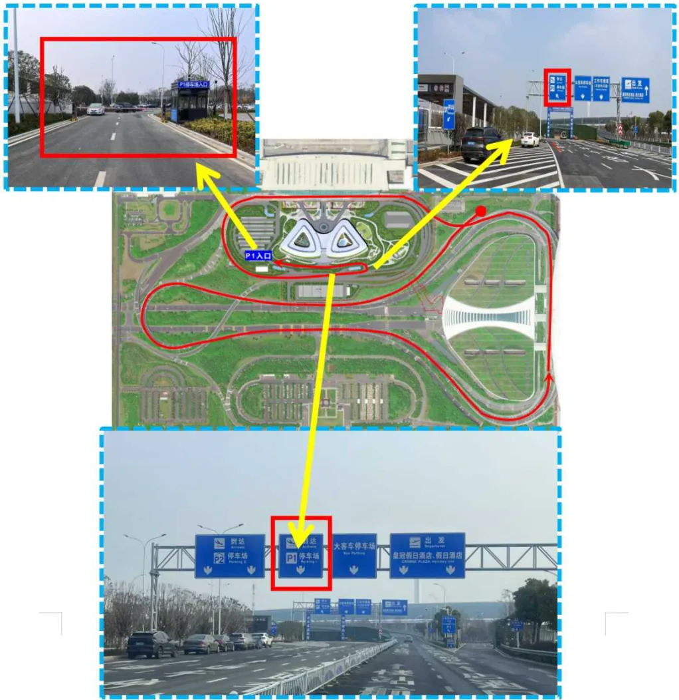

গ্রীষ্মের ছুটির শেষ আর ফেরার ভিড় একসঙ্গে পড়ায় উহান তিয়ানহে আন্তর্জাতিক বিমানবন্দর এখন সবচেয়ে ব্যস্ত। এই গাইডে টার্মিনাল ২ ও ৩-এর ব্যবহারিক খুঁটিনাটি চার ভাগে দেওয়া হলো — **অভ্যন্তরীণ প্রস্থান**, **অভ্যন্তরীণ আগমন**, **বিমানবন্দরে আসা-যাওয়া** এবং **পার্কিং**।

তিয়ানহেতে দুটি টার্মিনাল চালু আছে: **টার্মিনাল ৩** (প্রস্থান লেভেল ৪-এ, আগমন লেভেল ২-এ) এবং **টার্মিনাল ২** (প্রস্থান লেভেল ২-এ, আগমন লেভেল ১-এ)। বেরোনোর আগে নিশ্চিত করুন আপনার ফ্লাইট কোন টার্মিনাল ব্যবহার করে; **এয়ারপোর্ট রুট ৩** দুটির মধ্যে শাটল চালায়। এখানে দেওয়া টার্মিনাল প্ল্যান ও পার্কিং রুটের চিত্র বিমানবন্দরের অফিসিয়াল ওয়েবসাইট থেকে নেওয়া।

## ১. অভ্যন্তরীণ প্রস্থান

### টার্মিনাল ৩

1. **টার্মিনালে পৌঁছান।** ২ ঘণ্টা আগে পৌঁছে এয়ারলাইনের কাছে টার্মিনাল নিশ্চিত করুন। টার্মিনাল ৩-এ প্রস্থান তলা হলো লেভেল ৪।
2. **চেক-ইন করুন ও ব্যাগ জমা দিন।** চেক-ইন আইল্যান্ড E, F, J ও K চেক-ইন ও ব্যাগেজ সামলায়। প্রস্থানের **৩০ মিনিট** আগে চেক-ইন বন্ধ হয়, তাই যথেষ্ট সময় রাখুন। স্ব-পরিষেবা চেক-ইন ও ব্যাগ ড্রপ আছে, তবু আগে থেকে অনলাইনে চেক-ইন করে রাখা ভালো।
3. **নিরাপত্তা।** নিরাপত্তা কর্মীর জন্য বোর্ডিং পাস ও আইডি বা পাসপোর্ট তৈরি রাখুন।
4. **অপেক্ষা ও বোর্ডিং।** ফ্লাইট তথ্য স্ক্রিন ও সাইনবোর্ড অনুসরণ করুন, এবং প্রস্থানের **৩০-৪০ মিনিট** আগে গেটে উপস্থিত থাকুন।

### টার্মিনাল ২

1. **টার্মিনালে পৌঁছান।** ২ ঘণ্টা আগে পৌঁছে এয়ারলাইনের কাছে টার্মিনাল নিশ্চিত করুন। টার্মিনাল ২-এ প্রস্থান তলা হলো লেভেল ২।
2. **চেক-ইন করুন ও ব্যাগ জমা দিন।** চেক-ইন আইল্যান্ড A ও B চেক-ইন ও ব্যাগেজ সামলায়। প্রস্থানের **৩০ মিনিট** আগে চেক-ইন বন্ধ হয়, তাই যথেষ্ট সময় রাখুন। স্ব-পরিষেবা চেক-ইন ও ব্যাগ ড্রপ আছে, তবু আগে থেকে অনলাইনে চেক-ইন করে রাখা ভালো।
3. **নিরাপত্তা।** নিরাপত্তা কর্মীর জন্য বোর্ডিং পাস ও আইডি বা পাসপোর্ট তৈরি রাখুন।
4. **অপেক্ষা ও বোর্ডিং।** ফ্লাইট তথ্য স্ক্রিন ও সাইনবোর্ড অনুসরণ করুন, এবং প্রস্থানের **৩০-৪০ মিনিট** আগে গেটে উপস্থিত থাকুন।

## ২. অভ্যন্তরীণ আগমন

### টার্মিনাল ৩

1. **আগমন।** কেউ গ্রহণ করতে এলে আগেই তাকে বলে দিন আপনার ফ্লাইট কোন টার্মিনালে নামবে। টার্মিনাল ৩-এ আগমন তলা হলো লেভেল ২।
2. **ব্যাগ সংগ্রহ করুন।** তথ্য স্ক্রিনে আপনার ফ্লাইটের ক্যারোসেল খুঁজুন। ভুলে ব্যাগ চলে যাওয়া রোধে কর্মীরা ব্যাগেজ ট্যাগের সঙ্গে টিকিটের বারকোড মিলিয়ে আকস্মিক পরীক্ষা করতে পারেন, তাই ব্যাগেজ রসিদ হাতের কাছে রাখুন এবং সহযোগিতা করুন।
3. **বিমানবন্দর ছাড়া।** নিজের নিরাপত্তার জন্য সীমাবদ্ধ এলাকার বাইরে অফিসিয়াল বিমানবন্দর আইডি নেই এমন কারও কাছ থেকে কোনো সেবা নেবেন না, এবং লাইসেন্সহীন, ভাড়া আদায়কারী চালকের গাড়িতে উঠবেন না।

### টার্মিনাল ২

1. **আগমন।** কেউ গ্রহণ করতে এলে আগেই তাকে বলে দিন আপনার ফ্লাইট কোন টার্মিনালে নামবে। টার্মিনাল ২-এ আগমন তলা হলো লেভেল ১।
2. **ব্যাগ সংগ্রহ করুন।** তথ্য স্ক্রিনে আপনার ফ্লাইটের ক্যারোসেল খুঁজুন, এবং একইভাবে যেকোনো আকস্মিক পরীক্ষায় সহযোগিতা করুন।
3. **বিমানবন্দর ছাড়া।** সীমাবদ্ধ এলাকার বাইরে অফিসিয়াল বিমানবন্দর আইডি নেই এমন কারও কাছ থেকে কোনো সেবা নেবেন না, এবং লাইসেন্সহীন গাড়িতে উঠবেন না।

## ৩. বিমানবন্দরে আসা-যাওয়া

তিয়ানহেতে স্থল পরিবহন গড়ে উঠেছে **বিমানবন্দর বাস**, **মেট্রো লাইন ২**, **এয়ারপোর্ট রুট ৩** ও **রেল স্টেশন**কে ঘিরে। দুটি টার্মিনালের মধ্যে এবং টার্মিনালগুলোর সঙ্গে ট্রান্সপোর্ট সেন্টারের প্রতিটি সংযোগে সাইনবোর্ড আছে।

### বিমানবন্দর বাস

- **সময়:** প্রতিদিন ০৮:৩০ থেকে শেষ ফ্লাইট পর্যন্ত; ‘তিয়ানহে ছাংশিং’ (天河畅行) মিনি-প্রোগ্রামের মাধ্যমে অনলাইনে অর্ডার করুন।
- **ফ্রিকোয়েন্সি:** প্রতি ৩০ মিনিটে, শেষ ফ্লাইট পর্যন্ত।
- **কাউন্টারে টিকিট:** টার্মিনাল ২, লেভেল ১, গেট ৯ থেকে ১০; টার্মিনাল ৩, গেট ১২-এর ভেতরে।
- **গ্রাহক সেবা:** 13387631827

| রুট | স্টপ (ভাড়া) |
| --- | --- |
| লাইন ১ | T3 / T2 → ইউয়ানবোইউয়ান নর্থ (মেট্রো, ১০ ইউয়ান) → মিনহ্যাং আবাসিক এলাকা (১০ ইউয়ান) → হানকো রেলওয়ে স্টেশন (১২ ইউয়ান) → CBD ওয়েলথ সেন্টার, ফানহু (১২ ইউয়ান) → ছিংনিয়ান রোড (১২ ইউয়ান) → গুছিনতাই (১৫ ইউয়ান) → শোউই স্কোয়ার (১৮ ইউয়ান) → উছাং রেলওয়ে স্টেশন (২০ ইউয়ান) → উশাং ড্রিম প্লাজা (২০ ইউয়ান; এই স্টপের টিকিট রাত ২১:৩০-এ বিক্রি শুরু হয়) |
| লাইন ২ | T3 / T2 → ইয়াংশাহু (১০ ইউয়ান) → জিনছিয়াও ইয়ন (১০ ইউয়ান) → হুয়াংফু রোড / গংনংবিং রোড (১২ ইউয়ান) → শুডং শপিং মল (১৫ ইউয়ান) → ইউয়েছিয়াজুই (১৫ ইউয়ান) → ডংতিং (১৮ ইউয়ান) → ছুহে হান স্ট্রিট (২০ ইউয়ান) → হংশান স্কোয়ার (২০ ইউয়ান) → উহান রেলওয়ে স্টেশন (৪৫ ইউয়ান) |
| এয়ার-রেল সংযোগ | উহান তিয়ানহে আন্তর্জাতিক বিমানবন্দর ⇄ উহান রেলওয়ে স্টেশন, নন-স্টপ ও বিনামূল্যে (সাময়িক, ০৯:২৫–১৭:৫৫); টিকিট ও ওঠার জায়গা বিমানবন্দর বাসের মতোই |

### দূরপাল্লার কোচ

ছাড়ার সময় ও রুটের জন্য গ্রাহক সেবা নম্বরে ফোন করুন; কাউন্টারে বিক্রি হওয়া টিকিটই চূড়ান্ত সময়সূচি। বিমানবন্দর বাসের মতোই জায়গায় টিকিট পাওয়া যায় (টার্মিনাল ২, লেভেল ১, গেট ৯ থেকে ১০; টার্মিনাল ৩, গেট ১২-এর ভেতরে); ফোন 13387631827।

### মেট্রো লাইন ২

- **সময়:** কর্মদিবসে ০৬:০০–২৩:০০, সরকারি ছুটির দিনে ০৬:৩০–২৩:০০; ট্রেন প্রতি ৫-৮ মিনিটে।
- উহান মেট্রোর নিজস্ব ঘোষণাই চূড়ান্ত।

বিমানবন্দরমুখী ও বিমানবন্দর থেকে রুট:

- **T3 প্রস্থানের দিকে:** মেট্রো লাইন ২-এ তিয়ানহে এয়ারপোর্ট স্টেশন → এক্সিট B → ট্রান্সপোর্ট সেন্টার লেভেল ২, লিংক করিডোর ১, ২ ও ৩ → টার্মিনাল ৩, লেভেল ৪ প্রস্থান হল।
- **T3 আগমন থেকে:** টার্মিনাল ৩, লেভেল ২ আগমন হল → লেভেল ২-এর গেট ৬, ৭ ও ৮ → মেট্রো এক্সিট B → মেট্রো লাইন ২।
- **T2 প্রস্থানের দিকে:** মেট্রো লাইন ২-এ তিয়ানহে এয়ারপোর্ট স্টেশন → এক্সিট B → ট্রান্সপোর্ট সেন্টার লেভেল ২, লিংক করিডোর ১, ২ ও ৩ → টার্মিনাল ৩-এর গেট ১২-এর বাইরে → এয়ারপোর্ট রুট ৩-এ বদল করুন → টার্মিনাল ২-এর গেট ৭ → লেভেল ২ প্রস্থান হল।
- **T2 আগমন থেকে:** টার্মিনাল ২, লেভেল ১ আগমন হল → লেভেল ১-এ গেট ১০-এর স্টপ → এয়ারপোর্ট রুট ৩-এ বদল করুন → টার্মিনাল ৩-এর গেট ১২ → ট্রান্সপোর্ট সেন্টার লেভেল ২, লিংক করিডোর ১, ২ ও ৩ → মেট্রো এক্সিট B → মেট্রো লাইন ২।

### এয়ারপোর্ট রুট ৩ (টার্মিনাল শাটল)

- **স্টপ:** টার্মিনাল ৩ গেট ১২ (নামানো ও তোলা) → টার্মিনাল ২, লেভেল ১, গেট ৭ (নামানো) → টার্মিনাল ২, লেভেল ১, গেট ১০ (তোলা) → টার্মিনাল ৩ গেট ১২ (নামানো ও তোলা)।
- **ফ্রিকোয়েন্সি:** মোটামুটি প্রতি ৫ মিনিটে।
- **সময়:** ০৬:০০–২৩:০০।

### রেল

তিয়ানহে এয়ারপোর্ট স্টেশন থেকে ট্রেন উহানের হানকো ও উছাং স্টেশনে এবং প্রদেশের কয়েকটি শহরে থামে; রেল পরিচালকের নিজস্ব ঘোষণাই চূড়ান্ত।

- **T3 প্রস্থানের দিকে:** তিয়ানহে এয়ারপোর্ট স্টেশনে পৌঁছান → এক্সিট C → ট্রান্সপোর্ট সেন্টার লেভেল ২, লিংক করিডোর ১, ২ ও ৩ → টার্মিনাল ৩, লেভেল ৪ প্রস্থান হল।
- **T3 আগমন থেকে:** টার্মিনাল ৩, লেভেল ২ আগমন হল → লেভেল ২-এর গেট ৬, ৭ ও ৮ → এক্সিট C → তিয়ানহে এয়ারপোর্ট স্টেশন।
- **T2 প্রস্থানের দিকে:** তিয়ানহে এয়ারপোর্ট স্টেশনে পৌঁছান → মেট্রো এক্সিট B → ট্রান্সপোর্ট সেন্টার লেভেল ২, লিংক করিডোর ১, ২ ও ৩ → টার্মিনাল ৩-এর গেট ১২-এর বাইরে → এয়ারপোর্ট রুট ৩-এ বদল করুন → টার্মিনাল ২-এর গেট ৭ → লেভেল ২ প্রস্থান হল।
- **T2 আগমন থেকে:** টার্মিনাল ২, লেভেল ১ আগমন হল → লেভেল ১-এ গেট ১০-এর স্টপ → এয়ারপোর্ট রুট ৩-এ বদল করুন → টার্মিনাল ৩-এর গেট ১২ → ট্রান্সপোর্ট সেন্টার লেভেল ২, লিংক করিডোর ১, ২ ও ৩ → এক্সিট C → তিয়ানহে এয়ারপোর্ট স্টেশন।

### গাড়িতে

**শহর থেকে**

| গন্তব্য | রুট |
| --- | --- |
| T2-তে নামানো | কংগাং অ্যাভিনিউ ধরে সোজা, ডানে টার্মিনাল ২-এর র্যাম্পে উঠে টার্মিনাল ২-এর লুপ রোডে ঢুকুন, ডানে ভায়াডাক্টে উঠে টার্মিনাল ২-এর প্রস্থান লেভেলে নামান |
| T2-তে পার্কিং | কংগাং অ্যাভিনিউ ধরে সোজা, ডানে টার্মিনাল ২-এর র্যাম্পে উঠে টার্মিনাল ২-এর লুপ রোডে ঢুকুন, বাঁয়ে P1 (টার্মিনাল ২ সারফেস কার পার্ক) বা P2 (টার্মিনাল ২ ভূগর্ভস্থ কার পার্ক)-এ ঢুকুন |
| T3-তে নামানো | কংগাং অ্যাভিনিউ ধরে সোজা, ডানে টার্মিনাল ৩-এর ফ্লাইওভার র্যাম্পে উঠে টার্মিনাল ৩-এর প্রস্থান লেভেলে নামান |
| T3-তে পার্কিং | কংগাং অ্যাভিনিউ ধরে সোজা, তারপর মাঝের লেনে P7 (টার্মিনাল ৩ ভূগর্ভস্থ কার পার্ক) |
| ট্রান্সপোর্ট সেন্টার কার পার্ক | কংগাং অ্যাভিনিউ ধরে সোজা, তারপর বাঁ লেনে P6 (ট্রান্সপোর্ট সেন্টার কার পার্ক) |
| যাত্রী সেবা কমপ্লেক্স (ক্রাউন প্লাজা, হলিডে ইন) | কংগাং অ্যাভিনিউ ধরে সোজা, ডানে টার্মিনাল ২-এর র্যাম্পে উঠে টার্মিনাল ২-এর লুপ রোডে ঢুকুন, বাঁয়ে P2 (টার্মিনাল ২ ভূগর্ভস্থ কার পার্ক)-এ ঢুকুন |

**হুয়াংপি থেকে**

| গন্তব্য | রুট |
| --- | --- |
| T2-তে নামানো | কংগাং অ্যাভিনিউ ধরে সোজা কংগাং টানেলে ঢুকুন, টানেল থেকে ডানে বেরিয়ে র্যাম্পে উঠে ইউ-টার্ন নিন, টার্মিনাল ৩-এর প্রস্থান লেভেল পর্যন্ত উঠুন, ডানে টার্মিনাল ৩ ও ২-এর সংযোগ সেতুতে উঠে টার্মিনাল ২-এর প্রস্থান লেভেলে নামান |
| T2-তে পার্কিং | কংগাং অ্যাভিনিউ ধরে সোজা কংগাং টানেলে ঢুকুন, টানেল থেকে ডানে বেরিয়ে র্যাম্পে উঠে ইউ-টার্ন নিন, টার্মিনাল ৩-এর প্রস্থান লেভেল পর্যন্ত উঠুন, ডানে টার্মিনাল ৩ ও ২-এর সংযোগ সেতুতে উঠে টার্মিনাল ২-এর লুপ রোড ধরে বাঁয়ে P1 বা P2-এ ঢুকুন |
| T3-তে নামানো | কংগাং অ্যাভিনিউ ধরে সোজা কংগাং টানেলে ঢুকুন, টানেল থেকে ডানে বেরিয়ে র্যাম্পে উঠে ইউ-টার্ন নিয়ে টার্মিনাল ৩-এর প্রস্থান লেভেল পর্যন্ত উঠে সেখানেই নামান |
| T3-তে পার্কিং | কংগাং অ্যাভিনিউ ধরে সোজা কংগাং টানেলে ঢুকুন, টানেল থেকে ডানে বেরিয়ে র্যাম্পে উঠে ইউ-টার্ন নিয়ে কংগাং অ্যাভিনিউতে ফিরুন, তারপর মাঝের লেনে P7 (টার্মিনাল ৩ ভূগর্ভস্থ কার পার্ক) |
| ট্রান্সপোর্ট সেন্টার কার পার্ক | কংগাং অ্যাভিনিউ ধরে সোজা কংগাং টানেলে ঢুকুন, টানেল থেকে ডানে বেরিয়ে র্যাম্পে উঠে ইউ-টার্ন নিয়ে কংগাং অ্যাভিনিউতে ফিরুন, তারপর বাঁ লেনে P6 (ট্রান্সপোর্ট সেন্টার কার পার্ক) |
| যাত্রী সেবা কমপ্লেক্স (ক্রাউন প্লাজা, হলিডে ইন) | কংগাং অ্যাভিনিউ ধরে সোজা কংগাং টানেলে ঢুকুন, টানেল থেকে ডানে বেরিয়ে র্যাম্পে উঠে ইউ-টার্ন নিন, টার্মিনাল ৩-এর প্রস্থান লেভেল পর্যন্ত উঠুন, ডানে টার্মিনাল ৩ ও ২-এর সংযোগ সেতুতে উঠে টার্মিনাল ২-এর লুপ রোড ধরে বাঁয়ে P2-এ ঢুকুন |

### ট্যাক্সি

- **টার্মিনাল ২:** লেভেল ১-এ গেট ৭-এর বাইরে; ট্যাক্সি র‍্যাঙ্কে লাইন ধরুন।
- **টার্মিনাল ৩:** লেভেল ১-এ গেট ১২-এর বাইরে; ট্যাক্সি র‍্যাঙ্কে লাইন ধরুন।

### রাইড-হেইলিং

- **টার্মিনাল ২:** লেভেল ১ আগমন হল → লেভেল ১-এ গেট ৯ → P1 (টার্মিনাল ২ সারফেস কার পার্ক)-এ পিক-আপ → মধ্য উহান।
- **টার্মিনাল ৩:** লেভেল ২ আগমন হল → লেভেল ২-এর গেট ৬, ৭ ও ৮ → ট্রান্সপোর্ট সেন্টার লেভেল ১-এর রাইড-হেইলিং পিক-আপ পয়েন্ট → মধ্য উহান।

## ৪. পার্কিং

### টার্মিনাল ৩

**১. ভূগর্ভস্থ কার পার্ক (P7)**

S19 / S18 → কংগাং অ্যাভিনিউ → T3 ভূগর্ভস্থ কার পার্ক → টার্মিনাল ৩, লেভেল ৪ প্রস্থান হল (হাঁটাপথ প্রায় ৫ মিনিট)।

B1 ও B2 লেভেলে ৫৪৯টি স্থান, শুধু ছোট গাড়ির জন্য।

**২. ট্রান্সপোর্ট সেন্টার কার পার্ক (P6)**

S19 / S18 → কংগাং অ্যাভিনিউ → ট্রান্সপোর্ট সেন্টার কার পার্ক → ট্রান্সপোর্ট সেন্টার লেভেল ২, লিংক করিডোর ১, ২ ও ৩ → টার্মিনাল ৩, লেভেল ২-এর গেট ৮, ৭ ও ৬ → টার্মিনাল ৩, লেভেল ৪ প্রস্থান হল (হাঁটাপথ প্রায় ১০ মিনিট)।

B1 লেভেল, ভূতল ও ভূতল ২ মিলিয়ে ৩৩০০টি স্থান।

### টার্মিনাল ২

**১. শহর থেকে**

কংগাং অ্যাভিনিউ ধরে সোজা, ডানে টার্মিনাল ২-এর র্যাম্পে উঠে টার্মিনাল ২-এর লুপ রোডে ঢুকুন।

**P1-এর দিকে (টার্মিনাল ২ সারফেস কার পার্ক):** টার্মিনাল ২-এর লুপ রোড ধরে বাঁয়ে P1-এ ঢুকুন।

**P2-এর দিকে (টার্মিনাল ২ ভূগর্ভস্থ কার পার্ক):** টার্মিনাল ২-এর লুপ রোড ধরে বাঁয়ে P2-এ ঢুকুন।

**২. হুয়াংপি থেকে**

কংগাং অ্যাভিনিউ ধরে সোজা কংগাং টানেলে ঢুকুন, টানেল থেকে ডানে বেরিয়ে র্যাম্পে উঠে ইউ-টার্ন নিন, টার্মিনাল ৩-এর প্রস্থান লেভেল পর্যন্ত উঠুন, তারপর ডানে টার্মিনাল ৩ ও ২-এর সংযোগ সেতুতে উঠুন।

**P1-এর দিকে (টার্মিনাল ২ সারফেস কার পার্ক):** টার্মিনাল ২-এর লুপ রোড ধরে বাঁয়ে P1-এ ঢুকুন।

**P2-এর দিকে (টার্মিনাল ২ ভূগর্ভস্থ কার পার্ক):** টার্মিনাল ২-এর লুপ রোড ধরে বাঁয়ে P2-এ ঢুকুন।

## সংশ্লিষ্ট লিংক

- **এই সাইটে**: [চীন (CN)](/country/CN)
- **উইকিপিডিয়া**: [উহান তিয়ানহে আন্তর্জাতিক বিমানবন্দর](https://en.wikipedia.org/wiki/Wuhan_Tianhe_International_Airport)
- **বাইদু বাইকে**: [উহান তিয়ানহে আন্তর্জাতিক বিমানবন্দর](https://baike.baidu.com/item/%E6%AD%A6%E6%B1%89%E5%A4%A9%E6%B2%B3%E5%9B%BD%E9%99%85%E6%9C%BA%E5%9C%BA)
