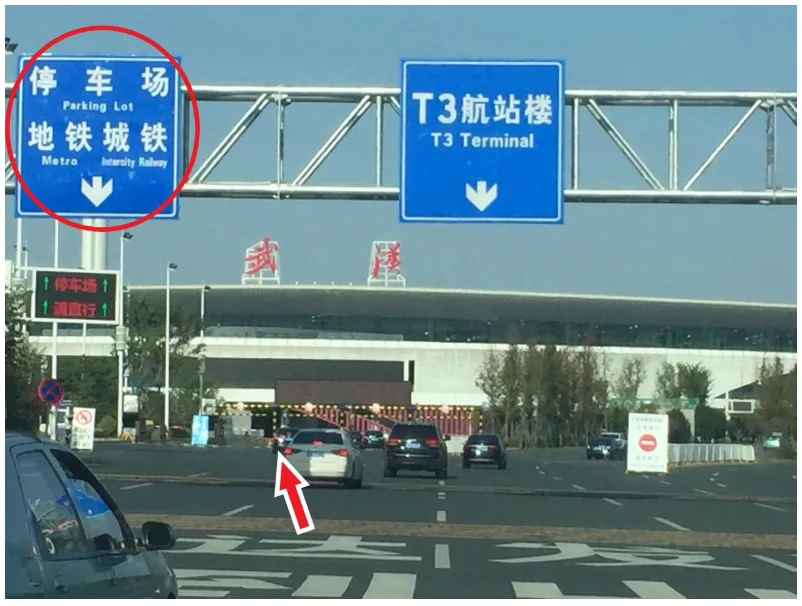
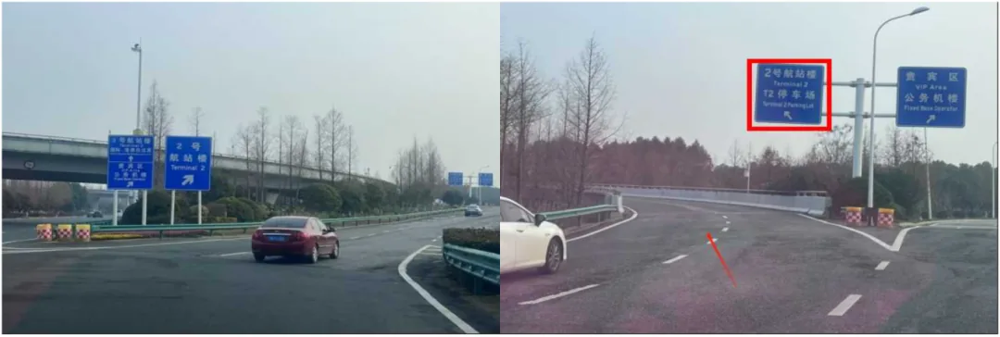
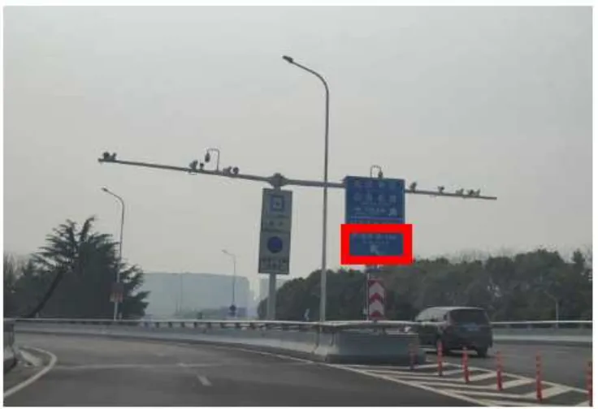

गर्मियों की छुट्टियों का अंत और वापसी की भीड़ एक साथ पड़ने से वुहान तियानहे अंतर्राष्ट्रीय हवाई अड्डा अपने सबसे व्यस्त दौर में है। यह गाइड टर्मिनल 2 और 3 की व्यावहारिक जानकारी चार हिस्सों में देती है — **घरेलू प्रस्थान**, **घरेलू आगमन**, **हवाई अड्डे तक आना-जाना**, और **पार्किंग**।

तियानहे में दो टर्मिनल चालू हैं: **टर्मिनल 3** (स्तर 4 पर प्रस्थान, स्तर 2 पर आगमन) और **टर्मिनल 2** (स्तर 2 पर प्रस्थान, स्तर 1 पर आगमन)। निकलने से पहले जांच लें कि आपकी उड़ान किस टर्मिनल से है; **एयरपोर्ट रूट 3** दोनों टर्मिनलों के बीच शटल चलाता है। यहां दिए टर्मिनल प्लान और पार्किंग मार्ग के चित्र हवाई अड्डे की आधिकारिक वेबसाइट से हैं।

## 1. घरेलू प्रस्थान

### टर्मिनल 3

1. **टर्मिनल पहुंचें।** 2 घंटे पहले पहुंचें और अपनी एयरलाइन से टर्मिनल की पुष्टि करें। टर्मिनल 3 में प्रस्थान स्तर 4 पर है।
2. **चेक-इन करें और सामान जमा करें।** चेक-इन आइलैंड E, F, J और K चेक-इन और सामान संभालते हैं। चेक-इन उड़ान रवाना होने से **30 मिनट** पहले बंद हो जाता है, इसलिए पर्याप्त समय रखें। सेल्फ-सर्विस चेक-इन और बैग ड्रॉप उपलब्ध हैं, फिर भी पहले ऑनलाइन चेक-इन कर लेना बेहतर है।
3. **सुरक्षा जांच।** सुरक्षा अधिकारी के लिए बोर्डिंग पास और पहचान पत्र या पासपोर्ट तैयार रखें।
4. **प्रतीक्षा करें और बोर्ड करें।** उड़ान सूचना स्क्रीन और संकेतों का पालन करें, और उड़ान रवाना होने से **30–40 मिनट** पहले अपने गेट पर पहुंचें।

### टर्मिनल 2

1. **टर्मिनल पहुंचें।** 2 घंटे पहले पहुंचें और अपनी एयरलाइन से टर्मिनल की पुष्टि करें। टर्मिनल 2 में प्रस्थान स्तर 2 पर है।
2. **चेक-इन करें और सामान जमा करें।** चेक-इन आइलैंड A और B चेक-इन और सामान संभालते हैं। चेक-इन उड़ान रवाना होने से **30 मिनट** पहले बंद हो जाता है, इसलिए पर्याप्त समय रखें। सेल्फ-सर्विस चेक-इन और बैग ड्रॉप उपलब्ध हैं, फिर भी पहले ऑनलाइन चेक-इन कर लेना बेहतर है।
3. **सुरक्षा जांच।** सुरक्षा अधिकारी के लिए बोर्डिंग पास और पहचान पत्र या पासपोर्ट तैयार रखें।
4. **प्रतीक्षा करें और बोर्ड करें।** उड़ान सूचना स्क्रीन और संकेतों का पालन करें, और उड़ान रवाना होने से **30–40 मिनट** पहले अपने गेट पर पहुंचें।

## 2. घरेलू आगमन

### टर्मिनल 3

1. **आगमन।** अगर कोई आपको लेने आ रहा है, तो उसे पहले ही बता दें कि आपकी उड़ान किस टर्मिनल पर उतरेगी। टर्मिनल 3 में आगमन स्तर 2 पर है।
2. **अपना सामान लें।** सूचना स्क्रीन पर अपनी उड़ान का कैरोसेल देखें। गलती से कोई बैग न उठा ले जाए, इसके लिए कर्मचारी बैगेज टैग का मिलान आपके टिकट के बारकोड से कर सकते हैं, इसलिए अपनी बैगेज रसीद पास रखें और सहयोग करें।
3. **हवाई अड्डे से बाहर निकलना।** अपनी सुरक्षा के लिए प्रतिबंधित क्षेत्र के बाहर बिना आधिकारिक हवाई अड्डा पहचान पत्र वाले किसी भी व्यक्ति से सेवा न लें, और बिना लाइसेंस वाले, ग्राहक फुसलाने वाले ड्राइवरों की सवारी न लें।

### टर्मिनल 2

1. **आगमन।** अगर कोई आपको लेने आ रहा है, तो उसे पहले ही बता दें कि आपकी उड़ान किस टर्मिनल पर उतरेगी। टर्मिनल 2 में आगमन स्तर 1 पर है।
2. **अपना सामान लें।** सूचना स्क्रीन पर अपनी उड़ान का कैरोसेल देखें, और इसी तरह किसी भी जांच में सहयोग करें।
3. **हवाई अड्डे से बाहर निकलना।** प्रतिबंधित क्षेत्र के बाहर बिना आधिकारिक हवाई अड्डा पहचान पत्र वाले किसी भी व्यक्ति से सेवा न लें, और बिना लाइसेंस वाली सवारी न लें।

## 3. हवाई अड्डे तक आना-जाना

तियानहे में भूमि परिवहन **हवाई अड्डा बसों**, **मेट्रो लाइन 2**, **एयरपोर्ट रूट 3** और **रेल स्टेशन** के इर्द-गिर्द बना है। दोनों टर्मिनलों के बीच और टर्मिनलों से ट्रांसपोर्ट सेंटर तक हर लिंक पर संकेत लगे हैं।

### हवाई अड्डा बसें

- **समय:** रोज़ 08:30 से अंतिम उड़ान तक; "天河畅行" (तियानहे चांगशिंग) मिनी-प्रोग्राम से ऑनलाइन ऑर्डर करें।
- **आवृत्ति:** हर 30 मिनट पर, अंतिम उड़ान तक।
- **काउंटर पर टिकट:** टर्मिनल 2, स्तर 1, गेट 9 से 10; टर्मिनल 3, गेट 12 के अंदर।
- **ग्राहक सेवा:** 13387631827

| मार्ग | स्टॉप (किराया) |
| --- | --- |
| लाइन 1 | T3 / T2 → युआनबोयुआन नॉर्थ (मेट्रो, ¥10) → मिनहांग आवासीय क्षेत्र (¥10) → हांकौ रेलवे स्टेशन (¥12) → सीबीडी वेल्थ सेंटर, फानहु (¥12) → क्विंगनियन रोड (¥12) → गुकिंताई (¥15) → शौयी स्क्वायर (¥18) → वुचांग रेलवे स्टेशन (¥20) → वुशांग ड्रीम प्लाज़ा (¥20; इस स्टॉप के टिकट 21:30 पर बिक्री के लिए खुलते हैं) |
| लाइन 2 | T3 / T2 → यांगचाहु (¥10) → जिनचियाओ ईऑन (¥10) → हुआंगपु रोड / गोंगनोंगबिंग रोड (¥12) → श्युदोंग शॉपिंग मॉल (¥15) → युएजियाज़ुई (¥15) → दोंगतिंग (¥18) → चूहे हान स्ट्रीट (¥20) → होंगशान स्क्वायर (¥20) → वुहान रेलवे स्टेशन (¥45) |
| एयर-रेल लिंक | वुहान तियानहे अंतर्राष्ट्रीय हवाई अड्डा ⇄ वुहान रेलवे स्टेशन, बिना रुके और निःशुल्क (अनंतिम, 09:25–17:55); टिकट और बोर्डिंग के स्थान हवाई अड्डा बसों जैसे ही |

### लंबी दूरी की बसें

प्रस्थान के समय और मार्गों के लिए ग्राहक सेवा लाइन पर कॉल करें; काउंटर पर बिक्री ही अंतिम समय-सारणी है। टिकट हवाई अड्डा बसों वाली जगहों (टर्मिनल 2, स्तर 1, गेट 9 से 10; टर्मिनल 3, गेट 12 के अंदर) से या 13387631827 पर खरीदे जा सकते हैं।

### मेट्रो लाइन 2

- **समय:** कार्यदिवसों में 06:00–23:00, सार्वजनिक छुट्टियों में 06:30–23:00; ट्रेनें हर 5–8 मिनट पर।
- वुहान मेट्रो की अपनी घोषणाएं ही अंतिम मानी जाती हैं।

हवाई अड्डे तक और वहां से मार्ग:

- **T3 प्रस्थान के लिए:** मेट्रो लाइन 2 से तियानहे एयरपोर्ट स्टेशन → निकास B → ट्रांसपोर्ट सेंटर स्तर 2, लिंक कॉरिडोर 1, 2 और 3 → टर्मिनल 3, स्तर 4 प्रस्थान हॉल।
- **T3 आगमन से:** टर्मिनल 3, स्तर 2 आगमन हॉल → स्तर 2 पर गेट 6, 7 और 8 → मेट्रो निकास B → मेट्रो लाइन 2।
- **T2 प्रस्थान के लिए:** मेट्रो लाइन 2 से तियानहे एयरपोर्ट स्टेशन → निकास B → ट्रांसपोर्ट सेंटर स्तर 2, लिंक कॉरिडोर 1, 2 और 3 → टर्मिनल 3 के गेट 12 के बाहर → एयरपोर्ट रूट 3 पर ट्रांसफर → टर्मिनल 2 का गेट 7 → स्तर 2 प्रस्थान हॉल।
- **T2 आगमन से:** टर्मिनल 2, स्तर 1 आगमन हॉल → स्तर 1 पर गेट 10 का स्टॉप → एयरपोर्ट रूट 3 पर ट्रांसफर → टर्मिनल 3 का गेट 12 → ट्रांसपोर्ट सेंटर स्तर 2, लिंक कॉरिडोर 1, 2 और 3 → मेट्रो निकास B → मेट्रो लाइन 2।

### एयरपोर्ट रूट 3 (टर्मिनल शटल)

- **स्टॉप:** टर्मिनल 3 गेट 12 (उतारना और चढ़ाना) → टर्मिनल 2, स्तर 1, गेट 7 (उतारना) → टर्मिनल 2, स्तर 1, गेट 10 (चढ़ाना) → टर्मिनल 3 गेट 12 (उतारना और चढ़ाना)।
- **आवृत्ति:** लगभग हर 5 मिनट पर।
- **समय:** 06:00–23:00।

### रेल

तियानहे एयरपोर्ट स्टेशन से ट्रेनें वुहान के हांकौ और वुचांग स्टेशनों तथा प्रांत के कई शहरों पर रुकती हैं; रेल ऑपरेटर की अपनी घोषणाएं ही अंतिम हैं।

- **T3 प्रस्थान के लिए:** तियानहे एयरपोर्ट स्टेशन पहुंचें → निकास C → ट्रांसपोर्ट सेंटर स्तर 2, लिंक कॉरिडोर 1, 2 और 3 → टर्मिनल 3, स्तर 4 प्रस्थान हॉल।
- **T3 आगमन से:** टर्मिनल 3, स्तर 2 आगमन हॉल → स्तर 2 पर गेट 6, 7 और 8 → निकास C → तियानहे एयरपोर्ट स्टेशन।
- **T2 प्रस्थान के लिए:** तियानहे एयरपोर्ट स्टेशन पहुंचें → मेट्रो निकास B → ट्रांसपोर्ट सेंटर स्तर 2, लिंक कॉरिडोर 1, 2 और 3 → टर्मिनल 3 के गेट 12 के बाहर → एयरपोर्ट रूट 3 पर ट्रांसफर → टर्मिनल 2 का गेट 7 → स्तर 2 प्रस्थान हॉल।
- **T2 आगमन से:** टर्मिनल 2, स्तर 1 आगमन हॉल → स्तर 1 पर गेट 10 का स्टॉप → एयरपोर्ट रूट 3 पर ट्रांसफर → टर्मिनल 3 का गेट 12 → ट्रांसपोर्ट सेंटर स्तर 2, लिंक कॉरिडोर 1, 2 और 3 → निकास C → तियानहे एयरपोर्ट स्टेशन।

### ड्राइविंग

**शहर से**

| गंतव्य | मार्ग |
| --- | --- |
| T2 पर उतारना | कोंगगांग एवेन्यू पर सीधे चलें, दाईं ओर टर्मिनल 2 रैंप पर रहें और टर्मिनल 2 लूप रोड में जाएं, दाईं ओर वायाडक्ट पर चढ़ें और टर्मिनल 2 प्रस्थान स्तर पर उतारें |
| T2 में पार्किंग | कोंगगांग एवेन्यू पर सीधे चलें, दाईं ओर टर्मिनल 2 रैंप पर रहें और टर्मिनल 2 लूप रोड में जाएं, बाईं ओर P1 (टर्मिनल 2 सतही कार पार्क) या P2 (टर्मिनल 2 भूमिगत कार पार्क) में जाएं |
| T3 पर उतारना | कोंगगांग एवेन्यू पर सीधे चलें, दाईं ओर टर्मिनल 3 फ्लाईओवर रैंप पर जाएं और टर्मिनल 3 प्रस्थान स्तर पर उतारें |
| T3 में पार्किंग | कोंगगांग एवेन्यू पर सीधे चलें, फिर बीच की लेन से P7 (टर्मिनल 3 भूमिगत कार पार्क) में जाएं |
| ट्रांसपोर्ट सेंटर कार पार्क | कोंगगांग एवेन्यू पर सीधे चलें, फिर बाईं लेन से P6 (ट्रांसपोर्ट सेंटर कार पार्क) में जाएं |
| यात्री सेवा परिसर (क्राउन प्लाज़ा, हॉलिडे इन) | कोंगगांग एवेन्यू पर सीधे चलें, दाईं ओर टर्मिनल 2 रैंप पर रहें और टर्मिनल 2 लूप रोड में जाएं, बाईं ओर P2 (टर्मिनल 2 भूमिगत कार पार्क) में जाएं |

**हुआंगपी से**

| गंतव्य | मार्ग |
| --- | --- |
| T2 पर उतारना | कोंगगांग एवेन्यू पर सीधे कोंगगांग टनल में जाएं, टनल से निकलकर दाईं ओर रैंप पर रहें और U-टर्न लें, टर्मिनल 3 प्रस्थान स्तर तक जाएं, दाईं ओर टर्मिनल 3 और 2 के बीच लिंक ब्रिज पर रहें, और टर्मिनल 2 प्रस्थान स्तर पर उतारें |
| T2 में पार्किंग | कोंगगांग एवेन्यू पर सीधे कोंगगांग टनल में जाएं, टनल से निकलकर दाईं ओर रैंप पर रहें और U-टर्न लें, टर्मिनल 3 प्रस्थान स्तर तक जाएं, दाईं ओर टर्मिनल 3 और 2 के बीच लिंक ब्रिज पर रहें, टर्मिनल 2 लूप रोड का पालन करें और बाईं ओर P1 या P2 में जाएं |
| T3 पर उतारना | कोंगगांग एवेन्यू पर सीधे कोंगगांग टनल में जाएं, टनल से निकलकर दाईं ओर रैंप पर रहें और U-टर्न लेकर टर्मिनल 3 प्रस्थान स्तर तक जाएं, और वहीं उतारें |
| T3 में पार्किंग | कोंगगांग एवेन्यू पर सीधे कोंगगांग टनल में जाएं, टनल से निकलकर दाईं ओर रैंप पर रहें और U-टर्न लेकर कोंगगांग एवेन्यू पर आएं, फिर बीच की लेन से P7 (टर्मिनल 3 भूमिगत कार पार्क) में जाएं |
| ट्रांसपोर्ट सेंटर कार पार्क | कोंगगांग एवेन्यू पर सीधे कोंगगांग टनल में जाएं, टनल से निकलकर दाईं ओर रैंप पर रहें और U-टर्न लेकर कोंगगांग एवेन्यू पर आएं, फिर बाईं लेन से P6 (ट्रांसपोर्ट सेंटर कार पार्क) में जाएं |
| यात्री सेवा परिसर (क्राउन प्लाज़ा, हॉलिडे इन) | कोंगगांग एवेन्यू पर सीधे कोंगगांग टनल में जाएं, टनल से निकलकर दाईं ओर रैंप पर रहें और U-टर्न लें, टर्मिनल 3 प्रस्थान स्तर तक जाएं, दाईं ओर टर्मिनल 3 और 2 के बीच लिंक ब्रिज पर रहें, टर्मिनल 2 लूप रोड का पालन करें और बाईं ओर P2 में जाएं |

### टैक्सियां

- **टर्मिनल 2:** स्तर 1 पर गेट 7 के बाहर; टैक्सी रैंक पर कतार लगाएं।
- **टर्मिनल 3:** स्तर 1 पर गेट 12 के बाहर; टैक्सी रैंक पर कतार लगाएं।

### राइड-हेलिंग

- **टर्मिनल 2:** स्तर 1 आगमन हॉल → स्तर 1 पर गेट 9 → P1 (टर्मिनल 2 सतही कार पार्क) में पिकअप → मध्य वुहान।
- **टर्मिनल 3:** स्तर 2 आगमन हॉल → स्तर 2 पर गेट 6, 7 और 8 → ट्रांसपोर्ट सेंटर स्तर 1 पर राइड-हेलिंग पिकअप पॉइंट → मध्य वुहान।

## 4. पार्किंग

### टर्मिनल 3

**1. भूमिगत कार पार्क (P7)**

S19 / S18 → कोंगगांग एवेन्यू → T3 भूमिगत कार पार्क → टर्मिनल 3, स्तर 4 प्रस्थान हॉल (लगभग 5 मिनट पैदल)।

B1 और B2 स्तरों पर 549 जगहें, केवल छोटी कारों के लिए।

**2. ट्रांसपोर्ट सेंटर कार पार्क (P6)**

S19 / S18 → कोंगगांग एवेन्यू → ट्रांसपोर्ट सेंटर कार पार्क → ट्रांसपोर्ट सेंटर स्तर 2, लिंक कॉरिडोर 1, 2 और 3 → टर्मिनल 3, स्तर 2 पर गेट 8, 7 और 6 → टर्मिनल 3, स्तर 4 प्रस्थान हॉल (लगभग 10 मिनट पैदल)।

B1 स्तर, भूतल और भूमि स्तर 2 पर 3300 जगहें।

### टर्मिनल 2

**1. शहर से**

कोंगगांग एवेन्यू पर सीधे चलें, दाईं ओर टर्मिनल 2 रैंप पर रहें और टर्मिनल 2 लूप रोड में जाएं।

**P1 (टर्मिनल 2 सतही कार पार्क) के लिए:** टर्मिनल 2 लूप रोड का पालन करें और बाईं ओर P1 में जाएं।

**P2 (टर्मिनल 2 भूमिगत कार पार्क) के लिए:** टर्मिनल 2 लूप रोड का पालन करें और बाईं ओर P2 में जाएं।

**2. हुआंगपी से**

कोंगगांग एवेन्यू पर सीधे कोंगगांग टनल में जाएं, टनल से निकलकर दाईं ओर रैंप पर रहें और U-टर्न लें, टर्मिनल 3 प्रस्थान स्तर तक जाएं, फिर दाईं ओर टर्मिनल 3 और 2 के बीच लिंक ब्रिज पर रहें।

**P1 (टर्मिनल 2 सतही कार पार्क) के लिए:** टर्मिनल 2 लूप रोड का पालन करें और बाईं ओर P1 में जाएं।

**P2 (टर्मिनल 2 भूमिगत कार पार्क) के लिए:** टर्मिनल 2 लूप रोड का पालन करें और बाईं ओर P2 में जाएं।

## संबंधित लिंक

- **इस साइट पर**: [चीन (CN)](/country/CN)
- **विकिपीडिया**: [वुहान तियानहे अंतर्राष्ट्रीय हवाई अड्डा](https://en.wikipedia.org/wiki/Wuhan_Tianhe_International_Airport)
- **बाइडू बाइके**: [वुहान तियानहे अंतर्राष्ट्रीय हवाई अड्डा](https://baike.baidu.com/item/%E6%AD%A6%E6%B1%89%E5%A4%A9%E6%B2%B3%E5%9B%BD%E9%99%85%E6%9C%BA%E5%9C%BA)
